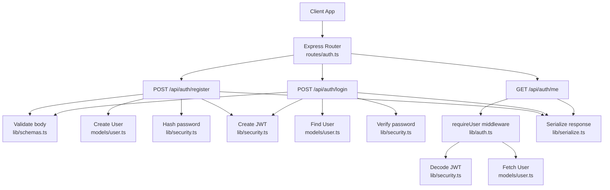
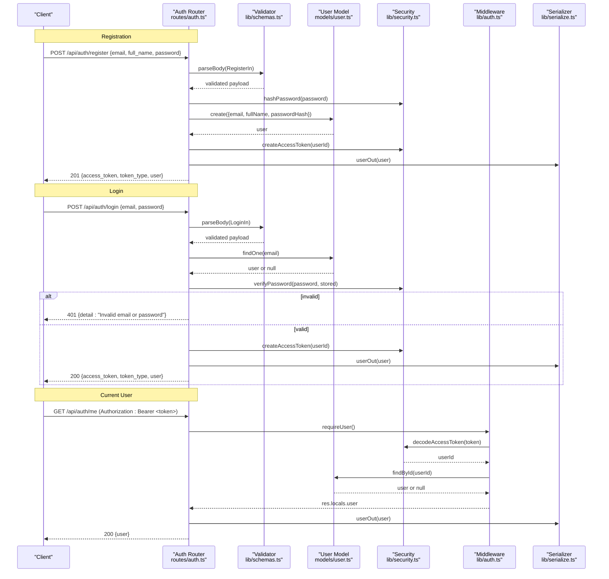
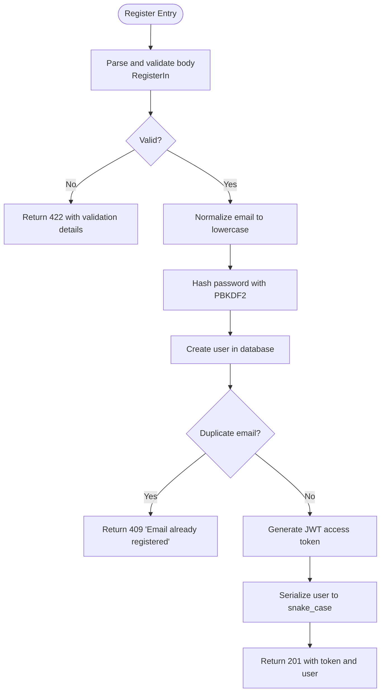
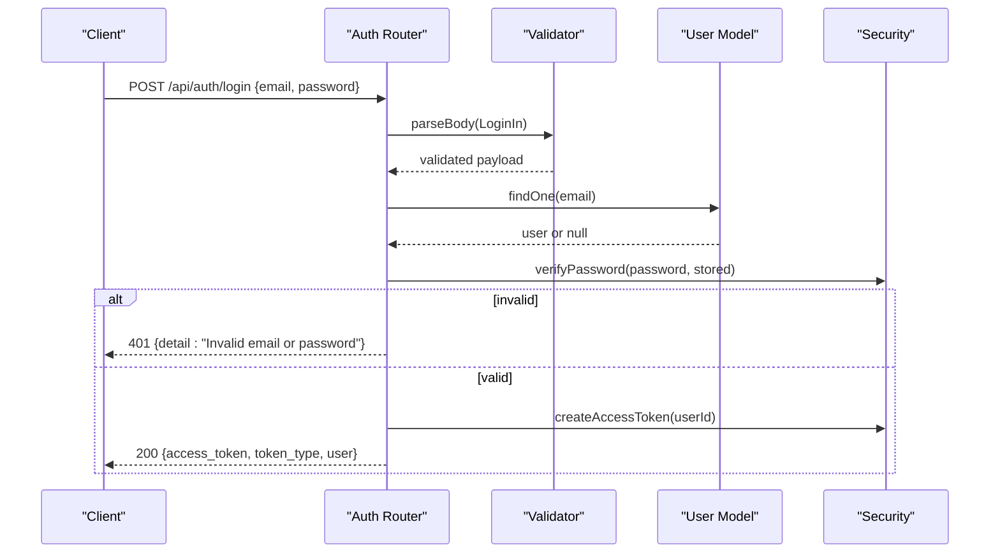
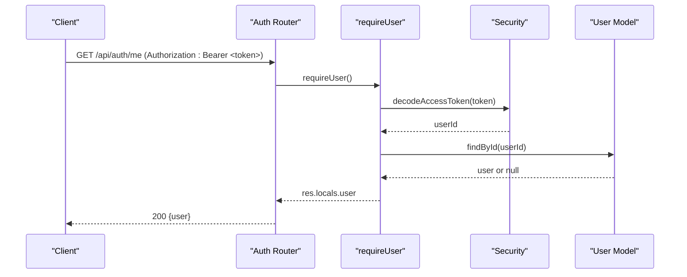
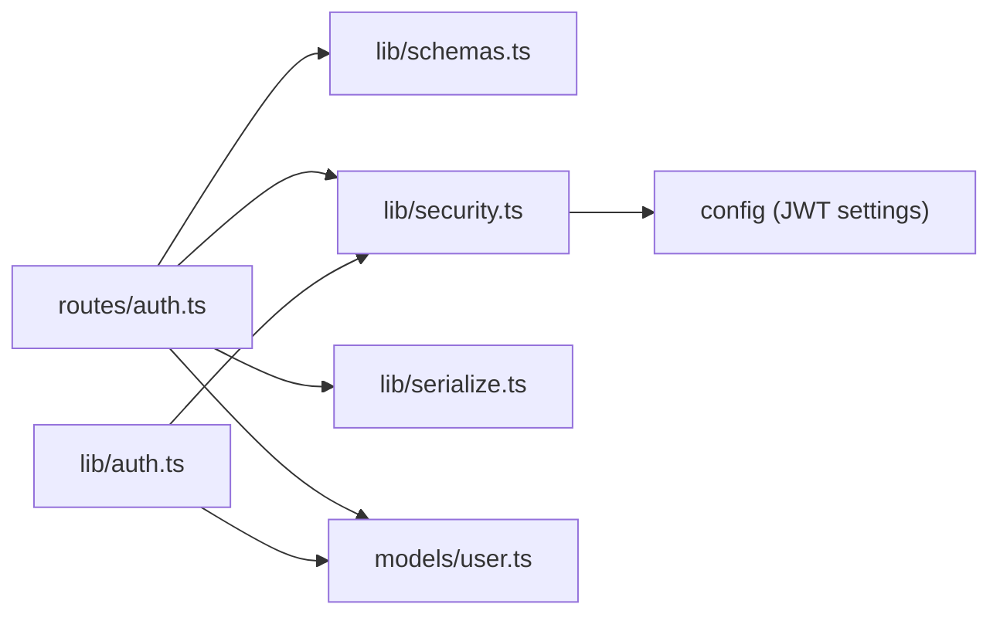

# Authentication API

<cite>
**Referenced Files in This Document**
- [auth.ts](file://phoenix-backend/src/routes/auth.ts)
- [auth.ts](file://phoenix-backend/src/lib/auth.ts)
- [security.ts](file://phoenix-backend/src/lib/security.ts)
- [schemas.ts](file://phoenix-backend/src/lib/schemas.ts)
- [http.ts](file://phoenix-backend/src/lib/http.ts)
- [serialize.ts](file://phoenix-backend/src/lib/serialize.ts)
- [user.ts](file://phoenix-backend/src/models/user.ts)
- [README.md](file://phoenix-backend/README.md)
</cite>

## Table of Contents
1. [Introduction](#introduction)
2. [Project Structure](#project-structure)
3. [Core Components](#core-components)
4. [Architecture Overview](#architecture-overview)
5. [Detailed Component Analysis](#detailed-component-analysis)
6. [Dependency Analysis](#dependency-analysis)
7. [Performance Considerations](#performance-considerations)
8. [Troubleshooting Guide](#troubleshooting-guide)
9. [Conclusion](#conclusion)

## Introduction
This document provides detailed API documentation for the authentication endpoints of the Phoenix backend:
- User registration: POST /api/auth/register
- Login: POST /api/auth/login
- Current user: GET /api/auth/me

It covers request/response schemas, validation rules, status codes, error messages, and security considerations such as password hashing and JWT token expiration. It also includes practical examples of authentication flows, common integration patterns, and troubleshooting guidance.

## Project Structure
The authentication functionality is implemented in the Express backend under phoenix-backend:
- Route handlers are defined in routes/auth.ts
- Authentication middleware and helpers are in lib/auth.ts
- Security utilities (password hashing, JWT) are in lib/security.ts
- Request validation schemas are in lib/schemas.ts
- HTTP error handling and parsing utilities are in lib/http.ts
- Public serialization helpers are in lib/serialize.ts
- The User model is defined in models/user.ts

**Diagram sources**
- [auth.ts:1-52](file://phoenix-backend/src/routes/auth.ts#L1-L52)
- [auth.ts:1-58](file://phoenix-backend/src/lib/auth.ts#L1-L58)
- [security.ts:1-38](file://phoenix-backend/src/lib/security.ts#L1-L38)
- [schemas.ts:1-41](file://phoenix-backend/src/lib/schemas.ts#L1-L41)
- [http.ts:1-81](file://phoenix-backend/src/lib/http.ts#L1-L81)
- [serialize.ts:1-34](file://phoenix-backend/src/lib/serialize.ts#L1-L34)
- [user.ts:1-20](file://phoenix-backend/src/models/user.ts#L1-L20)

**Section sources**
- [README.md:59-75](file://phoenix-backend/README.md#L59-L75)

## Core Components
- Registration endpoint: validates input, hashes password, creates user, returns access token and serialized user.
- Login endpoint: validates input, verifies credentials, returns access token and serialized user.
- Current user endpoint: requires a valid bearer token, decodes it, fetches the user, and returns serialized user data.
- Validation: Zod-based schema validation with structured error responses.
- Security: PBKDF2 password hashing with salt and iterations; JWT access tokens signed with configured algorithm and expiration.
- Serialization: snake_case public JSON with string IDs.

**Section sources**
- [auth.ts:1-52](file://phoenix-backend/src/routes/auth.ts#L1-L52)
- [schemas.ts:1-41](file://phoenix-backend/src/lib/schemas.ts#L1-L41)
- [security.ts:1-38](file://phoenix-backend/src/lib/security.ts#L1-L38)
- [serialize.ts:1-34](file://phoenix-backend/src/lib/serialize.ts#L1-L34)

## Architecture Overview
The authentication flow uses Express route handlers that delegate to shared libraries for validation, security, and serialization. The requireUser middleware enforces authentication by validating the Authorization header and decoding the JWT.

**Diagram sources**
- [auth.ts:1-52](file://phoenix-backend/src/routes/auth.ts#L1-L52)
- [auth.ts:1-58](file://phoenix-backend/src/lib/auth.ts#L1-L58)
- [security.ts:1-38](file://phoenix-backend/src/lib/security.ts#L1-L38)
- [schemas.ts:1-41](file://phoenix-backend/src/lib/schemas.ts#L1-L41)
- [serialize.ts:1-34](file://phoenix-backend/src/lib/serialize.ts#L1-L34)
- [user.ts:1-20](file://phoenix-backend/src/models/user.ts#L1-L20)

## Detailed Component Analysis

### POST /api/auth/register
Registers a new user and returns an access token along with the serialized user object.

- Method: POST
- Path: /api/auth/register
- Authentication: None
- Request body schema (JSON):
  - email: string, required, 3–255 characters, must match a basic email pattern
  - full_name: string, required, 1–120 characters
  - password: string, required, 8–128 characters
- Response:
  - 201 Created:
    - access_token: string (JWT)
    - token_type: string ("bearer")
    - user: object
      - id: string (MongoDB ObjectId as string)
      - email: string
      - full_name: string
  - 409 Conflict:
    - detail: "Email already registered"
  - 422 Unprocessable Entity:
    - detail: array of validation issues from Zod
  - 400 Bad Request:
    - detail: "Malformed JSON body"
  - 413 Payload Too Large:
    - detail: "Request body too large"
  - 500 Internal Server Error:
    - detail: "Internal server error"

Processing logic:
- Validates the request body using RegisterIn schema.
- Normalizes email to lowercase before storage.
- Hashes the password using PBKDF2 with random salt and configurable iterations.
- Creates the user record.
- Generates a JWT access token for the new user.
- Serializes the user into snake_case fields.

Security considerations:
- Passwords are never stored in plaintext; they are hashed with PBKDF2.
- Email uniqueness is enforced at the database level; duplicate emails return 409.

Integration notes:
- Store the returned access_token and include it in subsequent requests as Authorization: Bearer <token>.
- Use token_type to determine the scheme when constructing Authorization headers.

**Section sources**
- [auth.ts:11-31](file://phoenix-backend/src/routes/auth.ts#L11-L31)
- [schemas.ts:7-11](file://phoenix-backend/src/lib/schemas.ts#L7-L11)
- [security.ts:7-11](file://phoenix-backend/src/lib/security.ts#L7-L11)
- [http.ts:20-24](file://phoenix-backend/src/lib/http.ts#L20-L24)
- [http.ts:38-40](file://phoenix-backend/src/lib/http.ts#L38-L40)
- [http.ts:47-80](file://phoenix-backend/src/lib/http.ts#L47-L80)
- [serialize.ts:7-11](file://phoenix-backend/src/lib/serialize.ts#L7-L11)
- [user.ts:3-10](file://phoenix-backend/src/models/user.ts#L3-L10)

#### Registration Flowchart

**Diagram sources**
- [auth.ts:11-31](file://phoenix-backend/src/routes/auth.ts#L11-L31)
- [schemas.ts:7-11](file://phoenix-backend/src/lib/schemas.ts#L7-L11)
- [security.ts:7-11](file://phoenix-backend/src/lib/security.ts#L7-L11)
- [http.ts:38-40](file://phoenix-backend/src/lib/http.ts#L38-L40)
- [serialize.ts:7-11](file://phoenix-backend/src/lib/serialize.ts#L7-L11)

### POST /api/auth/login
Logs in a user and returns an access token along with the serialized user object.

- Method: POST
- Path: /api/auth/login
- Authentication: None
- Request body schema (JSON):
  - email: string, required, 1–255 characters
  - password: string, required, minimum length 1
- Response:
  - 200 OK:
    - access_token: string (JWT)
    - token_type: string ("bearer")
    - user: object
      - id: string
      - email: string
      - full_name: string
  - 401 Unauthorized:
    - detail: "Invalid email or password"
  - 422 Unprocessable Entity:
    - detail: array of validation issues from Zod
  - 400 Bad Request:
    - detail: "Malformed JSON body"
  - 413 Payload Too Large:
    - detail: "Request body too large"
  - 500 Internal Server Error:
    - detail: "Internal server error"

Processing logic:
- Validates the request body using LoginIn schema.
- Looks up the user by normalized email.
- Verifies the provided password against the stored hash using timing-safe comparison.
- On success, generates a JWT access token and serializes the user.

Security considerations:
- Password verification uses timingSafeEqual to mitigate timing attacks.
- Invalid credentials always return the same generic message to avoid leaking whether an email exists.

Integration notes:
- Treat the access_token as a bearer token for subsequent authenticated requests.
- Refresh or re-authenticate when the token expires.

**Section sources**
- [auth.ts:33-47](file://phoenix-backend/src/routes/auth.ts#L33-L47)
- [schemas.ts:13-13](file://phoenix-backend/src/lib/schemas.ts#L13-L13)
- [security.ts:13-21](file://phoenix-backend/src/lib/security.ts#L13-L21)
- [http.ts:20-24](file://phoenix-backend/src/lib/http.ts#L20-L24)
- [http.ts:47-80](file://phoenix-backend/src/lib/http.ts#L47-L80)
- [serialize.ts:7-11](file://phoenix-backend/src/lib/serialize.ts#L7-L11)

#### Login Sequence

**Diagram sources**
- [auth.ts:33-47](file://phoenix-backend/src/routes/auth.ts#L33-L47)
- [security.ts:13-29](file://phoenix-backend/src/lib/security.ts#L13-L29)

### GET /api/auth/me
Retrieves information about the currently authenticated user.

- Method: GET
- Path: /api/auth/me
- Authentication: Required (Bearer token)
- Headers:
  - Authorization: Bearer <token>
- Response:
  - 200 OK:
    - user: object
      - id: string
      - email: string
      - full_name: string
  - 401 Unauthorized:
    - detail: "Not authenticated"
    - detail: "Invalid or expired token"
    - detail: "User no longer exists"
  - 404 Not Found:
    - detail: "Not found"
  - 500 Internal Server Error:
    - detail: "Internal server error"

Processing logic:
- The requireUser middleware checks the Authorization header for a valid Bearer token.
- Decodes the JWT to extract the user ID.
- Fetches the user from the database; if not found, returns 401.
- Serializes the user and returns it.

Security considerations:
- Tokens are verified using the configured algorithm and secret.
- Expired or malformed tokens result in 401 errors.

Integration notes:
- Include the Authorization header on every protected request.
- Handle 401 responses by prompting re-login or refreshing the token.

**Section sources**
- [auth.ts:49-51](file://phoenix-backend/src/routes/auth.ts#L49-L51)
- [auth.ts:8-23](file://phoenix-backend/src/lib/auth.ts#L8-L23)
- [security.ts:31-37](file://phoenix-backend/src/lib/security.ts#L31-L37)
- [http.ts:47-80](file://phoenix-backend/src/lib/http.ts#L47-L80)
- [serialize.ts:7-11](file://phoenix-backend/src/lib/serialize.ts#L7-L11)

#### Current User Flow

**Diagram sources**
- [auth.ts:49-51](file://phoenix-backend/src/routes/auth.ts#L49-L51)
- [auth.ts:8-23](file://phoenix-backend/src/lib/auth.ts#L8-L23)
- [security.ts:31-37](file://phoenix-backend/src/lib/security.ts#L31-L37)

## Dependency Analysis
Authentication endpoints depend on several core modules:
- Routes depend on validation schemas, security utilities, serialization helpers, and the User model.
- Middleware depends on security utilities for JWT decoding and the User model for fetching users.
- Security utilities depend on configuration for JWT settings.

**Diagram sources**
- [auth.ts:1-52](file://phoenix-backend/src/routes/auth.ts#L1-L52)
- [auth.ts:1-58](file://phoenix-backend/src/lib/auth.ts#L1-L58)
- [security.ts:1-38](file://phoenix-backend/src/lib/security.ts#L1-L38)
- [schemas.ts:1-41](file://phoenix-backend/src/lib/schemas.ts#L1-L41)
- [serialize.ts:1-34](file://phoenix-backend/src/lib/serialize.ts#L1-L34)
- [user.ts:1-20](file://phoenix-backend/src/models/user.ts#L1-L20)

**Section sources**
- [auth.ts:1-52](file://phoenix-backend/src/routes/auth.ts#L1-L52)
- [auth.ts:1-58](file://phoenix-backend/src/lib/auth.ts#L1-L58)
- [security.ts:1-38](file://phoenix-backend/src/lib/security.ts#L1-L38)

## Performance Considerations
- Password hashing uses PBKDF2 with a high iteration count to resist brute-force attacks. Ensure your deployment environment can handle the CPU cost during registration and login.
- JWT decoding is lightweight but still involves cryptographic operations; cache tokens client-side and reuse them until expiration.
- Database lookups for user creation and login should be indexed on email (enforced via unique constraint).
- Avoid unnecessary serialization overhead by returning only needed fields; the serializer already limits output to essential user fields.

[No sources needed since this section provides general guidance]

## Troubleshooting Guide
Common issues and resolutions:
- 422 Validation errors:
  - Cause: Malformed or missing fields in the request body.
  - Resolution: Ensure email matches the expected pattern, full_name and password meet length requirements.
- 409 Duplicate email:
  - Cause: Attempting to register with an existing email.
  - Resolution: Use a different email or log in with the existing account.
- 401 Invalid credentials:
  - Cause: Wrong email or password.
  - Resolution: Verify credentials; note that both invalid email and invalid password return the same message to prevent enumeration.
- 401 Not authenticated or Invalid or expired token:
  - Cause: Missing, malformed, or expired Authorization header.
  - Resolution: Include Authorization: Bearer <token>; refresh or re-authenticate if expired.
- 400 Malformed JSON body:
  - Cause: Invalid JSON in the request body.
  - Resolution: Send properly formatted JSON with correct Content-Type.
- 413 Request body too large:
  - Cause: Exceeds allowed payload size.
  - Resolution: Reduce request size or adjust server configuration.

Error response format:
- Errors are returned as {"detail": ...}, where detail may be a string or an array of validation issues.

**Section sources**
- [http.ts:47-80](file://phoenix-backend/src/lib/http.ts#L47-L80)
- [auth.ts:11-51](file://phoenix-backend/src/routes/auth.ts#L11-L51)
- [auth.ts:8-23](file://phoenix-backend/src/lib/auth.ts#L8-L23)

## Conclusion
The authentication API provides secure registration, login, and current user retrieval with robust validation, password hashing, and JWT-based authorization. Clients should:
- Validate inputs according to the documented schemas.
- Handle all documented status codes and error formats.
- Manage bearer tokens securely, including expiration and refresh strategies.
- Follow best practices for storing and transmitting sensitive data.

[No sources needed since this section summarizes without analyzing specific files]