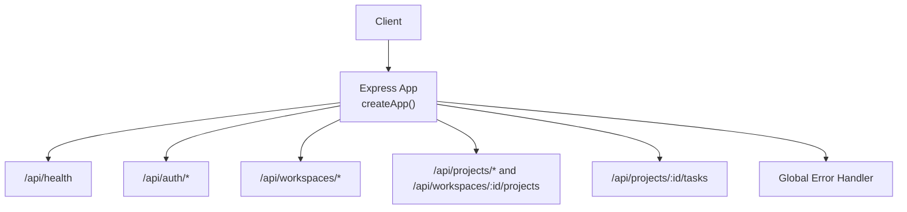
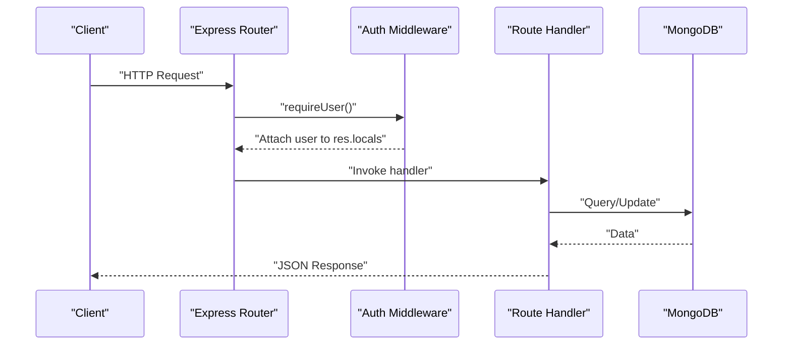
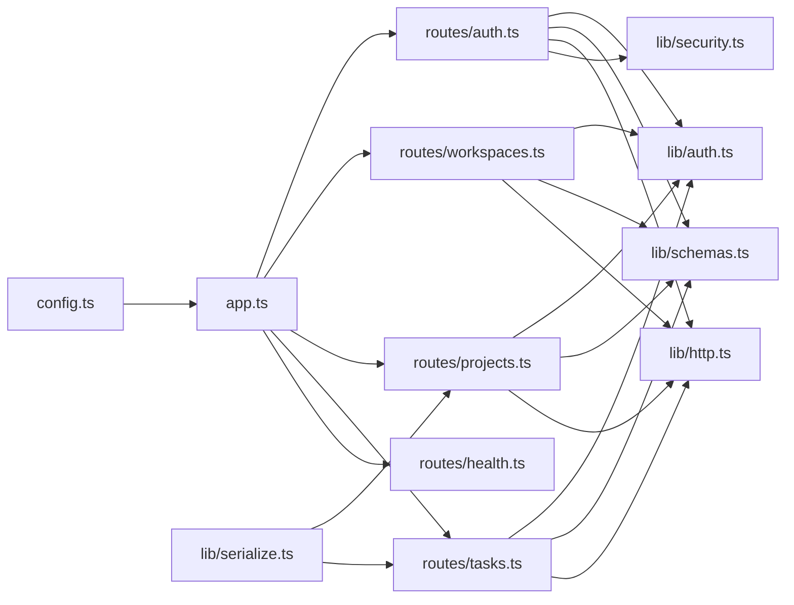

# Backend API Documentation

<cite>
**Referenced Files in This Document**
- [app.ts](file://phoenix-backend/src/app.ts)
- [server.ts](file://phoenix-backend/src/server.ts)
- [index.ts](file://phoenix-backend/api/index.ts)
- [config.ts](file://phoenix-backend/src/config.ts)
- [auth.ts](file://phoenix-backend/src/routes/auth.ts)
- [workspaces.ts](file://phoenix-backend/src/routes/workspaces.ts)
- [projects.ts](file://phoenix-backend/src/routes/projects.ts)
- [tasks.ts](file://phoenix-backend/src/routes/tasks.ts)
- [health.ts](file://phoenix-backend/src/routes/health.ts)
- [auth.ts](file://phoenix-backend/src/lib/auth.ts)
- [schemas.ts](file://phoenix-backend/src/lib/schemas.ts)
- [http.ts](file://phoenix-backend/src/lib/http.ts)
- [security.ts](file://phoenix-backend/src/lib/security.ts)
- [serialize.ts](file://phoenix-backend/src/lib/serialize.ts)
</cite>

## Table of Contents
1. [Introduction](#introduction)
2. [Project Structure](#project-structure)
3. [Core Components](#core-components)
4. [Architecture Overview](#architecture-overview)
5. [Detailed Component Analysis](#detailed-component-analysis)
6. [Dependency Analysis](#dependency-analysis)
7. [Performance Considerations](#performance-considerations)
8. [Troubleshooting Guide](#troubleshooting-guide)
9. [Conclusion](#conclusion)

## Introduction
This document provides comprehensive API documentation for the Project Phoenix backend. It covers all RESTful endpoints, including authentication, workspace management, project management, task management, and health checks. For each endpoint, you will find HTTP methods, URL patterns, request/response schemas, authentication requirements, error responses, validation rules, and practical examples.

The backend is an Express application with Mongoose models, Zod-based input validation, JWT-based authentication, and a JSON error response format. The server supports both local development and Vercel serverless deployment.

## Project Structure
The backend exposes routes grouped by domain:
- Health check
- Authentication (register, login, me)
- Workspaces (CRUD, members, credits)
- Projects (list, create, get)
- Tasks (list with search/filter, create with credit deduction)

**Diagram sources**
- [app.ts:11-28](file://phoenix-backend/src/app.ts#L11-L28)
- [health.ts:4-8](file://phoenix-backend/src/routes/health.ts#L4-L8)
- [auth.ts:9-51](file://phoenix-backend/src/routes/auth.ts#L9-L51)
- [workspaces.ts:8-125](file://phoenix-backend/src/routes/workspaces.ts#L8-L125)
- [projects.ts:9-49](file://phoenix-backend/src/routes/projects.ts#L9-L49)
- [tasks.ts:10-81](file://phoenix-backend/src/routes/tasks.ts#L10-L81)

**Section sources**
- [app.ts:11-28](file://phoenix-backend/src/app.ts#L11-L28)
- [server.ts:5-23](file://phoenix-backend/src/server.ts#L5-L23)
- [index.ts:6-10](file://phoenix-backend/api/index.ts#L6-L10)

## Core Components
- Configuration: Environment variables are validated at startup using Zod. Missing or invalid configuration fails fast.
- Security: Passwords are hashed with PBKDF2; access tokens are JWTs signed with HS* algorithms.
- Validation: All inputs are validated with Zod schemas; invalid payloads return 422 errors with details.
- Authorization: Endpoints require valid bearer tokens and membership where applicable.
- Serialization: Public responses use snake_case fields and string IDs.

Key behaviors:
- Global JSON body limit: 100kb.
- CORS configured from settings.
- Not found and error handlers normalize responses.

**Section sources**
- [config.ts:3-31](file://phoenix-backend/src/config.ts#L3-L31)
- [security.ts:7-36](file://phoenix-backend/src/lib/security.ts#L7-L36)
- [schemas.ts:4-40](file://phoenix-backend/src/lib/schemas.ts#L4-L40)
- [auth.ts:8-23](file://phoenix-backend/src/lib/auth.ts#L8-L23)
- [serialize.ts:1-33](file://phoenix-backend/src/lib/serialize.ts#L1-L33)
- [http.ts:42-66](file://phoenix-backend/src/lib/http.ts#L42-L66)
- [app.ts:17-27](file://phoenix-backend/src/app.ts#L17-L27)

## Architecture Overview
The API follows a layered structure:
- Routes define endpoints and orchestrate business logic.
- Middleware enforces authentication and authorization.
- Models interact with MongoDB via Mongoose.
- Utilities handle validation, serialization, security, and HTTP helpers.

**Diagram sources**
- [auth.ts:8-23](file://phoenix-backend/src/lib/auth.ts#L8-L23)
- [app.ts:19-23](file://phoenix-backend/src/app.ts#L19-L23)

## Detailed Component Analysis

### Authentication
Endpoints:
- POST /api/auth/register
- POST /api/auth/login
- GET /api/auth/me

Authentication:
- Register and login do not require a token.
- Me requires a valid Bearer token.

Request/Response Schemas:
- Register request: email (string, valid email), full_name (string, 1–120 chars), password (string, 8–128 chars).
- Login request: email (string, 1–255 chars), password (string, min 1 char).
- Me response: id (string), email (string), full_name (string).
- Register/Login response: access_token (string), token_type (string), user (object matching user schema).

Status Codes:
- 201 Created on successful registration.
- 200 OK on successful login and me.
- 401 Unauthorized for invalid credentials or missing/invalid token.
- 409 Conflict if email already registered.
- 422 Unprocessable Entity for validation errors.

Examples:
- Register:
  - Request: POST /api/auth/register with { email, full_name, password }
  - Response: 201 { access_token, token_type, user }
- Login:
  - Request: POST /api/auth/login with { email, password }
  - Response: 200 { access_token, token_type, user }
- Me:
  - Request: GET /api/auth/me with Authorization: Bearer <token>
  - Response: 200 { id, email, full_name }

Error Responses:
- 401: { detail: "Invalid email or password" } or { detail: "Not authenticated" } or { detail: "Invalid or expired token" }
- 409: { detail: "Email already registered" }
- 422: { detail: [...] } (Zod issues)

Security Notes:
- Passwords are hashed with PBKDF2 before storage.
- Tokens are JWTs with configurable algorithm and expiry.

**Section sources**
- [auth.ts:11-51](file://phoenix-backend/src/routes/auth.ts#L11-L51)
- [schemas.ts:7-13](file://phoenix-backend/src/lib/schemas.ts#L7-L13)
- [security.ts:7-36](file://phoenix-backend/src/lib/security.ts#L7-L36)
- [serialize.ts:7-11](file://phoenix-backend/src/lib/serialize.ts#L7-L11)
- [http.ts:47-66](file://phoenix-backend/src/lib/http.ts#L47-L66)

### Workspace Management
Endpoints:
- GET /api/workspaces
- POST /api/workspaces
- GET /api/workspaces/:workspaceId
- GET /api/workspaces/:workspaceId/members
- POST /api/workspaces/:workspaceId/members
- GET /api/workspaces/:workspaceId/credits
- POST /api/workspaces/:workspaceId/credits/topup

Authentication:
- All workspace endpoints require a valid Bearer token.
- Member-only endpoints enforce workspace membership.

Request/Response Schemas:
- Create workspace request: name (string, 1–120 chars).
- Add member request: email (string, 3–255 chars), role (enum; default "member").
- Top-up request: amount (number, integer, positive, max 1000).
- List workspaces response: array of { id, name, owner_id, role }.
- Get workspace response: { id, name, owner_id, role }.
- Members list response: array of { user_id, email, full_name, role }.
- Credits response: { workspace_id, balance }.
- Top-up response: { workspace_id, balance }.

Status Codes:
- 200 OK for reads and top-up.
- 201 Created for workspace creation and adding a member.
- 401 Unauthorized for missing/invalid token.
- 404 Not Found for invalid workspace ID or non-existent workspace.
- 400 Bad Request when attempting to assign owner role.
- 409 Conflict when adding an existing member.
- 422 Unprocessable Entity for validation errors.

Examples:
- Create workspace:
  - Request: POST /api/workspaces with { name }
  - Response: 201 { id, name, owner_id, role }
- Add member:
  - Request: POST /api/workspaces/:workspaceId/members with { email, role }
  - Response: 201 { user_id, email, full_name, role }
- Top-up credits:
  - Request: POST /api/workspaces/:workspaceId/credits/topup with { amount }
  - Response: 200 { workspace_id, balance }

Notes:
- Creating a workspace grants welcome credits based on configuration.
- Role restrictions: only one owner per workspace.

**Section sources**
- [workspaces.ts:18-125](file://phoenix-backend/src/routes/workspaces.ts#L18-L125)
- [schemas.ts:15-22](file://phoenix-backend/src/lib/schemas.ts#L15-L22)
- [auth.ts:29-34](file://phoenix-backend/src/lib/auth.ts#L29-L34)
- [http.ts:28-32](file://phoenix-backend/src/lib/http.ts#L28-L32)

### Project Management
Endpoints:
- GET /api/workspaces/:workspaceId/projects
- POST /api/workspaces/:workspaceId/projects
- GET /api/projects/:projectId

Authentication:
- All endpoints require a valid Bearer token.
- Workspace-scoped endpoints enforce membership.

Request/Response Schemas:
- Create project request: name (string, 1–120 chars), description (string, up to 2000 chars, default "").
- List projects response: array of { id, workspace_id, name, description, created_at }.
- Get project response: same object shape.

Status Codes:
- 200 OK for reads.
- 201 Created for project creation.
- 401 Unauthorized for missing/invalid token.
- 404 Not Found for invalid workspace/project IDs.
- 422 Unprocessable Entity for validation errors.

Examples:
- List projects:
  - Request: GET /api/workspaces/:workspaceId/projects
  - Response: 200 [ { id, workspace_id, name, description, created_at }, ... ]
- Create project:
  - Request: POST /api/workspaces/:workspaceId/projects with { name, description? }
  - Response: 201 { id, workspace_id, name, description, created_at }
- Get project:
  - Request: GET /api/projects/:projectId
  - Response: 200 { id, workspace_id, name, description, created_at }

Notes:
- Project listing uses an in-memory cache keyed by workspace ID. Writes invalidate the cache.

**Section sources**
- [projects.ts:11-49](file://phoenix-backend/src/routes/projects.ts#L11-L49)
- [schemas.ts:24-27](file://phoenix-backend/src/lib/schemas.ts#L24-L27)
- [serialize.ts:13-21](file://phoenix-backend/src/lib/serialize.ts#L13-L21)
- [auth.ts:44-49](file://phoenix-backend/src/lib/auth.ts#L44-L49)

### Task Management
Endpoints:
- GET /api/projects/:projectId/tasks
- POST /api/projects/:projectId/tasks

Authentication:
- All endpoints require a valid Bearer token.
- Project access enforced via membership.

Request/Response Schemas:
- List tasks query parameters:
  - q (string, optional, max 100): case-insensitive title search.
  - status (enum, optional): filter by status.
  - page (integer, min 1, default 1).
  - page_size (integer, min 1, max 100, default 10).
- Create task request:
  - title (string, max 200).
  - status (string, default "todo").
  - assignee_id (nullable ObjectId string, default null).
- List tasks response:
  - items: array of task objects.
  - total: number of matching tasks.
  - page: requested page.
  - page_size: requested page size.
- Create task response: task object.

Task object fields:
- id (string), project_id (string), title (string), status (string), created_by_id (string), assignee_id (string|null), created_at (ISO string).

Status Codes:
- 200 OK for reads.
- 201 Created for task creation.
- 401 Unauthorized for missing/invalid token.
- 402 Payment Required when workspace credits are insufficient.
- 404 Not Found for invalid project/workspace IDs.
- 422 Unprocessable Entity for validation errors or invalid assignee membership.

Examples:
- List tasks:
  - Request: GET /api/projects/:projectId/tasks?q=bug&status=in_progress&page=1&page_size=10
  - Response: 200 { items: [...], total: N, page: 1, page_size: 10 }
- Create task:
  - Request: POST /api/projects/:projectId/tasks with { title, status?, assignee_id? }
  - Response: 201 { id, project_id, title, status, created_by_id, assignee_id, created_at }

Credit Deduction and Idempotency:
- Creating a task deducts credits from the workspace based on configuration.
- If assignee_id is provided, the assignee must be a workspace member.
- Optional idempotency_key header prevents duplicate charges and returns the existing task if previously created with the same key.

**Section sources**
- [tasks.ts:12-81](file://phoenix-backend/src/routes/tasks.ts#L12-L81)
- [schemas.ts:29-40](file://phoenix-backend/src/lib/schemas.ts#L29-L40)
- [serialize.ts:23-33](file://phoenix-backend/src/lib/serialize.ts#L23-L33)
- [auth.ts:44-49](file://phoenix-backend/src/lib/auth.ts#L44-L49)

### Health Check
Endpoint:
- GET /api/health

Authentication:
- No authentication required.

Response Schema:
- status (string), version (string), db (string).

Status Codes:
- 200 OK.

Example:
- Request: GET /api/health
- Response: 200 { status: "ok", version: "<APP_VERSION>", db: "ok" }

Note:
- The health endpoint reports database connectivity as "ok". Ensure the database connection is established before relying on this endpoint for readiness checks.

**Section sources**
- [health.ts:4-8](file://phoenix-backend/src/routes/health.ts#L4-L8)

## Dependency Analysis
High-level dependencies between modules:

**Diagram sources**
- [app.ts:11-28](file://phoenix-backend/src/app.ts#L11-L28)
- [auth.ts:1-51](file://phoenix-backend/src/routes/auth.ts#L1-L51)
- [workspaces.ts:1-125](file://phoenix-backend/src/routes/workspaces.ts#L1-L125)
- [projects.ts:1-49](file://phoenix-backend/src/routes/projects.ts#L1-L49)
- [tasks.ts:1-81](file://phoenix-backend/src/routes/tasks.ts#L1-L81)
- [health.ts:1-8](file://phoenix-backend/src/routes/health.ts#L1-L8)
- [auth.ts:1-23](file://phoenix-backend/src/lib/auth.ts#L1-L23)
- [schemas.ts:1-40](file://phoenix-backend/src/lib/schemas.ts#L1-L40)
- [http.ts:1-66](file://phoenix-backend/src/lib/http.ts#L1-L66)
- [security.ts:1-36](file://phoenix-backend/src/lib/security.ts#L1-L36)
- [serialize.ts:1-33](file://phoenix-backend/src/lib/serialize.ts#L1-L33)
- [config.ts:1-31](file://phoenix-backend/src/config.ts#L1-L31)

**Section sources**
- [app.ts:11-28](file://phoenix-backend/src/app.ts#L11-L28)
- [auth.ts:1-51](file://phoenix-backend/src/routes/auth.ts#L1-L51)
- [workspaces.ts:1-125](file://phoenix-backend/src/routes/workspaces.ts#L1-L125)
- [projects.ts:1-49](file://phoenix-backend/src/routes/projects.ts#L1-L49)
- [tasks.ts:1-81](file://phoenix-backend/src/routes/tasks.ts#L1-L81)
- [health.ts:1-8](file://phoenix-backend/src/routes/health.ts#L1-L8)
- [auth.ts:1-23](file://phoenix-backend/src/lib/auth.ts#L1-L23)
- [schemas.ts:1-40](file://phoenix-backend/src/lib/schemas.ts#L1-L40)
- [http.ts:1-66](file://phoenix-backend/src/lib/http.ts#L1-L66)
- [security.ts:1-36](file://phoenix-backend/src/lib/security.ts#L1-L36)
- [serialize.ts:1-33](file://phoenix-backend/src/lib/serialize.ts#L1-L33)
- [config.ts:1-31](file://phoenix-backend/src/config.ts#L1-L31)

## Performance Considerations
- Input validation: Zod schemas provide fast, consistent validation and clear error reporting.
- Body size limit: 100kb global limit prevents large payloads.
- Project list caching: In-memory cache reduces repeated queries for the same workspace.
- Pagination: Task listing supports pagination to control payload sizes and reduce DB load.
- Credit operations: Atomic increments/decrements and ledger entries ensure consistency.

Recommendations:
- Use pagination consistently for large lists.
- Avoid excessive concurrent task creation to prevent credit contention.
- Monitor memory usage due to in-memory cache.

[No sources needed since this section provides general guidance]

## Troubleshooting Guide
Common issues and resolutions:
- 401 Unauthorized:
  - Cause: Missing or invalid Authorization header, or invalid/expired token.
  - Fix: Ensure Authorization: Bearer <token> is present and token is valid.
- 404 Not Found:
  - Cause: Invalid resource IDs or non-existent resources.
  - Fix: Verify path parameters are valid 24-character hex ObjectIds.
- 402 Payment Required:
  - Cause: Insufficient workspace credits.
  - Fix: Top up credits or adjust TASK_CREDIT_COST.
- 409 Conflict:
  - Cause: Duplicate registration or duplicate member assignment.
  - Fix: Use unique emails and avoid re-adding members.
- 422 Unprocessable Entity:
  - Cause: Validation errors in request body or query parameters.
  - Fix: Validate against documented schemas and constraints.
- Malformed JSON:
  - Cause: Invalid JSON body.
  - Fix: Ensure Content-Type: application/json and valid JSON payload.

Integration tips:
- Always handle 422 responses and display validation details to users.
- Implement retry logic with exponential backoff for transient errors.
- Use idempotency_key when creating tasks to avoid duplicate charges.

**Section sources**
- [http.ts:47-66](file://phoenix-backend/src/lib/http.ts#L47-L66)
- [auth.ts:8-23](file://phoenix-backend/src/lib/auth.ts#L8-L23)
- [tasks.ts:34-81](file://phoenix-backend/src/routes/tasks.ts#L34-L81)
- [workspaces.ts:77-125](file://phoenix-backend/src/routes/workspaces.ts#L77-L125)

## Conclusion
The Project Phoenix backend provides a secure, validated, and well-structured REST API covering authentication, workspace and project management, and task operations with credit-based controls. Consumers should adhere to the documented schemas, handle error responses appropriately, and leverage idempotency for critical operations. Proper configuration and environment setup are essential for reliable operation.

[No sources needed since this section summarizes without analyzing specific files]