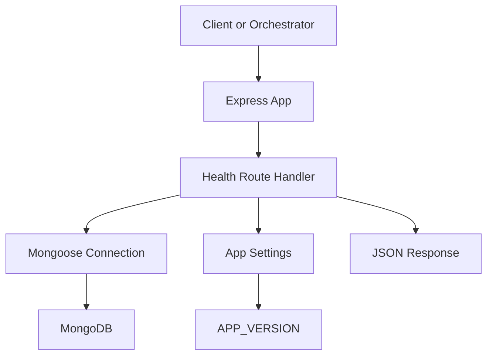

# Health Check API

<cite>
**Referenced Files in This Document**
- [health.ts](file://phoenix-backend/src/routes/health.ts)
- [app.ts](file://phoenix-backend/src/app.ts)
- [config.ts](file://phoenix-backend/src/config.ts)
- [smoke.sh](file://phoenix-ci/scripts/smoke.sh)
- [package.json](file://phoenix-backend/package.json)
</cite>

## Table of Contents
1. [Introduction](#introduction)
2. [Endpoint Summary](#endpoint-summary)
3. [Request Format](#request-format)
4. [Response Format](#response-format)
5. [Status Codes](#status-codes)
6. [Usage Patterns](#usage-patterns)
7. [Integration Examples](#integration-examples)
8. [Troubleshooting Guide](#troubleshooting-guide)
9. [Architecture Overview](#architecture-overview)
10. [Conclusion](#conclusion)

## Introduction
This document describes the health check endpoint used for service monitoring and readiness probes. The endpoint performs a lightweight database reachability check and returns a structured JSON response suitable for load balancers, orchestrators, and CI smoke tests.

## Endpoint Summary
- Method: GET
- Path: /api/health
- Purpose: Indicate whether the service is healthy and reachable, including an explicit database connectivity status.

The route is mounted as part of the Express application and is available immediately after the server starts.

**Section sources**
- [app.ts:23-23](file://phoenix-backend/src/app.ts#L23-L23)
- [health.ts:5-26](file://phoenix-backend/src/routes/health.ts#L5-L26)

## Request Format
- Authentication: Not required
- Headers: None required
- Query parameters: None
- Body: None

Example request:
```http
GET /api/health HTTP/1.1
Host: your-api.example.com
```

**Section sources**
- [health.ts:11-26](file://phoenix-backend/src/routes/health.ts#L11-L26)

## Response Format
The endpoint returns JSON with the following fields:

| Field | Type | Description |
|---|---|---|
| status | string | Overall health indicator. Values: "ok" or "error". |
| version | string | Application version from configuration. |
| db | string | Database reachability indicator. Values: "ok" or "down". |

Expected successful response example:
```json
{
  "status": "ok",
  "version": "1.0.0",
  "db": "ok"
}
```

Expected degraded response example:
```json
{
  "status": "error",
  "version": "1.0.0",
  "db": "down"
}
```

Notes:
- The response body is always valid JSON.
- The `version` field comes from application settings and can be used to verify the running build.

**Section sources**
- [health.ts:21-25](file://phoenix-backend/src/routes/health.ts#L21-L25)
- [config.ts:12-12](file://phoenix-backend/src/config.ts#L12-L12)

## Status Codes
| Status Code | Meaning | When Returned |
|---|---|---|
| 200 OK | Service is healthy and database is reachable. | MongoDB connection is ready and responds to ping. |
| 503 Service Unavailable | Service is not healthy or database is unreachable. | MongoDB connection is not ready or ping fails. |

Important:
- Do not treat 200 as “fully operational” without also checking the `db` field.
- Load balancers should consider 503 as unhealthy and remove the instance from rotation.

**Section sources**
- [health.ts:11-25](file://phoenix-backend/src/routes/health.ts#L11-L25)

## Usage Patterns
- Readiness probe (Kubernetes, Docker orchestration):
  - Probe path: GET /api/health
  - Expected status: 200
  - Expected body: status equals "ok" and db equals "ok"
- Liveness probe:
  - Use the same endpoint if you want liveness to include database reachability.
  - Alternatively, use a simpler endpoint that only checks process liveness if you do not want DB dependency.
- Smoke test:
  - Verify the endpoint returns 200 and parse the JSON to assert status and db fields.
  - Optionally compare the version field against the expected deployment version.

**Section sources**
- [smoke.sh:40-47](file://phoenix-ci/scripts/smoke.sh#L40-L47)

## Integration Examples
### Kubernetes Readiness Probe
```yaml
readinessProbe:
  httpGet:
    path: /api/health
    port: 8000
  initialDelaySeconds: 5
  periodSeconds: 10
  failureThreshold: 3
```

### cURL Example
```bash
curl -sSf https://your-api.example.com/api/health
```

### CI Smoke Test Pattern
The repository includes a smoke script that:
- Calls GET /api/health
- Asserts status equals "ok"
- Asserts db equals "ok"
- Optionally asserts the live version matches the expected version

Reference implementation:
- Backend health call and assertions are performed in the smoke script.

**Section sources**
- [smoke.sh:40-47](file://phoenix-ci/scripts/smoke.sh#L40-L47)

## Troubleshooting Guide
Common issues and resolutions:

- Endpoint returns 503:
  - Cause: MongoDB connection is not ready or ping fails.
  - Checks:
    - Ensure MONGODB_URI is correctly configured.
    - Verify network access to the MongoDB cluster.
    - Confirm the application has started and connected to MongoDB before probing.
  - Action:
    - Increase readiness probe initial delay until the database connection stabilizes.
    - Inspect application logs for connection errors.

- Version mismatch in smoke tests:
  - Cause: Running build does not match the expected version.
  - Action:
    - Update EXPECTED_VERSION in the smoke test to match the deployed build.
    - Verify APP_VERSION environment variable is set as intended.

- CORS or proxy issues:
  - Cause: Misconfigured CORS origins or reverse proxy headers.
  - Action:
    - Ensure CORS_ORIGINS includes the caller origin.
    - Verify trust proxy settings when behind a reverse proxy.

Configuration references:
- APP_VERSION is read from environment variables and included in the response.
- CORS_ORIGINS controls allowed origins for cross-origin requests.

**Section sources**
- [health.ts:11-25](file://phoenix-backend/src/routes/health.ts#L11-L25)
- [config.ts:4-13](file://phoenix-backend/src/config.ts#L4-L13)
- [app.ts:17-17](file://phoenix-backend/src/app.ts#L17-L17)

## Architecture Overview
The health endpoint is implemented as an Express route handler that:
- Uses Mongoose to check MongoDB connectivity.
- Returns a structured JSON payload with status, version, and db fields.
- Is mounted early in the Express middleware stack so it is available quickly.



**Diagram sources**
- [app.ts:23-23](file://phoenix-backend/src/app.ts#L23-L23)
- [health.ts:1-26](file://phoenix-backend/src/routes/health.ts#L1-L26)
- [config.ts:28-40](file://phoenix-backend/src/config.ts#L28-L40)

## Conclusion
The /api/health endpoint provides a reliable, database-aware health signal for monitoring and orchestration. Consumers should:
- Treat 200 with status "ok" and db "ok" as healthy.
- Treat 503 or any non-"ok" db value as unhealthy.
- Use the version field for deployment verification in CI and smoke tests.

[No sources needed since this section summarizes without analyzing specific files]