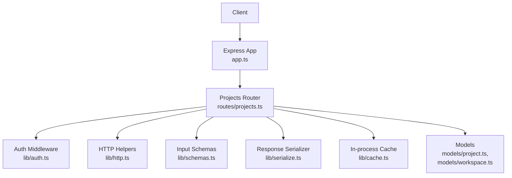
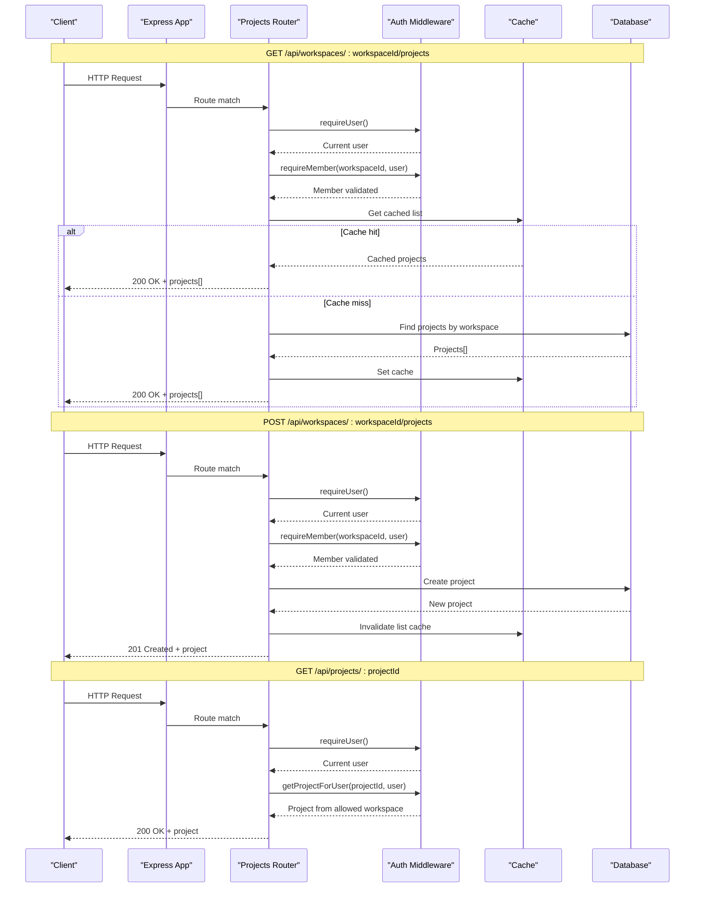
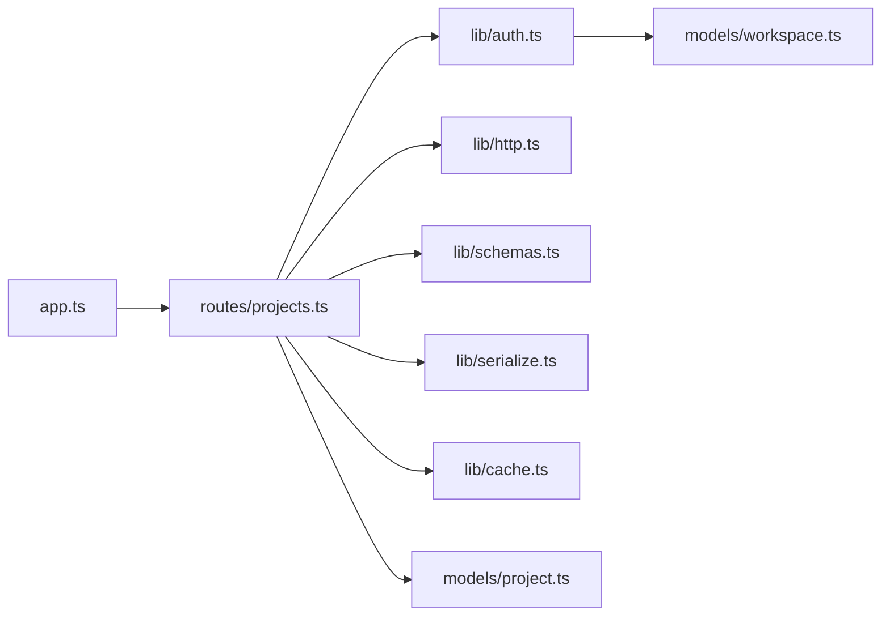

# Project Management API

<cite>
**Referenced Files in This Document**
- [projects.ts](file://phoenix-backend/src/routes/projects.ts)
- [project.ts](file://phoenix-backend/src/models/project.ts)
- [workspace.ts](file://phoenix-backend/src/models/workspace.ts)
- [schemas.ts](file://phoenix-backend/src/lib/schemas.ts)
- [auth.ts](file://phoenix-backend/src/lib/auth.ts)
- [http.ts](file://phoenix-backend/src/lib/http.ts)
- [serialize.ts](file://phoenix-backend/src/lib/serialize.ts)
- [cache.ts](file://phoenix-backend/src/lib/cache.ts)
- [app.ts](file://phoenix-backend/src/app.ts)
</cite>

## Table of Contents
1. [Introduction](#introduction)
2. [Project Structure](#project-structure)
3. [Core Components](#core-components)
4. [Architecture Overview](#architecture-overview)
5. [Detailed Component Analysis](#detailed-component-analysis)
6. [Dependency Analysis](#dependency-analysis)
7. [Performance Considerations](#performance-considerations)
8. [Troubleshooting Guide](#troubleshooting-guide)
9. [Conclusion](#conclusion)

## Introduction
This document provides detailed API documentation for project management endpoints scoped to workspaces. It covers:
- Listing projects within a workspace
- Creating a project within a workspace
- Retrieving an individual project by ID

It also documents authorization requirements, workspace membership validation, request and response schemas, caching behavior, and error handling for unauthorized access or invalid references.

## Project Structure
The backend is an Express application that registers routers for different resource domains. The project-related routes are defined in the projects router and rely on shared middleware for authentication, authorization, input parsing, serialization, and error handling.

**Diagram sources**
- [app.ts:11-31](file://phoenix-backend/src/app.ts#L11-L31)
- [projects.ts:1-58](file://phoenix-backend/src/routes/projects.ts#L1-L58)
- [auth.ts:8-57](file://phoenix-backend/src/lib/auth.ts#L8-L57)
- [http.ts:12-32](file://phoenix-backend/src/lib/http.ts#L12-L32)
- [schemas.ts:24-27](file://phoenix-backend/src/lib/schemas.ts#L24-L27)
- [serialize.ts:13-21](file://phoenix-backend/src/lib/serialize.ts#L13-L21)
- [cache.ts:1-26](file://phoenix-backend/src/lib/cache.ts#L1-L26)
- [project.ts:1-12](file://phoenix-backend/src/models/project.ts#L1-L12)
- [workspace.ts:1-22](file://phoenix-backend/src/models/workspace.ts#L1-L22)

**Section sources**
- [app.ts:11-31](file://phoenix-backend/src/app.ts#L11-L31)
- [projects.ts:1-58](file://phoenix-backend/src/routes/projects.ts#L1-L58)

## Core Components
- Projects Router: Defines three endpoints for listing, creating, and retrieving projects with workspace scoping and authorization checks.
- Authentication and Authorization: Validates bearer tokens, resolves current user, enforces workspace membership, and restricts access based on roles where applicable.
- Input Validation: Uses Zod schemas to validate request bodies and path parameters.
- Serialization: Converts internal model structures into public JSON contracts (snake_case, string IDs).
- Caching: In-memory TTL cache for project lists per workspace to reduce database load.
- Error Handling: Centralized HTTP error mapping for consistent client responses.

**Section sources**
- [projects.ts:11-57](file://phoenix-backend/src/routes/projects.ts#L11-L57)
- [auth.ts:8-57](file://phoenix-backend/src/lib/auth.ts#L8-L57)
- [schemas.ts:24-27](file://phoenix-backend/src/lib/schemas.ts#L24-L27)
- [serialize.ts:13-21](file://phoenix-backend/src/lib/serialize.ts#L13-L21)
- [cache.ts:1-26](file://phoenix-backend/src/lib/cache.ts#L1-L26)
- [http.ts:42-80](file://phoenix-backend/src/lib/http.ts#L42-L80)

## Architecture Overview
The project management flow ensures that only authenticated users who are members of a workspace can list or create projects in that workspace. Individual project retrieval validates that the requested project belongs to a workspace the user is a member of.

**Diagram sources**
- [projects.ts:11-57](file://phoenix-backend/src/routes/projects.ts#L11-L57)
- [auth.ts:29-57](file://phoenix-backend/src/lib/auth.ts#L29-L57)
- [cache.ts:5-24](file://phoenix-backend/src/lib/cache.ts#L5-L24)

## Detailed Component Analysis

### Endpoint: List Projects in Workspace
- Method and Path: GET /api/workspaces/:workspaceId/projects
- Authorization: Requires a valid Bearer token and workspace membership.
- Parameters:
  - workspaceId: 24-hex ObjectId string
- Response: Array of project objects
- Caching: Returns cached results if available; otherwise queries the database and caches the result for subsequent requests.

Request example
- Headers: Authorization: Bearer <token>
- Path: /api/workspaces/<workspaceId>/projects

Response format
- Status: 200 OK
- Body: Array of project objects with fields id, workspace_id, name, description, created_at

Error responses
- 401 Unauthorized: Missing or invalid token
- 404 Not Found: Invalid workspaceId or user not a member
- 422 Unprocessable Entity: Malformed request body (not applicable here)
- 500 Internal Server Error: Unexpected server errors

Implementation notes
- Authorization occurs before reading from cache to prevent leaking data to unauthorized users.
- Cache key is derived from workspaceId.

**Section sources**
- [projects.ts:11-31](file://phoenix-backend/src/routes/projects.ts#L11-L31)
- [auth.ts:8-33](file://phoenix-backend/src/lib/auth.ts#L8-L33)
- [cache.ts:5-24](file://phoenix-backend/src/lib/cache.ts#L5-L24)

### Endpoint: Create Project in Workspace
- Method and Path: POST /api/workspaces/:workspaceId/projects
- Authorization: Requires a valid Bearer token and workspace membership.
- Parameters:
  - workspaceId: 24-hex ObjectId string
- Request body schema:
  - name: string, required, trimmed, length 1–120
  - description: string, optional, trimmed, max 2000, defaults to empty string
- Response: Single project object
- Caching: Invalidates the workspace project list cache after creation.

Request example
- Headers: Authorization: Bearer <token>, Content-Type: application/json
- Body: { name: "<string>", description: "<string>" }

Response format
- Status: 201 Created
- Body: Project object with fields id, workspace_id, name, description, created_at

Error responses
- 401 Unauthorized: Missing or invalid token
- 404 Not Found: Invalid workspaceId or user not a member
- 422 Unprocessable Entity: Validation failure for request body
- 500 Internal Server Error: Unexpected server errors

Implementation notes
- Input is validated using the ProjectIn schema.
- After successful creation, the cache for the workspace project list is deleted to ensure consistency.

**Section sources**
- [projects.ts:33-46](file://phoenix-backend/src/routes/projects.ts#L33-L46)
- [schemas.ts:24-27](file://phoenix-backend/src/lib/schemas.ts#L24-L27)
- [cache.ts:23-24](file://phoenix-backend/src/lib/cache.ts#L23-L24)

### Endpoint: Retrieve Project by ID
- Method and Path: GET /api/projects/:projectId
- Authorization: Requires a valid Bearer token and membership in the project’s workspace.
- Parameters:
  - projectId: 24-hex ObjectId string
- Response: Single project object
- Caching: No caching for this endpoint.

Request example
- Headers: Authorization: Bearer <token>
- Path: /api/projects/<projectId>

Response format
- Status: 200 OK
- Body: Project object with fields id, workspace_id, name, description, created_at

Error responses
- 401 Unauthorized: Missing or invalid token
- 404 Not Found: Invalid projectId or project not found, or user not a member of the project’s workspace
- 500 Internal Server Error: Unexpected server errors

Implementation notes
- The handler uses a helper that fetches the project and verifies workspace membership.

**Section sources**
- [projects.ts:48-57](file://phoenix-backend/src/routes/projects.ts#L48-L57)
- [auth.ts:52-57](file://phoenix-backend/src/lib/auth.ts#L52-L57)

### Data Models and Schemas

#### Project Model
- Fields:
  - workspace: ObjectId reference to Workspace, required, indexed
  - name: String, required, trimmed
  - description: String, default empty
- Timestamps: createdAt enabled; updatedAt disabled

**Section sources**
- [project.ts:1-12](file://phoenix-backend/src/models/project.ts#L1-L12)

#### Workspace Membership
- Roles: owner, admin, member
- Membership record links a user to a workspace with a role.

**Section sources**
- [workspace.ts:1-22](file://phoenix-backend/src/models/workspace.ts#L1-L22)

#### Project Input Schema
- name: string, required, trimmed, min 1, max 120
- description: string, optional, trimmed, max 2000, default empty string

**Section sources**
- [schemas.ts:24-27](file://phoenix-backend/src/lib/schemas.ts#L24-L27)

### Public Response Contract
All project responses use snake_case and string IDs.

- Project object fields:
  - id: string (ObjectId as string)
  - workspace_id: string (ObjectId as string)
  - name: string
  - description: string (empty string if null)
  - created_at: ISO 8601 timestamp string

**Section sources**
- [serialize.ts:13-21](file://phoenix-backend/src/lib/serialize.ts#L13-L21)

## Dependency Analysis
The following diagram shows how the project endpoints depend on shared modules.

**Diagram sources**
- [projects.ts:1-58](file://phoenix-backend/src/routes/projects.ts#L1-L58)
- [auth.ts:1-57](file://phoenix-backend/src/lib/auth.ts#L1-L57)
- [http.ts:1-81](file://phoenix-backend/src/lib/http.ts#L1-L81)
- [schemas.ts:1-41](file://phoenix-backend/src/lib/schemas.ts#L1-L41)
- [serialize.ts:1-34](file://phoenix-backend/src/lib/serialize.ts#L1-L34)
- [cache.ts:1-26](file://phoenix-backend/src/lib/cache.ts#L1-L26)
- [project.ts:1-12](file://phoenix-backend/src/models/project.ts#L1-L12)
- [workspace.ts:1-22](file://phoenix-backend/src/models/workspace.ts#L1-L22)
- [app.ts:11-31](file://phoenix-backend/src/app.ts#L11-L31)

**Section sources**
- [projects.ts:1-58](file://phoenix-backend/src/routes/projects.ts#L1-L58)
- [auth.ts:1-57](file://phoenix-backend/src/lib/auth.ts#L1-L57)
- [app.ts:11-31](file://phoenix-backend/src/app.ts#L11-L31)

## Performance Considerations
- Read-heavy project listing benefits from in-memory caching keyed by workspaceId.
- Cache invalidation occurs on project creation to maintain consistency.
- Avoid unnecessary database reads by leveraging cache hits when possible.
- Keep request payloads small; the app limits JSON body size to 100kb.

[No sources needed since this section provides general guidance]

## Troubleshooting Guide

Common errors and their causes:
- 401 Unauthorized
  - Missing Authorization header or invalid scheme
  - Expired or malformed token
  - User no longer exists
- 404 Not Found
  - Invalid workspaceId or projectId format
  - User not a member of the referenced workspace
  - Project does not exist
- 422 Unprocessable Entity
  - Request body fails validation against the ProjectIn schema
- 403 Forbidden
  - Insufficient role for operations requiring admin or owner permissions (not used directly in these endpoints but relevant for related workspace operations)
- 413 Payload Too Large
  - Request body exceeds configured limit
- 500 Internal Server Error
  - Unexpected server-side exceptions

Best practices for debugging:
- Ensure the Authorization header uses the Bearer scheme with a valid token.
- Validate that workspaceId and projectId are 24-character hex ObjectIds.
- Check that the authenticated user is a member of the target workspace.
- Review validation errors returned in the detail field for 422 responses.

**Section sources**
- [auth.ts:8-23](file://phoenix-backend/src/lib/auth.ts#L8-L23)
- [auth.ts:29-57](file://phoenix-backend/src/lib/auth.ts#L29-L57)
- [http.ts:42-80](file://phoenix-backend/src/lib/http.ts#L42-L80)

## Conclusion
The project management API provides secure, workspace-scoped operations for listing and creating projects, along with safe retrieval of individual projects. Authorization is enforced at multiple layers: authentication via bearer tokens, workspace membership validation, and role-based checks where applicable. Input validation and centralized error handling ensure predictable client experiences. Caching improves performance for read-heavy scenarios while maintaining correctness through targeted invalidation.

[No sources needed since this section summarizes without analyzing specific files]