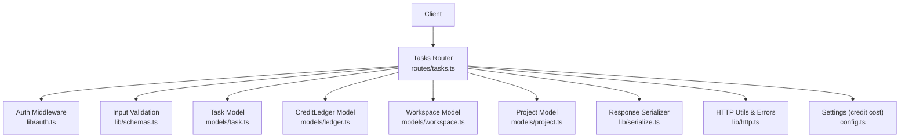
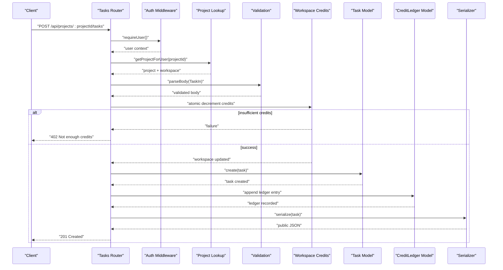
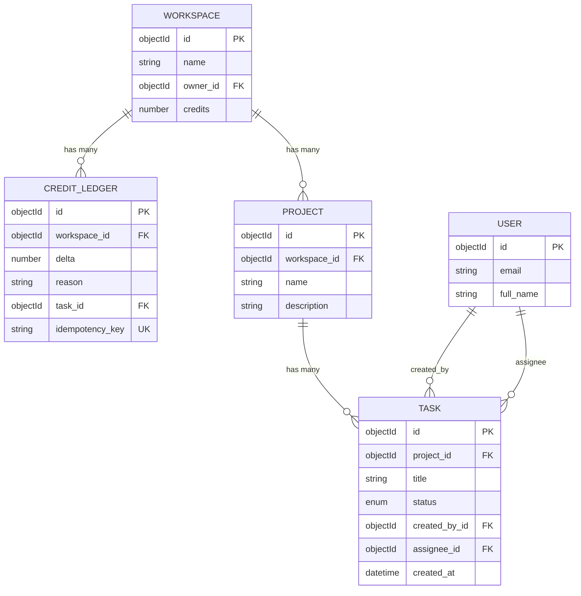
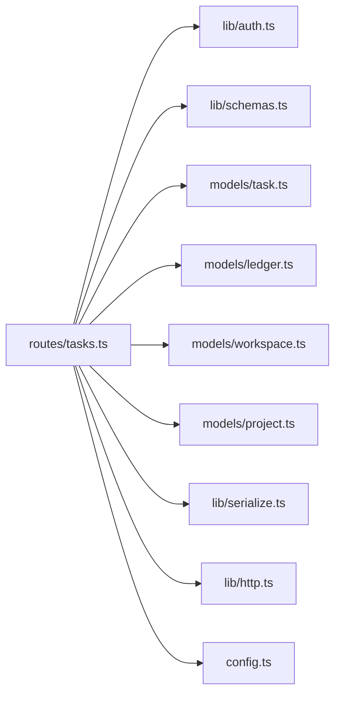

# Task Management API

<cite>
**Referenced Files in This Document**
- [tasks.ts](file://phoenix-backend/src/routes/tasks.ts)
- [task.ts](file://phoenix-backend/src/models/task.ts)
- [ledger.ts](file://phoenix-backend/src/models/ledger.ts)
- [schemas.ts](file://phoenix-backend/src/lib/schemas.ts)
- [http.ts](file://phoenix-backend/src/lib/http.ts)
- [serialize.ts](file://phoenix-backend/src/lib/serialize.ts)
- [auth.ts](file://phoenix-backend/src/lib/auth.ts)
- [config.ts](file://phoenix-backend/src/config.ts)
- [project.ts](file://phoenix-backend/src/models/project.ts)
- [workspace.ts](file://phoenix-backend/src/models/workspace.ts)
</cite>

## Table of Contents
1. [Introduction](#introduction)
2. [Project Structure](#project-structure)
3. [Core Components](#core-components)
4. [Architecture Overview](#architecture-overview)
5. [Detailed Component Analysis](#detailed-component-analysis)
6. [Dependency Analysis](#dependency-analysis)
7. [Performance Considerations](#performance-considerations)
8. [Troubleshooting Guide](#troubleshooting-guide)
9. [Conclusion](#conclusion)

## Introduction
This document provides comprehensive API documentation for task management endpoints, focusing on:
- Listing tasks with search and filtering (GET /api/projects/:projectId/tasks)
- Creating tasks with credit deduction, validation, and audit trail (POST /api/projects/:projectId/tasks)

It includes request/response schemas, status codes, error handling, idempotency support, and examples of typical workflows.

## Project Structure
The task management functionality is implemented in the backend Express application:
- Routes define HTTP endpoints and orchestrate business logic
- Models define data structures and database interactions
- Schemas validate input payloads
- Utilities handle authentication, serialization, and error handling
- Configuration defines environment-driven settings such as credit cost

**Diagram sources**
- [tasks.ts:10-126](file://phoenix-backend/src/routes/tasks.ts#L10-L126)
- [auth.ts:8-57](file://phoenix-backend/src/lib/auth.ts#L8-L57)
- [schemas.ts:29-40](file://phoenix-backend/src/lib/schemas.ts#L29-L40)
- [task.ts:1-15](file://phoenix-backend/src/models/task.ts#L1-L15)
- [ledger.ts:1-19](file://phoenix-backend/src/models/ledger.ts#L1-L19)
- [workspace.ts:1-22](file://phoenix-backend/src/models/workspace.ts#L1-L22)
- [project.ts:1-12](file://phoenix-backend/src/models/project.ts#L1-L12)
- [serialize.ts:23-33](file://phoenix-backend/src/lib/serialize.ts#L23-L33)
- [http.ts:5-80](file://phoenix-backend/src/lib/http.ts#L5-L80)
- [config.ts:4-14](file://phoenix-backend/src/config.ts#L4-L14)

**Section sources**
- [tasks.ts:10-126](file://phoenix-backend/src/routes/tasks.ts#L10-L126)
- [schemas.ts:29-40](file://phoenix-backend/src/lib/schemas.ts#L29-L40)
- [task.ts:1-15](file://phoenix-backend/src/models/task.ts#L1-L15)
- [ledger.ts:1-19](file://phoenix-backend/src/models/ledger.ts#L1-L19)
- [workspace.ts:1-22](file://phoenix-backend/src/models/workspace.ts#L1-L22)
- [project.ts:1-12](file://phoenix-backend/src/models/project.ts#L1-L12)
- [serialize.ts:23-33](file://phoenix-backend/src/lib/serialize.ts#L23-L33)
- [http.ts:5-80](file://phoenix-backend/src/lib/http.ts#L5-L80)
- [config.ts:4-14](file://phoenix-backend/src/config.ts#L4-L14)

## Core Components
- Tasks Router: Implements GET and POST endpoints for listing and creating tasks within a project.
- Input Schemas: Validate query parameters and request bodies using Zod.
- Models: Define Task, CreditLedger, Workspace, Project, and related relationships.
- Authentication: Enforces bearer token authentication and project membership checks.
- Serialization: Converts internal Mongoose documents to public JSON responses.
- Error Handling: Centralized error mapping to consistent HTTP responses.
- Configuration: Provides TASK_CREDIT_COST used during task creation.

**Section sources**
- [tasks.ts:10-126](file://phoenix-backend/src/routes/tasks.ts#L10-L126)
- [schemas.ts:29-40](file://phoenix-backend/src/lib/schemas.ts#L29-L40)
- [task.ts:1-15](file://phoenix-backend/src/models/task.ts#L1-L15)
- [ledger.ts:1-19](file://phoenix-backend/src/models/ledger.ts#L1-L19)
- [workspace.ts:1-22](file://phoenix-backend/src/models/workspace.ts#L1-L22)
- [project.ts:1-12](file://phoenix-backend/src/models/project.ts#L1-L12)
- [serialize.ts:23-33](file://phoenix-backend/src/lib/serialize.ts#L23-L33)
- [http.ts:5-80](file://phoenix-backend/src/lib/http.ts#L5-L80)
- [config.ts:4-14](file://phoenix-backend/src/config.ts#L4-L14)

## Architecture Overview
The task management endpoints follow a layered architecture:
- Route handlers receive requests, authenticate users, and validate inputs.
- Business logic enforces permissions, performs credit checks, and persists data.
- Database models encapsulate schema definitions and indexes.
- Response serializers ensure consistent public JSON contracts.
- Global error handler maps exceptions to standardized error responses.

**Diagram sources**
- [tasks.ts:38-126](file://phoenix-backend/src/routes/tasks.ts#L38-L126)
- [auth.ts:8-27](file://phoenix-backend/src/lib/auth.ts#L8-L27)
- [schemas.ts:29-33](file://phoenix-backend/src/lib/schemas.ts#L29-L33)
- [task.ts:1-15](file://phoenix-backend/src/models/task.ts#L1-L15)
- [ledger.ts:1-19](file://phoenix-backend/src/models/ledger.ts#L1-L19)
- [workspace.ts:1-22](file://phoenix-backend/src/models/workspace.ts#L1-L22)
- [serialize.ts:23-33](file://phoenix-backend/src/lib/serialize.ts#L23-L33)

## Detailed Component Analysis

### Endpoint: List Tasks
- Method: GET
- Path: /api/projects/:projectId/tasks
- Authentication: Required (Bearer token)
- Authorization: Caller must be a member of the project’s workspace

Query Parameters
- q: Optional string; case-insensitive substring match against title
- status: Optional enum; one of todo, in_progress, done
- page: Optional integer; minimum 1, default 1
- page_size: Optional integer; minimum 1, maximum 100, default 10

Behavior
- Validates path parameter projectId as a valid ObjectId; invalid returns 404
- Verifies user membership in the project’s workspace; non-membership returns 404
- Builds filter by project, optional title regex (escaped), and optional status
- Returns paginated results sorted by newest first, with stable ordering via _id
- Response includes items array, total count, current page, and page size

Request Examples
- Basic list: GET /api/projects/PROJECT_ID/tasks?page=1&page_size=10
- Search by title: GET /api/projects/PROJECT_ID/tasks?q=bug
- Filter by status: GET /api/projects/PROJECT_ID/tasks?status=in_progress
- Combined: GET /api/projects/PROJECT_ID/tasks?q=fix&status=todo&page=2&page_size=20

Response Schema
- items: Array of task objects
- total: Integer count of matching tasks
- page: Integer current page
- page_size: Integer page size

Task Object Fields
- id: String ObjectId
- project_id: String ObjectId
- title: String
- status: Enum (todo, in_progress, done)
- created_by_id: String ObjectId
- assignee_id: String ObjectId or null
- created_at: ISO 8601 timestamp

Status Codes
- 200 OK: Successful listing
- 401 Unauthorized: Missing or invalid Bearer token
- 404 Not Found: Invalid projectId or caller not a project member
- 422 Unprocessable Entity: Invalid query parameters

Error Responses
- { detail: "..." } for standard errors
- { detail: [...] } for validation issues

**Section sources**
- [tasks.ts:12-36](file://phoenix-backend/src/routes/tasks.ts#L12-L36)
- [schemas.ts:35-40](file://phoenix-backend/src/lib/schemas.ts#L35-L40)
- [serialize.ts:23-33](file://phoenix-backend/src/lib/serialize.ts#L23-L33)
- [http.ts:28-32](file://phoenix-backend/src/lib/http.ts#L28-L32)
- [http.ts:47-80](file://phoenix-backend/src/lib/http.ts#L47-L80)
- [auth.ts:8-27](file://phoenix-backend/src/lib/auth.ts#L8-L27)
- [auth.ts:52-57](file://phoenix-backend/src/lib/auth.ts#L52-L57)

### Endpoint: Create Task
- Method: POST
- Path: /api/projects/:projectId/tasks
- Authentication: Required (Bearer token)
- Authorization: Caller must be a member of the project’s workspace
- Idempotency: Supported via Idempotency-Key header

Request Body Schema
- title: String; required; trimmed; length 1–200
- status: Enum; optional; defaults to todo; values: todo, in_progress, done
- assignee_id: String ObjectId or null; optional; if provided, must be a workspace member

Behavior
- Validates path parameter projectId; invalid returns 404
- Verifies user membership in the project’s workspace; non-membership returns 404
- Validates request body using TaskIn schema; invalid returns 422
- If assignee_id is provided, validates that the assignee is a workspace member; otherwise returns 422
- Deducts credits atomically from the workspace; insufficient credits returns 402
- Creates the task; on failure, refunds credits and rethrows error
- Records an append-only ledger entry for the credit deduction; ties the charge to the created task
- Supports idempotency: if Idempotency-Key is present and already recorded, returns the original task without additional charges

Idempotency Details
- Header: Idempotency-Key (optional)
- Behavior:
  - If key exists and a prior successful creation is found, returns 200 with the existing task
  - If duplicate key occurs concurrently, resolves to the winning task and returns 200
  - Ledger index ensures uniqueness per workspace and idempotencyKey

Credit Deduction Process
- Cost retrieved from configuration (TASK_CREDIT_COST)
- Atomic check-and-decrement on workspace.credits prevents overspending
- On task creation failure, credits are refunded
- Ledger entry records delta (-cost), reason ("task <taskId>"), and links to the task

Audit Trail
- CreditLedger stores workspace, delta, reason, task reference, and optional idempotencyKey
- Unique partial index on (workspace, idempotencyKey) ensures idempotent entries

Request Examples
- Minimal: POST /api/projects/PROJECT_ID/tasks with { title: "Fix login bug", status: "todo" }
- With assignee: POST /api/projects/PROJECT_ID/tasks with { title: "Implement feature", status: "in_progress", assignee_id: "USER_ID" }
- Idempotent retry: Same request with Idempotency-Key: UNIQUE_KEY

Response Schema
- 201 Created: Task object serialized as public JSON
- 200 OK: When idempotency key matches a previous successful creation

Status Codes
- 201 Created: Task successfully created
- 200 OK: Idempotent replay returning existing task
- 401 Unauthorized: Missing or invalid Bearer token
- 402 Payment Required: Insufficient credits
- 404 Not Found: Invalid projectId or caller not a project member
- 422 Unprocessable Entity: Invalid request body or invalid assignee

Error Responses
- { detail: "Not enough credits" } for insufficient funds
- { detail: "Assignee is not a workspace member" } for invalid assignee
- { detail: "..." } for other validation or system errors

**Section sources**
- [tasks.ts:38-126](file://phoenix-backend/src/routes/tasks.ts#L38-L126)
- [schemas.ts:29-33](file://phoenix-backend/src/lib/schemas.ts#L29-L33)
- [ledger.ts:1-19](file://phoenix-backend/src/models/ledger.ts#L1-L19)
- [workspace.ts:1-22](file://phoenix-backend/src/models/workspace.ts#L1-L22)
- [config.ts:4-14](file://phoenix-backend/src/config.ts#L4-L14)
- [http.ts:38-40](file://phoenix-backend/src/lib/http.ts#L38-L40)
- [http.ts:47-80](file://phoenix-backend/src/lib/http.ts#L47-L80)
- [serialize.ts:23-33](file://phoenix-backend/src/lib/serialize.ts#L23-L33)

### Data Models and Relationships
- Task: Represents a task within a project, including title, status, creator, optional assignee, and timestamps
- CreditLedger: Append-only record of credit changes, linking to workspace and optionally to a task
- Workspace: Holds workspace metadata and available credits
- Project: Links to a workspace and contains project details
- User: Referenced by tasks and workspace members

**Diagram sources**
- [task.ts:1-15](file://phoenix-backend/src/models/task.ts#L1-L15)
- [ledger.ts:1-19](file://phoenix-backend/src/models/ledger.ts#L1-L19)
- [workspace.ts:1-22](file://phoenix-backend/src/models/workspace.ts#L1-L22)
- [project.ts:1-12](file://phoenix-backend/src/models/project.ts#L1-L12)

**Section sources**
- [task.ts:1-15](file://phoenix-backend/src/models/task.ts#L1-L15)
- [ledger.ts:1-19](file://phoenix-backend/src/models/ledger.ts#L1-L19)
- [workspace.ts:1-22](file://phoenix-backend/src/models/workspace.ts#L1-L22)
- [project.ts:1-12](file://phoenix-backend/src/models/project.ts#L1-L12)

### Request/Response Schemas Summary

List Tasks Query Parameters
- q: string | undefined; max 100 characters; case-insensitive title search
- status: "todo" | "in_progress" | "done" | undefined
- page: number; min 1; default 1
- page_size: number; min 1; max 100; default 10

Create Task Request Body
- title: string; min 1; max 200; trimmed
- status: "todo" | "in_progress" | "done"; default "todo"
- assignee_id: string ObjectId | null; optional; must be a workspace member if provided

Create Task Response
- 201: Task object
- 200: Existing task when idempotency key matches

Task Object
- id: string
- project_id: string
- title: string
- status: "todo" | "in_progress" | "done"
- created_by_id: string
- assignee_id: string | null
- created_at: string (ISO 8601)

**Section sources**
- [schemas.ts:29-40](file://phoenix-backend/src/lib/schemas.ts#L29-L40)
- [serialize.ts:23-33](file://phoenix-backend/src/lib/serialize.ts#L23-L33)

### Status Code Definitions
- 200 OK: Successful operation (list tasks; idempotent create)
- 201 Created: New task created
- 400 Bad Request: Malformed JSON body
- 401 Unauthorized: Missing or invalid Bearer token
- 402 Payment Required: Insufficient credits
- 404 Not Found: Invalid resource ID or unauthorized access
- 413 Payload Too Large: Request body too large
- 422 Unprocessable Entity: Validation failures
- 500 Internal Server Error: Unexpected server error

**Section sources**
- [http.ts:47-80](file://phoenix-backend/src/lib/http.ts#L47-L80)

### Error Handling Patterns
- HttpError: Custom error with status and detail mapped to JSON responses
- ZodError: Validation issues returned as arrays of issues
- Mongoose CastError: Treated as 404 Not Found
- Mongoose ValidationError: Returned as 422 with message
- SyntaxError with body: Returned as 400 Malformed JSON
- Body parser errors: Specific statuses like 413 for oversized payloads

**Section sources**
- [http.ts:5-80](file://phoenix-backend/src/lib/http.ts#L5-L80)

## Dependency Analysis
The task management routes depend on several modules:
- Authentication middleware ensures user identity and project membership
- Schemas validate incoming data
- Models interact with MongoDB collections
- Serializer converts internal documents to public JSON
- HTTP utilities provide error handling and parsing helpers
- Configuration supplies runtime settings like credit cost

**Diagram sources**
- [tasks.ts:1-126](file://phoenix-backend/src/routes/tasks.ts#L1-L126)
- [auth.ts:1-58](file://phoenix-backend/src/lib/auth.ts#L1-L58)
- [schemas.ts:1-41](file://phoenix-backend/src/lib/schemas.ts#L1-L41)
- [task.ts:1-15](file://phoenix-backend/src/models/task.ts#L1-L15)
- [ledger.ts:1-19](file://phoenix-backend/src/models/ledger.ts#L1-L19)
- [workspace.ts:1-22](file://phoenix-backend/src/models/workspace.ts#L1-L22)
- [project.ts:1-12](file://phoenix-backend/src/models/project.ts#L1-L12)
- [serialize.ts:1-34](file://phoenix-backend/src/lib/serialize.ts#L1-L34)
- [http.ts:1-81](file://phoenix-backend/src/lib/http.ts#L1-L81)
- [config.ts:1-41](file://phoenix-backend/src/config.ts#L1-L41)

**Section sources**
- [tasks.ts:1-126](file://phoenix-backend/src/routes/tasks.ts#L1-L126)
- [auth.ts:1-58](file://phoenix-backend/src/lib/auth.ts#L1-L58)
- [schemas.ts:1-41](file://phoenix-backend/src/lib/schemas.ts#L1-L41)
- [task.ts:1-15](file://phoenix-backend/src/models/task.ts#L1-L15)
- [ledger.ts:1-19](file://phoenix-backend/src/models/ledger.ts#L1-L19)
- [workspace.ts:1-22](file://phoenix-backend/src/models/workspace.ts#L1-L22)
- [project.ts:1-12](file://phoenix-backend/src/models/project.ts#L1-L12)
- [serialize.ts:1-34](file://phoenix-backend/src/lib/serialize.ts#L1-L34)
- [http.ts:1-81](file://phoenix-backend/src/lib/http.ts#L1-L81)
- [config.ts:1-41](file://phoenix-backend/src/config.ts#L1-L41)

## Performance Considerations
- Pagination: Use page and page_size to limit result sets; default page_size is 10, max 100
- Sorting: Results are sorted by createdAt descending, then by _id descending for stability
- Indexing: Task model indexes project, createdAt, and _id to optimize queries
- Filtering: Title search uses escaped regex for safety; consider limiting search scope
- Atomic Operations: Credit deduction uses atomic update to prevent race conditions
- Audit Trail: Ledger entries are append-only; maintain efficient indexing on workspace and idempotencyKey

[No sources needed since this section provides general guidance]

## Troubleshooting Guide
Common Issues and Resolutions
- 401 Unauthorized: Ensure Authorization header uses Bearer scheme with a valid JWT
- 404 Not Found: Verify projectId is a valid ObjectId and you are a member of its workspace
- 422 Validation Error: Check request body fields against TaskIn schema; ensure assignee_id belongs to workspace
- 402 Payment Required: Top up workspace credits before creating tasks
- Duplicate Key Errors: Idempotency-Key collisions are handled; retries return the original task
- Oversized Requests: Reduce payload size to avoid 413 errors

Debugging Tips
- Inspect error responses for detailed messages
- Validate tokens and memberships independently
- Confirm workspace credits and TASK_CREDIT_COST configuration
- Review ledger entries to trace credit deductions and idempotency keys

**Section sources**
- [http.ts:47-80](file://phoenix-backend/src/lib/http.ts#L47-L80)
- [tasks.ts:38-126](file://phoenix-backend/src/routes/tasks.ts#L38-L126)
- [schemas.ts:29-40](file://phoenix-backend/src/lib/schemas.ts#L29-L40)
- [config.ts:4-14](file://phoenix-backend/src/config.ts#L4-L14)

## Conclusion
The Task Management API provides robust endpoints for listing and creating tasks with strong security, validation, and financial controls. It supports advanced search and filtering, pagination, and idempotent operations. The credit deduction process is atomic and auditable, ensuring consistency and traceability. Proper use of authentication, authorization, and error handling guarantees reliable and secure interactions.

[No sources needed since this section summarizes without analyzing specific files]