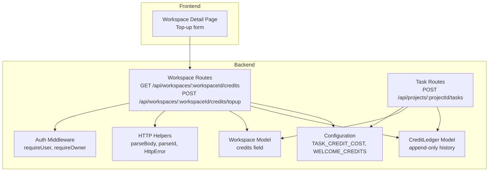
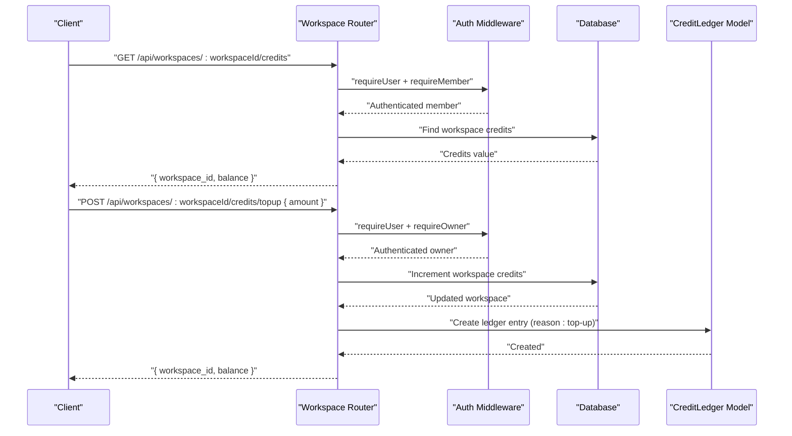
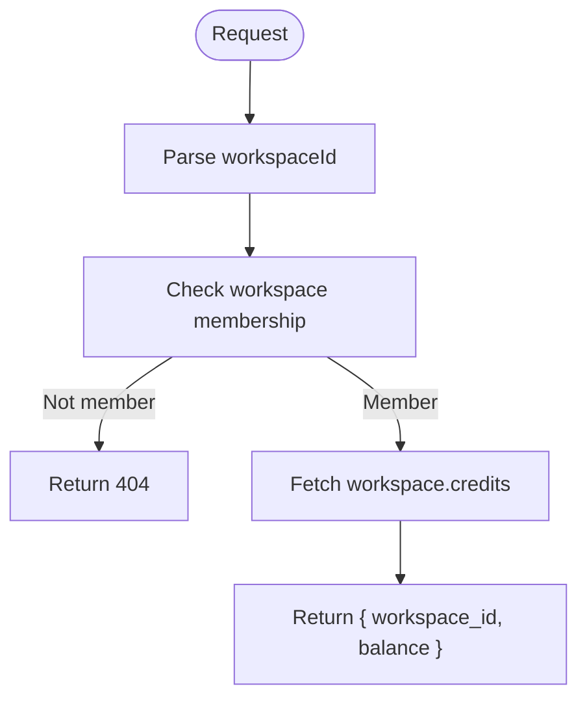
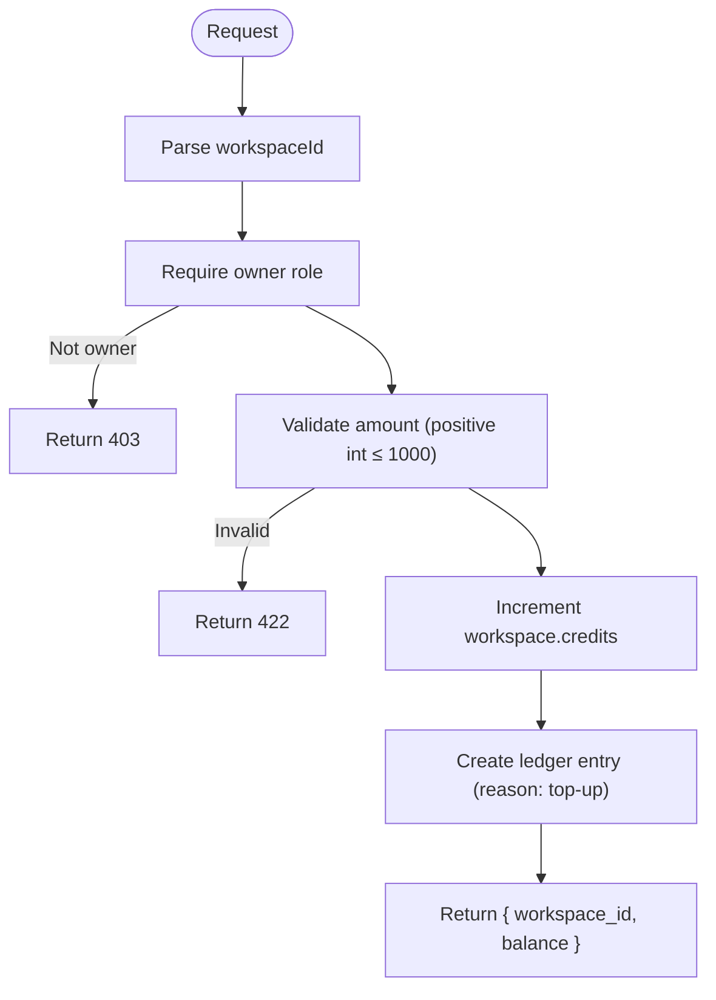
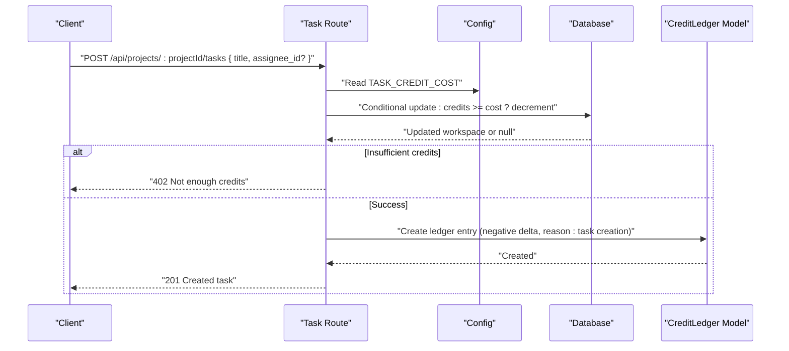
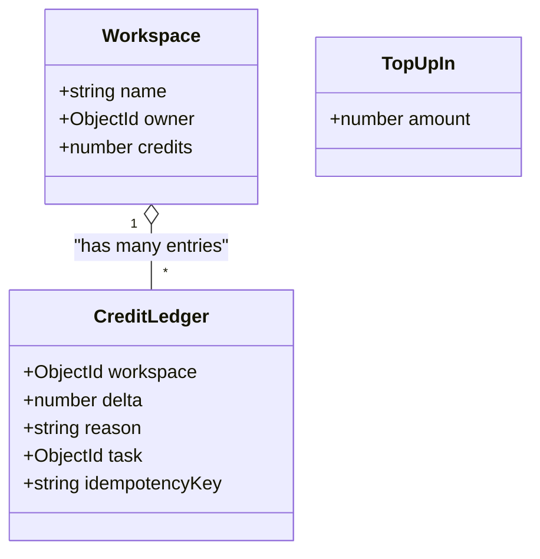
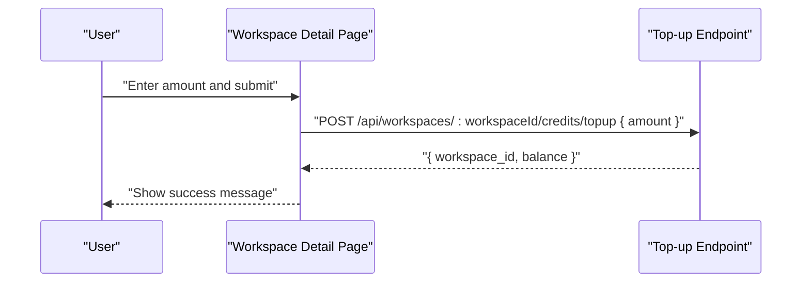
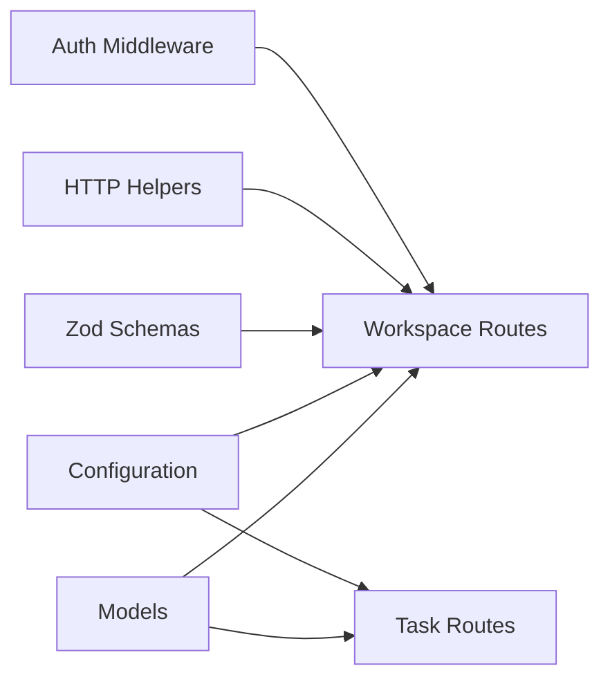

# Credit System API

<cite>
**Referenced Files in This Document**
- [workspaces.ts](file://phoenix-backend/src/routes/workspaces.ts)
- [tasks.ts](file://phoenix-backend/src/routes/tasks.ts)
- [ledger.ts](file://phoenix-backend/src/models/ledger.ts)
- [workspace.ts](file://phoenix-backend/src/models/workspace.ts)
- [schemas.ts](file://phoenix-backend/src/lib/schemas.ts)
- [auth.ts](file://phoenix-backend/src/lib/auth.ts)
- [http.ts](file://phoenix-backend/src/lib/http.ts)
- [config.ts](file://phoenix-backend/src/config.ts)
- [page.tsx](file://phoenix-frontend/src/app/workspaces/[id]/page.tsx)
- [smoke.test.ts](file://phoenix-backend/tests/smoke.test.ts)
</cite>

## Table of Contents
1. [Introduction](#introduction)
2. [Project Structure](#project-structure)
3. [Core Components](#core-components)
4. [Architecture Overview](#architecture-overview)
5. [Detailed Component Analysis](#detailed-component-analysis)
6. [Dependency Analysis](#dependency-analysis)
7. [Performance Considerations](#performance-considerations)
8. [Troubleshooting Guide](#troubleshooting-guide)
9. [Conclusion](#conclusion)

## Introduction
This document explains the workspace credit system endpoints used to check and top up workspace credits, how credits relate to task creation costs, and how changes are recorded through the credit ledger. It also covers authorization requirements, request and response schemas, error handling, and practical workflows such as initial welcome credits and manual top-ups.

## Project Structure
The credit-related logic is implemented in the backend Express application:
- Workspace routes define credit balance retrieval and top-up endpoints.
- Task routes deduct credits when creating tasks.
- Models define workspaces, members, and the append-only credit ledger.
- Shared libraries provide authentication, HTTP helpers, Zod-based validation, and configuration.
- The frontend demonstrates a user interface for topping up credits.

**Diagram sources**
- [workspaces.ts:104-127](file://phoenix-backend/src/routes/workspaces.ts#L104-L127)
- [tasks.ts:38-81](file://phoenix-backend/src/routes/tasks.ts#L38-L81)
- [config.ts:4-14](file://phoenix-backend/src/config.ts#L4-L14)
- [auth.ts:8-50](file://phoenix-backend/src/lib/auth.ts#L8-L50)
- [http.ts:20-32](file://phoenix-backend/src/lib/http.ts#L20-L32)
- [workspace.ts:5-13](file://phoenix-backend/src/models/workspace.ts#L5-L13)
- [ledger.ts:4-18](file://phoenix-backend/src/models/ledger.ts#L4-L18)
- [page.tsx:10-49](file://phoenix-frontend/src/app/workspaces/[id]/page.tsx#L10-L49)

**Section sources**
- [workspaces.ts:104-127](file://phoenix-backend/src/routes/workspaces.ts#L104-L127)
- [tasks.ts:38-81](file://phoenix-backend/src/routes/tasks.ts#L38-L81)
- [config.ts:4-14](file://phoenix-backend/src/config.ts#L4-L14)
- [auth.ts:8-50](file://phoenix-backend/src/lib/auth.ts#L8-L50)
- [http.ts:20-32](file://phoenix-backend/src/lib/http.ts#L20-L32)
- [workspace.ts:5-13](file://phoenix-backend/src/models/workspace.ts#L5-L13)
- [ledger.ts:4-18](file://phoenix-backend/src/models/ledger.ts#L4-L18)
- [page.tsx:10-49](file://phoenix-frontend/src/app/workspaces/[id]/page.tsx#L10-L49)

## Core Components
- GET /api/workspaces/:workspaceId/credits
  - Purpose: Return the current workspace credit balance.
  - Authorization: Requires an authenticated user who is a member of the workspace.
  - Behavior: Validates the workspace ID, checks membership, and returns only the credits field from the workspace.

- POST /api/workspaces/:workspaceId/credits/topup
  - Purpose: Add credits to a workspace balance.
  - Authorization: Requires an authenticated user with owner role on the workspace.
  - Validation: Amount must be a positive integer not greater than 1000.
  - Side effects: Atomically increments the workspace credits and creates an append-only ledger entry with reason “top-up”.
  - Response: Returns the updated workspace ID and balance.

- Relationship to task creation
  - Creating a task deducts TASK_CREDIT_COST credits from the project’s workspace.
  - Deduction is atomic using a conditional update that fails if insufficient credits exist.
  - Successful task creation records a negative delta in the credit ledger, optionally linked to the created task and idempotency key.

- Initial welcome credits
  - When a workspace is created, it receives WELCOME_CREDITS and a corresponding ledger entry with reason “welcome credits”.

**Section sources**
- [workspaces.ts:104-127](file://phoenix-backend/src/routes/workspaces.ts#L104-L127)
- [tasks.ts:38-81](file://phoenix-backend/src/routes/tasks.ts#L38-L81)
- [config.ts:4-14](file://phoenix-backend/src/config.ts#L4-L14)
- [workspace.ts:5-13](file://phoenix-backend/src/models/workspace.ts#L5-L13)
- [schemas.ts:22-22](file://phoenix-backend/src/lib/schemas.ts#L22-L22)

## Architecture Overview
The credit system integrates routing, middleware, models, and configuration:

**Diagram sources**
- [workspaces.ts:104-127](file://phoenix-backend/src/routes/workspaces.ts#L104-L127)
- [auth.ts:8-50](file://phoenix-backend/src/lib/auth.ts#L8-L50)
- [ledger.ts:4-18](file://phoenix-backend/src/models/ledger.ts#L4-L18)

## Detailed Component Analysis

### GET /api/workspaces/:workspaceId/credits
- Path parameters
  - workspaceId: A valid 24-character hexadecimal MongoDB ObjectId. Invalid IDs return 404.
- Authorization
  - Bearer token required.
  - Caller must be a member of the workspace; otherwise, a 404 is returned to avoid leaking existence.
- Request schema
  - No body.
- Response schema
  - workspace_id: string
  - balance: number
- Error handling
  - 401: Missing or invalid/expired token.
  - 404: Invalid workspace ID or caller is not a member.
  - 422: Malformed path or query parsing errors handled by shared HTTP error handler.

**Diagram sources**
- [workspaces.ts:104-113](file://phoenix-backend/src/routes/workspaces.ts#L104-L113)
- [http.ts:28-32](file://phoenix-backend/src/lib/http.ts#L28-L32)
- [auth.ts:29-34](file://phoenix-backend/src/lib/auth.ts#L29-L34)

**Section sources**
- [workspaces.ts:104-113](file://phoenix-backend/src/routes/workspaces.ts#L104-L113)
- [http.ts:28-32](file://phoenix-backend/src/lib/http.ts#L28-L32)
- [auth.ts:29-34](file://phoenix-backend/src/lib/auth.ts#L29-L34)

### POST /api/workspaces/:workspaceId/credits/topup
- Path parameters
  - workspaceId: A valid 24-character hexadecimal MongoDB ObjectId.
- Authorization
  - Bearer token required.
  - Caller must have owner role on the workspace; otherwise, a 403 is returned.
- Request schema
  - amount: integer, positive, maximum 1000.
- Response schema
  - workspace_id: string
  - balance: number
- Processing steps
  - Validate amount using TopUpIn schema.
  - Increment workspace credits atomically.
  - Create a ledger entry with reason “top-up”.
  - Return updated balance.

**Diagram sources**
- [workspaces.ts:115-127](file://phoenix-backend/src/routes/workspaces.ts#L115-L127)
- [schemas.ts:22-22](file://phoenix-backend/src/lib/schemas.ts#L22-L22)
- [auth.ts:44-50](file://phoenix-backend/src/lib/auth.ts#L44-L50)

**Section sources**
- [workspaces.ts:115-127](file://phoenix-backend/src/routes/workspaces.ts#L115-L127)
- [schemas.ts:22-22](file://phoenix-backend/src/lib/schemas.ts#L22-L22)
- [auth.ts:44-50](file://phoenix-backend/src/lib/auth.ts#L44-L50)

### Relationship Between Workspace Credits and Task Creation Costs
- Cost model
  - Each task creation deducts TASK_CREDIT_COST credits from the project’s workspace.
  - Default cost is 1, configurable via environment variable.
- Atomic deduction
  - Uses a conditional update ensuring sufficient credits before decrementing.
  - If insufficient credits, returns 402 Payment Required.
- Idempotency
  - Optional Idempotency-Key header allows safe retries without double-charging.
  - If a prior successful operation exists for the same key, the original task is returned without additional deduction.
- Ledger recording
  - Successful task creation records a negative delta in the credit ledger, optionally linking to the created task.

**Diagram sources**
- [tasks.ts:38-81](file://phoenix-backend/src/routes/tasks.ts#L38-L81)
- [config.ts:4-14](file://phoenix-backend/src/config.ts#L4-L14)
- [ledger.ts:4-18](file://phoenix-backend/src/models/ledger.ts#L4-L18)

**Section sources**
- [tasks.ts:38-81](file://phoenix-backend/src/routes/tasks.ts#L38-L81)
- [config.ts:4-14](file://phoenix-backend/src/config.ts#L4-L14)
- [ledger.ts:4-18](file://phoenix-backend/src/models/ledger.ts#L4-L18)

### Data Models and Schemas
- Workspace
  - Contains name, owner reference, and credits (non-negative).
- CreditLedger
  - Append-only record of credit changes with fields: workspace, delta, reason, optional task reference, and optional idempotencyKey.
- Input Schemas
  - TopUpIn enforces amount as a positive integer with a maximum of 1000.

**Diagram sources**
- [workspace.ts:5-13](file://phoenix-backend/src/models/workspace.ts#L5-L13)
- [ledger.ts:4-18](file://phoenix-backend/src/models/ledger.ts#L4-L18)
- [schemas.ts:22-22](file://phoenix-backend/src/lib/schemas.ts#L22-L22)

**Section sources**
- [workspace.ts:5-13](file://phoenix-backend/src/models/workspace.ts#L5-L13)
- [ledger.ts:4-18](file://phoenix-backend/src/models/ledger.ts#L4-L18)
- [schemas.ts:22-22](file://phoenix-backend/src/lib/schemas.ts#L22-L22)

### Frontend Integration Example
- The workspace detail page includes a top-up form that calls the top-up endpoint with an amount between 1 and 1000.
- On success, it displays a confirmation message and refreshes state.

**Diagram sources**
- [page.tsx:10-49](file://phoenix-frontend/src/app/workspaces/[id]/page.tsx#L10-L49)

**Section sources**
- [page.tsx:10-49](file://phoenix-frontend/src/app/workspaces/[id]/page.tsx#L10-L49)

## Dependency Analysis
- Authorization dependencies
  - requireUser validates bearer tokens and loads the current user.
  - requireMember ensures the user belongs to the workspace; non-members receive 404.
  - requireOwner restricts top-ups to workspace owners.
- Validation dependencies
  - parseBody uses Zod schemas; invalid payloads return 422 with structured error details.
  - parseId rejects malformed workspace IDs with 404.
- Configuration dependencies
  - TASK_CREDIT_COST controls task creation cost.
  - WELCOME_CREDITS sets initial credits upon workspace creation.

**Diagram sources**
- [auth.ts:8-50](file://phoenix-backend/src/lib/auth.ts#L8-L50)
- [http.ts:20-32](file://phoenix-backend/src/lib/http.ts#L20-L32)
- [schemas.ts:22-22](file://phoenix-backend/src/lib/schemas.ts#L22-L22)
- [config.ts:4-14](file://phoenix-backend/src/config.ts#L4-L14)
- [workspaces.ts:104-127](file://phoenix-backend/src/routes/workspaces.ts#L104-L127)
- [tasks.ts:38-81](file://phoenix-backend/src/routes/tasks.ts#L38-L81)

**Section sources**
- [auth.ts:8-50](file://phoenix-backend/src/lib/auth.ts#L8-L50)
- [http.ts:20-32](file://phoenix-backend/src/lib/http.ts#L20-L32)
- [schemas.ts:22-22](file://phoenix-backend/src/lib/schemas.ts#L22-L22)
- [config.ts:4-14](file://phoenix-backend/src/config.ts#L4-L14)
- [workspaces.ts:104-127](file://phoenix-backend/src/routes/workspaces.ts#L104-L127)
- [tasks.ts:38-81](file://phoenix-backend/src/routes/tasks.ts#L38-L81)

## Performance Considerations
- Use minimal projection when reading balances to reduce payload size.
- Prefer atomic updates for credit changes to avoid race conditions.
- Leverage indexes on workspace references in the ledger for efficient queries.
- Avoid unnecessary population of related documents when returning balances.

[No sources needed since this section provides general guidance]

## Troubleshooting Guide
Common errors and their causes:
- 401 Not authenticated
  - Missing or invalid Authorization header.
- 401 Invalid or expired token
  - Token cannot be decoded or user no longer exists.
- 404 Workspace not found
  - Invalid workspace ID or caller is not a member.
- 403 Owner role required
  - Attempted top-up by a non-owner.
- 422 Validation error
  - Invalid amount type, out-of-range value, or malformed JSON.
- 402 Not enough credits
  - Attempted task creation when workspace credits are below TASK_CREDIT_COST.

Operational tips:
- Verify JWT_SECRET and algorithm settings if authentication fails unexpectedly.
- Ensure TASK_CREDIT_COST and WELCOME_CREDITS are set correctly in environment variables.
- Review ledger entries to trace credit changes and reconcile discrepancies.

**Section sources**
- [http.ts:47-80](file://phoenix-backend/src/lib/http.ts#L47-L80)
- [auth.ts:8-50](file://phoenix-backend/src/lib/auth.ts#L8-L50)
- [tasks.ts:38-81](file://phoenix-backend/src/routes/tasks.ts#L38-L81)
- [config.ts:4-14](file://phoenix-backend/src/config.ts#L4-L14)

## Conclusion
The workspace credit system provides secure, auditable management of workspace credits:
- Members can read balances; only owners can add credits.
- Top-ups increment balances and create immutable ledger entries.
- Task creation deducts configurable credits atomically and records the change in the ledger.
- Initial welcome credits ensure new workspaces start with a usable balance.
- Robust validation and error handling protect against misuse and provide clear feedback to clients.

[No sources needed since this section summarizes without analyzing specific files]