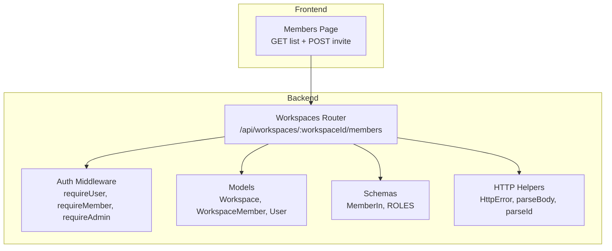
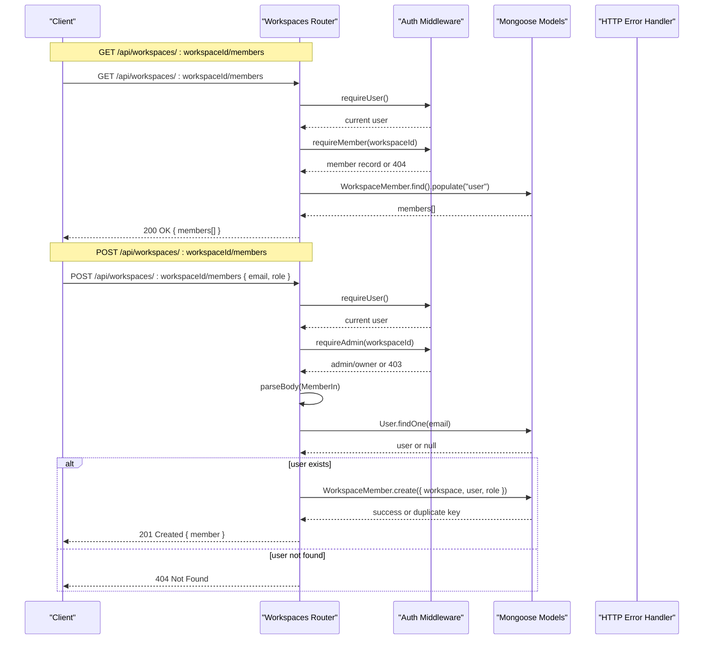
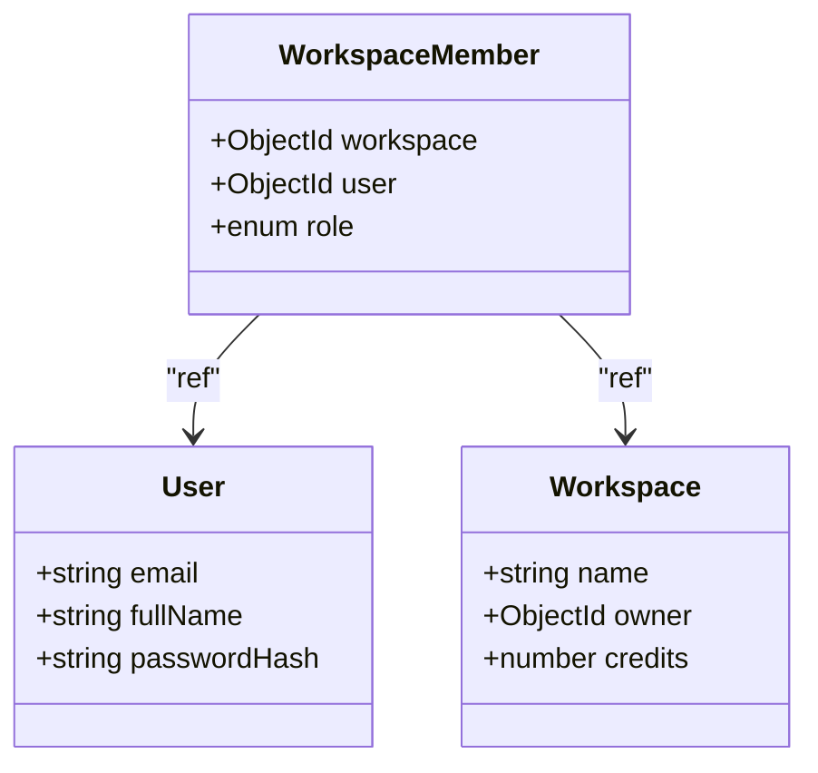
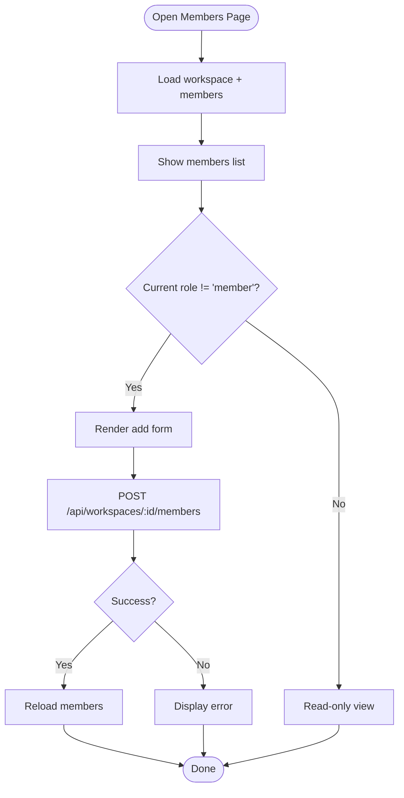
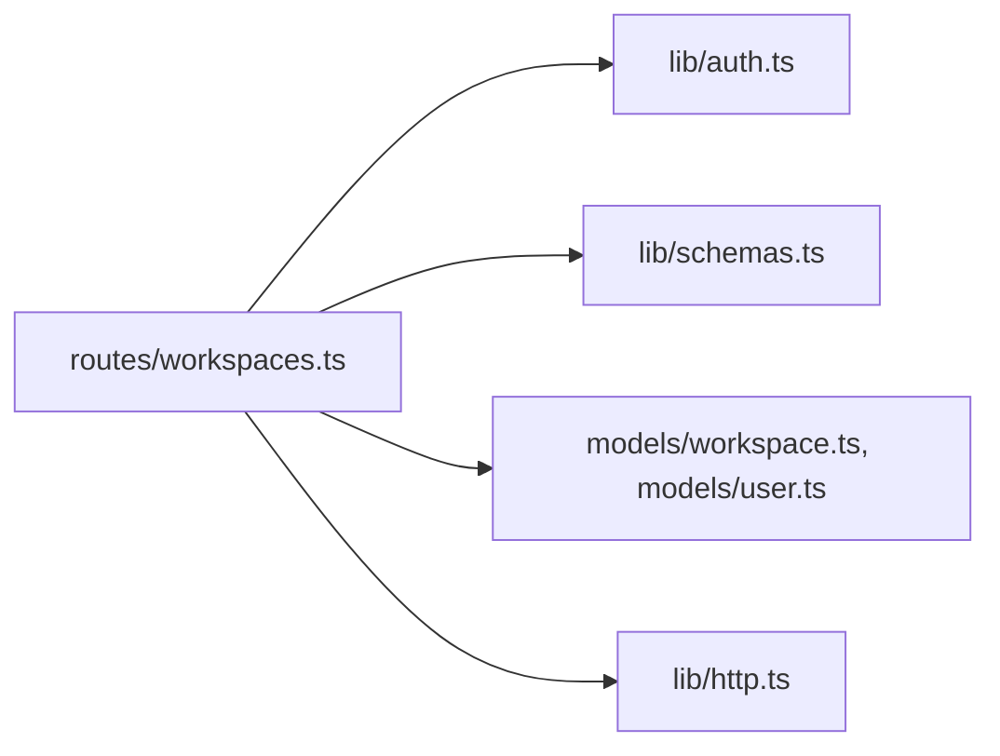

# Member Management API

<cite>
**Referenced Files in This Document**
- [workspaces.ts](file://phoenix-backend/src/routes/workspaces.ts)
- [workspace.ts](file://phoenix-backend/src/models/workspace.ts)
- [user.ts](file://phoenix-backend/src/models/user.ts)
- [schemas.ts](file://phoenix-backend/src/lib/schemas.ts)
- [auth.ts](file://phoenix-backend/src/lib/auth.ts)
- [http.ts](file://phoenix-backend/src/lib/http.ts)
- [page.tsx](file://phoenix-frontend/src/app/workspaces/[id]/members/page.tsx)
- [types.ts](file://phoenix-frontend/src/lib/types.ts)
</cite>

## Table of Contents
1. [Introduction](#introduction)
2. [Project Structure](#project-structure)
3. [Core Components](#core-components)
4. [Architecture Overview](#architecture-overview)
5. [Detailed Component Analysis](#detailed-component-analysis)
6. [Dependency Analysis](#dependency-analysis)
7. [Performance Considerations](#performance-considerations)
8. [Troubleshooting Guide](#troubleshooting-guide)
9. [Conclusion](#conclusion)

## Introduction
This document describes the workspace member management endpoints for the Phoenix backend:
- GET /api/workspaces/:workspaceId/members: List all members with their roles and user details.
- POST /api/workspaces/:workspaceId/members: Invite a new member, including role validation, email lookup, and duplicate handling.

It also covers authorization requirements (only existing members can manage other members; only owners/admins can invite), request/response schemas, error scenarios, and workflow examples for team collaboration setup.

## Project Structure
The member management functionality is implemented in the backend routes and models, validated by shared schema definitions, and consumed by a Next.js frontend page that lists members and invites new ones.

**Diagram sources**
- [workspaces.ts:56-102](file://phoenix-backend/src/routes/workspaces.ts#L56-L102)
- [auth.ts:8-49](file://phoenix-backend/src/lib/auth.ts#L8-L49)
- [workspace.ts:1-22](file://phoenix-backend/src/models/workspace.ts#L1-L22)
- [user.ts:1-20](file://phoenix-backend/src/models/user.ts#L1-L20)
- [schemas.ts:17-20](file://phoenix-backend/src/lib/schemas.ts#L17-L20)
- [http.ts:5-40](file://phoenix-backend/src/lib/http.ts#L5-L40)

**Section sources**
- [workspaces.ts:56-102](file://phoenix-backend/src/routes/workspaces.ts#L56-L102)
- [page.tsx:17-44](file://phoenix-frontend/src/app/workspaces/[id]/members/page.tsx#L17-L44)

## Core Components
- Workspaces router endpoints for listing and inviting members.
- Authorization middleware to enforce membership and admin/owner roles.
- Data models for users, workspaces, and memberships.
- Request validation schemas using Zod.
- HTTP helpers for consistent error handling and parsing.

Key responsibilities:
- Listing members populates user details and returns role-per-member.
- Inviting members validates input, enforces owner restriction, looks up target user by email, prevents duplicates, and returns created member data.

**Section sources**
- [workspaces.ts:56-102](file://phoenix-backend/src/routes/workspaces.ts#L56-L102)
- [auth.ts:29-49](file://phoenix-backend/src/lib/auth.ts#L29-L49)
- [workspace.ts:15-21](file://phoenix-backend/src/models/workspace.ts#L15-L21)
- [schemas.ts:17-20](file://phoenix-backend/src/lib/schemas.ts#L17-L20)
- [http.ts:20-40](file://phoenix-backend/src/lib/http.ts#L20-L40)

## Architecture Overview
The member management flow uses Express routes protected by authentication and authorization middleware. Requests are validated against Zod schemas, then interact with Mongoose models. Errors are normalized via HttpError and handled centrally.

**Diagram sources**
- [workspaces.ts:56-102](file://phoenix-backend/src/routes/workspaces.ts#L56-L102)
- [auth.ts:8-49](file://phoenix-backend/src/lib/auth.ts#L8-L49)
- [http.ts:47-80](file://phoenix-backend/src/lib/http.ts#L47-L80)

## Detailed Component Analysis

### Endpoint: GET /api/workspaces/:workspaceId/members
Purpose:
- Return all members of a workspace, including user_id, email, full_name, and role.

Authorization:
- Requires an authenticated user who is a member of the workspace. Non-members receive a 404 to avoid leaking workspace existence.

Processing steps:
1. Parse and validate workspace ID.
2. Authenticate the current user.
3. Require membership via requireMember.
4. Query WorkspaceMember records for the workspace and populate user details.
5. Map results to response shape.

Response:
- 200 OK: Array of member objects with fields user_id, email, full_name, role.

Errors:
- 401 Unauthorized: Missing or invalid bearer token.
- 404 Not Found: Invalid workspace ID or caller is not a member.

Request example:
- Method: GET
- Path: /api/workspaces/{workspaceId}/members
- Headers: Authorization: Bearer <token>

Response example:
- 200 OK: [{ user_id, email, full_name, role }, ...]

**Section sources**
- [workspaces.ts:56-75](file://phoenix-backend/src/routes/workspaces.ts#L56-L75)
- [auth.ts:29-34](file://phoenix-backend/src/lib/auth.ts#L29-L34)
- [http.ts:28-32](file://phoenix-backend/src/lib/http.ts#L28-L32)

### Endpoint: POST /api/workspaces/:workspaceId/members
Purpose:
- Invite a new member to the workspace with a specified role.

Authorization:
- Requires an authenticated user who is a member of the workspace.
- Only owners or admins may invite; regular members get 403.

Validation rules:
- Role must be one of the allowed roles; “owner” is rejected because there must be exactly one owner.
- Email is lowercased before lookup.
- Target user must exist; otherwise 404.
- Duplicate membership is prevented by a unique index on (workspace, user).

Processing steps:
1. Parse and validate workspace ID.
2. Authenticate the current user.
3. Require admin/owner role via requireAdmin.
4. Validate body with MemberIn schema.
5. Reject role === "owner".
6. Look up user by email.
7. Attempt to create membership; handle duplicate key errors.
8. Return created member data.

Response:
- 201 Created: Member object with user_id, email, full_name, role.

Errors:
- 401 Unauthorized: Missing or invalid bearer token.
- 403 Forbidden: Caller is not admin/owner.
- 404 Not Found: Invalid workspace ID, caller not a member, or target user not found.
- 409 Conflict: User is already a member.
- 422 Unprocessable Entity: Invalid request body (e.g., invalid role).

Request example:
- Method: POST
- Path: /api/workspaces/{workspaceId}/members
- Headers: Authorization: Bearer <token>
- Body: { email: string, role: "member" | "admin" }

Response example:
- 201 Created: { user_id, email, full_name, role }

**Section sources**
- [workspaces.ts:77-102](file://phoenix-backend/src/routes/workspaces.ts#L77-L102)
- [auth.ts:36-42](file://phoenix-backend/src/lib/auth.ts#L36-L42)
- [schemas.ts:17-20](file://phoenix-backend/src/lib/schemas.ts#L17-L20)
- [http.ts:20-24](file://phoenix-backend/src/lib/http.ts#L20-L24)
- [http.ts:38-40](file://phoenix-backend/src/lib/http.ts#L38-L40)

### Data Models and Roles
- Workspace: Represents a workspace with name, owner reference, and credits.
- WorkspaceMember: Links a user to a workspace with a role; unique constraint on (workspace, user).
- User: Stores email, fullName, and passwordHash; email is unique and lowercase.
- Allowed roles: owner, admin, member.

**Diagram sources**
- [user.ts:1-20](file://phoenix-backend/src/models/user.ts#L1-L20)
- [workspace.ts:1-22](file://phoenix-backend/src/models/workspace.ts#L1-L22)

**Section sources**
- [workspace.ts:1-22](file://phoenix-backend/src/models/workspace.ts#L1-L22)
- [user.ts:1-20](file://phoenix-backend/src/models/user.ts#L1-L20)

### Request Validation Schemas
- MemberIn: Validates email and role. Role defaults to "member" if omitted.
- Role enum: owner, admin, member.

Notes:
- The route explicitly rejects role === "owner" even though it is a valid enum value.
- Email is lowercased during lookup to ensure case-insensitive matching.

**Section sources**
- [schemas.ts:17-20](file://phoenix-backend/src/lib/schemas.ts#L17-L20)
- [workspace.ts:3-3](file://phoenix-backend/src/models/workspace.ts#L3-L3)

### Frontend Integration
The Members page:
- Loads workspace info and members concurrently.
- Displays member list with role badges.
- Allows adding members when the current user’s role is not "member".
- Sends POST requests with email and selected role.

**Diagram sources**
- [page.tsx:17-44](file://phoenix-frontend/src/app/workspaces/[id]/members/page.tsx#L17-L44)
- [page.tsx:67-84](file://phoenix-frontend/src/app/workspaces/[id]/members/page.tsx#L67-L84)

**Section sources**
- [page.tsx:17-44](file://phoenix-frontend/src/app/workspaces/[id]/members/page.tsx#L17-L44)
- [page.tsx:67-84](file://phoenix-frontend/src/app/workspaces/[id]/members/page.tsx#L67-L84)
- [types.ts:23-28](file://phoenix-frontend/src/lib/types.ts#L23-L28)

## Dependency Analysis
The member management endpoints depend on:
- Authentication and authorization middleware for access control.
- Schema validation for request bodies.
- Database models for persistence and constraints.
- HTTP helpers for consistent error responses.

**Diagram sources**
- [workspaces.ts:1-6](file://phoenix-backend/src/routes/workspaces.ts#L1-L6)
- [auth.ts:1-58](file://phoenix-backend/src/lib/auth.ts#L1-L58)
- [schemas.ts:1-41](file://phoenix-backend/src/lib/schemas.ts#L1-L41)
- [workspace.ts:1-22](file://phoenix-backend/src/models/workspace.ts#L1-L22)
- [user.ts:1-20](file://phoenix-backend/src/models/user.ts#L1-L20)
- [http.ts:1-81](file://phoenix-backend/src/lib/http.ts#L1-L81)

**Section sources**
- [workspaces.ts:1-6](file://phoenix-backend/src/routes/workspaces.ts#L1-L6)
- [auth.ts:8-49](file://phoenix-backend/src/lib/auth.ts#L8-L49)
- [schemas.ts:17-20](file://phoenix-backend/src/lib/schemas.ts#L17-L20)
- [workspace.ts:15-21](file://phoenix-backend/src/models/workspace.ts#L15-L21)
- [http.ts:5-40](file://phoenix-backend/src/lib/http.ts#L5-L40)

## Performance Considerations
- Listing members uses a single query with population of user details. For large teams, consider pagination or projection to limit payload size.
- Invitation endpoint performs two database operations at minimum (user lookup and membership creation). Ensure indexes on user.email and WorkspaceMember(workspace, user) are present; the latter is defined.
- Avoid unnecessary re-fetching on the frontend; cache workspace and members where appropriate.

[No sources needed since this section provides general guidance]

## Troubleshooting Guide
Common issues and resolutions:
- 401 Unauthorized: Ensure Authorization header includes a valid bearer token.
- 403 Forbidden: Only owners/admins can invite; verify your role in the workspace.
- 404 Not Found:
  - Workspace not found or you are not a member.
  - Target user email does not exist.
- 409 Conflict: User is already a member; do not resend invitations.
- 422 Unprocessable Entity: Invalid request body; check email format and role values.

Diagnostic tips:
- Confirm workspace ID is a valid 24-character hex ObjectId.
- Verify the invited user has an account in the system before inviting.
- Check that the role is either "member" or "admin" when inviting.

**Section sources**
- [auth.ts:8-49](file://phoenix-backend/src/lib/auth.ts#L8-L49)
- [http.ts:47-80](file://phoenix-backend/src/lib/http.ts#L47-L80)
- [workspaces.ts:56-102](file://phoenix-backend/src/routes/workspaces.ts#L56-L102)

## Conclusion
The workspace member management endpoints provide secure and validated APIs for listing and inviting members. Authorization ensures only existing members can manage others, while role checks restrict invitations to owners and admins. Robust validation and error handling make the APIs predictable and easy to integrate from both backend clients and the frontend UI.

[No sources needed since this section summarizes without analyzing specific files]