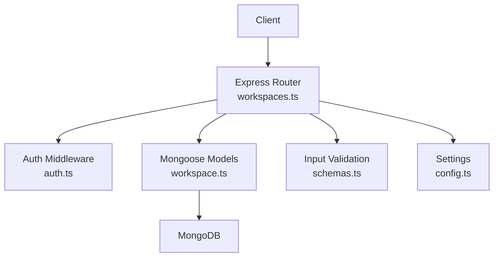
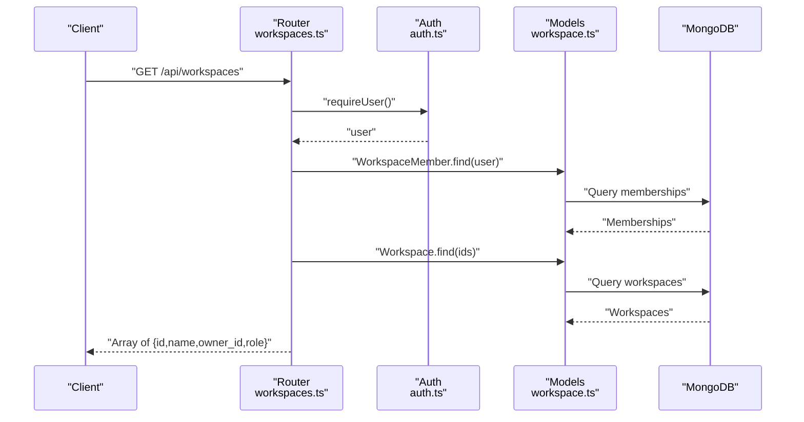
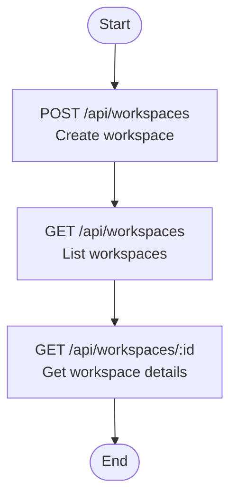
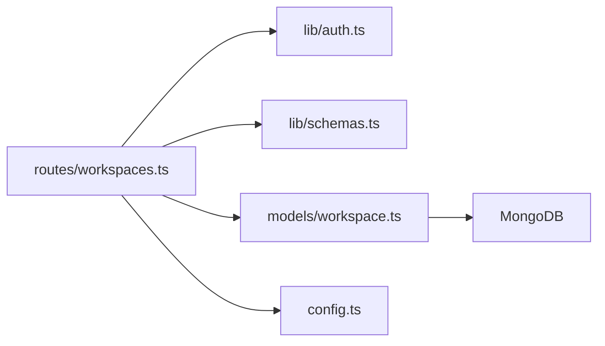

# Workspace CRUD Operations

<cite>
**Referenced Files in This Document**
- [workspaces.ts](file://phoenix-backend/src/routes/workspaces.ts)
- [workspace.ts](file://phoenix-backend/src/models/workspace.ts)
- [schemas.ts](file://phoenix-backend/src/lib/schemas.ts)
- [auth.ts](file://phoenix-backend/src/lib/auth.ts)
- [http.ts](file://phoenix-backend/src/lib/http.ts)
- [config.ts](file://phoenix-backend/src/config.ts)
- [README.md](file://phoenix-backend/README.md)
</cite>

## Table of Contents
1. [Introduction](#introduction)
2. [Project Structure](#project-structure)
3. [Core Components](#core-components)
4. [Architecture Overview](#architecture-overview)
5. [Detailed Component Analysis](#detailed-component-analysis)
6. [Dependency Analysis](#dependency-analysis)
7. [Performance Considerations](#performance-considerations)
8. [Troubleshooting Guide](#troubleshooting-guide)
9. [Conclusion](#conclusion)

## Introduction
This document explains the workspace CRUD operations exposed by the backend API, focusing on:
- Listing all workspaces a user is a member of
- Creating a new workspace with automatic owner assignment and welcome credits
- Retrieving a specific workspace with authorization checks

It also covers request/response schemas, authentication requirements, error handling for duplicate names and unauthorized access, and examples of workspace lifecycle management.

## Project Structure
The workspace endpoints are implemented in the backend Express router under `src/routes`. The data model lives under `src/models`, input validation under `src/lib/schemas`, and authentication/authorization helpers under `src/lib/auth`. Configuration values such as welcome credits come from `src/config`.

**Diagram sources**
- [workspaces.ts:1-128](file://phoenix-backend/src/routes/workspaces.ts#L1-L128)
- [auth.ts:8-50](file://phoenix-backend/src/lib/auth.ts#L8-L50)
- [workspace.ts:1-22](file://phoenix-backend/src/models/workspace.ts#L1-L22)
- [schemas.ts:15-22](file://phoenix-backend/src/lib/schemas.ts#L15-L22)
- [config.ts:1-200](file://phoenix-backend/src/config.ts#L1-L200)

**Section sources**
- [workspaces.ts:1-128](file://phoenix-backend/src/routes/workspaces.ts#L1-L128)
- [workspace.ts:1-22](file://phoenix-backend/src/models/workspace.ts#L1-L22)
- [schemas.ts:15-22](file://phoenix-backend/src/lib/schemas.ts#L15-L22)
- [auth.ts:8-50](file://phoenix-backend/src/lib/auth.ts#L8-L50)
- [README.md:59-75](file://phoenix-backend/README.md#L59-L75)

## Core Components
- Workspace listing endpoint: GET /api/workspaces
- Workspace creation endpoint: POST /api/workspaces
- Workspace detail endpoint: GET /api/workspaces/:workspaceId
- Authorization middleware: requireUser, requireMember, requireAdmin, requireOwner
- Input validation schemas: WorkspaceIn, MemberIn, TopUpIn
- Data models: Workspace, WorkspaceMember

Key responsibilities:
- Authentication: Bearer token required for all workspace routes.
- Authorization: Membership checks prevent leaking existence of workspaces; admin/owner-only operations enforced where needed.
- Data integrity: Unique index on (workspace, user) prevents duplicate memberships; role enum restricts roles to allowed values.

**Section sources**
- [workspaces.ts:18-54](file://phoenix-backend/src/routes/workspaces.ts#L18-L54)
- [auth.ts:8-50](file://phoenix-backend/src/lib/auth.ts#L8-L50)
- [workspace.ts:1-22](file://phoenix-backend/src/models/workspace.ts#L1-L22)
- [schemas.ts:15-22](file://phoenix-backend/src/lib/schemas.ts#L15-L22)

## Architecture Overview
The workspace endpoints follow a consistent flow:
1. Authenticate the caller via Bearer token.
2. Validate path/query/body parameters using Zod schemas.
3. Enforce authorization based on membership or role.
4. Perform database operations through Mongoose models.
5. Return snake_case JSON responses with role information where applicable.

**Diagram sources**
- [workspaces.ts:18-28](file://phoenix-backend/src/routes/workspaces.ts#L18-L28)
- [auth.ts:8-23](file://phoenix-backend/src/lib/auth.ts#L8-L23)
- [workspace.ts:1-22](file://phoenix-backend/src/models/workspace.ts#L1-L22)

## Detailed Component Analysis

### GET /api/workspaces — List Workspaces
Purpose:
- Returns all workspaces the authenticated user belongs to, including their role in each workspace.

Authentication:
- Required: Bearer token via Authorization header.

Authorization:
- No additional workspace-level check; lists only workspaces the user is a member of.

Request:
- Headers:
  - Authorization: Bearer <token>
- Body: None

Response:
- Status: 200 OK
- Body: Array of workspace objects
  - id: string (workspace ID)
  - name: string
  - owner_id: string (ID of the workspace owner)
  - role: string ("owner", "admin", or "member")

Error Responses:
- 401 Unauthorized: Missing, invalid, or expired token; or user no longer exists.
- 5xx: Unexpected server errors (handled generically).

Example Response:
- [200] [{"id":"...","name":"Acme Corp","owner_id":"...","role":"owner"},{"id":"...","name":"Globex Secret Lab","owner_id":"...","role":"member"}]

Implementation Notes:
- Fetches memberships for the current user, then fetches corresponding workspaces.
- Maps membership role into the response; defaults to "member" if missing.

**Section sources**
- [workspaces.ts:18-28](file://phoenix-backend/src/routes/workspaces.ts#L18-L28)
- [auth.ts:8-23](file://phoenix-backend/src/lib/auth.ts#L8-L23)

### POST /api/workspaces — Create Workspace
Purpose:
- Creates a new workspace for the authenticated user.
- Automatically assigns the creator as the workspace owner.
- Initializes workspace credits with the configured welcome amount.
- Records a welcome credit entry in the ledger.

Authentication:
- Required: Bearer token.

Authorization:
- Any authenticated user can create a workspace.

Request:
- Headers:
  - Authorization: Bearer <token>
  - Content-Type: application/json
- Body:
  - name: string (1–120 characters)

Validation Schema:
- WorkspaceIn:
  - name: string, trimmed, length 1–120

Response:
- Status: 201 Created
- Body: Workspace object
  - id: string
  - name: string
  - owner_id: string
  - role: "owner"

Error Responses:
- 400 Bad Request: Invalid body (e.g., name too short/long).
- 401 Unauthorized: Missing/invalid/expired token or user not found.
- 409 Conflict: Duplicate workspace name (see Error Handling section below).

Lifecycle Behavior:
- Creates workspace with initial credits equal to WELCOME_CREDITS from configuration.
- Inserts a WorkspaceMember record assigning the creator as "owner".
- Writes a CreditLedger entry with delta equal to welcome credits and reason "welcome credits".

**Section sources**
- [workspaces.ts:31-42](file://phoenix-backend/src/routes/workspaces.ts#L31-L42)
- [schemas.ts:15-15](file://phoenix-backend/src/lib/schemas.ts#L15-L15)
- [workspace.ts:5-13](file://phoenix-backend/src/models/workspace.ts#L5-L13)
- [README.md:59-75](file://phoenix-backend/README.md#L59-L75)

### GET /api/workspaces/:workspaceId — Get Workspace Details
Purpose:
- Retrieves details for a specific workspace, including the requesting user’s role.

Authentication:
- Required: Bearer token.

Authorization:
- Requires membership in the workspace. If the user is not a member, returns 404 to avoid leaking whether the workspace exists.

Request:
- Headers:
  - Authorization: Bearer <token>
- Path Parameters:
  - workspaceId: string (valid MongoDB ObjectId format)

Response:
- Status: 200 OK
- Body: Workspace object
  - id: string
  - name: string
  - owner_id: string
  - role: string ("owner", "admin", or "member")

Error Responses:
- 401 Unauthorized: Missing/invalid/expired token or user not found.
- 404 Not Found: Workspace does not exist or user is not a member.
- 400 Bad Request: Malformed workspaceId.

Implementation Notes:
- Uses requireMember to enforce membership and return 404 when unauthorized.
- Reads workspace fields and attaches the user’s role from the membership record.

**Section sources**
- [workspaces.ts:44-54](file://phoenix-backend/src/routes/workspaces.ts#L44-L54)
- [auth.ts:29-34](file://phoenix-backend/src/lib/auth.ts#L29-L34)

### Request/Response Schemas

Workspace Creation Request (POST /api/workspaces):
- name: string (1–120 characters, trimmed)

Workspace Listing Response (GET /api/workspaces):
- Array of objects:
  - id: string
  - name: string
  - owner_id: string
  - role: string ("owner" | "admin" | "member")

Workspace Detail Response (GET /api/workspaces/:workspaceId):
- Object:
  - id: string
  - name: string
  - owner_id: string
  - role: string ("owner" | "admin" | "member")

Validation Sources:
- WorkspaceIn schema defines name constraints.
- Role enumeration is defined in the workspace model.

**Section sources**
- [schemas.ts:15-15](file://phoenix-backend/src/lib/schemas.ts#L15-L15)
- [workspace.ts:3-3](file://phoenix-backend/src/models/workspace.ts#L3-L3)

### Authentication Requirements
All workspace endpoints are protected by requireUser:
- Expects Authorization: Bearer <JWT>.
- Validates token signature and expiration.
- Resolves user by ID and ensures the user still exists.
- Attaches user to res.locals for downstream handlers.

Unauthorized Access:
- Missing or malformed Authorization header: 401.
- Invalid/expired token: 401.
- User deleted or not found: 401.

**Section sources**
- [workspaces.ts:8-9](file://phoenix-backend/src/routes/workspaces.ts#L8-L9)
- [auth.ts:8-23](file://phoenix-backend/src/lib/auth.ts#L8-L23)

### Error Handling

Duplicate Names:
- The workspace model enforces uniqueness at the database level for workspace names.
- When creating a workspace, duplicate names trigger a duplicate key error.
- The route converts this to HTTP 409 Conflict with a descriptive message.

Unauthorized Access:
- Non-members attempting to access a workspace get 404 to avoid leaking existence.
- Admin-only or owner-only operations return 403 when the user lacks the required role.

Common Errors:
- 400 Bad Request: Invalid input (e.g., name length violations).
- 401 Unauthorized: Authentication failures.
- 403 Forbidden: Insufficient permissions.
- 404 Not Found: Resource not found or user not a member.
- 409 Conflict: Duplicate resource (e.g., duplicate membership or duplicate workspace name depending on constraint).

**Section sources**
- [workspaces.ts:31-42](file://phoenix-backend/src/routes/workspaces.ts#L31-L42)
- [workspaces.ts:44-54](file://phoenix-backend/src/routes/workspaces.ts#L44-L54)
- [auth.ts:29-50](file://phoenix-backend/src/lib/auth.ts#L29-L50)
- [workspace.ts:15-21](file://phoenix-backend/src/models/workspace.ts#L15-L21)

### Examples of Workspace Lifecycle Management

Create a Workspace:
- Send POST /api/workspaces with a valid name.
- Receive 201 with the created workspace and role "owner".
- Credits initialized to WELCOME_CREDITS; a ledger entry is recorded.

List Your Workspaces:
- Send GET /api/workspaces.
- Receive an array of workspaces you belong to, each with your role.

Access a Specific Workspace:
- Send GET /api/workspaces/:workspaceId.
- Receive the workspace details with your role if you are a member; otherwise 404.

[No sources needed since this diagram shows conceptual workflow, not actual code structure]

## Dependency Analysis
The workspace endpoints depend on:
- Express Router for routing and middleware composition.
- Authentication middleware for bearer token validation and user resolution.
- Mongoose models for persistence and queries.
- Zod schemas for input validation.
- Configuration module for runtime settings like welcome credits.

**Diagram sources**
- [workspaces.ts:1-128](file://phoenix-backend/src/routes/workspaces.ts#L1-L128)
- [auth.ts:1-58](file://phoenix-backend/src/lib/auth.ts#L1-L58)
- [workspace.ts:1-22](file://phoenix-backend/src/models/workspace.ts#L1-L22)
- [schemas.ts:1-41](file://phoenix-backend/src/lib/schemas.ts#L1-L41)
- [config.ts:1-200](file://phoenix-backend/src/config.ts#L1-L200)

**Section sources**
- [workspaces.ts:1-128](file://phoenix-backend/src/routes/workspaces.ts#L1-L128)
- [auth.ts:1-58](file://phoenix-backend/src/lib/auth.ts#L1-L58)
- [workspace.ts:1-22](file://phoenix-backend/src/models/workspace.ts#L1-L22)
- [schemas.ts:1-41](file://phoenix-backend/src/lib/schemas.ts#L1-L41)
- [config.ts:1-200](file://phoenix-backend/src/config.ts#L1-L200)

## Performance Considerations
- Workspace listing performs two queries: one for memberships and one for workspaces by IDs. This is efficient for typical user membership counts.
- Using lean() reduces overhead by returning plain JavaScript objects.
- Sorting by _id provides deterministic ordering.
- Avoid unnecessary population; only populate when exposing nested user details (as seen in members listing).

[No sources needed since this section provides general guidance]

## Troubleshooting Guide
- 401 Unauthorized:
  - Ensure Authorization header is present and uses Bearer scheme.
  - Verify JWT secret configuration and token validity.
- 404 Not Found:
  - For workspace detail, confirm you are a member; non-members receive 404 to prevent existence leaks.
- 400 Bad Request:
  - Validate request body against schemas (e.g., name length).
- 403 Forbidden:
  - Check role requirements for admin/owner-only endpoints.
- 409 Conflict:
  - Duplicate workspace name or duplicate membership attempts.

**Section sources**
- [auth.ts:8-23](file://phoenix-backend/src/lib/auth.ts#L8-L23)
- [auth.ts:29-50](file://phoenix-backend/src/lib/auth.ts#L29-L50)
- [workspaces.ts:31-42](file://phoenix-backend/src/routes/workspaces.ts#L31-L42)
- [workspaces.ts:44-54](file://phoenix-backend/src/routes/workspaces.ts#L44-L54)

## Conclusion
The workspace API provides secure, role-aware operations for managing multi-tenant workspaces. Authentication is enforced via Bearer tokens, and authorization ensures users can only access workspaces they belong to. Creation automatically sets ownership and initializes credits, while listing and detail endpoints expose role context for client-side UIs. Proper error handling protects against information leakage and guides clients to correct usage.