# Workspace Management API

<cite>
**Referenced Files in This Document**
- [workspaces.ts](file://phoenix-backend/src/routes/workspaces.ts)
- [workspace.ts](file://phoenix-backend/src/models/workspace.ts)
- [user.ts](file://phoenix-backend/src/models/user.ts)
- [ledger.ts](file://phoenix-backend/src/models/ledger.ts)
- [schemas.ts](file://phoenix-backend/src/lib/schemas.ts)
- [auth.ts](file://phoenix-backend/src/lib/auth.ts)
- [http.ts](file://phoenix-backend/src/lib/http.ts)
- [config.ts](file://phoenix-backend/src/config.ts)
- [README.md](file://phoenix-backend/README.md)
</cite>

## Table of Contents
1. [Introduction](#introduction)
2. [Project Structure](#project-structure)
3. [Core Components](#core-components)
4. [Architecture Overview](#architecture-overview)
5. [Detailed Component Analysis](#detailed-component-analysis)
6. [Dependency Analysis](#dependency-analysis)
7. [Performance Considerations](#performance-considerations)
8. [Troubleshooting Guide](#troubleshooting-guide)
9. [Conclusion](#conclusion)

## Introduction
This document provides comprehensive API documentation for workspace management endpoints in the Phoenix backend. It covers:
- Workspace listing, creation, and retrieval
- Member management (listing and inviting members)
- Role-based access control (owner, admin, member)
- Credit operations (balance checking and top-up)

The API is a multi-tenant system where users belong to workspaces with roles that determine permissions. All JSON responses use snake_case identifiers and error bodies follow a consistent format.

## Project Structure
The workspace-related functionality lives primarily under the backend routes and models:
- Routes define HTTP endpoints and authorization checks
- Models define data schemas for workspaces, members, users, and credit ledger entries
- Shared libraries provide authentication, validation, and error handling utilities

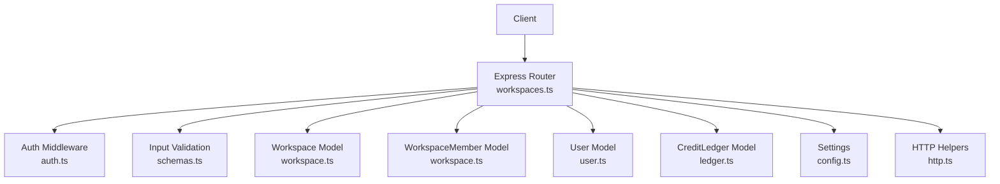

**Diagram sources**
- [workspaces.ts:1-128](file://phoenix-backend/src/routes/workspaces.ts#L1-L128)
- [workspace.ts:1-22](file://phoenix-backend/src/models/workspace.ts#L1-L22)
- [user.ts:1-20](file://phoenix-backend/src/models/user.ts#L1-L20)
- [ledger.ts:1-19](file://phoenix-backend/src/models/ledger.ts#L1-L19)
- [schemas.ts:1-41](file://phoenix-backend/src/lib/schemas.ts#L1-L41)
- [auth.ts:1-58](file://phoenix-backend/src/lib/auth.ts#L1-L58)
- [http.ts:1-81](file://phoenix-backend/src/lib/http.ts#L1-L81)
- [config.ts:1-41](file://phoenix-backend/src/config.ts#L1-L41)

**Section sources**
- [README.md:59-75](file://phoenix-backend/README.md#L59-L75)

## Core Components
- Workspaces: Represent tenant contexts with an owner and credits balance.
- Members: Map users to workspaces with roles (owner, admin, member).
- Users: Account entities identified by email and name.
- Credit Ledger: Append-only history of credit changes per workspace.
- Authorization: Bearer token-based authentication with role checks.
- Validation: Zod-based request body and ID parsing.
- Error Handling: Centralized HTTP error formatting and status mapping.

Key responsibilities:
- Route handlers enforce authorization and orchestrate database operations.
- Models define schema constraints and indexes.
- Libraries provide reusable auth, validation, and error utilities.

**Section sources**
- [workspace.ts:1-22](file://phoenix-backend/src/models/workspace.ts#L1-L22)
- [user.ts:1-20](file://phoenix-backend/src/models/user.ts#L1-L20)
- [ledger.ts:1-19](file://phoenix-backend/src/models/ledger.ts#L1-L19)
- [auth.ts:1-58](file://phoenix-backend/src/lib/auth.ts#L1-L58)
- [schemas.ts:1-41](file://phoenix-backend/src/lib/schemas.ts#L1-L41)
- [http.ts:1-81](file://phoenix-backend/src/lib/http.ts#L1-L81)

## Architecture Overview
The workspace management API follows a layered architecture:
- Express router defines endpoints and applies middleware for authentication and authorization.
- Route handlers validate inputs using Zod schemas and call Mongoose models.
- Data integrity is enforced via model schemas and unique indexes.
- Errors are normalized through centralized error handling.

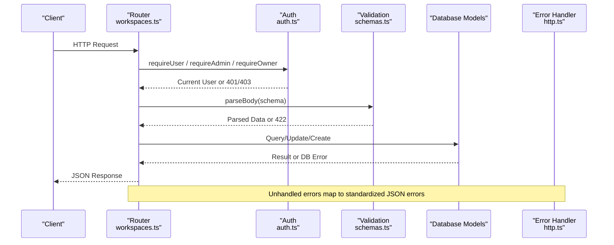

**Diagram sources**
- [workspaces.ts:1-128](file://phoenix-backend/src/routes/workspaces.ts#L1-L128)
- [auth.ts:1-58](file://phoenix-backend/src/lib/auth.ts#L1-L58)
- [schemas.ts:1-41](file://phoenix-backend/src/lib/schemas.ts#L1-L41)
- [http.ts:1-81](file://phoenix-backend/src/lib/http.ts#L1-L81)

## Detailed Component Analysis

### Authentication and Authorization
- Authentication requires a Bearer token; invalid or missing tokens return 401.
- Authorization functions enforce workspace membership and role requirements:
  - requireMember: user must be a member of the workspace.
  - requireAdmin: user must be owner or admin.
  - requireOwner: user must be owner.
- If a user is not a member, endpoints return 404 to avoid leaking workspace existence.

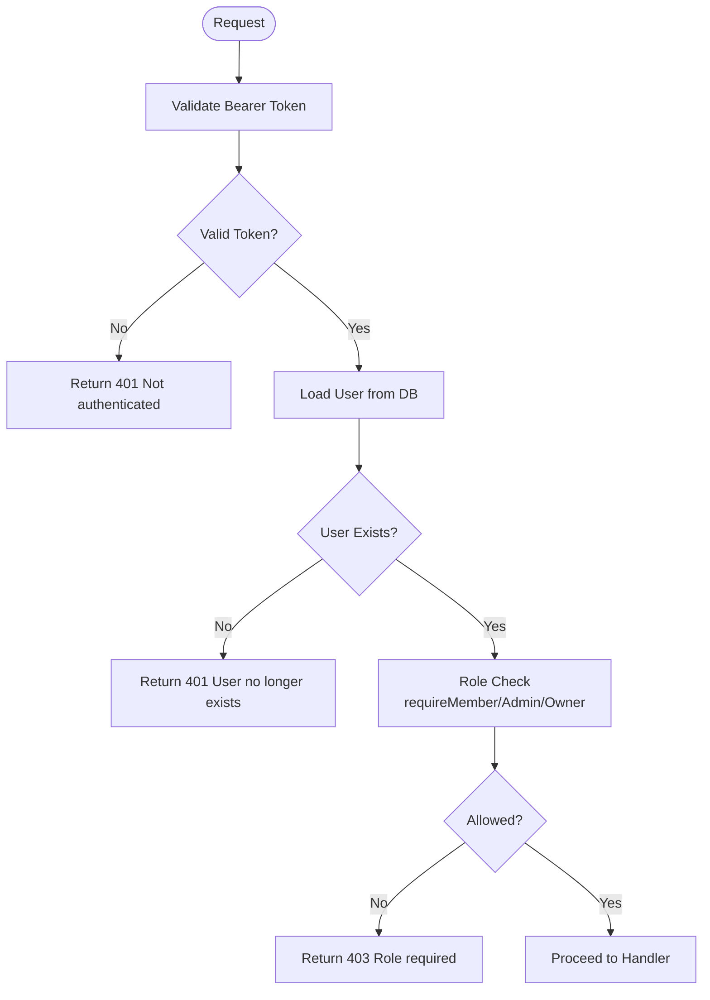

**Diagram sources**
- [auth.ts:8-50](file://phoenix-backend/src/lib/auth.ts#L8-L50)

**Section sources**
- [auth.ts:1-58](file://phoenix-backend/src/lib/auth.ts#L1-L58)

### Input Validation and ID Parsing
- Request bodies are validated using Zod schemas:
  - WorkspaceIn: workspace name
  - MemberIn: email and role
  - TopUpIn: amount (positive integer, max 1000)
- Path IDs must be valid MongoDB ObjectIds; otherwise, a 404 is returned.
- Validation failures return 422 with structured issues.

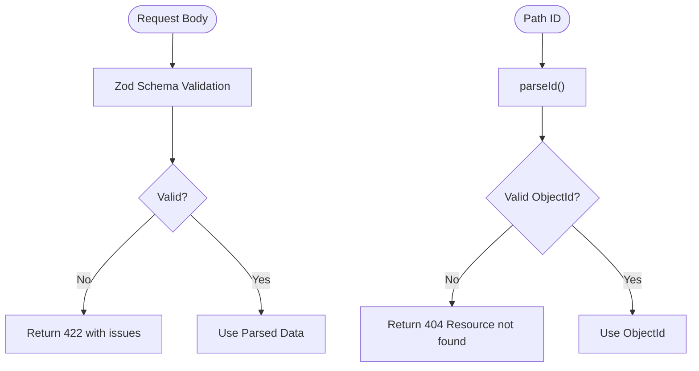

**Diagram sources**
- [schemas.ts:15-22](file://phoenix-backend/src/lib/schemas.ts#L15-L22)
- [http.ts:20-32](file://phoenix-backend/src/lib/http.ts#L20-L32)

**Section sources**
- [schemas.ts:1-41](file://phoenix-backend/src/lib/schemas.ts#L1-L41)
- [http.ts:20-32](file://phoenix-backend/src/lib/http.ts#L20-L32)

### Error Handling
- Centralized error handler maps exceptions to standardized JSON responses:
  - HttpError: uses provided status and detail
  - ZodError: returns 422 with validation issues
  - Mongoose CastError: returns 404
  - Mongoose ValidationError: returns 422
  - SyntaxError on body: returns 400 malformed JSON
  - Body parser errors: map to appropriate client error codes
  - Unknown errors: log and return 500

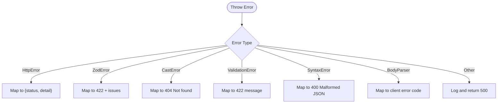

**Diagram sources**
- [http.ts:42-81](file://phoenix-backend/src/lib/http.ts#L42-L81)

**Section sources**
- [http.ts:1-81](file://phoenix-backend/src/lib/http.ts#L1-L81)

### Data Models and Relationships
- Workspace: stores name, owner reference, and credits balance.
- WorkspaceMember: links users to workspaces with roles; enforces uniqueness per workspace-user pair.
- User: stores email, full name, and password hash.
- CreditLedger: append-only record of credit deltas with optional idempotency keys.

```mermaid
erDiagram
WORKSPACE {
string name
objectId owner_id FK
number credits
}
USER {
string email UK
string fullName
string passwordHash
}
WORKSPACE_MEMBER {
objectId workspace_id FK
objectId user_id FK
enum role
}
CREDIT_LEDGER {
objectId workspace_id FK
number delta
string reason
objectId task_id FK
string idempotency_key
}
USER ||--o{ WORKSPACE_MEMBER : "has memberships"
WORKSPACE ||--o{ WORKSPACE_MEMBER : "has members"
WORKSPACE ||--o{ CREDIT_LEDGER : "has ledger entries"
```

**Diagram sources**
- [workspace.ts:1-22](file://phoenix-backend/src/models/workspace.ts#L1-L22)
- [user.ts:1-20](file://phoenix-backend/src/models/user.ts#L1-L20)
- [ledger.ts:1-19](file://phoenix-backend/src/models/ledger.ts#L1-L19)

**Section sources**
- [workspace.ts:1-22](file://phoenix-backend/src/models/workspace.ts#L1-L22)
- [user.ts:1-20](file://phoenix-backend/src/models/user.ts#L1-L20)
- [ledger.ts:1-19](file://phoenix-backend/src/models/ledger.ts#L1-L19)

## Detailed Component Analysis

### Workspace Listing
- Endpoint: GET /api/workspaces
- Authorization: Requires authenticated user (Bearer token).
- Behavior:
  - Fetches all workspaces the current user is a member of.
  - Returns workspace details including role within each workspace.
- Response fields:
  - id: workspace identifier
  - name: workspace name
  - owner_id: owner user identifier
  - role: current user’s role in the workspace

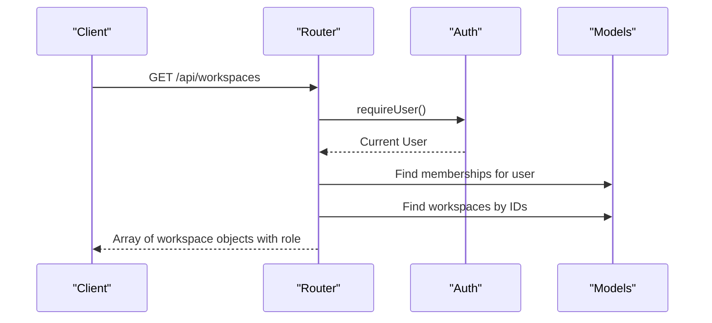

**Diagram sources**
- [workspaces.ts:18-29](file://phoenix-backend/src/routes/workspaces.ts#L18-L29)
- [auth.ts:8-23](file://phoenix-backend/src/lib/auth.ts#L8-L23)

**Section sources**
- [workspaces.ts:18-29](file://phoenix-backend/src/routes/workspaces.ts#L18-L29)

### Workspace Creation
- Endpoint: POST /api/workspaces
- Authorization: Requires authenticated user (Bearer token).
- Behavior:
  - Validates workspace name.
  - Creates workspace with initial credits based on settings.
  - Sets creator as owner and logs welcome credits in ledger.
- Request body:
  - name: string (1–120 characters)
- Response:
  - id, name, owner_id, role: "owner"

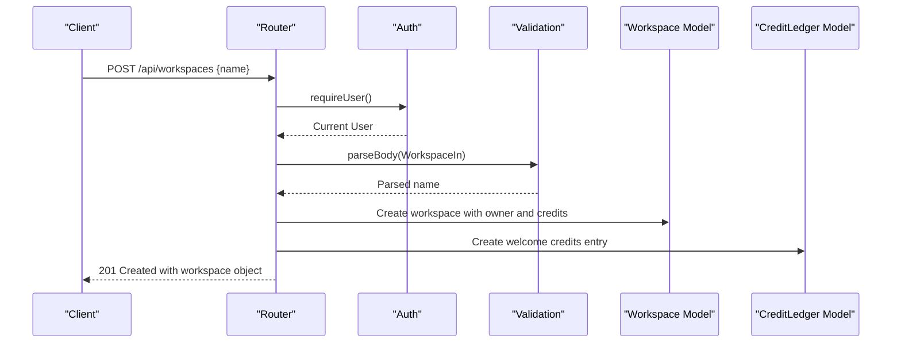

**Diagram sources**
- [workspaces.ts:31-42](file://phoenix-backend/src/routes/workspaces.ts#L31-L42)
- [schemas.ts:15-15](file://phoenix-backend/src/lib/schemas.ts#L15-L15)
- [config.ts:11-11](file://phoenix-backend/src/config.ts#L11-L11)

**Section sources**
- [workspaces.ts:31-42](file://phoenix-backend/src/routes/workspaces.ts#L31-L42)
- [schemas.ts:15-15](file://phoenix-backend/src/lib/schemas.ts#L15-L15)
- [config.ts:11-11](file://phoenix-backend/src/config.ts#L11-L11)

### Workspace Retrieval
- Endpoint: GET /api/workspaces/:id
- Authorization: Requires authenticated user who is a member of the workspace.
- Behavior:
  - Validates workspace ID.
  - Checks membership; returns 404 if not a member.
  - Returns workspace details with current user’s role.
- Response fields:
  - id, name, owner_id, role

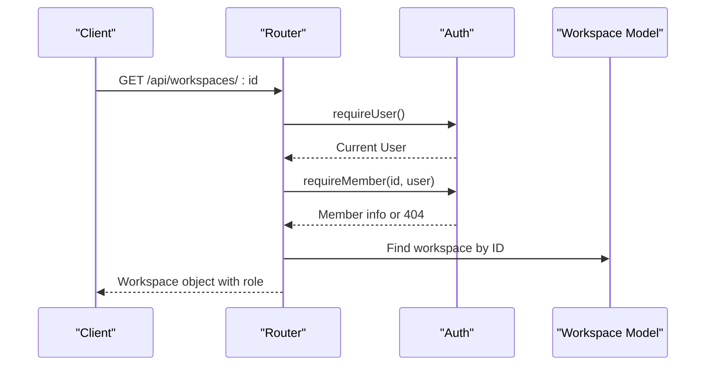

**Diagram sources**
- [workspaces.ts:44-54](file://phoenix-backend/src/routes/workspaces.ts#L44-L54)
- [auth.ts:29-34](file://phoenix-backend/src/lib/auth.ts#L29-L34)

**Section sources**
- [workspaces.ts:44-54](file://phoenix-backend/src/routes/workspaces.ts#L44-L54)
- [auth.ts:29-34](file://phoenix-backend/src/lib/auth.ts#L29-L34)

### Member Listing
- Endpoint: GET /api/workspaces/:id/members
- Authorization: Requires authenticated user who is a member of the workspace.
- Behavior:
  - Validates workspace ID and membership.
  - Retrieves all members with user details and roles.
- Response fields per member:
  - user_id, email, full_name, role

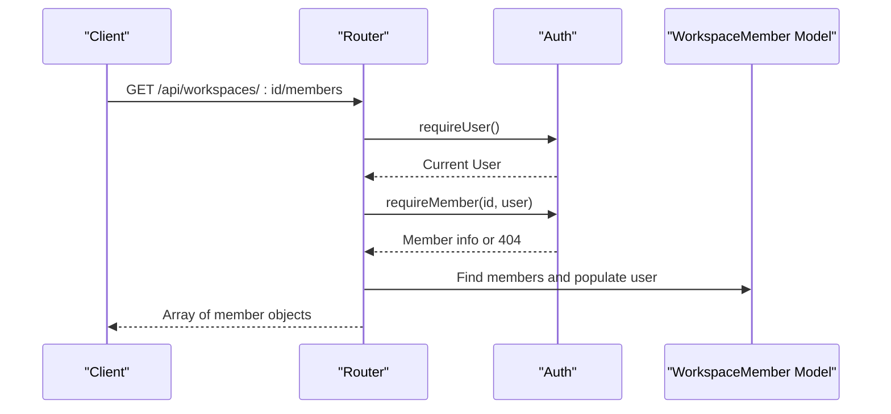

**Diagram sources**
- [workspaces.ts:56-75](file://phoenix-backend/src/routes/workspaces.ts#L56-L75)
- [auth.ts:29-34](file://phoenix-backend/src/lib/auth.ts#L29-L34)

**Section sources**
- [workspaces.ts:56-75](file://phoenix-backend/src/routes/workspaces.ts#L56-L75)
- [auth.ts:29-34](file://phoenix-backend/src/lib/auth.ts#L29-L34)

### Member Invitation
- Endpoint: POST /api/workspaces/:id/members
- Authorization: Requires authenticated user who is owner or admin.
- Behavior:
  - Validates workspace ID and actor role.
  - Validates request body (email and role).
  - Prevents assigning "owner" role to another user.
  - Looks up target user by email; returns 404 if not found.
  - Creates membership; handles duplicate key conflicts (returns 409).
- Request body:
  - email: string (3–255 characters)
  - role: one of "owner", "admin", "member" (default "member")
- Response:
  - user_id, email, full_name, role

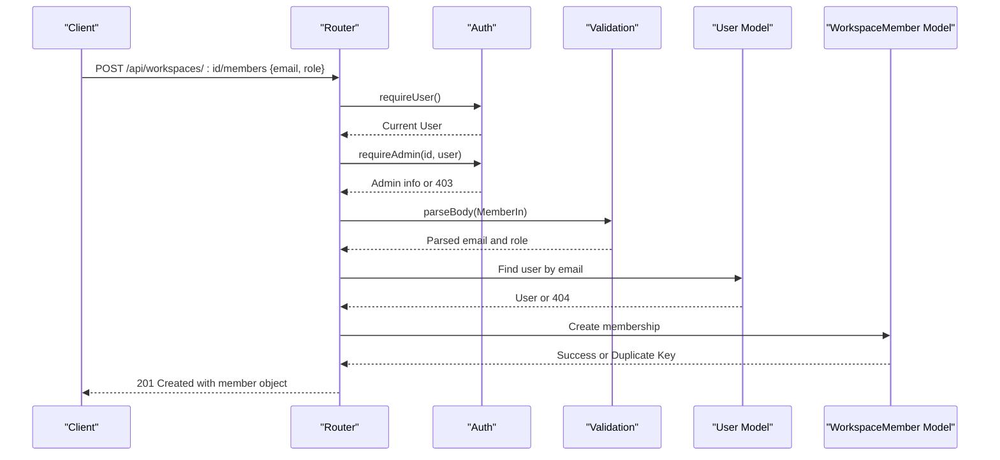

**Diagram sources**
- [workspaces.ts:77-102](file://phoenix-backend/src/routes/workspaces.ts#L77-L102)
- [schemas.ts:17-20](file://phoenix-backend/src/lib/schemas.ts#L17-L20)
- [http.ts:38-40](file://phoenix-backend/src/lib/http.ts#L38-L40)

**Section sources**
- [workspaces.ts:77-102](file://phoenix-backend/src/routes/workspaces.ts#L77-L102)
- [schemas.ts:17-20](file://phoenix-backend/src/lib/schemas.ts#L17-L20)
- [http.ts:38-40](file://phoenix-backend/src/lib/http.ts#L38-L40)

### Credit Balance Checking
- Endpoint: GET /api/workspaces/:id/credits
- Authorization: Requires authenticated user who is a member of the workspace.
- Behavior:
  - Validates workspace ID and membership.
  - Returns workspace ID and current credits balance.
- Response fields:
  - workspace_id, balance

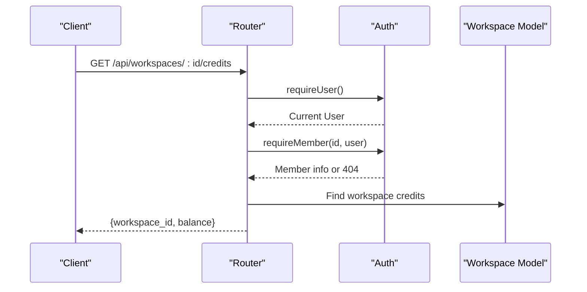

**Diagram sources**
- [workspaces.ts:104-113](file://phoenix-backend/src/routes/workspaces.ts#L104-L113)
- [auth.ts:29-34](file://phoenix-backend/src/lib/auth.ts#L29-L34)

**Section sources**
- [workspaces.ts:104-113](file://phoenix-backend/src/routes/workspaces.ts#L104-L113)
- [auth.ts:29-34](file://phoenix-backend/src/lib/auth.ts#L29-L34)

### Credit Top-Up
- Endpoint: POST /api/workspaces/:id/credits/topup
- Authorization: Requires authenticated user who is the workspace owner.
- Behavior:
  - Validates workspace ID and owner role.
  - Validates amount (positive integer, max 1000).
  - Increments workspace credits and records ledger entry.
- Request body:
  - amount: positive integer, maximum 1000
- Response:
  - workspace_id, balance

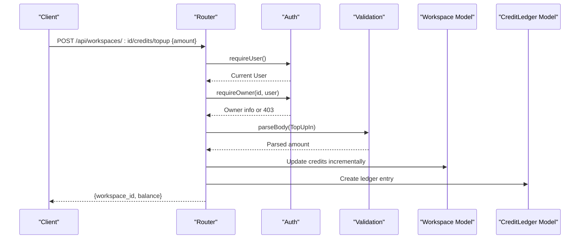

**Diagram sources**
- [workspaces.ts:115-127](file://phoenix-backend/src/routes/workspaces.ts#L115-L127)
- [schemas.ts:22-22](file://phoenix-backend/src/lib/schemas.ts#L22-L22)

**Section sources**
- [workspaces.ts:115-127](file://phoenix-backend/src/routes/workspaces.ts#L115-L127)
- [schemas.ts:22-22](file://phoenix-backend/src/lib/schemas.ts#L22-L22)

## Dependency Analysis
The workspace management endpoints depend on:
- Authentication middleware for user identity and role enforcement
- Zod schemas for input validation
- Mongoose models for data persistence
- Configuration for environment-driven defaults (e.g., welcome credits)
- HTTP helpers for consistent error handling and ID parsing

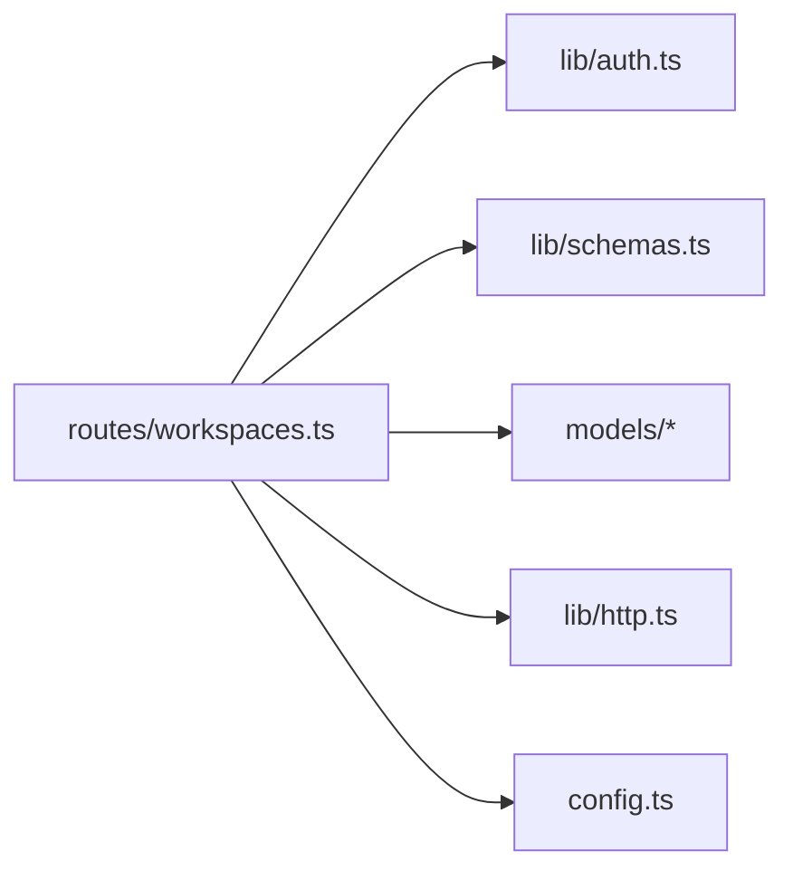

**Diagram sources**
- [workspaces.ts:1-128](file://phoenix-backend/src/routes/workspaces.ts#L1-L128)
- [auth.ts:1-58](file://phoenix-backend/src/lib/auth.ts#L1-L58)
- [schemas.ts:1-41](file://phoenix-backend/src/lib/schemas.ts#L1-L41)
- [http.ts:1-81](file://phoenix-backend/src/lib/http.ts#L1-L81)
- [config.ts:1-41](file://phoenix-backend/src/config.ts#L1-L41)

**Section sources**
- [workspaces.ts:1-128](file://phoenix-backend/src/routes/workspaces.ts#L1-L128)

## Performance Considerations
- Database queries are lean and targeted:
  - Workspace listing uses indexed membership lookups and sorts by ID.
  - Member listing populates only necessary user fields.
  - Credits balance reads only the credits field.
- Indexing:
  - WorkspaceMember has a unique index on workspace and user to prevent duplicates efficiently.
  - CreditLedger indexes workspace and idempotency key for fast lookups and deduplication.
- Validation overhead is minimal due to Zod’s efficient parsing.
- Avoid unnecessary population; only populate when returning member details.

[No sources needed since this section provides general guidance]

## Troubleshooting Guide
Common issues and resolutions:
- 401 Not authenticated: Ensure Bearer token is present and valid.
- 401 Invalid or expired token: Refresh or regenerate token.
- 403 Admin/Owner role required: Verify user role in workspace.
- 404 Workspace not found: Either workspace does not exist or user is not a member.
- 409 Conflict: Attempting to invite an existing member; check membership first.
- 422 Validation error: Inspect request body against schemas (name length, role enum, amount range).
- 400 Malformed JSON: Ensure proper JSON structure and encoding.

**Section sources**
- [http.ts:42-81](file://phoenix-backend/src/lib/http.ts#L42-L81)
- [workspaces.ts:77-102](file://phoenix-backend/src/routes/workspaces.ts#L77-L102)

## Conclusion
The workspace management API provides robust multi-tenant capabilities with clear role-based access control, validated inputs, and consistent error handling. It supports essential operations for managing workspaces, members, and credits, enabling secure and predictable workflows for team collaboration and resource allocation.

[No sources needed since this section summarizes without analyzing specific files]