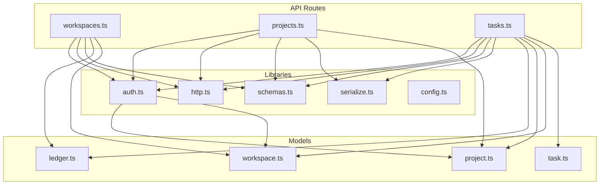
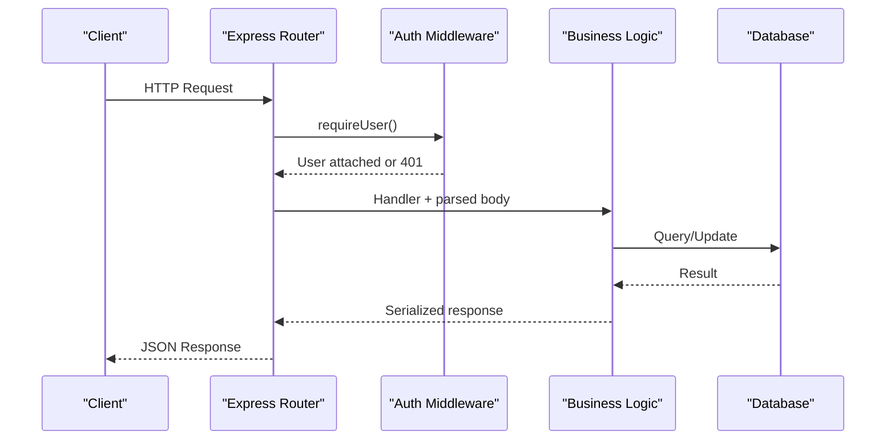
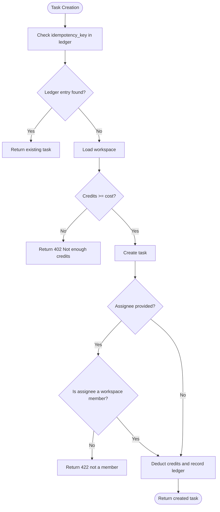
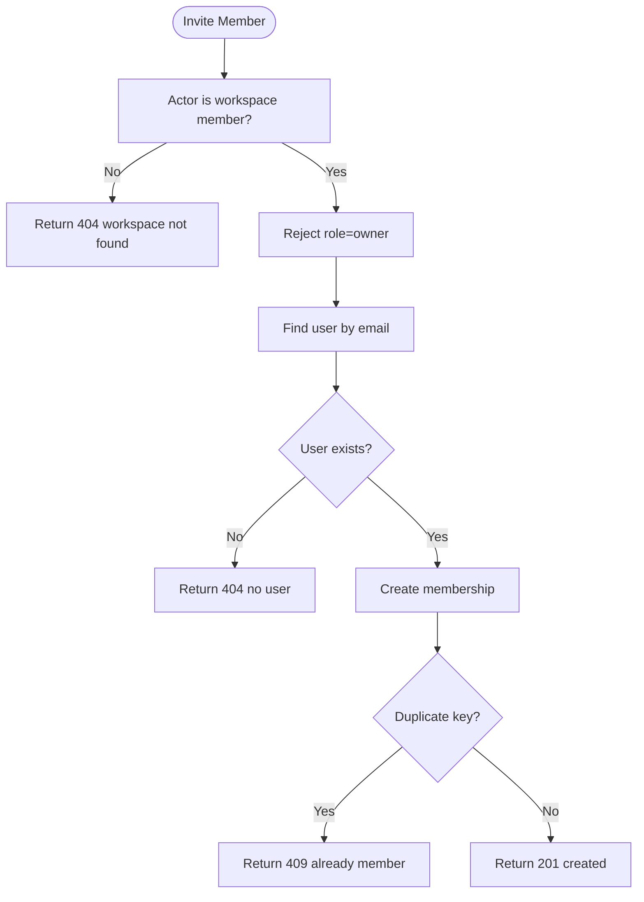
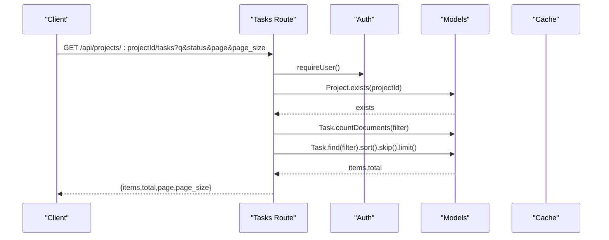
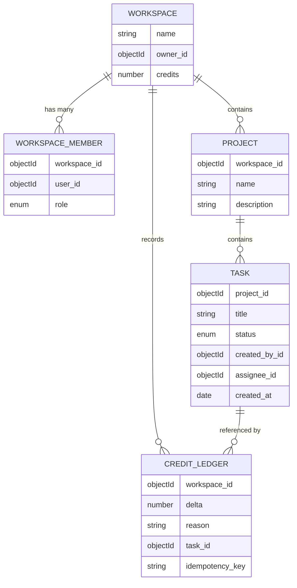
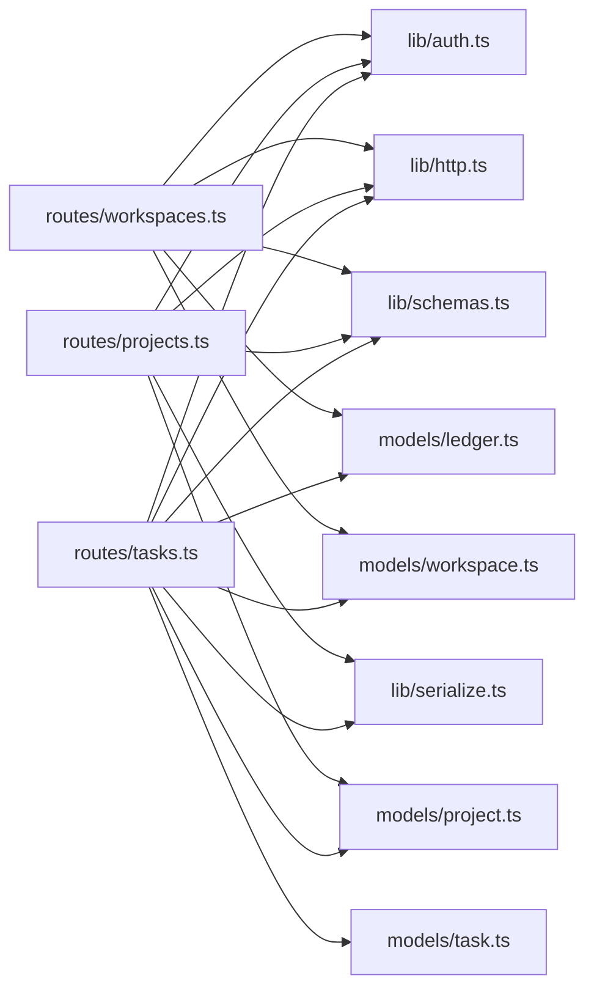

# Business Logic Layer

<cite>
**Referenced Files in This Document**
- [ledger.ts](file://phoenix-backend/src/models/ledger.ts)
- [workspace.ts](file://phoenix-backend/src/models/workspace.ts)
- [project.ts](file://phoenix-backend/src/models/project.ts)
- [task.ts](file://phoenix-backend/src/models/task.ts)
- [workspaces.ts](file://phoenix-backend/src/routes/workspaces.ts)
- [projects.ts](file://phoenix-backend/src/routes/projects.ts)
- [tasks.ts](file://phoenix-backend/src/routes/tasks.ts)
- [auth.ts](file://phoenix-backend/src/lib/auth.ts)
- [schemas.ts](file://phoenix-backend/src/lib/schemas.ts)
- [http.ts](file://phoenix-backend/src/lib/http.ts)
- [serialize.ts](file://phoenix-backend/src/lib/serialize.ts)
- [config.ts](file://phoenix-backend/src/config.ts)
</cite>

## Table of Contents
1. [Introduction](#introduction)
2. [Project Structure](#project-structure)
3. [Core Components](#core-components)
4. [Architecture Overview](#architecture-overview)
5. [Detailed Component Analysis](#detailed-component-analysis)
6. [Dependency Analysis](#dependency-analysis)
7. [Performance Considerations](#performance-considerations)
8. [Troubleshooting Guide](#troubleshooting-guide)
9. [Conclusion](#conclusion)

## Introduction
This document explains the business logic layer of Project Phoenix with a focus on core domain operations:
- Credit system: deduction, recording, balance calculation, and idempotency
- Workspace management: member invitation workflow, permission enforcement, owner/admin privileges
- Projects and tasks: creation workflows, validation rules, search/filtering
- Practical examples, edge cases, and performance considerations for complex operations

The backend is an Express application using Mongoose models, Zod-based input validation, and middleware for authentication and authorization.

## Project Structure
The business logic spans route handlers (controllers), shared libraries (auth, http utilities, serialization), data models, and configuration.

**Diagram sources**
- [workspaces.ts:1-126](file://phoenix-backend/src/routes/workspaces.ts#L1-L126)
- [projects.ts:1-50](file://phoenix-backend/src/routes/projects.ts#L1-L50)
- [tasks.ts:1-82](file://phoenix-backend/src/routes/tasks.ts#L1-L82)
- [auth.ts:1-58](file://phoenix-backend/src/lib/auth.ts#L1-L58)
- [http.ts:1-81](file://phoenix-backend/src/lib/http.ts#L1-L81)
- [schemas.ts:1-41](file://phoenix-backend/src/lib/schemas.ts#L1-L41)
- [serialize.ts:1-34](file://phoenix-backend/src/lib/serialize.ts#L1-L34)
- [config.ts:1-41](file://phoenix-backend/src/config.ts#L1-L41)
- [ledger.ts:1-19](file://phoenix-backend/src/models/ledger.ts#L1-L19)
- [workspace.ts:1-22](file://phoenix-backend/src/models/workspace.ts#L1-L22)
- [project.ts:1-12](file://phoenix-backend/src/models/project.ts#L1-L12)
- [task.ts:1-15](file://phoenix-backend/src/models/task.ts#L1-L15)

**Section sources**
- [workspaces.ts:1-126](file://phoenix-backend/src/routes/workspaces.ts#L1-L126)
- [projects.ts:1-50](file://phoenix-backend/src/routes/projects.ts#L1-L50)
- [tasks.ts:1-82](file://phoenix-backend/src/routes/tasks.ts#L1-L82)
- [auth.ts:1-58](file://phoenix-backend/src/lib/auth.ts#L1-L58)
- [http.ts:1-81](file://phoenix-backend/src/lib/http.ts#L1-L81)
- [schemas.ts:1-41](file://phoenix-backend/src/lib/schemas.ts#L1-L41)
- [serialize.ts:1-34](file://phoenix-backend/src/lib/serialize.ts#L1-L34)
- [config.ts:1-41](file://phoenix-backend/src/config.ts#L1-L41)
- [ledger.ts:1-19](file://phoenix-backend/src/models/ledger.ts#L1-L19)
- [workspace.ts:1-22](file://phoenix-backend/src/models/workspace.ts#L1-L22)
- [project.ts:1-12](file://phoenix-backend/src/models/project.ts#L1-L12)
- [task.ts:1-15](file://phoenix-backend/src/models/task.ts#L1-L15)

## Core Components
- Data models define entities and constraints:
  - Workspace, WorkspaceMember, Project, Task, CreditLedger
- Route handlers implement business workflows:
  - Workspaces: list, create, get details, members CRUD, credits top-up
  - Projects: list, create, get by id
  - Tasks: list with filtering/pagination, create with credit cost and idempotency
- Shared libraries:
  - Authentication and authorization helpers
  - HTTP error handling and parsing utilities
  - Input schemas via Zod
  - Response serializers to snake_case
  - Environment configuration with defaults

Key responsibilities:
- Enforce permissions at route level before any business logic executes
- Validate all inputs with strict schemas
- Record financial-like changes in an append-only ledger
- Provide idempotent task creation when a client retries requests

**Section sources**
- [workspace.ts:1-22](file://phoenix-backend/src/models/workspace.ts#L1-L22)
- [project.ts:1-12](file://phoenix-backend/src/models/project.ts#L1-L12)
- [task.ts:1-15](file://phoenix-backend/src/models/task.ts#L1-L15)
- [ledger.ts:1-19](file://phoenix-backend/src/models/ledger.ts#L1-L19)
- [workspaces.ts:1-126](file://phoenix-backend/src/routes/workspaces.ts#L1-L126)
- [projects.ts:1-50](file://phoenix-backend/src/routes/projects.ts#L1-L50)
- [tasks.ts:1-82](file://phoenix-backend/src/routes/tasks.ts#L1-L82)
- [auth.ts:1-58](file://phoenix-backend/src/lib/auth.ts#L1-L58)
- [http.ts:1-81](file://phoenix-backend/src/lib/http.ts#L1-L81)
- [schemas.ts:1-41](file://phoenix-backend/src/lib/schemas.ts#L1-L41)
- [serialize.ts:1-34](file://phoenix-backend/src/lib/serialize.ts#L1-L34)
- [config.ts:1-41](file://phoenix-backend/src/config.ts#L1-L41)

## Architecture Overview
The request flow follows a layered approach:
1. Request enters Express router
2. Authentication middleware validates token and attaches current user
3. Authorization middleware checks workspace membership or role
4. Input validation ensures schema compliance
5. Business logic performs domain operations and persists state
6. Response is serialized to public contract format

**Diagram sources**
- [auth.ts:8-23](file://phoenix-backend/src/lib/auth.ts#L8-L23)
- [http.ts:12-18](file://phoenix-backend/src/lib/http.ts#L12-L18)
- [workspaces.ts:18-42](file://phoenix-backend/src/routes/workspaces.ts#L18-L42)
- [projects.ts:11-43](file://phoenix-backend/src/routes/projects.ts#L11-L43)
- [tasks.ts:12-81](file://phoenix-backend/src/routes/tasks.ts#L12-L81)

## Detailed Component Analysis

### Credit System Implementation
The credit system tracks workspace balances and records every change in an append-only ledger.

- Balance storage:
  - Workspace model stores numeric credits with non-negative default
- Ledger model:
  - Append-only entries with delta, reason, optional task reference, and optional idempotency key
  - Unique index on (workspace, idempotencyKey) where idempotencyKey is present
- Top-up:
  - Increments workspace.credits atomically and appends a ledger entry
- Deduction:
  - Occurs during task creation; deducts configured TASK_CREDIT_COST
  - Records negative delta in ledger with task reference and idempotency key
- Idempotency:
  - If a previous ledger entry exists for the same workspace and idempotency key, the original task is returned without re-deducting credits
- Balance query:
  - Returns current workspace.credits after reading the workspace document

**Diagram sources**
- [tasks.ts:34-81](file://phoenix-backend/src/routes/tasks.ts#L34-L81)
- [ledger.ts:1-19](file://phoenix-backend/src/models/ledger.ts#L1-L19)
- [workspace.ts:5-12](file://phoenix-backend/src/models/workspace.ts#L5-L12)
- [config.ts:10-11](file://phoenix-backend/src/config.ts#L10-L11)

Practical examples:
- Top-up endpoint increments balance and logs a positive delta
- Task creation endpoint enforces sufficient balance, validates assignee membership, and records a negative delta
- Duplicate idempotency keys return the previously created task without additional charges

Edge cases:
- Negative balance guard prevents deductions when credits are insufficient
- Non-member assignee rejected with validation error
- Invalid idempotency key usage does not bypass duplicate detection due to unique index

Performance considerations:
- Ledger index on (workspace, idempotencyKey) enables fast idempotency lookups
- Atomic increment for top-ups reduces contention
- Avoid repeated reads by caching project lists where appropriate

**Section sources**
- [tasks.ts:34-81](file://phoenix-backend/src/routes/tasks.ts#L34-L81)
- [workspaces.ts:103-125](file://phoenix-backend/src/routes/workspaces.ts#L103-L125)
- [ledger.ts:1-19](file://phoenix-backend/src/models/ledger.ts#L1-L19)
- [workspace.ts:5-12](file://phoenix-backend/src/models/workspace.ts#L5-L12)
- [config.ts:10-11](file://phoenix-backend/src/config.ts#L10-L11)

### Workspace Management Business Rules
Workspace management covers membership, roles, and privilege enforcement.

- Roles:
  - owner, admin, member
- Member invitation workflow:
  - Actor must be a workspace member
  - Target email must exist in users
  - Role cannot be set to owner (only one owner per workspace)
  - Duplicate membership is detected via unique index and returns conflict
- Permission enforcement:
  - requireMember ensures the caller has any membership; missing membership returns 404 to avoid leaking existence
  - requireAdmin requires owner or admin role
  - requireOwner restricts to owner role only
- Owner privileges:
  - Creating a workspace automatically sets creator as owner and grants initial welcome credits
- Admin privileges:
  - Used to protect sensitive operations requiring elevated permissions

**Diagram sources**
- [workspaces.ts:77-101](file://phoenix-backend/src/routes/workspaces.ts#L77-L101)
- [auth.ts:29-50](file://phoenix-backend/src/lib/auth.ts#L29-L50)
- [workspace.ts:3-21](file://phoenix-backend/src/models/workspace.ts#L3-L21)

Practical examples:
- Inviting a new member with role member succeeds
- Attempting to assign role owner fails with bad request
- Re-inviting an existing member returns conflict

Edge cases:
- Missing membership returns 404 rather than 403 to prevent enumeration
- Duplicate membership handled gracefully with conflict status

Performance considerations:
- Membership lookup uses indexed fields (workspace, user)
- Populate used for listing members to include user details efficiently

**Section sources**
- [workspaces.ts:77-101](file://phoenix-backend/src/routes/workspaces.ts#L77-L101)
- [auth.ts:29-50](file://phoenix-backend/src/lib/auth.ts#L29-L50)
- [workspace.ts:3-21](file://phoenix-backend/src/models/workspace.ts#L3-L21)

### Projects and Tasks Operations
Projects and tasks provide core collaboration features with validation and search.

- Projects:
  - List projects within a workspace with caching
  - Create projects with validated name and description
  - Get project by id with membership check
- Tasks:
  - List tasks with filtering by title substring and status, plus pagination
  - Create tasks with credit cost and idempotency support
  - Validate assignee membership if provided

Validation rules:
- Workspace name length limits
- Project name and description lengths
- Task title length and allowed statuses
- Pagination parameters bounded and coerced

Search and filtering:
- Title search uses case-insensitive regex
- Status filter matches enum values
- Pagination uses page and page_size with safe defaults

**Diagram sources**
- [tasks.ts:12-32](file://phoenix-backend/src/routes/tasks.ts#L12-L32)
- [schemas.ts:35-40](file://phoenix-backend/src/lib/schemas.ts#L35-L40)

Practical examples:
- Listing tasks with q=search term and status=in_progress returns filtered results
- Creating a task with valid title and optional assignee triggers credit deduction and ledger recording
- Project list endpoint returns cached results when available

Edge cases:
- Project not found returns 404 before processing task queries
- Invalid pagination values are coerced and bounded by schema
- Assignee not a workspace member returns validation error

Performance considerations:
- Project list caching avoids repeated database queries
- Task queries use indexes on project and createdAt
- CountDocuments provides efficient total counts for pagination

**Section sources**
- [projects.ts:11-49](file://phoenix-backend/src/routes/projects.ts#L11-L49)
- [tasks.ts:12-81](file://phoenix-backend/src/routes/tasks.ts#L12-L81)
- [schemas.ts:24-40](file://phoenix-backend/src/lib/schemas.ts#L24-L40)

### Data Models and Relationships
The domain models define the structure and constraints for workspaces, projects, tasks, and credit history.

**Diagram sources**
- [workspace.ts:5-21](file://phoenix-backend/src/models/workspace.ts#L5-L21)
- [project.ts:3-11](file://phoenix-backend/src/models/project.ts#L3-L11)
- [task.ts:5-14](file://phoenix-backend/src/models/task.ts#L5-L14)
- [ledger.ts:4-17](file://phoenix-backend/src/models/ledger.ts#L4-L17)

**Section sources**
- [workspace.ts:1-22](file://phoenix-backend/src/models/workspace.ts#L1-L22)
- [project.ts:1-12](file://phoenix-backend/src/models/project.ts#L1-L12)
- [task.ts:1-15](file://phoenix-backend/src/models/task.ts#L1-L15)
- [ledger.ts:1-19](file://phoenix-backend/src/models/ledger.ts#L1-L19)

## Dependency Analysis
The following diagram shows how routes depend on libraries and models.

**Diagram sources**
- [workspaces.ts:1-126](file://phoenix-backend/src/routes/workspaces.ts#L1-L126)
- [projects.ts:1-50](file://phoenix-backend/src/routes/projects.ts#L1-L50)
- [tasks.ts:1-82](file://phoenix-backend/src/routes/tasks.ts#L1-L82)
- [auth.ts:1-58](file://phoenix-backend/src/lib/auth.ts#L1-L58)
- [http.ts:1-81](file://phoenix-backend/src/lib/http.ts#L1-L81)
- [schemas.ts:1-41](file://phoenix-backend/src/lib/schemas.ts#L1-L41)
- [serialize.ts:1-34](file://phoenix-backend/src/lib/serialize.ts#L1-L34)
- [ledger.ts:1-19](file://phoenix-backend/src/models/ledger.ts#L1-L19)
- [workspace.ts:1-22](file://phoenix-backend/src/models/workspace.ts#L1-L22)
- [project.ts:1-12](file://phoenix-backend/src/models/project.ts#L1-L12)
- [task.ts:1-15](file://phoenix-backend/src/models/task.ts#L1-L15)

**Section sources**
- [workspaces.ts:1-126](file://phoenix-backend/src/routes/workspaces.ts#L1-L126)
- [projects.ts:1-50](file://phoenix-backend/src/routes/projects.ts#L1-L50)
- [tasks.ts:1-82](file://phoenix-backend/src/routes/tasks.ts#L1-L82)
- [auth.ts:1-58](file://phoenix-backend/src/lib/auth.ts#L1-L58)
- [http.ts:1-81](file://phoenix-backend/src/lib/http.ts#L1-L81)
- [schemas.ts:1-41](file://phoenix-backend/src/lib/schemas.ts#L1-L41)
- [serialize.ts:1-34](file://phoenix-backend/src/lib/serialize.ts#L1-L34)
- [ledger.ts:1-19](file://phoenix-backend/src/models/ledger.ts#L1-L19)
- [workspace.ts:1-22](file://phoenix-backend/src/models/workspace.ts#L1-L22)
- [project.ts:1-12](file://phoenix-backend/src/models/project.ts#L1-L12)
- [task.ts:1-15](file://phoenix-backend/src/models/task.ts#L1-L15)

## Performance Considerations
- Caching:
  - Project list endpoint caches results keyed by workspace id to reduce database load
- Indexes:
  - WorkspaceMember composite index on (workspace, user) supports fast membership checks
  - Task index on (project, createdAt, _id) optimizes listing and sorting
  - CreditLedger unique partial index on (workspace, idempotencyKey) ensures fast idempotency checks
- Validation:
  - Zod schemas enforce bounds and types early, preventing expensive downstream operations
- Atomic updates:
  - Workspace credit top-up uses atomic increment to minimize race conditions
- Pagination:
  - Task listing uses countDocuments and skip/limit to handle large datasets efficiently

[No sources needed since this section provides general guidance]

## Troubleshooting Guide
Common errors and their causes:
- 401 Not authenticated:
  - Missing or invalid Authorization header or token
- 401 Invalid or expired token:
  - Token verification failed
- 404 Workspace not found:
  - Caller not a member or invalid workspace id
- 409 User is already a member:
  - Duplicate membership attempt
- 422 Validation error:
  - Invalid input payload according to Zod schema
- 402 Not enough credits:
  - Insufficient workspace balance for task creation
- 422 Assignee is not a workspace member:
  - Assignee not part of workspace

Error handling utilities:
- HttpError wraps status codes and details
- asyncHandler catches promise rejections
- parseBody throws structured validation errors
- errorHandler maps various error types to consistent responses

**Section sources**
- [http.ts:5-81](file://phoenix-backend/src/lib/http.ts#L5-L81)
- [auth.ts:8-23](file://phoenix-backend/src/lib/auth.ts#L8-L23)
- [workspaces.ts:77-101](file://phoenix-backend/src/routes/workspaces.ts#L77-L101)
- [tasks.ts:34-81](file://phoenix-backend/src/routes/tasks.ts#L34-L81)

## Conclusion
The business logic layer implements robust domain operations for credits, workspace management, projects, and tasks. It emphasizes:
- Strict input validation and clear error signaling
- Permission enforcement through reusable auth helpers
- Append-only financial tracking with idempotency guarantees
- Efficient querying and caching strategies

These patterns ensure correctness, safety, and scalability for complex operations while remaining accessible to developers integrating with the API.

[No sources needed since this section summarizes without analyzing specific files]