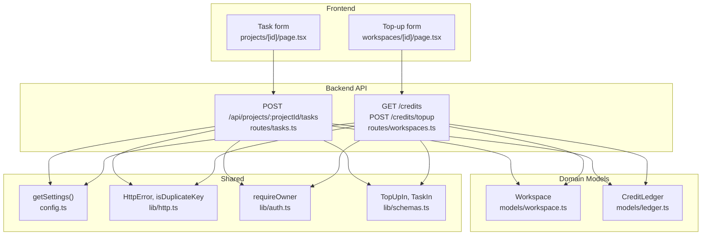
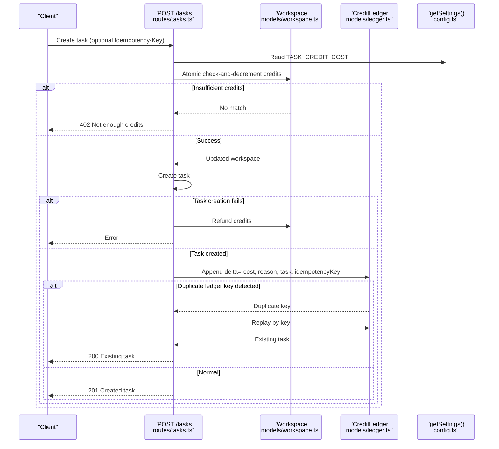
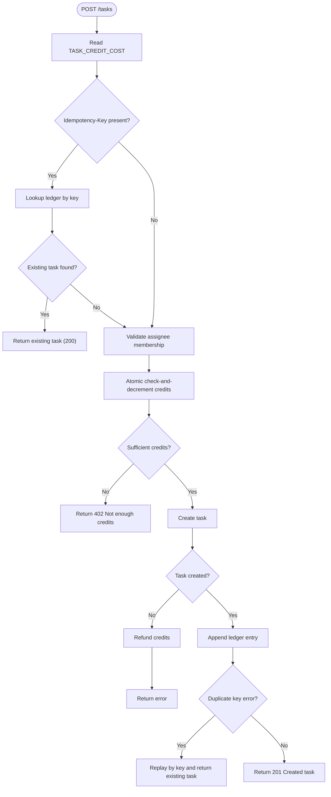
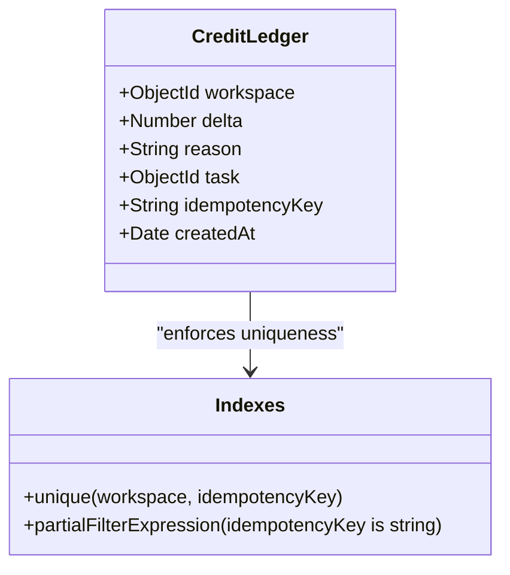
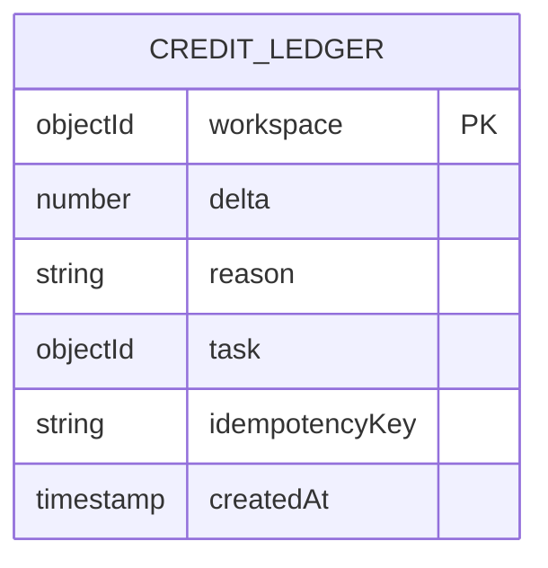
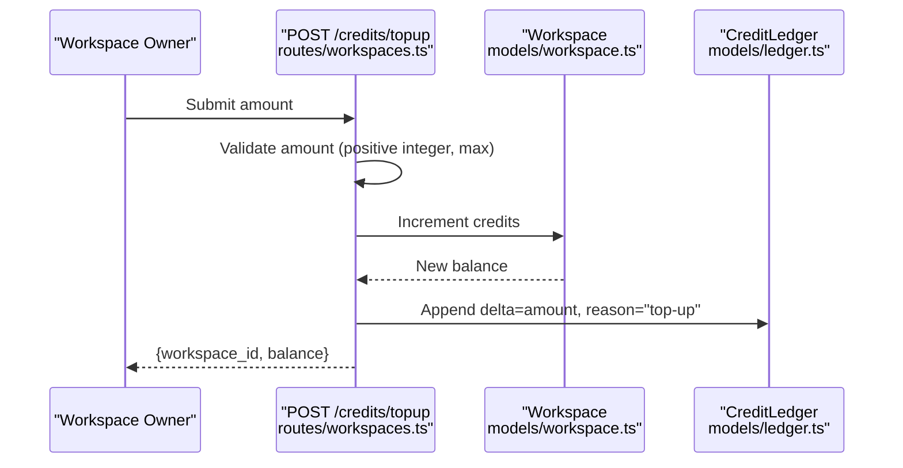
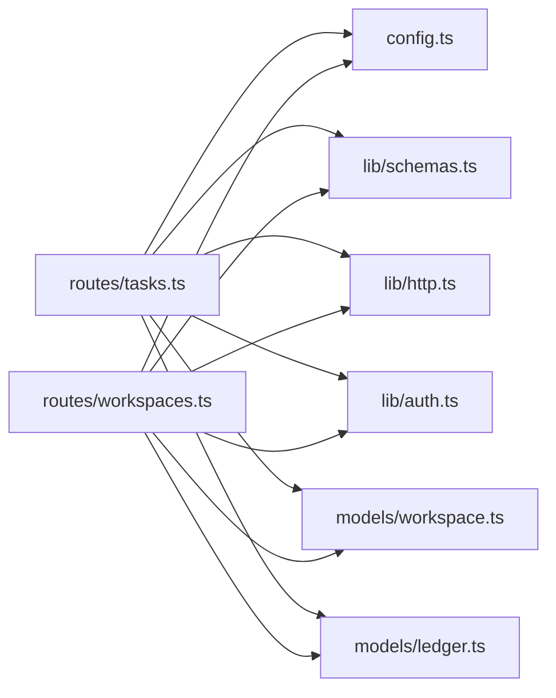

# Credit System

<cite>
**Referenced Files in This Document**
- [tasks.ts](file://phoenix-backend/src/routes/tasks.ts)
- [workspaces.ts](file://phoenix-backend/src/routes/workspaces.ts)
- [ledger.ts](file://phoenix-backend/src/models/ledger.ts)
- [workspace.ts](file://phoenix-backend/src/models/workspace.ts)
- [config.ts](file://phoenix-backend/src/config.ts)
- [schemas.ts](file://phoenix-backend/src/lib/schemas.ts)
- [http.ts](file://phoenix-backend/src/lib/http.ts)
- [auth.ts](file://phoenix-backend/src/lib/auth.ts)
- [page.tsx](file://phoenix-frontend/src/app/projects/[id]/page.tsx)
- [page.tsx](file://phoenix-frontend/src/app/workspaces/[id]/page.tsx)
- [smoke.test.ts](file://phoenix-backend/tests/smoke.test.ts)
</cite>

## Table of Contents
1. [Introduction](#introduction)
2. [Project Structure](#project-structure)
3. [Core Components](#core-components)
4. [Architecture Overview](#architecture-overview)
5. [Detailed Component Analysis](#detailed-component-analysis)
6. [Dependency Analysis](#dependency-analysis)
7. [Performance Considerations](#performance-considerations)
8. [Troubleshooting Guide](#troubleshooting-guide)
9. [Conclusion](#conclusion)

## Introduction
This document explains the credit system business logic used to charge workspaces for task creation, top up credits, and maintain an auditable ledger. It covers:
- How task creation deducts credits based on configuration.
- Idempotency support using idempotency keys to prevent duplicate charges.
- The credit ledger audit trail with reasons and timestamps.
- Workspace credit balance management, validation, and error handling.
- Practical workflows for top-ups, transaction recording, and concurrent operations.

## Project Structure
The credit system spans backend routes, models, configuration, shared HTTP utilities, and a small frontend surface for creating tasks and topping up credits.

**Diagram sources**
- [tasks.ts:38-126](file://phoenix-backend/src/routes/tasks.ts#L38-L126)
- [workspaces.ts:104-127](file://phoenix-backend/src/routes/workspaces.ts#L104-L127)
- [workspace.ts:5-13](file://phoenix-backend/src/models/workspace.ts#L5-L13)
- [ledger.ts:4-18](file://phoenix-backend/src/models/ledger.ts#L4-L18)
- [config.ts:28-40](file://phoenix-backend/src/config.ts#L28-L40)
- [http.ts:5-40](file://phoenix-backend/src/lib/http.ts#L5-L40)
- [auth.ts:44-50](file://phoenix-backend/src/lib/auth.ts#L44-L50)
- [schemas.ts:22-33](file://phoenix-backend/src/lib/schemas.ts#L22-L33)
- [page.tsx](file://phoenix-frontend/src/app/projects/[id]/page.tsx)
- [page.tsx](file://phoenix-frontend/src/app/workspaces/[id]/page.tsx)

**Section sources**
- [tasks.ts:38-126](file://phoenix-backend/src/routes/tasks.ts#L38-L126)
- [workspaces.ts:104-127](file://phoenix-backend/src/routes/workspaces.ts#L104-L127)
- [workspace.ts:5-13](file://phoenix-backend/src/models/workspace.ts#L5-L13)
- [ledger.ts:4-18](file://phoenix-backend/src/models/ledger.ts#L4-L18)
- [config.ts:28-40](file://phoenix-backend/src/config.ts#L28-L40)
- [http.ts:5-40](file://phoenix-backend/src/lib/http.ts#L5-L40)
- [auth.ts:44-50](file://phoenix-backend/src/lib/auth.ts#L44-L50)
- [schemas.ts:22-33](file://phoenix-backend/src/lib/schemas.ts#L22-L33)
- [page.tsx](file://phoenix-frontend/src/app/projects/[id]/page.tsx)
- [page.tsx](file://phoenix-frontend/src/app/workspaces/[id]/page.tsx)

## Core Components
- Task creation route enforces credit deduction, idempotency, and ledger recording.
- Workspace routes expose credit balance and owner-only top-up functionality.
- Workspace model stores the current credit balance with non-negative constraint.
- Ledger model records every credit change as an append-only entry with reason, optional task reference, and optional idempotency key.
- Configuration provides cost per task and welcome credits.
- Shared utilities provide typed parsing, error mapping, and duplicate-key detection.

**Section sources**
- [tasks.ts:38-126](file://phoenix-backend/src/routes/tasks.ts#L38-L126)
- [workspaces.ts:104-127](file://phoenix-backend/src/routes/workspaces.ts#L104-L127)
- [workspace.ts:5-13](file://phoenix-backend/src/models/workspace.ts#L5-L13)
- [ledger.ts:4-18](file://phoenix-backend/src/models/ledger.ts#L4-L18)
- [config.ts:4-14](file://phoenix-backend/src/config.ts#L4-L14)
- [http.ts:5-40](file://phoenix-backend/src/lib/http.ts#L5-L40)

## Architecture Overview
The credit flow centers around two main operations:
- Deducting credits when creating a task.
- Adding credits via an owner-only top-up endpoint.

Both operations update the workspace balance and record an immutable ledger entry.

**Diagram sources**
- [tasks.ts:38-126](file://phoenix-backend/src/routes/tasks.ts#L38-L126)
- [workspace.ts:5-13](file://phoenix-backend/src/models/workspace.ts#L5-L13)
- [ledger.ts:4-18](file://phoenix-backend/src/models/ledger.ts#L4-L18)
- [config.ts:28-40](file://phoenix-backend/src/config.ts#L28-L40)

## Detailed Component Analysis

### Credit Deduction During Task Creation
- Cost calculation: The task creation route reads the configured cost from settings and uses it to validate and deduct workspace credits.
- Pre-validation: Assignee membership is validated before any credit is spent to avoid unnecessary deductions.
- Atomic deduction: Uses a single database operation that checks sufficient balance and decrements in one step to prevent race conditions.
- Transaction safety: If task creation fails after deduction, credits are refunded. If ledger recording fails, the task is deleted and credits are refunded.
- Idempotency: When an idempotency key is provided, the route replays previous successful results instead of charging again.

**Diagram sources**
- [tasks.ts:38-126](file://phoenix-backend/src/routes/tasks.ts#L38-L126)

**Section sources**
- [tasks.ts:38-126](file://phoenix-backend/src/routes/tasks.ts#L38-L126)
- [config.ts:28-40](file://phoenix-backend/src/config.ts#L28-L40)
- [schemas.ts:29-33](file://phoenix-backend/src/lib/schemas.ts#L29-L33)

### Idempotency Support Using Idempotency Keys
- Header usage: Clients can send an `Idempotency-Key` header to make repeated requests safe.
- Early replay: If a ledger entry exists for the key and references a task, the original task is returned without recharging.
- Unique index: The ledger has a unique composite index on workspace and idempotency key, ensuring only one successful charge per key per workspace.
- Concurrent handling: If two requests race and both attempt to create a ledger entry, the duplicate key error triggers a replay path that returns the winning request’s result.

**Diagram sources**
- [ledger.ts:4-18](file://phoenix-backend/src/models/ledger.ts#L4-L18)

**Section sources**
- [tasks.ts:47-66](file://phoenix-backend/src/routes/tasks.ts#L47-L66)
- [tasks.ts:101-122](file://phoenix-backend/src/routes/tasks.ts#L101-L122)
- [ledger.ts:14-17](file://phoenix-backend/src/models/ledger.ts#L14-L17)
- [http.ts:38-40](file://phoenix-backend/src/lib/http.ts#L38-L40)

### Credit Ledger Audit Trail
- Append-only design: Every credit movement is recorded as a new row with a signed delta.
- Reasons: Each entry includes a human-readable reason such as task creation or top-up.
- References: Entries may link to the affected task for traceability.
- Timestamps: Entries include creation time for auditing.
- Idempotency linkage: Entries may carry the idempotency key used during the operation.

**Diagram sources**
- [ledger.ts:4-18](file://phoenix-backend/src/models/ledger.ts#L4-L18)

**Section sources**
- [ledger.ts:4-18](file://phoenix-backend/src/models/ledger.ts#L4-L18)
- [tasks.ts:101-108](file://phoenix-backend/src/routes/tasks.ts#L101-L108)
- [workspaces.ts:123-124](file://phoenix-backend/src/routes/workspaces.ts#L123-L124)

### Workspace Credit Balance Management
- Balance storage: The workspace model stores a numeric credit field constrained to be non-negative.
- Reading balance: A dedicated endpoint returns the current balance for members.
- Top-up workflow: Only the workspace owner can add credits; the amount is validated and applied atomically, followed by a ledger entry.
- Validation: Input amounts are validated to be positive integers within allowed limits.

**Diagram sources**
- [workspaces.ts:115-127](file://phoenix-backend/src/routes/workspaces.ts#L115-L127)
- [workspace.ts:5-13](file://phoenix-backend/src/models/workspace.ts#L5-L13)
- [schemas.ts:22-22](file://phoenix-backend/src/lib/schemas.ts#L22-L22)

**Section sources**
- [workspaces.ts:104-127](file://phoenix-backend/src/routes/workspaces.ts#L104-L127)
- [workspace.ts:5-13](file://phoenix-backend/src/models/workspace.ts#L5-L13)
- [schemas.ts:22-22](file://phoenix-backend/src/lib/schemas.ts#L22-L22)
- [auth.ts:44-50](file://phoenix-backend/src/lib/auth.ts#L44-L50)

### Configuration-Based Cost Calculation
- Settings schema defines `TASK_CREDIT_COST` as a positive integer with a default value.
- The task creation route reads this setting to determine how many credits to deduct per task.
- Changing the environment variable updates the cost for subsequent task creations.

**Section sources**
- [config.ts:4-14](file://phoenix-backend/src/config.ts#L4-L14)
- [config.ts:28-40](file://phoenix-backend/src/config.ts#L28-L40)
- [tasks.ts:47-48](file://phoenix-backend/src/routes/tasks.ts#L47-L48)

### Frontend Integration Examples
- Creating a task: The project page shows a simple form indicating that each task costs credits and submits a POST request to create a task.
- Topping up credits: The workspace detail page exposes a form for owners to add credits, displaying feedback messages for success or errors.

**Section sources**
- [page.tsx](file://phoenix-frontend/src/app/projects/[id]/page.tsx)
- [page.tsx](file://phoenix-frontend/src/app/workspaces/[id]/page.tsx)

### Edge Cases and Concurrency Handling
- Insufficient credits: Returns a clear 402 response when the workspace lacks enough credits.
- Assignee not a member: Prevents task creation with a 422 error before spending credits.
- Task creation failure after deduction: Automatically refunds credits to keep balances consistent.
- Ledger duplicate key: On concurrent attempts with the same idempotency key, the system replays the winning request’s result rather than charging twice.
- Non-owner top-up: Enforced by requiring the owner role before allowing credit additions.

**Section sources**
- [tasks.ts:68-81](file://phoenix-backend/src/routes/tasks.ts#L68-L81)
- [tasks.ts:87-122](file://phoenix-backend/src/routes/tasks.ts#L87-L122)
- [workspaces.ts:115-127](file://phoenix-backend/src/routes/workspaces.ts#L115-L127)
- [http.ts:38-40](file://phoenix-backend/src/lib/http.ts#L38-L40)

## Dependency Analysis
The credit system depends on several modules:
- Routes depend on configuration for cost values, schemas for input validation, and shared HTTP utilities for error handling.
- Task creation depends on workspace and ledger models for balance updates and audit trails.
- Workspace top-up depends on authorization helpers to enforce ownership.

**Diagram sources**
- [tasks.ts:1-8](file://phoenix-backend/src/routes/tasks.ts#L1-L8)
- [workspaces.ts:1-6](file://phoenix-backend/src/routes/workspaces.ts#L1-L6)
- [config.ts:28-40](file://phoenix-backend/src/config.ts#L28-L40)
- [schemas.ts:22-33](file://phoenix-backend/src/lib/schemas.ts#L22-L33)
- [http.ts:5-40](file://phoenix-backend/src/lib/http.ts#L5-L40)
- [auth.ts:44-50](file://phoenix-backend/src/lib/auth.ts#L44-L50)
- [workspace.ts:5-13](file://phoenix-backend/src/models/workspace.ts#L5-L13)
- [ledger.ts:4-18](file://phoenix-backend/src/models/ledger.ts#L4-L18)

**Section sources**
- [tasks.ts:1-8](file://phoenix-backend/src/routes/tasks.ts#L1-L8)
- [workspaces.ts:1-6](file://phoenix-backend/src/routes/workspaces.ts#L1-L6)
- [config.ts:28-40](file://phoenix-backend/src/config.ts#L28-L40)
- [schemas.ts:22-33](file://phoenix-backend/src/lib/schemas.ts#L22-L33)
- [http.ts:5-40](file://phoenix-backend/src/lib/http.ts#L5-L40)
- [auth.ts:44-50](file://phoenix-backend/src/lib/auth.ts#L44-L50)
- [workspace.ts:5-13](file://phoenix-backend/src/models/workspace.ts#L5-L13)
- [ledger.ts:4-18](file://phoenix-backend/src/models/ledger.ts#L4-L18)

## Performance Considerations
- Atomic credit deduction: Using a single database operation reduces contention and prevents double-spending.
- Indexed queries: The ledger’s composite index on workspace and idempotency key ensures fast lookups and uniqueness enforcement.
- Minimal payload: The balance endpoint projects only the credits field to reduce data transfer.
- Pagination: Task listing uses pagination to limit memory and network overhead.

[No sources needed since this section provides general guidance]

## Troubleshooting Guide
Common issues and resolutions:
- 402 Not enough credits: Indicates insufficient workspace balance; resolve by topping up credits.
- 422 Assignee not a workspace member: Ensure the assignee is added as a workspace member before creating tasks.
- Duplicate key errors: Occur when multiple requests use the same idempotency key; the system handles this by returning the existing task.
- Invalid top-up amount: Ensure the amount is a positive integer within allowed limits.
- Non-owner top-up attempts: Only workspace owners can add credits; verify user role.

**Section sources**
- [tasks.ts:68-81](file://phoenix-backend/src/routes/tasks.ts#L68-L81)
- [tasks.ts:101-122](file://phoenix-backend/src/routes/tasks.ts#L101-L122)
- [workspaces.ts:115-127](file://phoenix-backend/src/routes/workspaces.ts#L115-L127)
- [http.ts:47-80](file://phoenix-backend/src/lib/http.ts#L47-L80)

## Conclusion
The credit system implements a robust, auditable mechanism for charging workspaces for task creation and adding credits through an owner-only top-up process. It leverages atomic database operations, idempotency keys, and an append-only ledger to ensure correctness under concurrency and provide full traceability. Configuration-driven costs allow flexible pricing policies, while comprehensive validation and error handling improve reliability and user experience.

[No sources needed since this section summarizes without analyzing specific files]