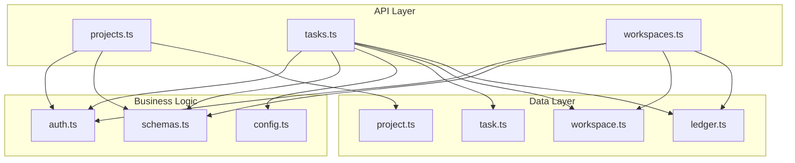
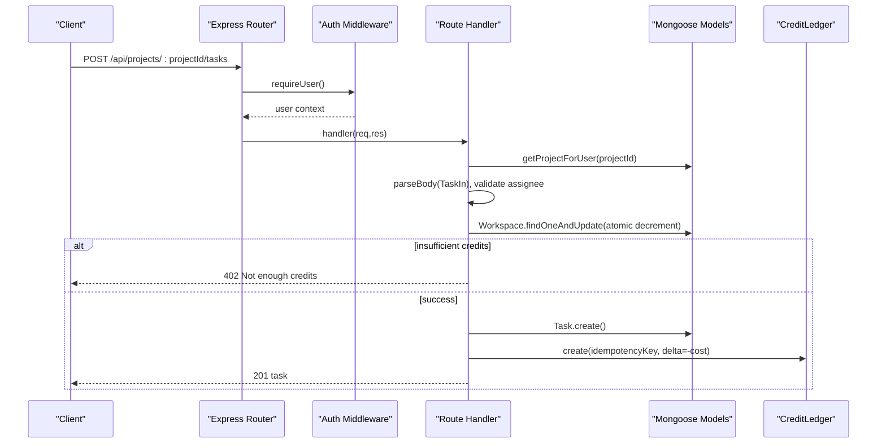
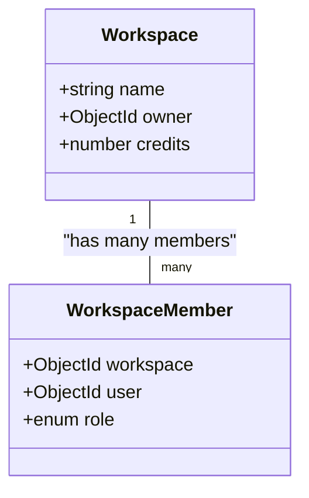
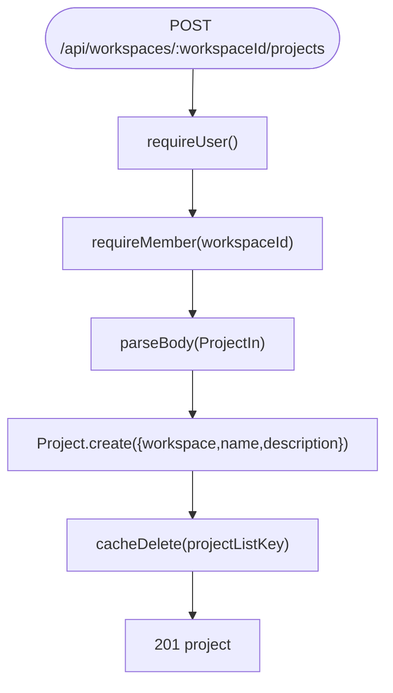
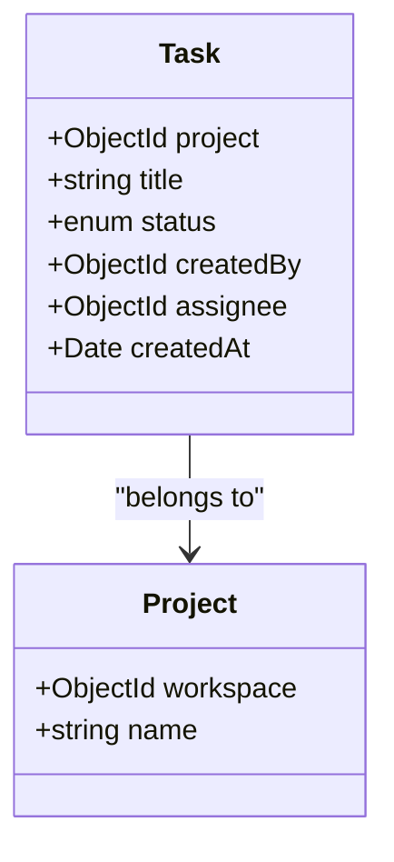
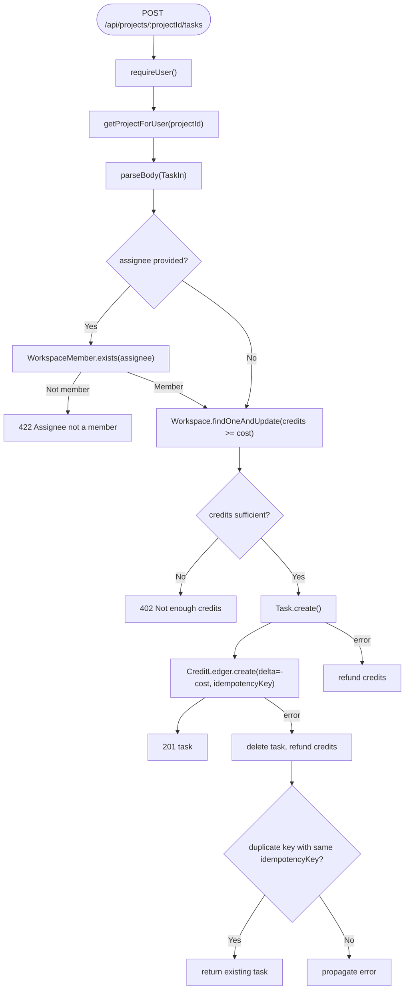
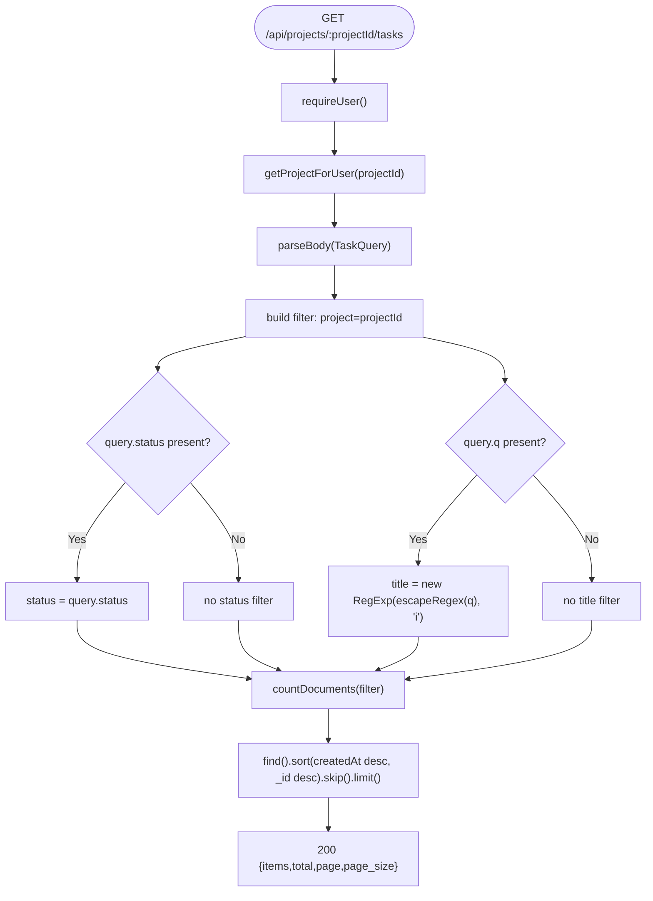
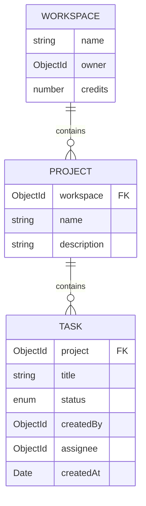
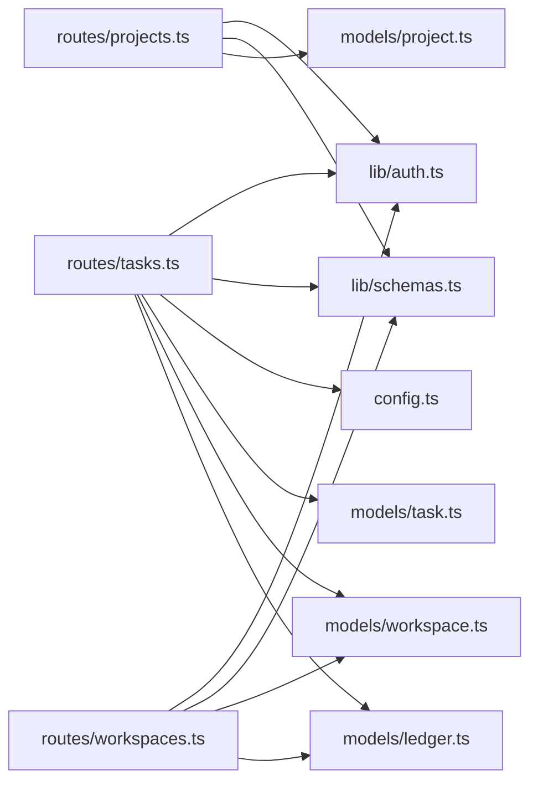

# Project & Task Operations

<cite>
**Referenced Files in This Document**
- [project.ts](file://phoenix-backend/src/models/project.ts)
- [task.ts](file://phoenix-backend/src/models/task.ts)
- [workspace.ts](file://phoenix-backend/src/models/workspace.ts)
- [ledger.ts](file://phoenix-backend/src/models/ledger.ts)
- [projects.ts](file://phoenix-backend/src/routes/projects.ts)
- [tasks.ts](file://phoenix-backend/src/routes/tasks.ts)
- [workspaces.ts](file://phoenix-backend/src/routes/workspaces.ts)
- [schemas.ts](file://phoenix-backend/src/lib/schemas.ts)
- [auth.ts](file://phoenix-backend/src/lib/auth.ts)
- [config.ts](file://phoenix-backend/src/config.ts)
</cite>

## Table of Contents
1. [Introduction](#introduction)
2. [Project Structure](#project-structure)
3. [Core Components](#core-components)
4. [Architecture Overview](#architecture-overview)
5. [Detailed Component Analysis](#detailed-component-analysis)
6. [Dependency Analysis](#dependency-analysis)
7. [Performance Considerations](#performance-considerations)
8. [Troubleshooting Guide](#troubleshooting-guide)
9. [Conclusion](#conclusion)

## Introduction
This document explains the business logic for projects and tasks, focusing on:
- How projects are created and associated with workspaces
- Validation rules enforced at the API and model layers
- How tasks are created with credit deduction and assignee validation
- Search, filtering, and pagination for tasks
- The relationships between workspaces, projects, and tasks
- Practical examples for complex queries, bulk operations, and performance optimization

The backend is an Express application using Mongoose models, Zod schemas for input validation, and middleware for authentication and authorization.

## Project Structure
At a high level:
- Models define data structures and indexes
- Routes implement REST endpoints
- Shared libraries provide authentication, schema validation, and utilities
- Configuration centralizes environment-driven settings such as credit costs

**Diagram sources**
- [projects.ts:1-58](file://phoenix-backend/src/routes/projects.ts#L1-L58)
- [tasks.ts:1-127](file://phoenix-backend/src/routes/tasks.ts#L1-L127)
- [workspaces.ts:1-128](file://phoenix-backend/src/routes/workspaces.ts#L1-L128)
- [auth.ts:1-58](file://phoenix-backend/src/lib/auth.ts#L1-L58)
- [schemas.ts:1-41](file://phoenix-backend/src/lib/schemas.ts#L1-L41)
- [config.ts:1-41](file://phoenix-backend/src/config.ts#L1-L41)
- [workspace.ts:1-22](file://phoenix-backend/src/models/workspace.ts#L1-L22)
- [project.ts:1-12](file://phoenix-backend/src/models/project.ts#L1-L12)
- [task.ts:1-15](file://phoenix-backend/src/models/task.ts#L1-L15)
- [ledger.ts:1-19](file://phoenix-backend/src/models/ledger.ts#L1-L19)

**Section sources**
- [projects.ts:1-58](file://phoenix-backend/src/routes/projects.ts#L1-L58)
- [tasks.ts:1-127](file://phoenix-backend/src/routes/tasks.ts#L1-L127)
- [workspaces.ts:1-128](file://phoenix-backend/src/routes/workspaces.ts#L1-L128)

## Core Components
- Workspace: Represents a tenant boundary with credits and roles (owner, admin, member). Memberships are tracked separately.
- Project: Belongs to a workspace; requires a name and optional description.
- Task: Belongs to a project; has title, status, creator, optional assignee, and creation timestamp.
- CreditLedger: Append-only ledger recording credit changes and linking them to tasks or top-ups.

Key responsibilities:
- Workspaces manage membership and credits
- Projects group tasks within a workspace
- Tasks consume workspace credits upon creation
- Ledgers provide auditability and idempotency support

**Section sources**
- [workspace.ts:1-22](file://phoenix-backend/src/models/workspace.ts#L1-L22)
- [project.ts:1-12](file://phoenix-backend/src/models/project.ts#L1-L12)
- [task.ts:1-15](file://phoenix-backend/src/models/task.ts#L1-L15)
- [ledger.ts:1-19](file://phoenix-backend/src/models/ledger.ts#L1-L19)

## Architecture Overview
The request flow enforces authentication, authorization, input validation, business rules, and persistence.

**Diagram sources**
- [tasks.ts:38-126](file://phoenix-backend/src/routes/tasks.ts#L38-L126)
- [auth.ts:8-23](file://phoenix-backend/src/lib/auth.ts#L8-L23)
- [auth.ts:52-57](file://phoenix-backend/src/lib/auth.ts#L52-L57)
- [ledger.ts:1-19](file://phoenix-backend/src/models/ledger.ts#L1-L19)

## Detailed Component Analysis

### Workspace Model and Membership
- Fields: name, owner, credits (non-negative)
- Roles: owner, admin, member
- Membership: unique index on (workspace, user)
- Business rules:
  - Only owners can top up credits
  - Admins and owners can invite members
  - A workspace cannot have duplicate memberships

**Diagram sources**
- [workspace.ts:1-22](file://phoenix-backend/src/models/workspace.ts#L1-L22)

**Section sources**
- [workspace.ts:1-22](file://phoenix-backend/src/models/workspace.ts#L1-L22)
- [workspaces.ts:31-42](file://phoenix-backend/src/routes/workspaces.ts#L31-L42)
- [workspaces.ts:77-102](file://phoenix-backend/src/routes/workspaces.ts#L77-L102)
- [workspaces.ts:115-127](file://phoenix-backend/src/routes/workspaces.ts#L115-L127)

### Project Model and Creation Workflow
- Fields: workspace (required), name (required, trimmed), description (optional)
- Indexes: workspace indexed for fast scoping
- Validation:
  - Name length and trimming via schema
  - Input validated by ProjectIn schema
- Authorization:
  - Must be a workspace member to create or list projects
- Caching:
  - Project list per workspace is cached; invalidated on creation

**Diagram sources**
- [projects.ts:33-46](file://phoenix-backend/src/routes/projects.ts#L33-L46)
- [schemas.ts:24-27](file://phoenix-backend/src/lib/schemas.ts#L24-L27)
- [project.ts:1-12](file://phoenix-backend/src/models/project.ts#L1-L12)

**Section sources**
- [project.ts:1-12](file://phoenix-backend/src/models/project.ts#L1-L12)
- [projects.ts:11-46](file://phoenix-backend/src/routes/projects.ts#L11-L46)
- [schemas.ts:24-27](file://phoenix-backend/src/lib/schemas.ts#L24-L27)

### Task Model and Status Management
- Fields: project (required), title (required, trimmed), status (enum), createdBy (required), assignee (nullable), createdAt
- Statuses: todo, in_progress, done
- Index: composite index on (project, createdAt, _id) for efficient listing and stable pagination

**Diagram sources**
- [task.ts:1-15](file://phoenix-backend/src/models/task.ts#L1-L15)
- [project.ts:1-12](file://phoenix-backend/src/models/project.ts#L1-L12)

**Section sources**
- [task.ts:1-15](file://phoenix-backend/src/models/task.ts#L1-L15)

### Task Creation with Credit Deduction and Idempotency
Key behaviors:
- Requires user authentication and project membership
- Validates input via TaskIn schema
- Optional assignee must be a workspace member
- Credits are deducted atomically from the workspace balance
- Idempotency key prevents double-charging and duplicate tasks
- On failure after partial state, refunds credits and cleans up created records
- Records a credit ledger entry linked to the created task

**Diagram sources**
- [tasks.ts:38-126](file://phoenix-backend/src/routes/tasks.ts#L38-L126)
- [schemas.ts:29-33](file://phoenix-backend/src/lib/schemas.ts#L29-L33)
- [config.ts:10-11](file://phoenix-backend/src/config.ts#L10-L11)
- [ledger.ts:1-19](file://phoenix-backend/src/models/ledger.ts#L1-L19)

**Section sources**
- [tasks.ts:38-126](file://phoenix-backend/src/routes/tasks.ts#L38-L126)
- [schemas.ts:29-33](file://phoenix-backend/src/lib/schemas.ts#L29-L33)
- [config.ts:10-11](file://phoenix-backend/src/config.ts#L10-L11)
- [ledger.ts:1-19](file://phoenix-backend/src/models/ledger.ts#L1-L19)

### Task Search, Filtering, and Pagination
Capabilities:
- Title search using escaped text converted to a case-insensitive regex
- Status filter restricted to allowed enum values
- Pagination with page and page_size parameters
- Stable ordering by createdAt descending and _id descending

**Diagram sources**
- [tasks.ts:12-36](file://phoenix-backend/src/routes/tasks.ts#L12-L36)
- [schemas.ts:35-40](file://phoenix-backend/src/lib/schemas.ts#L35-L40)

**Section sources**
- [tasks.ts:12-36](file://phoenix-backend/src/routes/tasks.ts#L12-L36)
- [schemas.ts:35-40](file://phoenix-backend/src/lib/schemas.ts#L35-L40)

### Relationship Between Workspaces, Projects, and Tasks
- Workspace contains multiple Projects
- Each Project belongs to exactly one Workspace
- Each Task belongs to exactly one Project
- Tasks consume Workspace credits
- Membership controls access to both Projects and Tasks

**Diagram sources**
- [workspace.ts:1-22](file://phoenix-backend/src/models/workspace.ts#L1-L22)
- [project.ts:1-12](file://phoenix-backend/src/models/project.ts#L1-L12)
- [task.ts:1-15](file://phoenix-backend/src/models/task.ts#L1-L15)

**Section sources**
- [workspace.ts:1-22](file://phoenix-backend/src/models/workspace.ts#L1-L22)
- [project.ts:1-12](file://phoenix-backend/src/models/project.ts#L1-L12)
- [task.ts:1-15](file://phoenix-backend/src/models/task.ts#L1-L15)

## Dependency Analysis
- Route handlers depend on:
  - Authentication and authorization helpers
  - Schema validators for inputs and queries
  - Models for persistence
  - Configuration for credit costs and defaults
- Models depend on Mongoose and each other through references

**Diagram sources**
- [projects.ts:1-58](file://phoenix-backend/src/routes/projects.ts#L1-L58)
- [tasks.ts:1-127](file://phoenix-backend/src/routes/tasks.ts#L1-L127)
- [workspaces.ts:1-128](file://phoenix-backend/src/routes/workspaces.ts#L1-L128)
- [auth.ts:1-58](file://phoenix-backend/src/lib/auth.ts#L1-L58)
- [schemas.ts:1-41](file://phoenix-backend/src/lib/schemas.ts#L1-L41)
- [config.ts:1-41](file://phoenix-backend/src/config.ts#L1-L41)
- [project.ts:1-12](file://phoenix-backend/src/models/project.ts#L1-L12)
- [task.ts:1-15](file://phoenix-backend/src/models/task.ts#L1-L15)
- [workspace.ts:1-22](file://phoenix-backend/src/models/workspace.ts#L1-L22)
- [ledger.ts:1-19](file://phoenix-backend/src/models/ledger.ts#L1-L19)

**Section sources**
- [projects.ts:1-58](file://phoenix-backend/src/routes/projects.ts#L1-L58)
- [tasks.ts:1-127](file://phoenix-backend/src/routes/tasks.ts#L1-L127)
- [workspaces.ts:1-128](file://phoenix-backend/src/routes/workspaces.ts#L1-L128)

## Performance Considerations
- Database indexes:
  - Project.workspace indexed for fast scoping
  - Task.project, createdAt, _id composite index supports efficient filtered listing and stable pagination
  - CreditLedger.workspace indexed; unique compound index on (workspace, idempotencyKey) ensures idempotent writes
- Query efficiency:
  - Task listing uses countDocuments plus paginated find with deterministic sort
  - Title search escapes special characters before building regex to avoid injection and ensure literal matching
- Atomicity:
  - Workspace credit decrement uses findOneAndUpdate with a condition to prevent overdraw
- Caching:
  - Project list per workspace is cached and invalidated on creation to reduce repeated queries

Optimization strategies for large datasets:
- Use appropriate page_size (up to configured maximum) to limit payload size
- Prefer exact filters (status) when possible to leverage indexes
- Avoid overly broad title searches; narrow keywords to improve regex performance
- For bulk operations, consider batching requests and leveraging idempotency keys to safely retry failed operations

[No sources needed since this section provides general guidance]

## Troubleshooting Guide
Common issues and resolutions:
- 401 Unauthorized:
  - Missing or invalid Authorization header; ensure bearer token is present and valid
- 404 Not Found:
  - Workspace or project does not exist or user lacks membership; verify IDs and membership
- 402 Payment Required:
  - Insufficient workspace credits; top up credits or reduce operation volume
- 422 Unprocessable Entity:
  - Invalid assignee or malformed input; confirm assignee is a workspace member and payloads match schemas
- Duplicate Key Errors:
  - Concurrent requests with the same idempotency key; use the same key to receive the original result

Operational checks:
- Verify environment variables for credit costs and welcome credits
- Confirm database indexes exist for performance-sensitive queries
- Review credit ledger entries to reconcile workspace balances

**Section sources**
- [auth.ts:8-23](file://phoenix-backend/src/lib/auth.ts#L8-L23)
- [auth.ts:29-57](file://phoenix-backend/src/lib/auth.ts#L29-L57)
- [tasks.ts:68-81](file://phoenix-backend/src/routes/tasks.ts#L68-L81)
- [tasks.ts:101-122](file://phoenix-backend/src/routes/tasks.ts#L101-L122)
- [config.ts:4-14](file://phoenix-backend/src/config.ts#L4-L14)

## Conclusion
The system enforces strong boundaries between workspaces, projects, and tasks, with clear validation and authorization at every step. Task creation integrates credit deduction with atomic checks and idempotency, while task search supports safe regex-based title filtering, status filtering, and stable pagination. Proper indexing and caching help maintain performance under load. For large-scale usage, adopt careful pagination, targeted filters, and idempotent retries to ensure correctness and efficiency.

[No sources needed since this section summarizes without analyzing specific files]