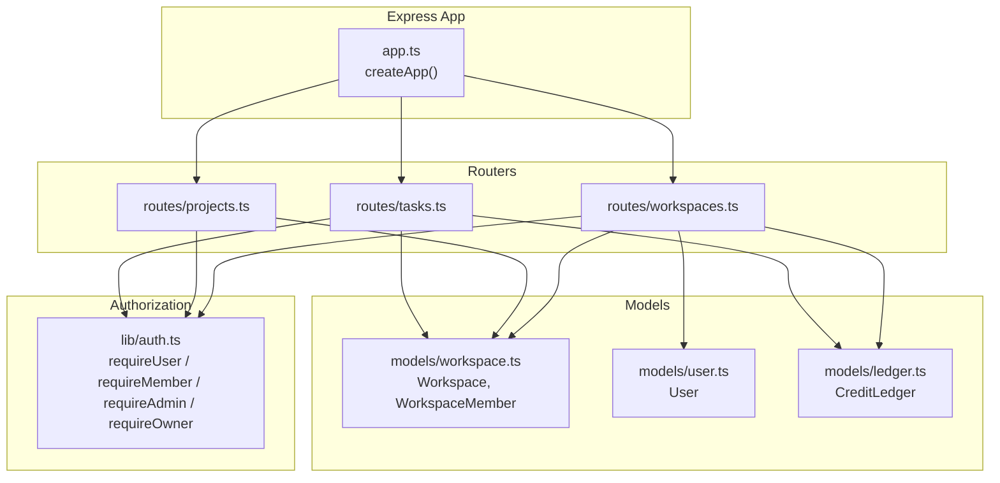
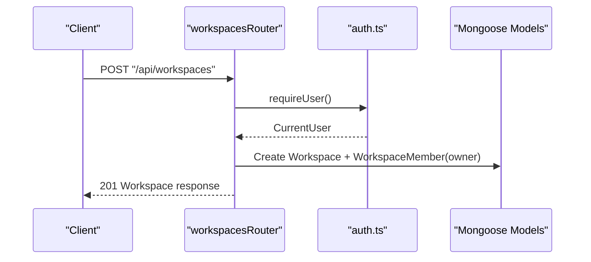
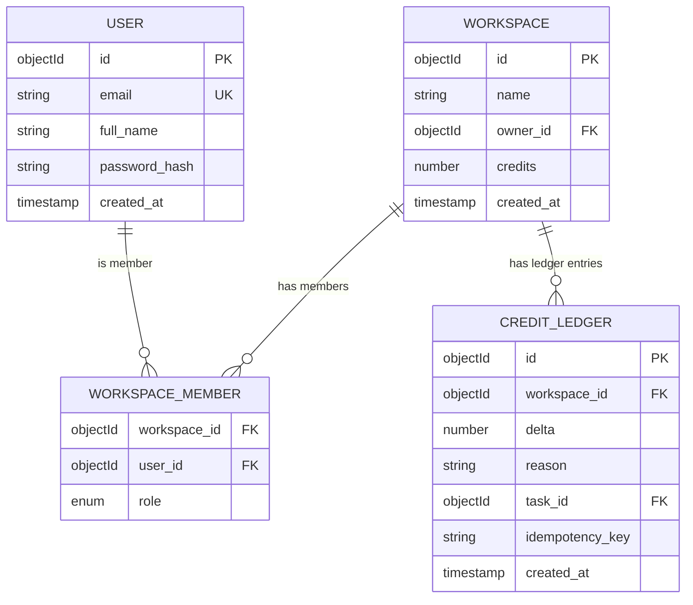
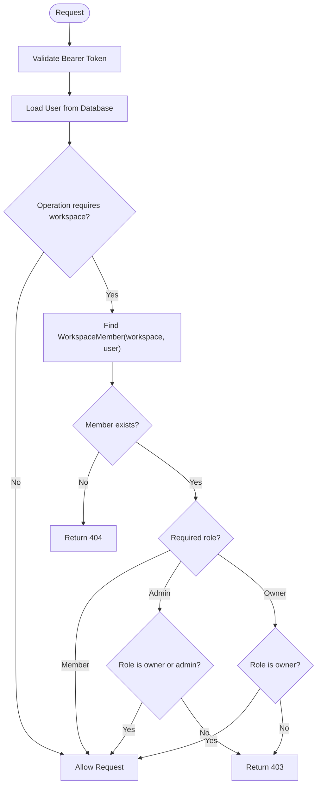
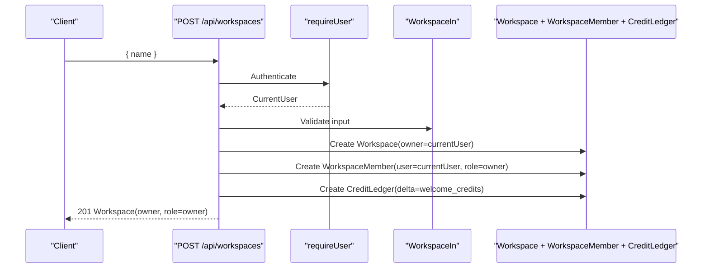
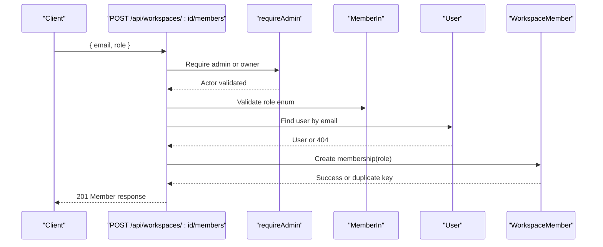
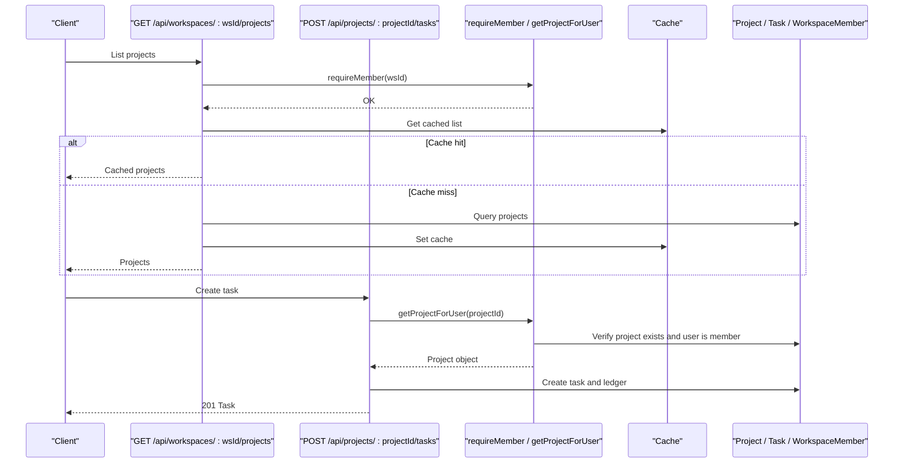
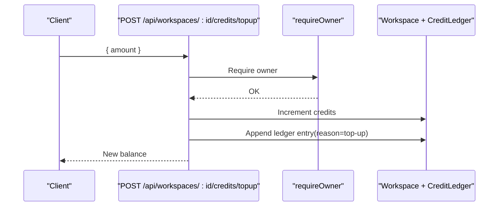
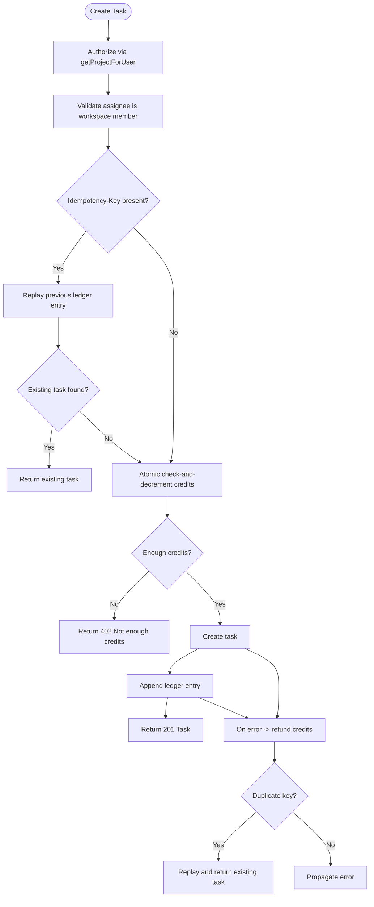
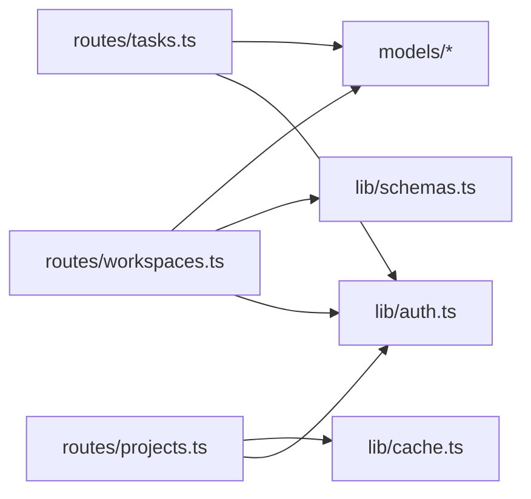

# Workspace Management

<cite>
**Referenced Files in This Document**
- [app.ts](file://phoenix-backend/src/app.ts)
- [auth.ts](file://phoenix-backend/src/lib/auth.ts)
- [schemas.ts](file://phoenix-backend/src/lib/schemas.ts)
- [workspace.ts](file://phoenix-backend/src/models/workspace.ts)
- [user.ts](file://phoenix-backend/src/models/user.ts)
- [ledger.ts](file://phoenix-backend/src/models/ledger.ts)
- [workspaces.ts](file://phoenix-backend/src/routes/workspaces.ts)
- [projects.ts](file://phoenix-backend/src/routes/projects.ts)
- [tasks.ts](file://phoenix-backend/src/routes/tasks.ts)
</cite>

## Table of Contents
1. [Introduction](#introduction)
2. [Project Structure](#project-structure)
3. [Core Components](#core-components)
4. [Architecture Overview](#architecture-overview)
5. [Detailed Component Analysis](#detailed-component-analysis)
6. [Dependency Analysis](#dependency-analysis)
7. [Performance Considerations](#performance-considerations)
8. [Troubleshooting Guide](#troubleshooting-guide)
9. [Conclusion](#conclusion)

## Introduction
This document explains the workspace management business logic, focusing on multi-tenant isolation, role-based access control, and member lifecycle operations. It covers:
- Member invitation workflow and role assignment (owner, admin, member).
- Authorization rules that enforce permissions across workspace resources.
- Workspace creation validation and ownership semantics.
- Permission checking middleware for role-based access control.
- Practical workflows for member management, role hierarchy, and security considerations for tenant isolation.

## Project Structure
The backend is an Express application with feature-based routing and shared authorization utilities. The workspace domain spans models, schemas, routes, and middleware.

**Diagram sources**
- [app.ts:11-31](file://phoenix-backend/src/app.ts#L11-L31)
- [workspaces.ts:1-128](file://phoenix-backend/src/routes/workspaces.ts#L1-L128)
- [projects.ts:1-58](file://phoenix-backend/src/routes/projects.ts#L1-L58)
- [tasks.ts:1-127](file://phoenix-backend/src/routes/tasks.ts#L1-L127)
- [auth.ts:1-58](file://phoenix-backend/src/lib/auth.ts#L1-L58)
- [workspace.ts:1-22](file://phoenix-backend/src/models/workspace.ts#L1-L22)
- [user.ts:1-20](file://phoenix-backend/src/models/user.ts#L1-L20)
- [ledger.ts:1-19](file://phoenix-backend/src/models/ledger.ts#L1-L19)

**Section sources**
- [app.ts:11-31](file://phoenix-backend/src/app.ts#L11-L31)

## Core Components
- Workspace model: stores workspace metadata and links to the owner user.
- WorkspaceMember model: maps users to workspaces with roles (owner, admin, member).
- User model: represents system users.
- CreditLedger model: append-only ledger for workspace credits.
- Authorization middleware: enforces authentication and role checks.
- Workspace routes: implement workspace CRUD, membership management, and credit top-ups.
- Project and task routes: demonstrate cross-resource authorization through workspace membership.

Key responsibilities:
- Role enforcement via middleware functions.
- Validation of inputs using schema definitions.
- Tenant isolation by scoping queries to workspace IDs.
- Idempotency and financial integrity for credit-consuming operations.

**Section sources**
- [workspace.ts:1-22](file://phoenix-backend/src/models/workspace.ts#L1-L22)
- [user.ts:1-20](file://phoenix-backend/src/models/user.ts#L1-L20)
- [ledger.ts:1-19](file://phoenix-backend/src/models/ledger.ts#L1-L19)
- [auth.ts:1-58](file://phoenix-backend/src/lib/auth.ts#L1-L58)
- [workspaces.ts:1-128](file://phoenix-backend/src/routes/workspaces.ts#L1-L128)
- [projects.ts:1-58](file://phoenix-backend/src/routes/projects.ts#L1-L58)
- [tasks.ts:1-127](file://phoenix-backend/src/routes/tasks.ts#L1-L127)

## Architecture Overview
The workspace management architecture centers around a role-based authorization layer that protects all workspace-scoped endpoints. Requests flow through Express routers, which invoke middleware to authenticate users and validate their roles before accessing data.

**Diagram sources**
- [workspaces.ts:31-42](file://phoenix-backend/src/routes/workspaces.ts#L31-L42)
- [auth.ts:8-23](file://phoenix-backend/src/lib/auth.ts#L8-L23)
- [workspace.ts:5-13](file://phoenix-backend/src/models/workspace.ts#L5-L13)

## Detailed Component Analysis

### Data Model and Role Hierarchy
The workspace domain uses two primary collections:
- Workspace: identifies the workspace and its initial owner.
- WorkspaceMember: defines each user’s role within a workspace.

Roles are strictly enumerated and enforced at both schema and route levels.

**Diagram sources**
- [workspace.ts:5-21](file://phoenix-backend/src/models/workspace.ts#L5-L21)
- [user.ts:3-10](file://phoenix-backend/src/models/user.ts#L3-L10)
- [ledger.ts:4-18](file://phoenix-backend/src/models/ledger.ts#L4-L18)

**Section sources**
- [workspace.ts:1-22](file://phoenix-backend/src/models/workspace.ts#L1-L22)
- [user.ts:1-20](file://phoenix-backend/src/models/user.ts#L1-L20)
- [ledger.ts:1-19](file://phoenix-backend/src/models/ledger.ts#L1-L19)

### Authorization Middleware and Role Enforcement
The authorization layer provides:
- Authentication: validates bearer tokens and loads the current user.
- Membership checks: ensures the user belongs to the requested workspace.
- Role checks: restricts operations based on role (member, admin, owner).

**Diagram sources**
- [auth.ts:8-50](file://phoenix-backend/src/lib/auth.ts#L8-L50)

**Section sources**
- [auth.ts:1-58](file://phoenix-backend/src/lib/auth.ts#L1-L58)

### Workspace Creation and Ownership
Workspace creation:
- Validates workspace name via schema.
- Creates the workspace with the requesting user as owner.
- Automatically grants the creator the owner role in WorkspaceMember.
- Seeds initial credits and records a welcome ledger entry.

**Diagram sources**
- [workspaces.ts:31-42](file://phoenix-backend/src/routes/workspaces.ts#L31-L42)
- [schemas.ts:15-15](file://phoenix-backend/src/lib/schemas.ts#L15-L15)
- [workspace.ts:5-13](file://phoenix-backend/src/models/workspace.ts#L5-L13)
- [ledger.ts:4-18](file://phoenix-backend/src/models/ledger.ts#L4-L18)

**Section sources**
- [workspaces.ts:31-42](file://phoenix-backend/src/routes/workspaces.ts#L31-L42)
- [schemas.ts:15-15](file://phoenix-backend/src/lib/schemas.ts#L15-L15)

### Member Invitation Workflow and Role Assignment
Inviting a new member:
- Requires admin or owner role.
- Validates target email and allowed roles.
- Prevents assigning multiple owners.
- Ensures uniqueness of memberships.

**Diagram sources**
- [workspaces.ts:77-102](file://phoenix-backend/src/routes/workspaces.ts#L77-L102)
- [auth.ts:36-42](file://phoenix-backend/src/lib/auth.ts#L36-L42)
- [schemas.ts:17-20](file://phoenix-backend/src/lib/schemas.ts#L17-L20)

**Section sources**
- [workspaces.ts:77-102](file://phoenix-backend/src/routes/workspaces.ts#L77-L102)
- [auth.ts:36-42](file://phoenix-backend/src/lib/auth.ts#L36-L42)
- [schemas.ts:17-20](file://phoenix-backend/src/lib/schemas.ts#L17-L20)

### Permission Checking Across Resources
Projects and tasks enforce workspace membership:
- Listing projects requires membership; cache is only served after authorization.
- Creating projects requires membership.
- Accessing a project requires membership via helper function.
- Listing and creating tasks require project membership, which implies workspace membership.

**Diagram sources**
- [projects.ts:11-46](file://phoenix-backend/src/routes/projects.ts#L11-L46)
- [tasks.ts:39-125](file://phoenix-backend/src/routes/tasks.ts#L39-L125)
- [auth.ts:52-57](file://phoenix-backend/src/lib/auth.ts#L52-L57)

**Section sources**
- [projects.ts:11-46](file://phoenix-backend/src/routes/projects.ts#L11-L46)
- [tasks.ts:39-125](file://phoenix-backend/src/routes/tasks.ts#L39-L125)
- [auth.ts:52-57](file://phoenix-backend/src/lib/auth.ts#L52-L57)

### Credits Top-Up and Financial Integrity
Only workspace owners can add credits:
- Requires owner role.
- Increments workspace balance atomically.
- Records a ledger entry for auditability.

**Diagram sources**
- [workspaces.ts:115-127](file://phoenix-backend/src/routes/workspaces.ts#L115-L127)
- [auth.ts:44-50](file://phoenix-backend/src/lib/auth.ts#L44-L50)
- [ledger.ts:4-18](file://phoenix-backend/src/models/ledger.ts#L4-L18)

**Section sources**
- [workspaces.ts:115-127](file://phoenix-backend/src/routes/workspaces.ts#L115-L127)

### Task Creation Cost and Idempotency
Creating tasks consumes workspace credits and supports idempotency:
- Validates assignee membership.
- Performs atomic credit check-and-decrement.
- Uses idempotency keys to avoid double-charging.
- Refunds credits on failure to maintain consistency.

**Diagram sources**
- [tasks.ts:39-125](file://phoenix-backend/src/routes/tasks.ts#L39-L125)
- [ledger.ts:4-18](file://phoenix-backend/src/models/ledger.ts#L4-L18)

**Section sources**
- [tasks.ts:39-125](file://phoenix-backend/src/routes/tasks.ts#L39-L125)

### Ownership Transfer Procedures
There is no explicit endpoint to transfer workspace ownership in the current implementation. Ownership is tied to the Workspace.owner field and the WorkspaceMember record created during workspace creation. To support ownership transfer safely, consider adding:
- A dedicated endpoint requiring current owner role.
- Validation that the target user is already a member.
- Atomic update of Workspace.owner and WorkspaceMember.role fields.
- Audit logging via CreditLedger or a separate audit log.

[No sources needed since this section proposes future changes not implemented]

### Member Removal Processes
There is no explicit endpoint to remove members in the current implementation. To implement safe removal:
- Add an endpoint requiring admin or owner role.
- Prevent removing the last owner.
- Ensure the actor cannot remove themselves if they are the sole owner.
- Invalidate any caches scoped to the workspace if applicable.

[No sources needed since this section proposes future changes not implemented]

## Dependency Analysis
The workspace module depends on shared authorization and models. Cross-cutting concerns include:
- Input validation via Zod schemas.
- Error handling and HTTP helpers.
- Mongoose models for persistence.
- Optional caching for project lists.

**Diagram sources**
- [workspaces.ts:1-128](file://phoenix-backend/src/routes/workspaces.ts#L1-L128)
- [projects.ts:1-58](file://phoenix-backend/src/routes/projects.ts#L1-L58)
- [tasks.ts:1-127](file://phoenix-backend/src/routes/tasks.ts#L1-L127)
- [auth.ts:1-58](file://phoenix-backend/src/lib/auth.ts#L1-L58)
- [schemas.ts:1-41](file://phoenix-backend/src/lib/schemas.ts#L1-L41)

**Section sources**
- [workspaces.ts:1-128](file://phoenix-backend/src/routes/workspaces.ts#L1-L128)
- [projects.ts:1-58](file://phoenix-backend/src/routes/projects.ts#L1-L58)
- [tasks.ts:1-127](file://phoenix-backend/src/routes/tasks.ts#L1-L127)

## Performance Considerations
- Workspace listing joins memberships and workspaces efficiently using lean queries and precomputed role maps.
- Project listing uses an in-memory cache keyed by workspace ID; authorization occurs before cache reads to prevent leaks.
- Task creation uses atomic updates to avoid race conditions when spending credits.
- Ledger entries provide audit trails without impacting read performance.

[No sources needed since this section provides general guidance]

## Troubleshooting Guide
Common issues and resolutions:
- 401 Unauthorized: Missing or invalid bearer token; ensure clients send Authorization: Bearer <token>.
- 404 Workspace not found: User is not a member; verify membership before calling workspace endpoints.
- 403 Admin/Owner required: Insufficient role; confirm the user has the required role.
- 409 Conflict: Duplicate membership; user is already a member.
- 402 Payment Required: Insufficient credits; top up workspace credits.
- 422 Validation error: Assignee is not a workspace member; invite the user first.

Operational tips:
- Use idempotency keys for task creation to avoid duplicate charges.
- Monitor CreditLedger for anomalies and reconcile workspace balances.
- Validate role assignments during invitations to prevent accidental owner duplication.

**Section sources**
- [auth.ts:8-50](file://phoenix-backend/src/lib/auth.ts#L8-L50)
- [workspaces.ts:77-102](file://phoenix-backend/src/routes/workspaces.ts#L77-L102)
- [tasks.ts:68-81](file://phoenix-backend/src/routes/tasks.ts#L68-L81)

## Conclusion
The workspace management system implements robust role-based access control and multi-tenant isolation:
- Roles (owner, admin, member) are enforced through centralized middleware.
- Workspace creation automatically assigns ownership and seeds credits.
- Member invitations are restricted to admins and owners, with strict role validation.
- All workspace-scoped resources protect data by verifying membership before access.
- Financial operations use atomic updates and append-only ledgers for integrity.

Future enhancements should include explicit ownership transfer and member removal endpoints, along with comprehensive audit logging for sensitive operations.

[No sources needed since this section summarizes without analyzing specific files]