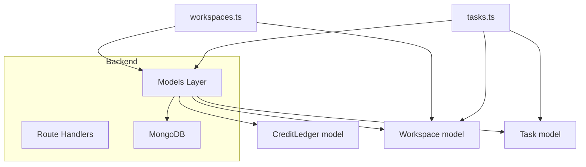
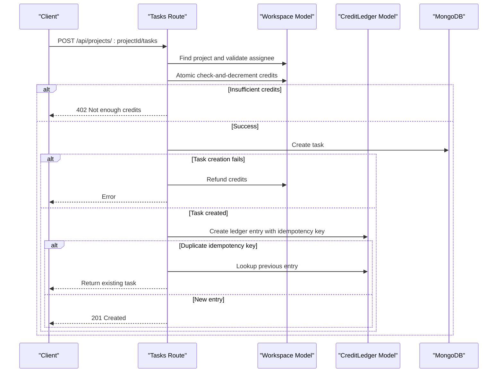
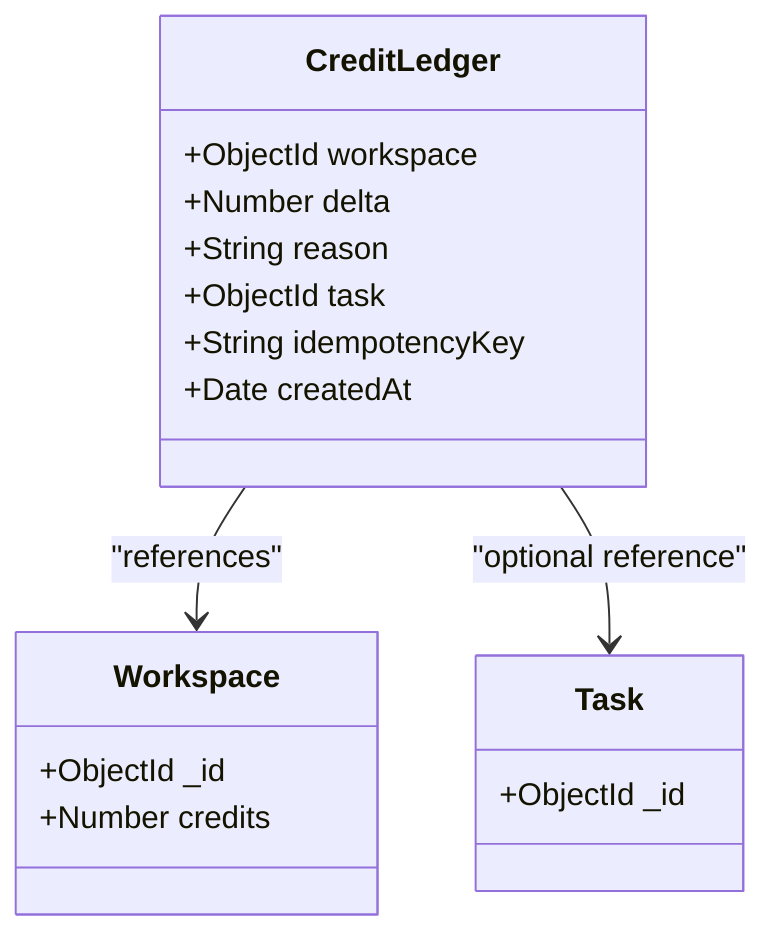
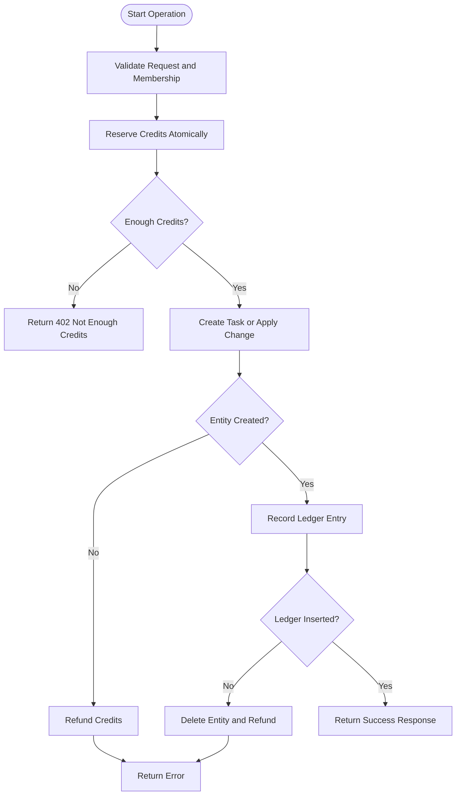
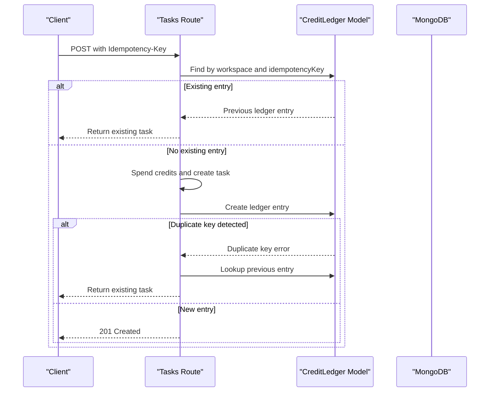
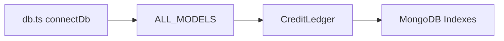

# Credit Ledger Model

<cite>
**Referenced Files in This Document**
- [ledger.ts](file://phoenix-backend/src/models/ledger.ts)
- [index.ts](file://phoenix-backend/src/models/index.ts)
- [db.ts](file://phoenix-backend/src/db.ts)
- [tasks.ts](file://phoenix-backend/src/routes/tasks.ts)
- [workspaces.ts](file://phoenix-backend/src/routes/workspaces.ts)
- [seed.ts](file://phoenix-backend/scripts/seed.ts)
</cite>

## Table of Contents
1. [Introduction](#introduction)
2. [Project Structure](#project-structure)
3. [Core Components](#core-components)
4. [Architecture Overview](#architecture-overview)
5. [Detailed Component Analysis](#detailed-component-analysis)
6. [Dependency Analysis](#dependency-analysis)
7. [Performance Considerations](#performance-considerations)
8. [Troubleshooting Guide](#troubleshooting-guide)
9. [Conclusion](#conclusion)

## Introduction
This document describes the CreditLedger data model and its role in maintaining financial integrity for workspace credits. The ledger is an append-only audit trail that records every credit change, including top-ups, welcome credits, and task creation costs. It ties each transaction to a workspace, explains why it happened, optionally links it to a task, and supports idempotency keys to prevent duplicate deductions.

The system combines:
- An immutable ledger schema with unique idempotency constraints.
- Transactional business logic in route handlers that update workspace balances and record ledger entries.
- Database initialization that ensures indexes exist before serving traffic.

## Project Structure
The CreditLedger model lives under the backend models layer and is used by workspace and task routes. The database connection initializes all registered models so that unique indexes are created at startup.

**Diagram sources**
- [tasks.ts:38-126](file://phoenix-backend/src/routes/tasks.ts#L38-L126)
- [workspaces.ts:31-40](file://phoenix-backend/src/routes/workspaces.ts#L31-L40)
- [workspaces.ts:115-127](file://phoenix-backend/src/routes/workspaces.ts#L115-L127)
- [index.ts:1-26](file://phoenix-backend/src/models/index.ts#L1-L26)

**Section sources**
- [index.ts:1-26](file://phoenix-backend/src/models/index.ts#L1-L26)
- [db.ts:1-36](file://phoenix-backend/src/db.ts#L1-L36)

## Core Components
- CreditLedger model: Defines the audit-trail schema, fields, and uniqueness constraint for idempotency keys.
- Workspace model: Holds the current credit balance and is updated atomically when credits are spent or added.
- Task model: Represents tasks whose creation may consume credits; ledger entries can reference the created task.
- Route handlers: Implement business flows for workspace creation, top-ups, and task creation, ensuring ledger consistency.

Key responsibilities:
- Record every credit delta with reason and context.
- Enforce idempotency through a composite unique index on workspace and idempotency key.
- Maintain workspace balance and ledger entries as a consistent unit of work.

**Section sources**
- [ledger.ts:1-18](file://phoenix-backend/src/models/ledger.ts#L1-L18)
- [tasks.ts:38-126](file://phoenix-backend/src/routes/tasks.ts#L38-L126)
- [workspaces.ts:31-40](file://phoenix-backend/src/routes/workspaces.ts#L31-L40)
- [workspaces.ts:115-127](file://phoenix-backend/src/routes/workspaces.ts#L115-L127)

## Architecture Overview
The credit system follows an append-only ledger pattern:
- Credits are stored as a numeric balance on the workspace.
- Every change is recorded in the ledger with a signed delta (positive for additions, negative for deductions).
- Idempotency keys allow safe retries without double-charging.
- Task creation deducts credits only after validating membership and reserving the balance atomically.

**Diagram sources**
- [tasks.ts:38-126](file://phoenix-backend/src/routes/tasks.ts#L38-L126)

## Detailed Component Analysis

### CreditLedger Schema
The CreditLedger schema defines an append-only history of credit changes.

Fields:
- workspace: Reference to the workspace that owns the credits. Indexed for efficient queries.
- delta: Signed number representing the credit change. Positive for additions, negative for deductions.
- reason: Human-readable explanation of the transaction.
- task: Optional reference to the task associated with the deduction.
- idempotencyKey: Optional string used to deduplicate identical operations.

Indexes:
- A composite unique index on workspace and idempotencyKey prevents duplicate ledger entries for the same operation within a workspace. The index applies only when idempotencyKey is present.

Design implications:
- Append-only design preserves complete audit history.
- Unique partial index guarantees idempotency at the database level.
- Timestamps capture when each event occurred, enabling chronological analysis.

**Diagram sources**
- [ledger.ts:4-17](file://phoenix-backend/src/models/ledger.ts#L4-L17)

**Section sources**
- [ledger.ts:1-18](file://phoenix-backend/src/models/ledger.ts#L1-L18)

### Transaction Recording System
The transaction recording system ensures financial integrity by combining workspace balance updates with ledger entries.

Key behaviors:
- Workspace creation grants welcome credits and records a positive delta.
- Top-up operations add credits and record a positive delta.
- Task creation deducts credits and records a negative delta, linking the ledger entry to the created task.
- If task creation fails after deducting credits, the system refunds the workspace balance.
- If ledger insertion fails after task creation, the system deletes the task and refunds the balance.

**Diagram sources**
- [tasks.ts:68-122](file://phoenix-backend/src/routes/tasks.ts#L68-L122)

**Section sources**
- [workspaces.ts:31-40](file://phoenix-backend/src/routes/workspaces.ts#L31-L40)
- [tasks.ts:68-122](file://phoenix-backend/src/routes/tasks.ts#L68-L122)

### Idempotency Mechanism
Idempotency prevents duplicate credit deductions when clients retry requests.

Mechanism details:
- Clients may send an Idempotency-Key header with task creation requests.
- Before spending credits, the handler checks whether a ledger entry already exists for the given workspace and idempotency key.
- If found, the original task is returned without recharging.
- If not found, the handler proceeds to spend credits and create the ledger entry.
- If another concurrent request wins the race and inserts the same idempotency key, the failing request detects the duplicate and returns the winning task.

**Diagram sources**
- [tasks.ts:47-66](file://phoenix-backend/src/routes/tasks.ts#L47-L66)
- [tasks.ts:101-122](file://phoenix-backend/src/routes/tasks.ts#L101-L122)

**Section sources**
- [tasks.ts:47-66](file://phoenix-backend/src/routes/tasks.ts#L47-L66)
- [tasks.ts:101-122](file://phoenix-backend/src/routes/tasks.ts#L101-L122)

### Examples of Operations

#### Credit Top-Up
- Endpoint: POST /api/workspaces/:workspaceId/credits/topup
- Authorization: Workspace owner required.
- Behavior: Increments workspace credits and appends a ledger entry with a positive delta and reason indicating a top-up.
- Response: Returns the updated workspace balance.

Use this endpoint to add credits to a workspace. Ensure the caller has owner permissions.

**Section sources**
- [workspaces.ts:115-127](file://phoenix-backend/src/routes/workspaces.ts#L115-L127)

#### Welcome Credits on Workspace Creation
- Endpoint: POST /api/workspaces
- Behavior: Creates the workspace, assigns initial welcome credits, and records a positive delta in the ledger.

Use this flow to bootstrap new workspaces with starting credits.

**Section sources**
- [workspaces.ts:31-40](file://phoenix-backend/src/routes/workspaces.ts#L31-L40)

#### Task Creation Credit Deduction
- Endpoint: POST /api/projects/:projectId/tasks
- Behavior: Validates assignee membership, reserves credits atomically, creates the task, and records a negative delta in the ledger linked to the task. Supports idempotency via Idempotency-Key header.

Use this endpoint to create tasks while consuming workspace credits safely.

**Section sources**
- [tasks.ts:38-126](file://phoenix-backend/src/routes/tasks.ts#L38-L126)

### Ledger Query Patterns
Common query patterns for auditing and reporting:
- List recent transactions for a workspace:
  - Filter by workspace and sort by createdAt descending.
  - Paginate using skip and limit for large histories.
- Reconcile balance:
  - Sum deltas from ledger entries for a workspace and compare with the workspace credits field.
- Investigate a specific operation:
  - Query by idempotencyKey and workspace to find the exact transaction and associated task.

Recommended indexing:
- Use the existing workspace index for fast per-workspace queries.
- For reconciliation reports, consider aggregating by workspace and time windows.

**Section sources**
- [ledger.ts:6-17](file://phoenix-backend/src/models/ledger.ts#L6-L17)

## Dependency Analysis
The CreditLedger model depends on Mongoose and is initialized alongside other models during database connection.

**Diagram sources**
- [db.ts:13-29](file://phoenix-backend/src/db.ts#L13-L29)
- [index.ts:19-26](file://phoenix-backend/src/models/index.ts#L19-L26)

**Section sources**
- [db.ts:1-36](file://phoenix-backend/src/db.ts#L1-L36)
- [index.ts:1-26](file://phoenix-backend/src/models/index.ts#L1-L26)

## Performance Considerations
- Index usage:
  - The workspace field is indexed, making per-workspace queries efficient.
  - The composite unique index on workspace and idempotencyKey enforces idempotency without scanning entire collections.
- Append-only growth:
  - The ledger grows monotonically; plan for archival strategies if transaction volume is high.
- Aggregation performance:
  - Balance reconciliation across many documents can be expensive; consider materialized summaries or periodic reconciliation jobs.
- Connection warm-up:
  - Initializing models at startup ensures unique indexes exist before handling requests, reducing contention and errors.

[No sources needed since this section provides general guidance]

## Troubleshooting Guide
Common issues and resolutions:
- Duplicate idempotency key errors:
  - Occur when two concurrent requests use the same idempotency key. The system handles this by returning the winning task. Verify client retry logic and ensure unique keys per intended operation.
- Insufficient credits:
  - Task creation fails with a 402 response when the workspace lacks sufficient credits. Add credits via the top-up endpoint or adjust task cost configuration.
- Inconsistent state after failures:
  - The system refunds credits and cleans up entities when intermediate steps fail. If inconsistencies appear, reconcile workspace credits against the sum of ledger deltas.

Operational tips:
- Monitor ledger growth and set alerts for unusual spikes.
- Periodically run reconciliation jobs to detect mismatches between workspace credits and ledger sums.
- Use pagination and time-bounded queries for reporting dashboards.

**Section sources**
- [tasks.ts:74-81](file://phoenix-backend/src/routes/tasks.ts#L74-L81)
- [tasks.ts:109-122](file://phoenix-backend/src/routes/tasks.ts#L109-L122)

## Conclusion
The CreditLedger model provides a robust, append-only audit trail for workspace credits. Combined with atomic workspace updates and idempotency enforcement, it ensures financial integrity and complete traceability. By following the documented patterns for top-ups, task deductions, and ledger queries, teams can maintain accurate credit accounting while scaling to large transaction histories.

[No sources needed since this section summarizes without analyzing specific files]