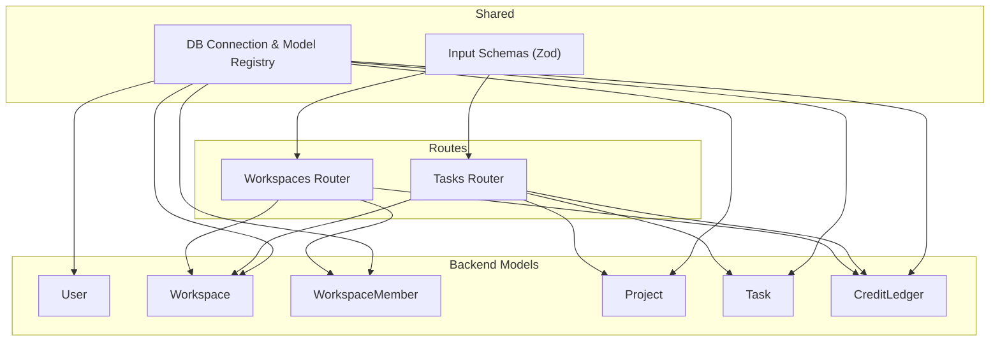
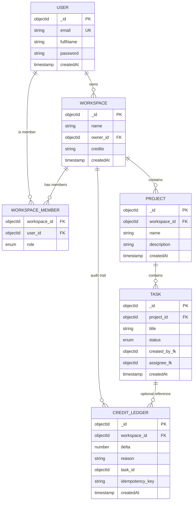
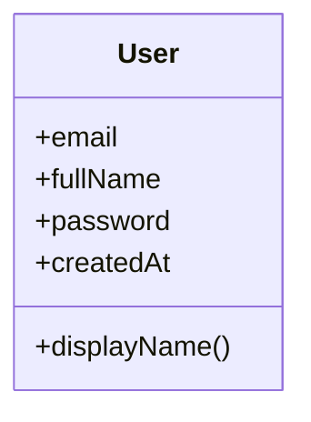
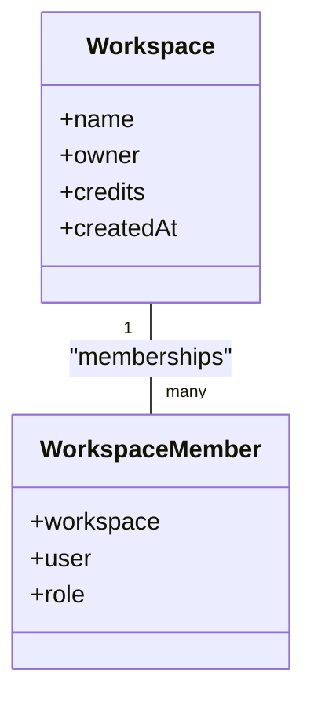
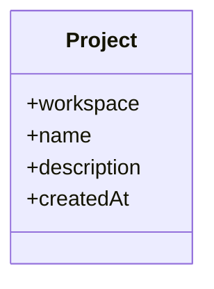
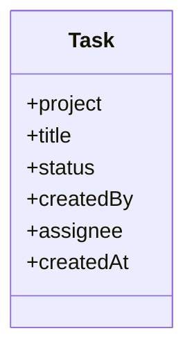
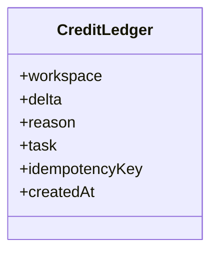
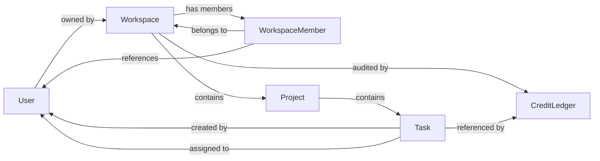
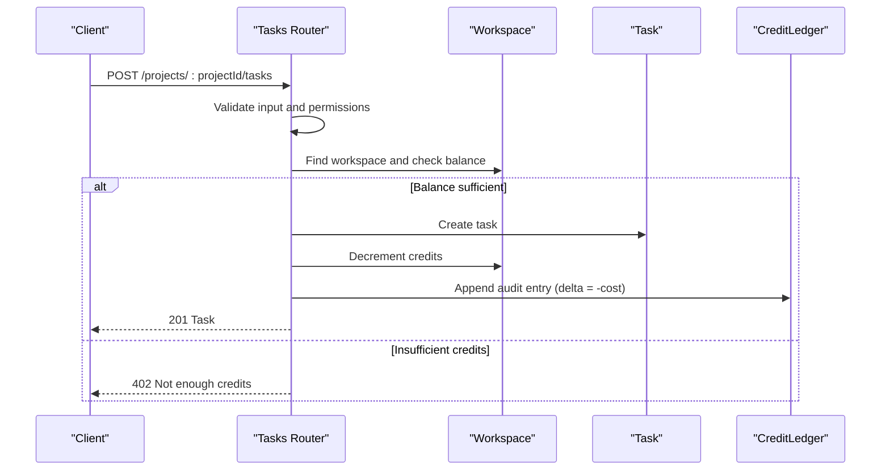

# Database Schema Design

<cite>
**Referenced Files in This Document**
- [index.ts](file://phoenix-backend/src/models/index.ts)
- [user.ts](file://phoenix-backend/src/models/user.ts)
- [workspace.ts](file://phoenix-backend/src/models/workspace.ts)
- [project.ts](file://phoenix-backend/src/models/project.ts)
- [task.ts](file://phoenix-backend/src/models/task.ts)
- [ledger.ts](file://phoenix-backend/src/models/ledger.ts)
- [db.ts](file://phoenix-backend/src/db.ts)
- [workspaces.ts](file://phoenix-backend/src/routes/workspaces.ts)
- [tasks.ts](file://phoenix-backend/src/routes/tasks.ts)
- [schemas.ts](file://phoenix-backend/src/lib/schemas.ts)
</cite>

## Table of Contents
1. [Introduction](#introduction)
2. [Project Structure](#project-structure)
3. [Core Components](#core-components)
4. [Architecture Overview](#architecture-overview)
5. [Detailed Component Analysis](#detailed-component-analysis)
6. [Dependency Analysis](#dependency-analysis)
7. [Performance Considerations](#performance-considerations)
8. [Troubleshooting Guide](#troubleshooting-guide)
9. [Conclusion](#conclusion)
10. [Appendices](#appendices)

## Introduction
This document describes the Project Phoenix database schema and data model implemented with Mongoose. It focuses on the core entities User, Workspace, Project, Task, and CreditLedger, including field definitions, validation rules, indexes, constraints, relationships, and business logic enforced at the database layer. It also covers credit operations lifecycle, audit trail design, migration and backup considerations, and performance guidance for large datasets.

## Project Structure
The data model is defined under the backend models directory and wired into application startup via a central connection module. Route handlers enforce additional business rules and orchestrate credit ledger entries alongside workspace balance updates.

**Diagram sources**
- [index.ts:1-14](file://phoenix-backend/src/models/index.ts#L1-L14)
- [db.ts:1-27](file://phoenix-backend/src/db.ts#L1-L27)
- [workspaces.ts:1-125](file://phoenix-backend/src/routes/workspaces.ts#L1-L125)
- [tasks.ts:1-82](file://phoenix-backend/src/routes/tasks.ts#L1-L82)
- [schemas.ts:1-41](file://phoenix-backend/src/lib/schemas.ts#L1-L41)

**Section sources**
- [index.ts:1-14](file://phoenix-backend/src/models/index.ts#L1-L14)
- [db.ts:1-27](file://phoenix-backend/src/db.ts#L1-L27)

## Core Components
This section summarizes each Mongoose schema, its fields, types, validations, indexes, and constraints.

- User
  - Fields: email (string, required, unique, lowercase, trimmed), fullName (string, required, trimmed), password (string, required). Timestamps: createdAt enabled; updatedAt disabled.
  - Constraints: Unique email index enforced by MongoDB.
  - Notes: Virtual displayName computed from fullName or email is added at runtime in the model registry.

- Workspace
  - Fields: name (string, required, trimmed), owner (ObjectId ref to User, required), credits (string, default "0"). Timestamps: createdAt enabled; updatedAt disabled.
  - Constraints: Owner references a valid User document. Credits stored as string to preserve precision during arithmetic in route handlers.

- WorkspaceMember
  - Fields: workspace (ObjectId ref to Workspace, required), user (ObjectId ref to User, required), role (enum ["owner","admin","member"], required, default "member").
  - Indexes: Unique composite index on {workspace, user}.
  - Constraints: Enforces one membership per user per workspace.

- Project
  - Fields: workspace (ObjectId ref to Workspace, required, indexed), name (string, required, trimmed), description (string, default ""). Timestamps: createdAt enabled; updatedAt disabled.
  - Indexes: workspace index supports efficient queries scoped to a workspace.

- Task
  - Fields: project (ObjectId ref to Project, required), title (string, required, trimmed), status (enum ["todo","in_progress","done"], required, default "todo"), createdBy (ObjectId ref to User, required), assignee (ObjectId ref to User, nullable), createdAt (Date, required, default now).
  - Indexes: Compound index on {project: 1, createdAt: -1, _id: -1} optimizes listing tasks by project with pagination.

- CreditLedger
  - Fields: workspace (ObjectId ref to Workspace, required, indexed), delta (number, required), reason (string, required), task (ObjectId ref to Task, nullable), idempotencyKey (string, optional). Timestamps: createdAt enabled; updatedAt disabled.
  - Indexes: Partial unique index on {workspace, idempotencyKey} where idempotencyKey exists ensures idempotent credit operations per workspace.

**Section sources**
- [user.ts:1-14](file://phoenix-backend/src/models/user.ts#L1-L14)
- [workspace.ts:1-22](file://phoenix-backend/src/models/workspace.ts#L1-L22)
- [project.ts:1-12](file://phoenix-backend/src/models/project.ts#L1-L12)
- [task.ts:1-15](file://phoenix-backend/src/models/task.ts#L1-L15)
- [ledger.ts:1-19](file://phoenix-backend/src/models/ledger.ts#L1-L19)
- [index.ts:1-14](file://phoenix-backend/src/models/index.ts#L1-L14)

## Architecture Overview
The data architecture centers around workspaces that own projects, which contain tasks. Users are members of workspaces with roles. CreditLedger provides an append-only audit trail for credit changes tied to workspaces and optionally to specific tasks.

**Diagram sources**
- [user.ts:1-14](file://phoenix-backend/src/models/user.ts#L1-L14)
- [workspace.ts:1-22](file://phoenix-backend/src/models/workspace.ts#L1-L22)
- [project.ts:1-12](file://phoenix-backend/src/models/project.ts#L1-L12)
- [task.ts:1-15](file://phoenix-backend/src/models/task.ts#L1-L15)
- [ledger.ts:1-19](file://phoenix-backend/src/models/ledger.ts#L1-L19)

## Detailed Component Analysis

### User
- Purpose: Represents authenticated users with identity and credentials.
- Key behaviors:
  - Email uniqueness enforced at the database level.
  - Virtual displayName computed at runtime for convenience.
- Data integrity:
  - Required fields ensure minimal profile completeness.
  - Lowercase and trim normalization applied to email and fullName.

**Diagram sources**
- [user.ts:1-14](file://phoenix-backend/src/models/user.ts#L1-L14)
- [index.ts:1-14](file://phoenix-backend/src/models/index.ts#L1-L14)

**Section sources**
- [user.ts:1-14](file://phoenix-backend/src/models/user.ts#L1-L14)
- [index.ts:1-14](file://phoenix-backend/src/models/index.ts#L1-L14)

### Workspace and WorkspaceMember
- Purpose: Workspaces group projects and manage credits; memberships define access control and roles.
- Key behaviors:
  - Owner relationship ties a workspace to a single user.
  - Credits stored as string to avoid floating-point precision issues; numeric conversion occurs in route handlers.
  - Membership enforces exactly one owner per workspace at the API layer; database-level uniqueness prevents duplicate memberships.
- Indexes and constraints:
  - Unique composite index on {workspace, user} prevents duplicate memberships.
  - Role restricted to a predefined set.

**Diagram sources**
- [workspace.ts:1-22](file://phoenix-backend/src/models/workspace.ts#L1-L22)

**Section sources**
- [workspace.ts:1-22](file://phoenix-backend/src/models/workspace.ts#L1-L22)

### Project
- Purpose: Projects belong to a workspace and organize tasks.
- Key behaviors:
  - Scoped queries by workspace benefit from the workspace index.
- Data integrity:
  - Required name and optional description.

**Diagram sources**
- [project.ts:1-12](file://phoenix-backend/src/models/project.ts#L1-L12)

**Section sources**
- [project.ts:1-12](file://phoenix-backend/src/models/project.ts#L1-L12)

### Task
- Purpose: Tasks represent work items within a project, with lifecycle states and ownership metadata.
- Key behaviors:
  - Status constrained to a fixed set.
  - CreatedBy and optional Assignee link to users.
  - Optimized listing via compound index on project, createdAt, and _id.
- Business rules:
  - Creating a task deducts credits from the workspace balance and records an audit entry.
  - Assignee must be a workspace member; otherwise, request is rejected.

**Diagram sources**
- [task.ts:1-15](file://phoenix-backend/src/models/task.ts#L1-L15)

**Section sources**
- [task.ts:1-15](file://phoenix-backend/src/models/task.ts#L1-L15)

### CreditLedger
- Purpose: Append-only audit log of credit changes for a workspace, optionally linked to a specific task.
- Key behaviors:
  - Delta indicates positive or negative change.
  - Idempotency key ensures repeated top-ups or task creations do not double-charge when provided.
  - Partial unique index on {workspace, idempotencyKey} guarantees idempotency only when the key is present.

**Diagram sources**
- [ledger.ts:1-19](file://phoenix-backend/src/models/ledger.ts#L1-L19)

**Section sources**
- [ledger.ts:1-19](file://phoenix-backend/src/models/ledger.ts#L1-L19)

## Dependency Analysis
Model dependencies and references:
- Workspace.owner -> User
- WorkspaceMember.workspace -> Workspace
- WorkspaceMember.user -> User
- Project.workspace -> Workspace
- Task.project -> Project
- Task.createdBy -> User
- Task.assignee -> User
- CreditLedger.workspace -> Workspace
- CreditLedger.task -> Task

**Diagram sources**
- [workspace.ts:1-22](file://phoenix-backend/src/models/workspace.ts#L1-L22)
- [project.ts:1-12](file://phoenix-backend/src/models/project.ts#L1-L12)
- [task.ts:1-15](file://phoenix-backend/src/models/task.ts#L1-L15)
- [ledger.ts:1-19](file://phoenix-backend/src/models/ledger.ts#L1-L19)

**Section sources**
- [workspace.ts:1-22](file://phoenix-backend/src/models/workspace.ts#L1-L22)
- [project.ts:1-12](file://phoenix-backend/src/models/project.ts#L1-L12)
- [task.ts:1-15](file://phoenix-backend/src/models/task.ts#L1-L15)
- [ledger.ts:1-19](file://phoenix-backend/src/models/ledger.ts#L1-L19)

## Performance Considerations
- Indexing strategy:
  - WorkspaceMember: unique composite index on {workspace, user} prevents duplicates and speeds up membership checks.
  - Project: workspace index improves scoping queries.
  - Task: compound index on {project, createdAt, _id} optimizes paginated listings by project.
  - CreditLedger: partial unique index on {workspace, idempotencyKey} enables idempotent operations without penalizing records without keys.
- Query patterns:
  - Use lean queries and selective projections where possible to reduce payload size.
  - Prefer countDocuments for total counts and limit/skip for pagination.
- Storage considerations:
  - Credits stored as string to maintain precision; conversions occur in route handlers.
  - Audit logs grow over time; consider partitioning or archival strategies based on retention policies.

[No sources needed since this section provides general guidance]

## Troubleshooting Guide
Common issues and resolutions:
- Duplicate membership errors:
  - Cause: Attempting to add a user who is already a member.
  - Resolution: Check for existing WorkspaceMember documents before creating new ones; handle duplicate key errors gracefully.
- Not enough credits:
  - Cause: Workspace balance insufficient to cover task creation cost.
  - Resolution: Prompt user to top up credits; validate balance before allowing task creation.
- Idempotency conflicts:
  - Cause: Repeated requests with the same idempotencyKey.
  - Resolution: Return the previously created task if found; avoid double-charging.
- Invalid assignee:
  - Cause: Assignee is not a workspace member.
  - Resolution: Validate assignee membership before assignment.

Operational notes:
- Connection settings disable autoIndex; ensure indexes are managed externally or through migrations.
- StrictQuery mode is enabled; ensure query filters match schema-defined paths.

**Section sources**
- [workspaces.ts:77-125](file://phoenix-backend/src/routes/workspaces.ts#L77-L125)
- [tasks.ts:34-82](file://phoenix-backend/src/routes/tasks.ts#L34-L82)
- [db.ts:1-27](file://phoenix-backend/src/db.ts#L1-L27)

## Conclusion
The Project Phoenix data model uses Mongoose schemas to enforce core integrity constraints while delegating richer business logic to route handlers. The CreditLedger provides a robust audit trail for credit operations, with idempotency support to prevent duplicate charges. Proper indexing and careful handling of workspace balances ensure reliable performance and data consistency across workspaces, projects, and tasks.

[No sources needed since this section summarizes without analyzing specific files]

## Appendices

### Data Lifecycle Patterns
- Workspace creation:
  - Creates a workspace record and initializes welcome credits.
  - Records a welcome credit entry in CreditLedger.
- Top-up credits:
  - Increments workspace.credits and appends a CreditLedger entry with reason "top-up".
- Task creation:
  - Validates workspace balance and assigns a cost.
  - Deducts credits from workspace.credits and creates a CreditLedger entry referencing the new task.
  - Supports idempotency via optional idempotencyKey.

**Diagram sources**
- [tasks.ts:34-82](file://phoenix-backend/src/routes/tasks.ts#L34-L82)
- [workspaces.ts:114-125](file://phoenix-backend/src/routes/workspaces.ts#L114-L125)

**Section sources**
- [tasks.ts:34-82](file://phoenix-backend/src/routes/tasks.ts#L34-L82)
- [workspaces.ts:114-125](file://phoenix-backend/src/routes/workspaces.ts#L114-L125)

### Transaction Handling for Credit Operations
- Current behavior:
  - Workspace balance update and CreditLedger creation are performed as separate operations.
  - IdempotencyKey provides protection against duplicate writes but does not wrap operations in a transaction.
- Recommendations:
  - Wrap related operations in a MongoDB session-based transaction to ensure atomicity.
  - Ensure idempotencyKey uniqueness constraint remains active to guard against concurrent retries.

**Section sources**
- [tasks.ts:34-82](file://phoenix-backend/src/routes/tasks.ts#L34-L82)
- [workspaces.ts:114-125](file://phoenix-backend/src/routes/workspaces.ts#L114-L125)
- [ledger.ts:1-19](file://phoenix-backend/src/models/ledger.ts#L1-L19)

### Audit Trail Design
- CreditLedger captures every credit change with:
  - workspace reference for grouping.
  - delta indicating direction and magnitude.
  - reason describing the operation context.
  - optional task reference linking to the originating task.
  - optional idempotencyKey ensuring repeat-safe operations.
- Queries can aggregate deltas per workspace to reconstruct balances or investigate discrepancies.

**Section sources**
- [ledger.ts:1-19](file://phoenix-backend/src/models/ledger.ts#L1-L19)

### Input Validation Rules
- Zod schemas enforce:
  - Email format and length constraints.
  - Password strength and length.
  - Workspace name length.
  - Member role enumeration.
  - Top-up amount positivity, integer type, and maximum cap.
  - Project name/description lengths.
  - Task title length, status enumeration, and assignee ID format.
  - Pagination parameters with bounds.

**Section sources**
- [schemas.ts:1-41](file://phoenix-backend/src/lib/schemas.ts#L1-L41)

### Migration Strategies
- Index management:
  - AutoIndex is disabled; use explicit migration scripts to create or modify indexes.
- Schema evolution:
  - Add new fields with defaults to avoid breaking existing documents.
  - Backfill derived fields or migrate legacy values using batched updates.
- Data safety:
  - Run migrations in transactions where possible.
  - Test migrations on staging environments first.

**Section sources**
- [db.ts:1-27](file://phoenix-backend/src/db.ts#L1-L27)

### Backup Procedures
- Operational recommendations:
  - Schedule regular snapshots of the MongoDB cluster.
  - Export critical collections (Workspace, CreditLedger) periodically for compliance.
  - Verify restore procedures regularly.
- Retention policy:
  - Define retention windows for audit logs based on regulatory requirements.

[No sources needed since this section provides general guidance]