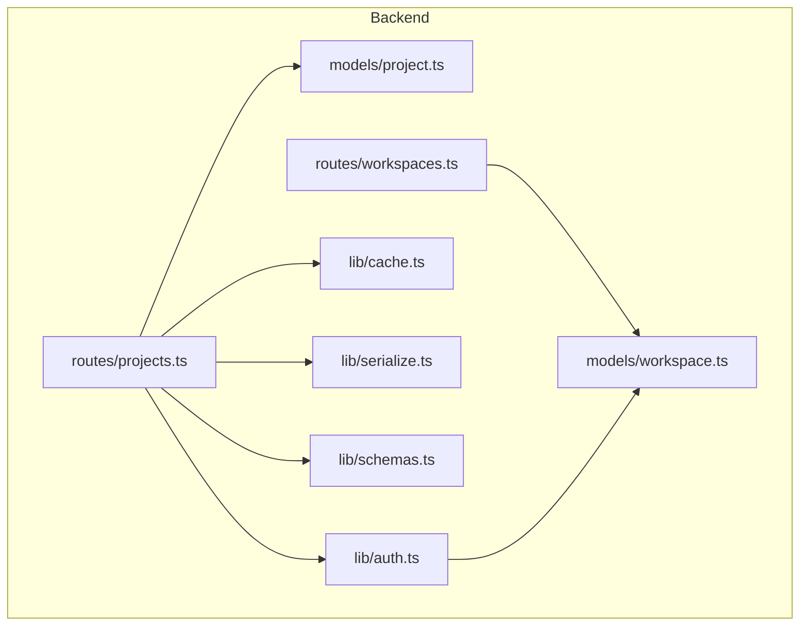
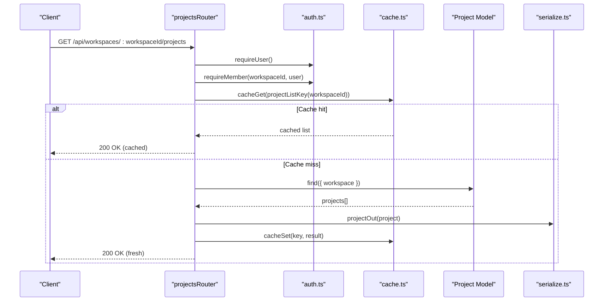
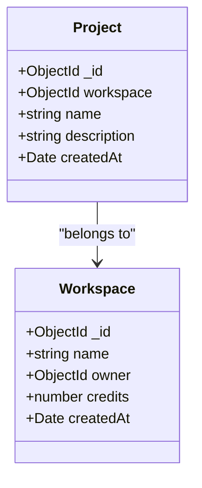
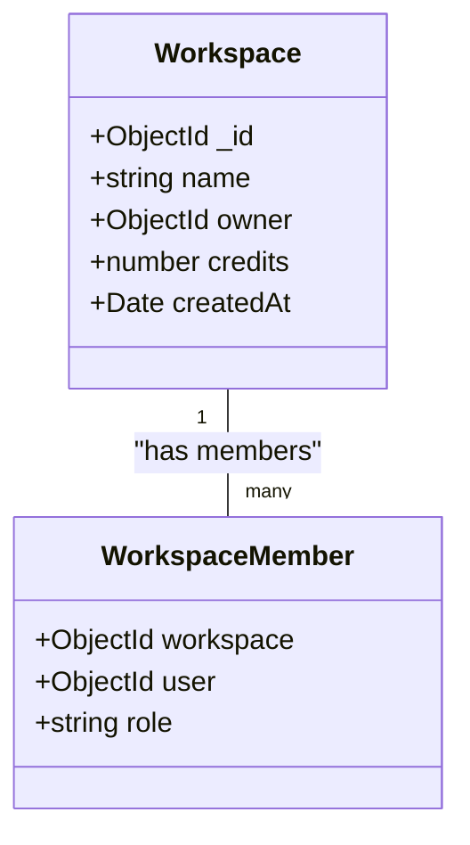
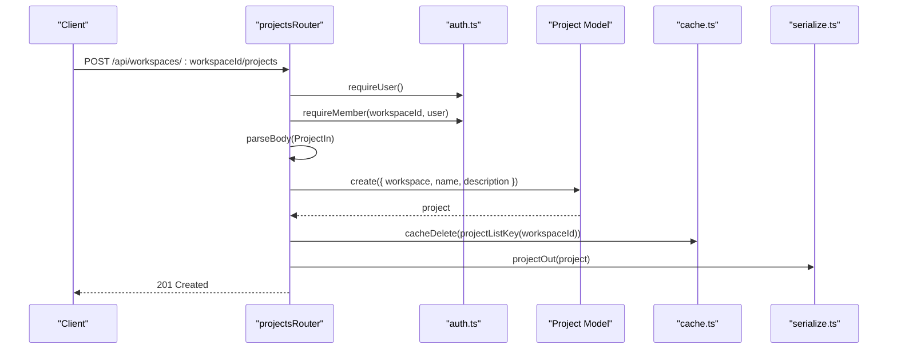
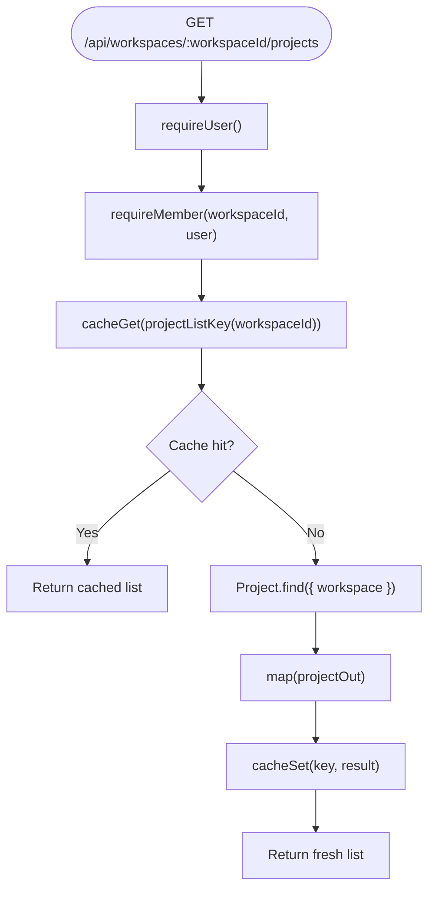
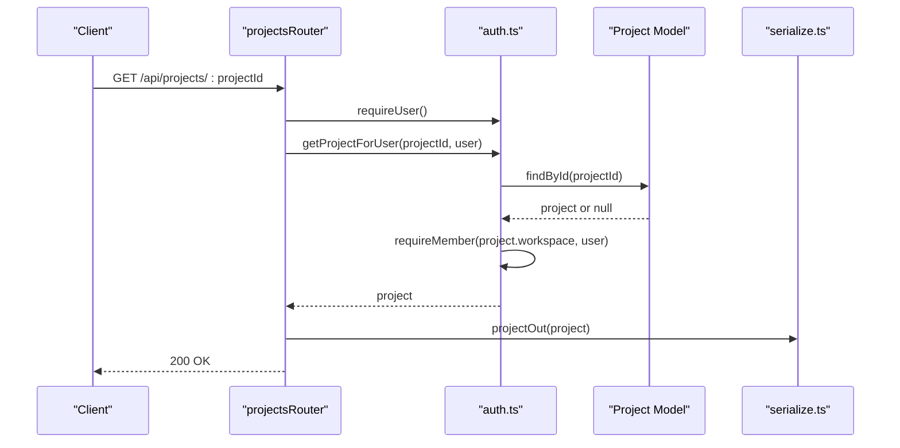
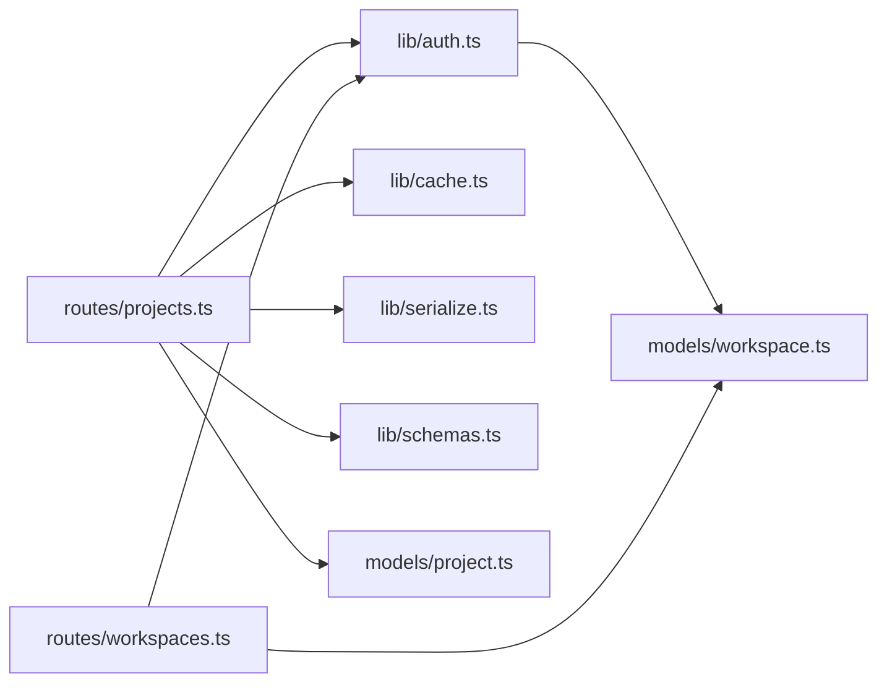

# Project Model

<cite>
**Referenced Files in This Document**
- [project.ts](file://phoenix-backend/src/models/project.ts)
- [workspace.ts](file://phoenix-backend/src/models/workspace.ts)
- [projects.ts](file://phoenix-backend/src/routes/projects.ts)
- [workspaces.ts](file://phoenix-backend/src/routes/workspaces.ts)
- [schemas.ts](file://phoenix-backend/src/lib/schemas.ts)
- [auth.ts](file://phoenix-backend/src/lib/auth.ts)
- [cache.ts](file://phoenix-backend/src/lib/cache.ts)
- [serialize.ts](file://phoenix-backend/src/lib/serialize.ts)
</cite>

## Table of Contents
1. [Introduction](#introduction)
2. [Project Structure](#project-structure)
3. [Core Components](#core-components)
4. [Architecture Overview](#architecture-overview)
5. [Detailed Component Analysis](#detailed-component-analysis)
6. [Dependency Analysis](#dependency-analysis)
7. [Performance Considerations](#performance-considerations)
8. [Troubleshooting Guide](#troubleshooting-guide)
9. [Conclusion](#conclusion)

## Introduction
This document describes the data model and operational behavior for Projects in the system. It explains how projects are structured, how they relate to workspaces, how access control is enforced, and how project lifecycle operations (create, list, retrieve, delete) behave. It also covers performance considerations for listing and searching projects within a workspace.

## Project Structure
The backend organizes code by feature modules: models define database schemas, routes implement API endpoints, lib contains shared utilities such as authentication, caching, serialization, and input validation. The Project model lives under models, while its API surface is exposed through routes.

**Diagram sources**
- [project.ts:1-12](file://phoenix-backend/src/models/project.ts#L1-L12)
- [workspace.ts:1-22](file://phoenix-backend/src/models/workspace.ts#L1-L22)
- [projects.ts:1-58](file://phoenix-backend/src/routes/projects.ts#L1-L58)
- [workspaces.ts:1-128](file://phoenix-backend/src/routes/workspaces.ts#L1-L128)
- [auth.ts:1-58](file://phoenix-backend/src/lib/auth.ts#L1-L58)
- [cache.ts:1-26](file://phoenix-backend/src/lib/cache.ts#L1-L26)
- [serialize.ts:1-34](file://phoenix-backend/src/lib/serialize.ts#L1-L34)
- [schemas.ts:1-41](file://phoenix-backend/src/lib/schemas.ts#L1-L41)

**Section sources**
- [project.ts:1-12](file://phoenix-backend/src/models/project.ts#L1-L12)
- [workspace.ts:1-22](file://phoenix-backend/src/models/workspace.ts#L1-L22)
- [projects.ts:1-58](file://phoenix-backend/src/routes/projects.ts#L1-L58)
- [workspaces.ts:1-128](file://phoenix-backend/src/routes/workspaces.ts#L1-L128)
- [auth.ts:1-58](file://phoenix-backend/src/lib/auth.ts#L1-L58)
- [cache.ts:1-26](file://phoenix-backend/src/lib/cache.ts#L1-L26)
- [serialize.ts:1-34](file://phoenix-backend/src/lib/serialize.ts#L1-L34)
- [schemas.ts:1-41](file://phoenix-backend/src/lib/schemas.ts#L1-L41)

## Core Components
- Project schema defines the core entity fields and relationships.
- Workspace schema defines workspaces and membership roles.
- Project routes expose endpoints for listing, creating, and retrieving projects.
- Auth helpers enforce user authentication and workspace membership checks.
- Cache provides an in-process TTL cache for hot read paths.
- Serialize transforms internal documents into the public JSON contract.
- Schemas validate incoming request payloads.

Key responsibilities:
- Data modeling: project.ts, workspace.ts
- API surface: projects.ts, workspaces.ts
- Security and authorization: auth.ts
- Performance optimization: cache.ts
- Public contract normalization: serialize.ts
- Input validation: schemas.ts

**Section sources**
- [project.ts:1-12](file://phoenix-backend/src/models/project.ts#L1-L12)
- [workspace.ts:1-22](file://phoenix-backend/src/models/workspace.ts#L1-L22)
- [projects.ts:1-58](file://phoenix-backend/src/routes/projects.ts#L1-L58)
- [workspaces.ts:1-128](file://phoenix-backend/src/routes/workspaces.ts#L1-L128)
- [auth.ts:1-58](file://phoenix-backend/src/lib/auth.ts#L1-L58)
- [cache.ts:1-26](file://phoenix-backend/src/lib/cache.ts#L1-L26)
- [serialize.ts:1-34](file://phoenix-backend/src/lib/serialize.ts#L1-L34)
- [schemas.ts:1-41](file://phoenix-backend/src/lib/schemas.ts#L1-L41)

## Architecture Overview
Projects belong to workspaces. Access to projects is controlled via workspace membership. The API enforces authentication and role-based authorization before performing any operation. Listing projects uses a small in-process cache keyed by workspace ID to reduce database load on frequent reads.

**Diagram sources**
- [projects.ts:11-31](file://phoenix-backend/src/routes/projects.ts#L11-L31)
- [auth.ts:8-34](file://phoenix-backend/src/lib/auth.ts#L8-L34)
- [cache.ts:5-21](file://phoenix-backend/src/lib/cache.ts#L5-L21)
- [serialize.ts:13-21](file://phoenix-backend/src/lib/serialize.ts#L13-L21)

## Detailed Component Analysis

### Project Entity Schema
The Project schema includes:
- workspace: reference to a Workspace; required; indexed for efficient queries by workspace.
- name: string; required; trimmed.
- description: string; optional default empty.
- createdAt: auto-generated timestamp via Mongoose timestamps.

Public output contract normalizes IDs to strings, maps workspace to workspace_id, trims description defaults, and exposes created_at as ISO string.

**Diagram sources**
- [project.ts:3-10](file://phoenix-backend/src/models/project.ts#L3-L10)
- [workspace.ts:5-12](file://phoenix-backend/src/models/workspace.ts#L5-L12)

**Section sources**
- [project.ts:1-12](file://phoenix-backend/src/models/project.ts#L1-L12)
- [serialize.ts:13-21](file://phoenix-backend/src/lib/serialize.ts#L13-L21)

### Workspace and Membership Model
Workspaces have:
- name: required, trimmed.
- owner: reference to User; required.
- credits: numeric balance with minimum zero.
- createdAt: auto-generated timestamp.

Membership is modeled separately:
- WorkspaceMember links a workspace and a user with a role from a fixed set: owner, admin, member.
- Unique index on (workspace, user) prevents duplicate memberships.

Roles drive authorization:
- requireMember ensures the user belongs to the workspace.
- requireAdmin requires owner or admin.
- requireOwner restricts to owner only.

**Diagram sources**
- [workspace.ts:5-21](file://phoenix-backend/src/models/workspace.ts#L5-L21)

**Section sources**
- [workspace.ts:1-22](file://phoenix-backend/src/models/workspace.ts#L1-L22)
- [auth.ts:29-50](file://phoenix-backend/src/lib/auth.ts#L29-L50)

### Project Lifecycle Operations

#### Create Project
- Endpoint: POST /api/workspaces/:workspaceId/projects
- Authorization: requireUser, then requireMember(workspaceId, user).
- Validation: ProjectIn schema validates name and description.
- Persistence: Creates a Project with workspace, name, description.
- Cache invalidation: Deletes the cached project list for that workspace.
- Response: Serialized project object.

**Diagram sources**
- [projects.ts:33-46](file://phoenix-backend/src/routes/projects.ts#L33-L46)
- [schemas.ts:24-27](file://phoenix-backend/src/lib/schemas.ts#L24-L27)
- [cache.ts:23-25](file://phoenix-backend/src/lib/cache.ts#L23-L25)
- [serialize.ts:13-21](file://phoenix-backend/src/lib/serialize.ts#L13-L21)

**Section sources**
- [projects.ts:33-46](file://phoenix-backend/src/routes/projects.ts#L33-L46)
- [schemas.ts:24-27](file://phoenix-backend/src/lib/schemas.ts#L24-L27)

#### List Projects in a Workspace
- Endpoint: GET /api/workspaces/:workspaceId/projects
- Authorization: requireUser, then requireMember(workspaceId, user).
- Caching: Reads from in-process cache first; if miss, queries DB and caches result.
- Query: Finds all projects for the workspace, sorted by id.
- Response: Serialized array of projects.

**Diagram sources**
- [projects.ts:11-31](file://phoenix-backend/src/routes/projects.ts#L11-L31)
- [cache.ts:5-21](file://phoenix-backend/src/lib/cache.ts#L5-L21)

**Section sources**
- [projects.ts:11-31](file://phoenix-backend/src/routes/projects.ts#L11-L31)
- [cache.ts:1-26](file://phoenix-backend/src/lib/cache.ts#L1-L26)

#### Retrieve a Single Project
- Endpoint: GET /api/projects/:projectId
- Authorization: requireUser.
- Access control: getProjectForUser loads the project and verifies the user’s membership in the project’s workspace.
- Response: Serialized project object.

**Diagram sources**
- [projects.ts:48-57](file://phoenix-backend/src/routes/projects.ts#L48-L57)
- [auth.ts:52-57](file://phoenix-backend/src/lib/auth.ts#L52-L57)
- [serialize.ts:13-21](file://phoenix-backend/src/lib/serialize.ts#L13-L21)

**Section sources**
- [projects.ts:48-57](file://phoenix-backend/src/routes/projects.ts#L48-L57)
- [auth.ts:52-57](file://phoenix-backend/src/lib/auth.ts#L52-L57)

#### Delete a Project
There is no DELETE endpoint for projects in the current routes. If deletion is needed, it should follow the same authorization pattern as other project operations: requireUser, requireMember on the project’s workspace, then remove the project and invalidate the workspace project list cache.

[No sources needed since this section proposes future behavior not present in the code]

### Project Creation Workflow Example
- Prerequisites: authenticated user who is a member of the target workspace.
- Steps:
  1. Validate payload using ProjectIn schema.
  2. Create project record linked to the workspace.
  3. Invalidate the workspace project list cache.
  4. Return serialized project.

**Section sources**
- [projects.ts:33-46](file://phoenix-backend/src/routes/projects.ts#L33-L46)
- [schemas.ts:24-27](file://phoenix-backend/src/lib/schemas.ts#L24-L27)

### Project Retrieval Workflow Example
- Prerequisites: authenticated user.
- Steps:
  1. Load project by ID.
  2. Verify user membership in the project’s workspace.
  3. Return serialized project.

**Section sources**
- [projects.ts:48-57](file://phoenix-backend/src/routes/projects.ts#L48-L57)
- [auth.ts:52-57](file://phoenix-backend/src/lib/auth.ts#L52-L57)

### Project Deletion Workflow Example
- Not implemented in current routes.
- Recommended approach:
  - Require user authentication and workspace membership.
  - Remove the project.
  - Invalidate the workspace project list cache.

[No sources needed since this section proposes future behavior not present in the code]

## Dependency Analysis
The following diagram shows how components depend on each other for project operations.

**Diagram sources**
- [projects.ts:1-58](file://phoenix-backend/src/routes/projects.ts#L1-L58)
- [auth.ts:1-58](file://phoenix-backend/src/lib/auth.ts#L1-L58)
- [cache.ts:1-26](file://phoenix-backend/src/lib/cache.ts#L1-L26)
- [serialize.ts:1-34](file://phoenix-backend/src/lib/serialize.ts#L1-L34)
- [schemas.ts:1-41](file://phoenix-backend/src/lib/schemas.ts#L1-L41)
- [project.ts:1-12](file://phoenix-backend/src/models/project.ts#L1-L12)
- [workspace.ts:1-22](file://phoenix-backend/src/models/workspace.ts#L1-L22)
- [workspaces.ts:1-128](file://phoenix-backend/src/routes/workspaces.ts#L1-L128)

**Section sources**
- [projects.ts:1-58](file://phoenix-backend/src/routes/projects.ts#L1-L58)
- [workspaces.ts:1-128](file://phoenix-backend/src/routes/workspaces.ts#L1-L128)
- [auth.ts:1-58](file://phoenix-backend/src/lib/auth.ts#L1-L58)

## Performance Considerations
- Project listing is optimized with an in-process TTL cache keyed by workspace ID.
  - Read path: cache-first; on miss, query DB and populate cache.
  - Write path: after creating a project, the cache entry for that workspace is invalidated to ensure subsequent reads reflect new data.
- Database queries:
  - Project listing uses a simple filter on workspace and sorts by id; the workspace field is indexed in the schema to speed up these queries.
- Serialization overhead is minimal; objects are mapped to a flat public contract.
- For search operations:
  - There is no dedicated search endpoint for projects in the current routes.
  - If search is added, consider adding text indexes on searchable fields and implementing pagination to limit result sets.

**Section sources**
- [cache.ts:1-26](file://phoenix-backend/src/lib/cache.ts#L1-L26)
- [projects.ts:11-46](file://phoenix-backend/src/routes/projects.ts#L11-L46)
- [project.ts:3-10](file://phoenix-backend/src/models/project.ts#L3-L10)

## Troubleshooting Guide
Common issues and resolutions:
- 401 Unauthorized:
  - Missing or malformed Authorization header.
  - Invalid or expired token.
  - Resolution: Ensure a valid bearer token is provided and the referenced user still exists.
- 404 Not Found:
  - Workspace not found when accessing projects or workspace details.
  - Project not found when retrieving a single project.
  - Resolution: Confirm the workspace/project IDs exist and the user has membership where required.
- 403 Forbidden:
  - Insufficient role for admin-only or owner-only operations.
  - Resolution: Use a user with the required role (owner/admin).
- Cache staleness:
  - After creating a project, the cache is invalidated automatically. If custom logic bypasses creation via the route, ensure cache invalidation is performed.
  - Resolution: Call cacheDelete with the correct workspace-scoped key.

**Section sources**
- [auth.ts:8-50](file://phoenix-backend/src/lib/auth.ts#L8-L50)
- [projects.ts:11-57](file://phoenix-backend/src/routes/projects.ts#L11-L57)
- [cache.ts:5-25](file://phoenix-backend/src/lib/cache.ts#L5-L25)

## Conclusion
The Project model is a lightweight entity tied to a Workspace, with access governed by workspace membership. The API enforces strong authorization at every step and uses a small in-process cache to optimize project listing. The public contract normalizes identifiers and timestamps for consistent client consumption. Future enhancements like project deletion and search should preserve the existing authorization and caching patterns to maintain security and performance.