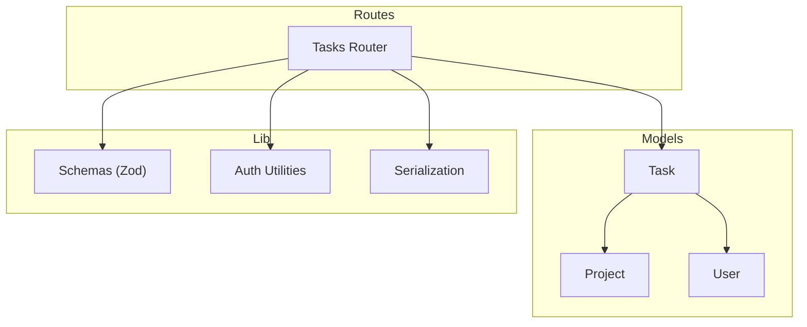
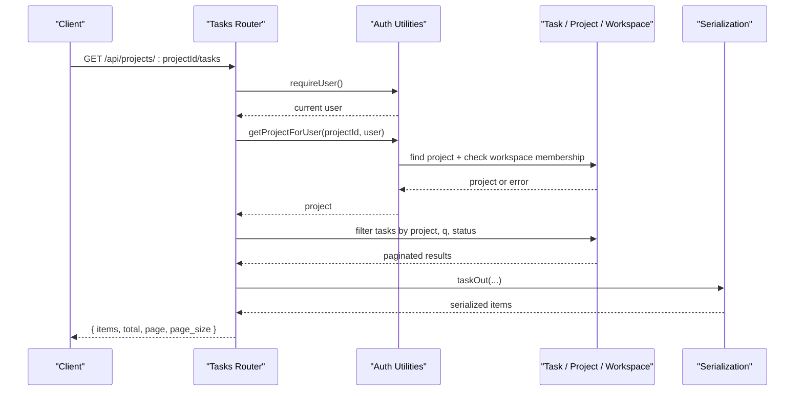
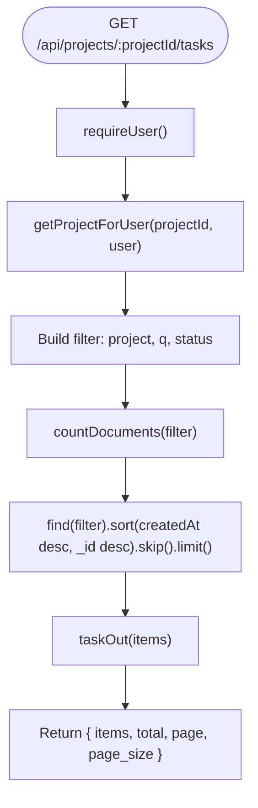
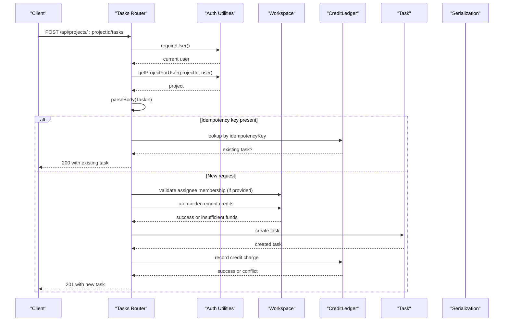
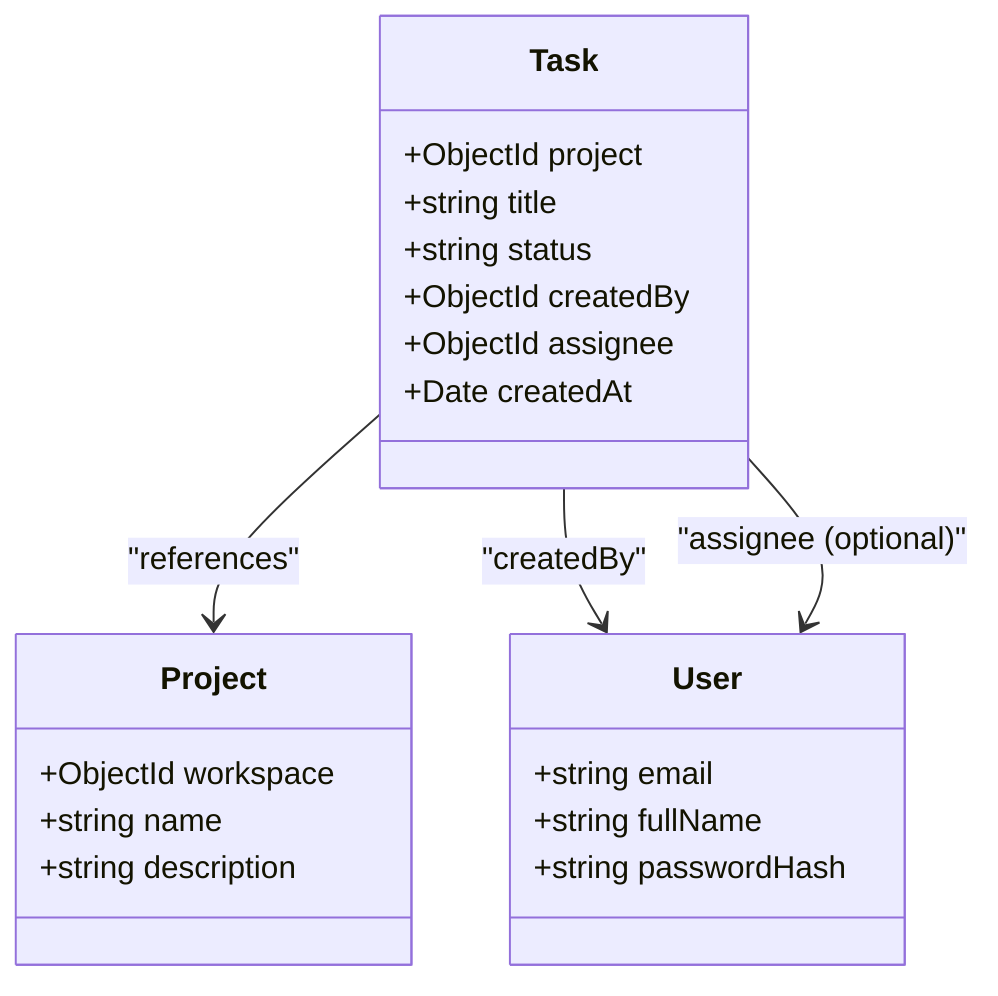
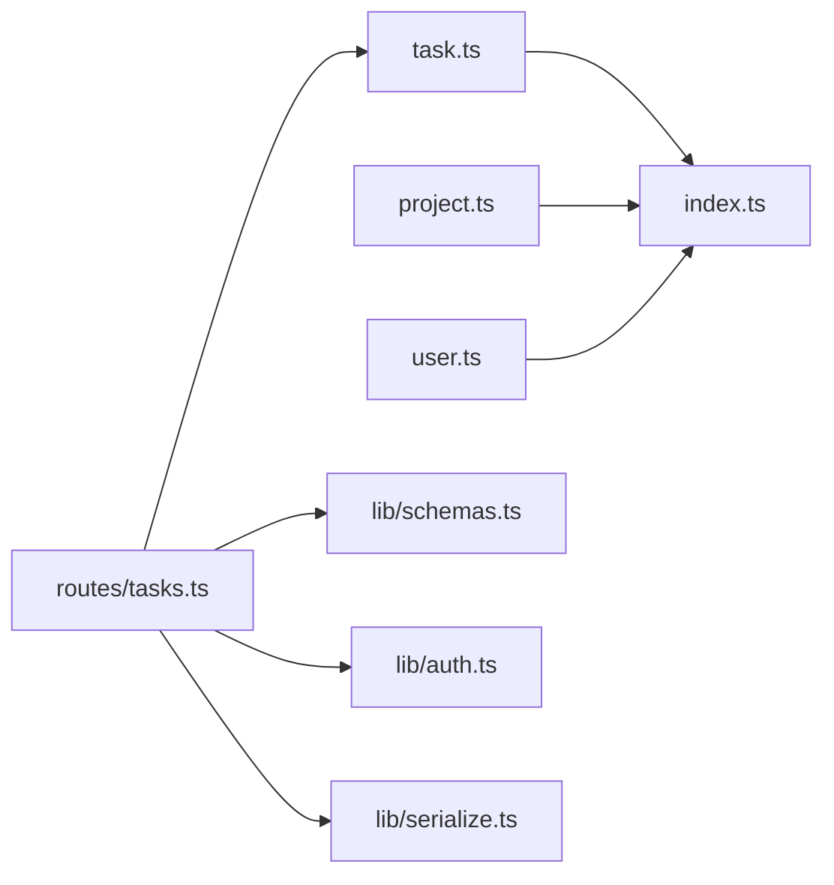

# Task Model

<cite>
**Referenced Files in This Document**
- [task.ts](file://phoenix-backend/src/models/task.ts)
- [project.ts](file://phoenix-backend/src/models/project.ts)
- [user.ts](file://phoenix-backend/src/models/user.ts)
- [tasks.ts](file://phoenix-backend/src/routes/tasks.ts)
- [schemas.ts](file://phoenix-backend/src/lib/schemas.ts)
- [auth.ts](file://phoenix-backend/src/lib/auth.ts)
- [serialize.ts](file://phoenix-backend/src/lib/serialize.ts)
- [index.ts](file://phoenix-backend/src/models/index.ts)
</cite>

## Table of Contents
1. [Introduction](#introduction)
2. [Project Structure](#project-structure)
3. [Core Components](#core-components)
4. [Architecture Overview](#architecture-overview)
5. [Detailed Component Analysis](#detailed-component-analysis)
6. [Dependency Analysis](#dependency-analysis)
7. [Performance Considerations](#performance-considerations)
8. [Troubleshooting Guide](#troubleshooting-guide)
9. [Conclusion](#conclusion)

## Introduction
This document describes the Task data model and its integration within the system. It explains the task entity structure, its relationship with projects and users, the status workflow, assignment rules, permission checks, and query patterns including filtering and pagination. It also covers indexing strategies that support efficient task operations.

## Project Structure
The Task model is defined in the backend models layer and consumed by routes for listing and creation. Validation schemas define the public API contract for creating tasks and querying them. Authentication and authorization utilities enforce workspace membership before exposing project-scoped resources like tasks. Serialization transforms internal documents into the stable snake_case JSON contract used by clients.

**Diagram sources**
- [task.ts:1-15](file://phoenix-backend/src/models/task.ts#L1-L15)
- [project.ts:1-12](file://phoenix-backend/src/models/project.ts#L1-L12)
- [user.ts:1-20](file://phoenix-backend/src/models/user.ts#L1-L20)
- [tasks.ts:1-127](file://phoenix-backend/src/routes/tasks.ts#L1-L127)
- [schemas.ts:1-41](file://phoenix-backend/src/lib/schemas.ts#L1-L41)
- [auth.ts:1-58](file://phoenix-backend/src/lib/auth.ts#L1-L58)
- [serialize.ts:1-34](file://phoenix-backend/src/lib/serialize.ts#L1-L34)

**Section sources**
- [task.ts:1-15](file://phoenix-backend/src/models/task.ts#L1-L15)
- [tasks.ts:1-127](file://phoenix-backend/src/routes/tasks.ts#L1-L127)
- [schemas.ts:1-41](file://phoenix-backend/src/lib/schemas.ts#L1-L41)
- [auth.ts:1-58](file://phoenix-backend/src/lib/auth.ts#L1-L58)
- [serialize.ts:1-34](file://phoenix-backend/src/lib/serialize.ts#L1-L34)

## Core Components
- Task schema defines the core fields: project association, title, status enumeration, creator reference, optional assignee, and creation timestamp.
- Status values are constrained to a fixed set: todo, in_progress, done.
- The Task model includes an index on project, createdAt, and _id to optimize list queries.
- Projects belong to workspaces; Users represent account holders. Tasks reference both Project and User.
- Public input/output contracts are enforced via Zod schemas and serialization helpers.

Key responsibilities:
- Data validation at the API boundary (schemas).
- Authorization and membership checks (auth).
- Persistence and indexing (models).
- Stable JSON output (serialization).

**Section sources**
- [task.ts:1-15](file://phoenix-backend/src/models/task.ts#L1-L15)
- [project.ts:1-12](file://phoenix-backend/src/models/project.ts#L1-L12)
- [user.ts:1-20](file://phoenix-backend/src/models/user.ts#L1-L20)
- [schemas.ts:29-40](file://phoenix-backend/src/lib/schemas.ts#L29-L40)
- [serialize.ts:23-33](file://phoenix-backend/src/lib/serialize.ts#L23-L33)

## Architecture Overview
The Task lifecycle spans route handlers, authorization, persistence, and serialization. Listing and creation are protected by user authentication and project membership checks. Creation enforces workspace credit accounting and validates assignees against workspace membership.

**Diagram sources**
- [tasks.ts:12-35](file://phoenix-backend/src/routes/tasks.ts#L12-L35)
- [auth.ts:8-23](file://phoenix-backend/src/lib/auth.ts#L8-L23)
- [auth.ts:52-57](file://phoenix-backend/src/lib/auth.ts#L52-L57)
- [serialize.ts:23-33](file://phoenix-backend/src/lib/serialize.ts#L23-L33)

## Detailed Component Analysis

### Task Entity Structure
- Fields:
  - project: references Project; required.
  - title: string; required; trimmed.
  - status: enum; required; defaults to todo.
  - createdBy: references User; required.
  - assignee: optional reference to User; defaults to null.
  - createdAt: timestamp; required; defaults to now.
- Indexes:
  - Compound index on project, createdAt descending, and _id descending to optimize list queries and ensure stable ordering across pages.

Relationships:
- Many-to-one with Project.
- Many-to-one with User (creator).
- Optional many-to-one with User (assignee).

Status workflow:
- todo → in_progress → done.
- The status field is constrained to these values; transitions are not enforced at the schema level but should be validated by business logic when updating tasks.

Assignment system:
- Assignee is optional. When provided during creation, it must be a member of the same workspace as the project.

Examples:
- Creating a task:
  - Input fields: title, status (optional), assignee_id (optional).
  - Validation: title length constraints, status from allowed set, assignee_id must be a valid ObjectId if present.
  - Output: serialized task with snake_case fields and string IDs.
- Updating task status:
  - Not implemented in the analyzed routes; would follow similar validation and authorization patterns.
- Filtering and searching:
  - Filter by project (implicit via route), search by title substring (case-insensitive), filter by status.
  - Pagination parameters: page (default 1), page_size (default 10, max 100).

**Section sources**
- [task.ts:3-14](file://phoenix-backend/src/models/task.ts#L3-L14)
- [schemas.ts:29-40](file://phoenix-backend/src/lib/schemas.ts#L29-L40)
- [serialize.ts:23-33](file://phoenix-backend/src/lib/serialize.ts#L23-L33)

### Task Listing Flow
The listing endpoint:
- Requires authentication.
- Verifies the caller is a member of the project’s workspace.
- Builds a filter based on project, optional title search, and optional status.
- Returns paginated results sorted by newest first, with tie-breaking by _id.

**Diagram sources**
- [tasks.ts:12-35](file://phoenix-backend/src/routes/tasks.ts#L12-L35)
- [auth.ts:52-57](file://phoenix-backend/src/lib/auth.ts#L52-L57)

**Section sources**
- [tasks.ts:12-35](file://phoenix-backend/src/routes/tasks.ts#L12-L35)

### Task Creation Flow
The creation endpoint:
- Requires authentication and project membership.
- Validates input using TaskIn schema.
- Supports idempotency via Idempotency-Key header to avoid duplicate charges and duplicate tasks.
- Validates assignee membership in the workspace before spending credits.
- Deducts workspace credits atomically; refunds on failure.
- Persists the task and records a credit ledger entry; rolls back on ledger write failure.

**Diagram sources**
- [tasks.ts:38-126](file://phoenix-backend/src/routes/tasks.ts#L38-L126)
- [auth.ts:52-57](file://phoenix-backend/src/lib/auth.ts#L52-L57)
- [schemas.ts:29-33](file://phoenix-backend/src/lib/schemas.ts#L29-L33)

**Section sources**
- [tasks.ts:38-126](file://phoenix-backend/src/routes/tasks.ts#L38-L126)

### Permission Checks and Security
- Authentication: Bearer token is decoded and validated; invalid or missing tokens result in 401.
- Authorization:
  - requireMember ensures the user belongs to the workspace; returns 404 to avoid leaking workspace existence.
  - requireAdmin and requireOwner enforce role-based access where needed.
  - getProjectForUser verifies project existence and workspace membership before exposing project-scoped resources.

Implications for tasks:
- All task endpoints under a project require the caller to be a workspace member of that project’s workspace.
- Assignee validation ensures only workspace members can be assigned tasks.

**Section sources**
- [auth.ts:8-23](file://phoenix-backend/src/lib/auth.ts#L8-L23)
- [auth.ts:29-57](file://phoenix-backend/src/lib/auth.ts#L29-L57)
- [tasks.ts:12-46](file://phoenix-backend/src/routes/tasks.ts#L12-L46)

### Data Models and Relationships

**Diagram sources**
- [task.ts:5-12](file://phoenix-backend/src/models/task.ts#L5-L12)
- [project.ts:3-10](file://phoenix-backend/src/models/project.ts#L3-L10)
- [user.ts:3-10](file://phoenix-backend/src/models/user.ts#L3-L10)

**Section sources**
- [task.ts:5-12](file://phoenix-backend/src/models/task.ts#L5-L12)
- [project.ts:3-10](file://phoenix-backend/src/models/project.ts#L3-L10)
- [user.ts:3-10](file://phoenix-backend/src/models/user.ts#L3-L10)

### API Contracts and Examples

#### Task Creation
- Endpoint: POST /api/projects/:projectId/tasks
- Headers:
  - Authorization: Bearer <token>
  - Idempotency-Key: optional unique key to deduplicate retries
- Request body (validated by TaskIn):
  - title: string, 1–200 characters
  - status: one of todo, in_progress, done (defaults to todo)
  - assignee_id: optional valid ObjectId string
- Response:
  - 201 Created with serialized task object
  - 401 Unauthorized if token invalid/expired or user missing
  - 404 Not Found if project not found or user not a workspace member
  - 402 Payment Required if workspace has insufficient credits
  - 422 Unprocessable Entity if assignee is not a workspace member

Example usage pattern:
- Create a task with no assignee:
  - Body: { title: "Implement feature X", status: "todo" }
- Create a task assigned to a workspace member:
  - Body: { title: "Review PR #123", status: "in_progress", assignee_id: "<user-id>" }

**Section sources**
- [tasks.ts:38-126](file://phoenix-backend/src/routes/tasks.ts#L38-L126)
- [schemas.ts:29-33](file://phoenix-backend/src/lib/schemas.ts#L29-L33)
- [serialize.ts:23-33](file://phoenix-backend/src/lib/serialize.ts#L23-L33)

#### Task Listing and Filtering
- Endpoint: GET /api/projects/:projectId/tasks
- Query parameters (validated by TaskQuery):
  - q: optional search term for title (case-insensitive substring match)
  - status: optional filter by status (todo, in_progress, done)
  - page: integer ≥ 1 (default 1)
  - page_size: integer 1–100 (default 10)
- Response:
  - 200 OK with { items: [], total: number, page: number, page_size: number }
  - 401 Unauthorized if token invalid/expired or user missing
  - 404 Not Found if project not found or user not a workspace member

Example usage pattern:
- List all tasks for a project:
  - GET /api/projects/<project-id>/tasks?page=1&page_size=20
- Search tasks by title:
  - GET /api/projects/<project-id>/tasks?q=feature&page_size=10
- Filter by status:
  - GET /api/projects/<project-id>/tasks?status=done&page_size=50

**Section sources**
- [tasks.ts:12-35](file://phoenix-backend/src/routes/tasks.ts#L12-L35)
- [schemas.ts:35-40](file://phoenix-backend/src/lib/schemas.ts#L35-L40)

### Status Workflow and Assignment Rules
- Status values:
  - todo: initial state
  - in_progress: active work
  - done: completed
- Assignment:
  - Assignee is optional.
  - During creation, if assignee_id is provided, the handler verifies that the user is a member of the project’s workspace; otherwise returns 422.

Note:
- Status transitions are not enforced by schema-level constraints beyond allowed values. Business logic should validate transitions when implementing update endpoints.

**Section sources**
- [task.ts:3-10](file://phoenix-backend/src/models/task.ts#L3-L10)
- [tasks.ts:68-72](file://phoenix-backend/src/routes/tasks.ts#L68-L72)

## Dependency Analysis
- Task depends on Project and User references.
- Routes depend on auth utilities for authentication and membership checks.
- Schemas define input validation for tasks and queries.
- Serialization maps internal documents to the public JSON contract.
- Model registration ensures indexes are created at startup.

**Diagram sources**
- [index.ts:1-27](file://phoenix-backend/src/models/index.ts#L1-L27)
- [tasks.ts:1-127](file://phoenix-backend/src/routes/tasks.ts#L1-L127)
- [schemas.ts:1-41](file://phoenix-backend/src/lib/schemas.ts#L1-L41)
- [auth.ts:1-58](file://phoenix-backend/src/lib/auth.ts#L1-L58)
- [serialize.ts:1-34](file://phoenix-backend/src/lib/serialize.ts#L1-L34)

**Section sources**
- [index.ts:1-27](file://phoenix-backend/src/models/index.ts#L1-L27)
- [tasks.ts:1-127](file://phoenix-backend/src/routes/tasks.ts#L1-L127)

## Performance Considerations
- Indexing strategy:
  - Compound index on project, createdAt descending, and _id descending supports efficient sorting and stable pagination for task listings.
- Query optimization:
  - Use lean queries to reduce overhead when returning lists.
  - Limit page_size to reasonable values (max 100) to prevent heavy payloads.
- Idempotency:
  - Idempotency keys prevent duplicate charges and duplicate task creation under concurrent retries.
- Credit accounting:
  - Atomic workspace credit deduction avoids race conditions and ensures consistent billing.

Recommendations:
- Keep page_size small for large datasets.
- Prefer filtering by status and title to narrow result sets.
- Avoid scanning without filters on large collections.

[No sources needed since this section provides general guidance]

## Troubleshooting Guide
Common issues and resolutions:
- 401 Unauthorized:
  - Ensure Authorization header uses Bearer scheme with a valid token.
  - Verify the user still exists in the system.
- 404 Not Found:
  - For task listing/creation, confirm the project exists and the user is a workspace member.
- 402 Payment Required:
  - Insufficient workspace credits; top up the workspace before creating tasks.
- 422 Unprocessable Entity:
  - Assignee not a workspace member; verify assignee_id belongs to the same workspace as the project.
- Duplicate task due to retries:
  - Provide a unique Idempotency-Key header to deduplicate repeated requests.

Operational tips:
- Validate inputs early using the provided schemas.
- Log errors with context (project id, user id) while avoiding sensitive data exposure.
- Monitor credit ledger entries to reconcile task creation charges.

**Section sources**
- [auth.ts:8-23](file://phoenix-backend/src/lib/auth.ts#L8-L23)
- [auth.ts:29-57](file://phoenix-backend/src/lib/auth.ts#L29-L57)
- [tasks.ts:68-81](file://phoenix-backend/src/routes/tasks.ts#L68-L81)
- [tasks.ts:109-122](file://phoenix-backend/src/routes/tasks.ts#L109-L122)

## Conclusion
The Task model provides a clear, constrained representation of tasks with strong relationships to projects and users. The implementation emphasizes secure access through workspace membership, robust input validation, and efficient query performance via targeted indexing. While status transitions are not enforced at the schema level, the allowed values and assignment checks provide a solid foundation for building reliable task workflows.

[No sources needed since this section summarizes without analyzing specific files]