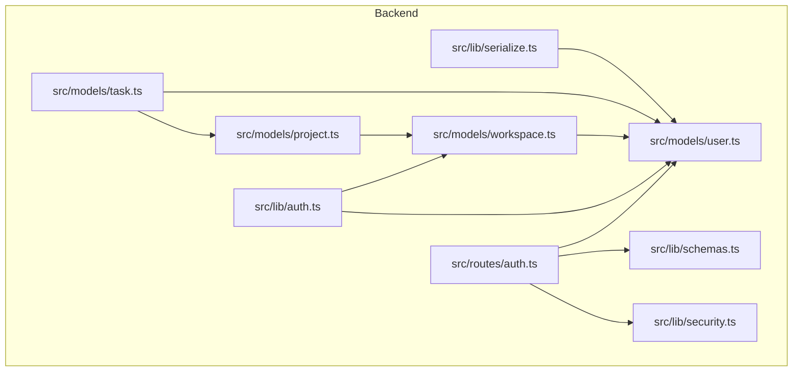
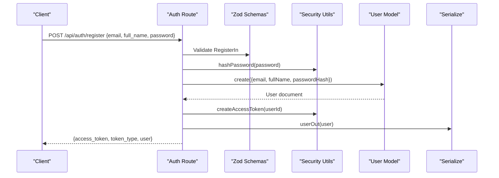
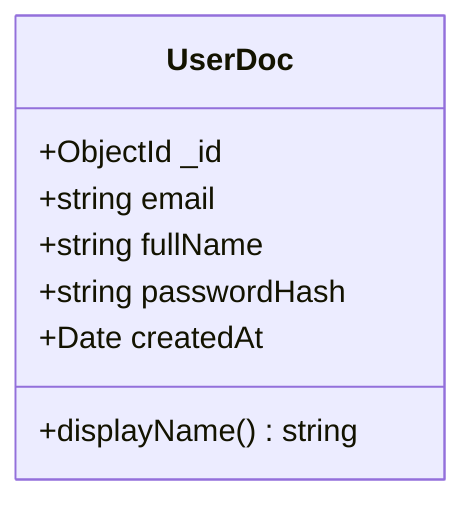
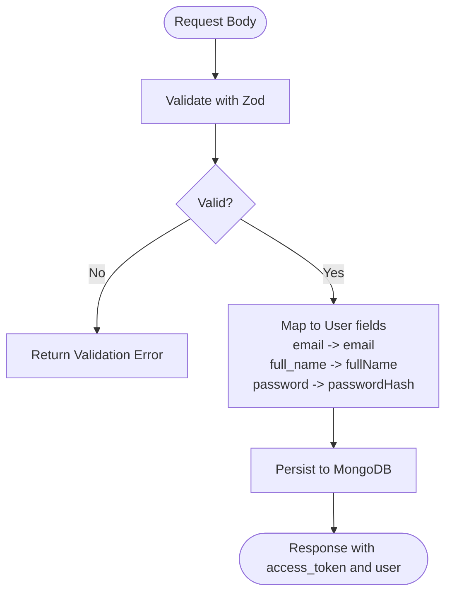
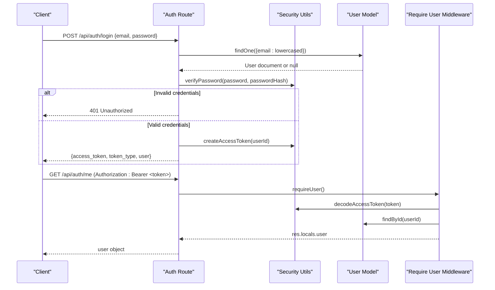
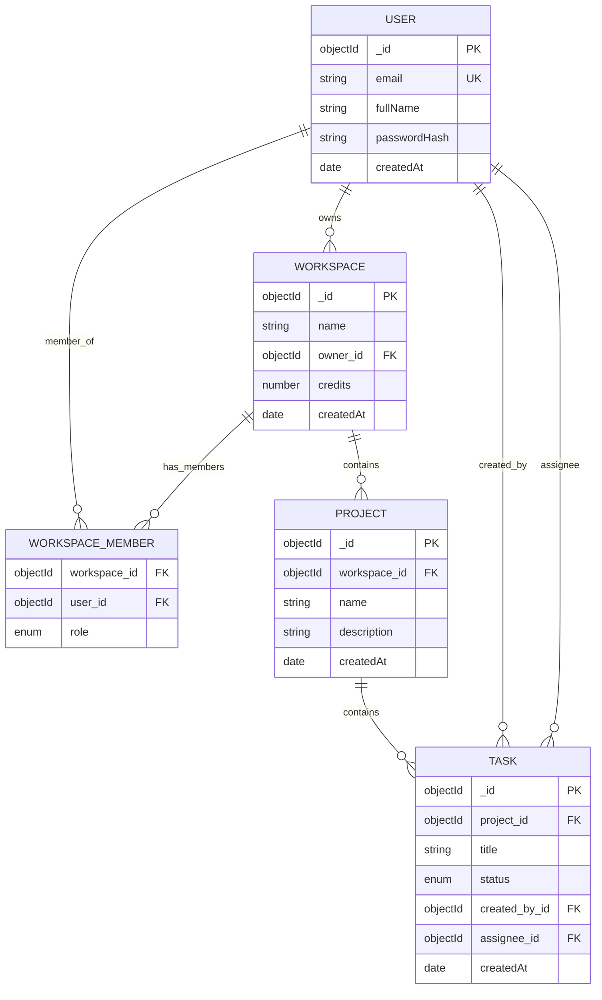
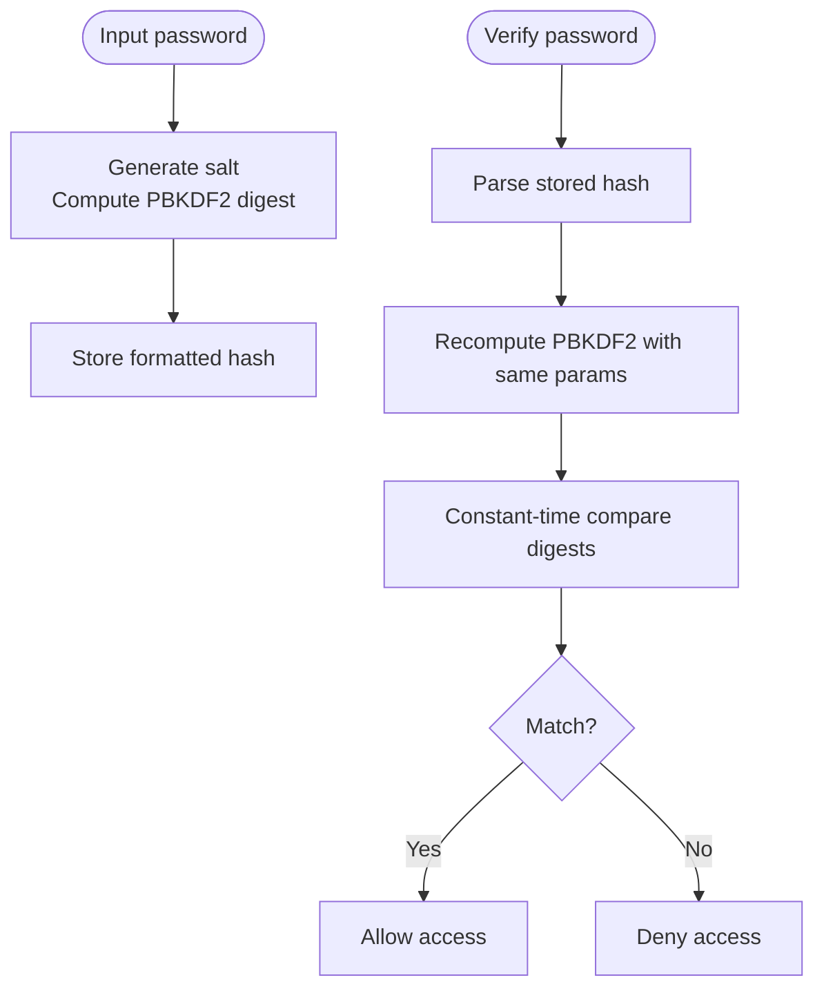
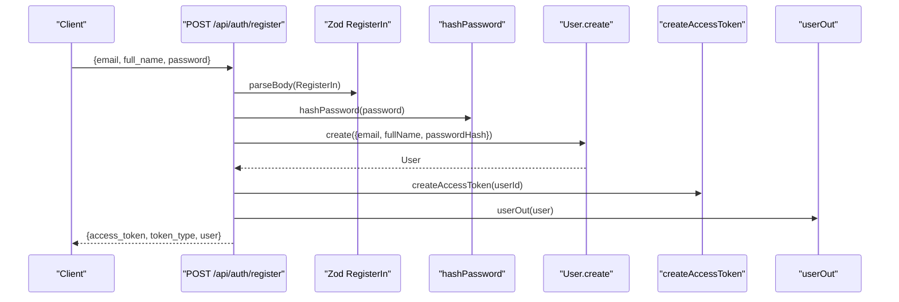
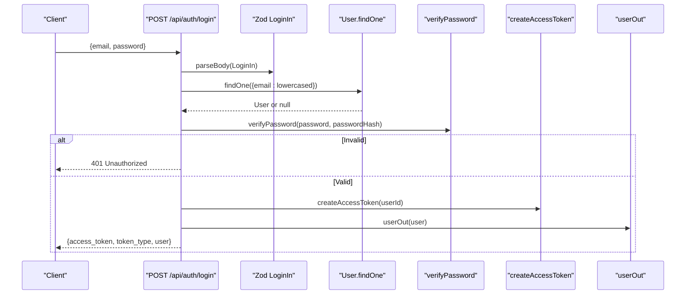
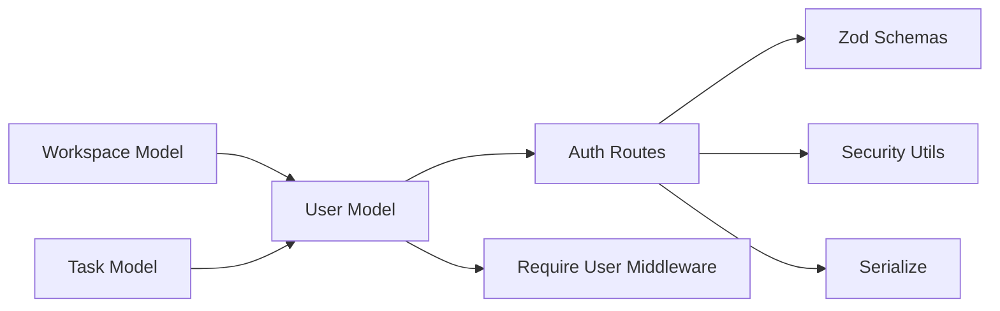

# User Model

<cite>
**Referenced Files in This Document**
- [user.ts](file://phoenix-backend/src/models/user.ts)
- [schemas.ts](file://phoenix-backend/src/lib/schemas.ts)
- [auth.ts](file://phoenix-backend/src/routes/auth.ts)
- [auth.ts](file://phoenix-backend/src/lib/auth.ts)
- [security.ts](file://phoenix-backend/src/lib/security.ts)
- [workspace.ts](file://phoenix-backend/src/models/workspace.ts)
- [project.ts](file://phoenix-backend/src/models/project.ts)
- [task.ts](file://phoenix-backend/src/models/task.ts)
- [serialize.ts](file://phoenix-backend/src/lib/serialize.ts)
</cite>

## Table of Contents
1. [Introduction](#introduction)
2. [Project Structure](#project-structure)
3. [Core Components](#core-components)
4. [Architecture Overview](#architecture-overview)
5. [Detailed Component Analysis](#detailed-component-analysis)
6. [Dependency Analysis](#dependency-analysis)
7. [Performance Considerations](#performance-considerations)
8. [Troubleshooting Guide](#troubleshooting-guide)
9. [Conclusion](#conclusion)

## Introduction
This document provides comprehensive data model documentation for the User entity in the backend application. It covers the Mongoose schema definition, validation rules, TypeScript types, timestamps configuration, and how the User model integrates with authentication and other domain models such as Workspace, Project, and Task. It also includes security considerations for password handling and data privacy requirements.

## Project Structure
The User model is defined in a dedicated file and exported through the models index. Input validation uses Zod schemas, while authentication routes integrate the User model with secure password hashing and JWT-based access tokens. Relationships to other models are established via references to User IDs.

**Diagram sources**
- [user.ts:1-20](file://phoenix-backend/src/models/user.ts#L1-L20)
- [schemas.ts:1-41](file://phoenix-backend/src/lib/schemas.ts#L1-L41)
- [auth.ts:1-52](file://phoenix-backend/src/routes/auth.ts#L1-L52)
- [auth.ts:1-58](file://phoenix-backend/src/lib/auth.ts#L1-L58)
- [security.ts:1-38](file://phoenix-backend/src/lib/security.ts#L1-L38)
- [workspace.ts:1-22](file://phoenix-backend/src/models/workspace.ts#L1-L22)
- [project.ts:1-12](file://phoenix-backend/src/models/project.ts#L1-L12)
- [task.ts:1-15](file://phoenix-backend/src/models/task.ts#L1-L15)
- [serialize.ts:1-33](file://phoenix-backend/src/lib/serialize.ts#L1-L33)

**Section sources**
- [user.ts:1-20](file://phoenix-backend/src/models/user.ts#L1-L20)
- [schemas.ts:1-41](file://phoenix-backend/src/lib/schemas.ts#L1-L41)
- [auth.ts:1-52](file://phoenix-backend/src/routes/auth.ts#L1-L52)
- [auth.ts:1-58](file://phoenix-backend/src/lib/auth.ts#L1-L58)
- [security.ts:1-38](file://phoenix-backend/src/lib/security.ts#L1-L38)
- [workspace.ts:1-22](file://phoenix-backend/src/models/workspace.ts#L1-L22)
- [project.ts:1-12](file://phoenix-backend/src/models/project.ts#L1-L12)
- [task.ts:1-15](file://phoenix-backend/src/models/task.ts#L1-L15)
- [serialize.ts:1-33](file://phoenix-backend/src/lib/serialize.ts#L1-L33)

## Core Components
- User Mongoose schema defines email (unique, lowercase, trimmed), fullName (required, trimmed), and passwordHash (required). Timestamps are configured to include createdAt and disable updatedAt.
- A virtual displayName returns fullName when present, otherwise falls back to email.
- The TypeScript type UserDoc is derived from the schema using InferSchemaType and adds an ObjectId _id.
- The User model is registered once and exported for use across the application.

Key responsibilities:
- Data modeling and validation at the database layer.
- Providing a consistent user identity used by authorization and business logic.
- Exposing a safe public representation via serialization utilities.

**Section sources**
- [user.ts:1-20](file://phoenix-backend/src/models/user.ts#L1-L20)

## Architecture Overview
The User model participates in several flows:
- Registration and login endpoints validate input, hash or verify passwords, create or retrieve users, and issue JWT access tokens.
- Authorization middleware decodes tokens, loads the current user, and enforces workspace membership and roles.
- Other models reference User IDs to establish relationships (e.g., tasks created by users, workspace owners, assignees).

**Diagram sources**
- [auth.ts:11-31](file://phoenix-backend/src/routes/auth.ts#L11-L31)
- [schemas.ts:7-11](file://phoenix-backend/src/lib/schemas.ts#L7-L11)
- [security.ts:7-11](file://phoenix-backend/src/lib/security.ts#L7-L11)
- [user.ts:1-20](file://phoenix-backend/src/models/user.ts#L1-L20)
- [serialize.ts:7-11](file://phoenix-backend/src/lib/serialize.ts#L7-L11)

## Detailed Component Analysis

### User Schema Definition and Validation
- Fields:
  - email: String, required, unique, lowercase, trimmed.
  - fullName: String, required, trimmed.
  - passwordHash: String, required.
- Timestamps:
  - createdAt enabled; updatedAt disabled.
- Virtual:
  - displayName returns fullName if present, else email.
- TypeScript:
  - UserDoc inferred from the schema and augmented with _id as ObjectId.

**Diagram sources**
- [user.ts:3-16](file://phoenix-backend/src/models/user.ts#L3-L16)

**Section sources**
- [user.ts:3-16](file://phoenix-backend/src/models/user.ts#L3-L16)

### Input Validation and Public API Contract
- Registration input (RegisterIn):
  - email: trimmed string between 3 and 255 characters, validated as an email-like pattern.
  - full_name: trimmed string between 1 and 120 characters.
  - password: string between 8 and 128 characters.
- Login input (LoginIn):
  - email: trimmed string between 1 and 255 characters.
  - password: non-empty string.
- Public user output (userOut):
  - id: stringified ObjectId.
  - email: string.
  - full_name: string.

**Diagram sources**
- [schemas.ts:7-13](file://phoenix-backend/src/lib/schemas.ts#L7-L13)
- [auth.ts:11-31](file://phoenix-backend/src/routes/auth.ts#L11-L31)
- [serialize.ts:7-11](file://phoenix-backend/src/lib/serialize.ts#L7-L11)

**Section sources**
- [schemas.ts:7-13](file://phoenix-backend/src/lib/schemas.ts#L7-L13)
- [auth.ts:11-31](file://phoenix-backend/src/routes/auth.ts#L11-L31)
- [serialize.ts:7-11](file://phoenix-backend/src/lib/serialize.ts#L7-L11)

### Authentication Flow Integration
- Registration:
  - Validates input, hashes password, creates user, issues JWT, returns serialized user.
- Login:
  - Validates input, finds user by email (lowercased), verifies password, issues JWT, returns serialized user.
- Current user:
  - Middleware extracts bearer token, decodes it, loads user, attaches to request locals.

**Diagram sources**
- [auth.ts:33-51](file://phoenix-backend/src/routes/auth.ts#L33-L51)
- [auth.ts:8-23](file://phoenix-backend/src/lib/auth.ts#L8-L23)
- [security.ts:13-21](file://phoenix-backend/src/lib/security.ts#L13-L21)
- [security.ts:23-37](file://phoenix-backend/src/lib/security.ts#L23-L37)
- [user.ts:1-20](file://phoenix-backend/src/models/user.ts#L1-L20)

**Section sources**
- [auth.ts:33-51](file://phoenix-backend/src/routes/auth.ts#L33-L51)
- [auth.ts:8-23](file://phoenix-backend/src/lib/auth.ts#L8-L23)
- [security.ts:13-21](file://phoenix-backend/src/lib/security.ts#L13-L21)
- [security.ts:23-37](file://phoenix-backend/src/lib/security.ts#L23-L37)

### Relationship with Other Models
- Workspace:
  - owner references User.
  - WorkspaceMember links users to workspaces with role enumeration.
- Project:
  - belongs to a Workspace; does not directly reference User.
- Task:
  - createdBy and assignee both reference User.

**Diagram sources**
- [workspace.ts:5-21](file://phoenix-backend/src/models/workspace.ts#L5-L21)
- [project.ts:3-11](file://phoenix-backend/src/models/project.ts#L3-L11)
- [task.ts:5-14](file://phoenix-backend/src/models/task.ts#L5-L14)
- [user.ts:3-16](file://phoenix-backend/src/models/user.ts#L3-L16)

**Section sources**
- [workspace.ts:5-21](file://phoenix-backend/src/models/workspace.ts#L5-L21)
- [project.ts:3-11](file://phoenix-backend/src/models/project.ts#L3-L11)
- [task.ts:5-14](file://phoenix-backend/src/models/task.ts#L5-L14)
- [user.ts:3-16](file://phoenix-backend/src/models/user.ts#L3-L16)

### Password Handling and Security Considerations
- Password storage:
  - Uses PBKDF2 with configurable iterations, random salt, and SHA-256 digest.
  - Stored as a structured string containing algorithm parameters and digest.
- Verification:
  - Compares computed digest against stored digest using constant-time comparison to mitigate timing attacks.
- Tokens:
  - Access tokens are JWTs signed with a secret and algorithm from settings, with expiration based on minutes.
- Best practices:
  - Never log or expose passwordHash in responses.
  - Ensure environment variables for JWT secret and algorithm are securely managed.
  - Enforce minimum password length and complexity at the client and server layers.

**Diagram sources**
- [security.ts:7-21](file://phoenix-backend/src/lib/security.ts#L7-L21)

**Section sources**
- [security.ts:7-21](file://phoenix-backend/src/lib/security.ts#L7-L21)
- [security.ts:23-37](file://phoenix-backend/src/lib/security.ts#L23-L37)

### Examples

#### User Creation Example
- Steps:
  - Validate registration payload with Zod.
  - Normalize email to lowercase.
  - Hash the password.
  - Create a new User document.
  - Issue a JWT access token.
  - Return serialized user object.

**Diagram sources**
- [auth.ts:11-31](file://phoenix-backend/src/routes/auth.ts#L11-L31)
- [schemas.ts:7-11](file://phoenix-backend/src/lib/schemas.ts#L7-L11)
- [security.ts:7-11](file://phoenix-backend/src/lib/security.ts#L7-L11)
- [serialize.ts:7-11](file://phoenix-backend/src/lib/serialize.ts#L7-L11)

**Section sources**
- [auth.ts:11-31](file://phoenix-backend/src/routes/auth.ts#L11-L31)
- [schemas.ts:7-11](file://phoenix-backend/src/lib/schemas.ts#L7-L11)
- [security.ts:7-11](file://phoenix-backend/src/lib/security.ts#L7-L11)
- [serialize.ts:7-11](file://phoenix-backend/src/lib/serialize.ts#L7-L11)

#### Authentication Flow Integration Example
- Steps:
  - Validate login payload.
  - Find user by email (lowercased).
  - Verify password against stored hash.
  - Issue JWT access token.
  - Return serialized user.

**Diagram sources**
- [auth.ts:33-47](file://phoenix-backend/src/routes/auth.ts#L33-L47)
- [schemas.ts:13](file://phoenix-backend/src/lib/schemas.ts#L13)
- [security.ts:13-21](file://phoenix-backend/src/lib/security.ts#L13-L21)
- [serialize.ts:7-11](file://phoenix-backend/src/lib/serialize.ts#L7-L11)

**Section sources**
- [auth.ts:33-47](file://phoenix-backend/src/routes/auth.ts#L33-L47)
- [schemas.ts:13](file://phoenix-backend/src/lib/schemas.ts#L13)
- [security.ts:13-21](file://phoenix-backend/src/lib/security.ts#L13-L21)
- [serialize.ts:7-11](file://phoenix-backend/src/lib/serialize.ts#L7-L11)

## Dependency Analysis
- User model dependencies:
  - Mongoose for schema and model registration.
  - Exported via models index for reuse.
- Authentication route dependencies:
  - Zod schemas for input validation.
  - Security utilities for password hashing/verification and JWT creation/decoding.
  - Serialization utility for public user representation.
- Authorization middleware dependencies:
  - Decodes JWT, fetches user, and enforces workspace membership and roles.
- Related models:
  - Workspace owns Users and has members with roles.
  - Tasks reference Users as creators and assignees.

**Diagram sources**
- [user.ts:1-20](file://phoenix-backend/src/models/user.ts#L1-L20)
- [auth.ts:1-52](file://phoenix-backend/src/routes/auth.ts#L1-L52)
- [auth.ts:1-58](file://phoenix-backend/src/lib/auth.ts#L1-L58)
- [schemas.ts:1-41](file://phoenix-backend/src/lib/schemas.ts#L1-L41)
- [security.ts:1-38](file://phoenix-backend/src/lib/security.ts#L1-L38)
- [workspace.ts:1-22](file://phoenix-backend/src/models/workspace.ts#L1-L22)
- [task.ts:1-15](file://phoenix-backend/src/models/task.ts#L1-L15)
- [serialize.ts:1-33](file://phoenix-backend/src/lib/serialize.ts#L1-L33)

**Section sources**
- [user.ts:1-20](file://phoenix-backend/src/models/user.ts#L1-L20)
- [auth.ts:1-52](file://phoenix-backend/src/routes/auth.ts#L1-L52)
- [auth.ts:1-58](file://phoenix-backend/src/lib/auth.ts#L1-L58)
- [schemas.ts:1-41](file://phoenix-backend/src/lib/schemas.ts#L1-L41)
- [security.ts:1-38](file://phoenix-backend/src/lib/security.ts#L1-L38)
- [workspace.ts:1-22](file://phoenix-backend/src/models/workspace.ts#L1-L22)
- [task.ts:1-15](file://phoenix-backend/src/models/task.ts#L1-L15)
- [serialize.ts:1-33](file://phoenix-backend/src/lib/serialize.ts#L1-L33)

## Performance Considerations
- Password hashing:
  - PBKDF2 iterations are set to a high value to resist brute-force attacks; ensure CPU resources are adequate during registration.
- Database queries:
  - Email uniqueness is enforced at the database level; avoid redundant checks in application code.
- Serialization:
  - Use lean queries where possible to reduce overhead when only reading user data.
- Indexing:
  - Unique indexes on email and composite indexes on related models improve query performance.

[No sources needed since this section provides general guidance]

## Troubleshooting Guide
- Duplicate email errors:
  - Registration may fail due to unique constraint on email; return appropriate conflict response.
- Invalid credentials:
  - Login fails if user not found or password verification fails; return unauthorized response.
- Token issues:
  - Missing or malformed Authorization header results in authentication failure.
  - Expired or invalid tokens result in unauthorized responses.
- Workspace membership:
  - Accessing workspace-scoped resources requires membership; missing membership returns not found or forbidden depending on context.

**Section sources**
- [auth.ts:11-31](file://phoenix-backend/src/routes/auth.ts#L11-L31)
- [auth.ts:33-51](file://phoenix-backend/src/routes/auth.ts#L33-L51)
- [auth.ts:8-23](file://phoenix-backend/src/lib/auth.ts#L8-L23)

## Conclusion
The User model provides a robust foundation for identity management within the application. Its schema enforces strict data constraints, while integration with Zod schemas ensures reliable input validation. Secure password handling and JWT-based authentication protect sensitive operations. Relationships with Workspace, Project, and Task models enable rich collaboration features. Following the outlined best practices will help maintain security, performance, and data integrity.

[No sources needed since this section summarizes without analyzing specific files]