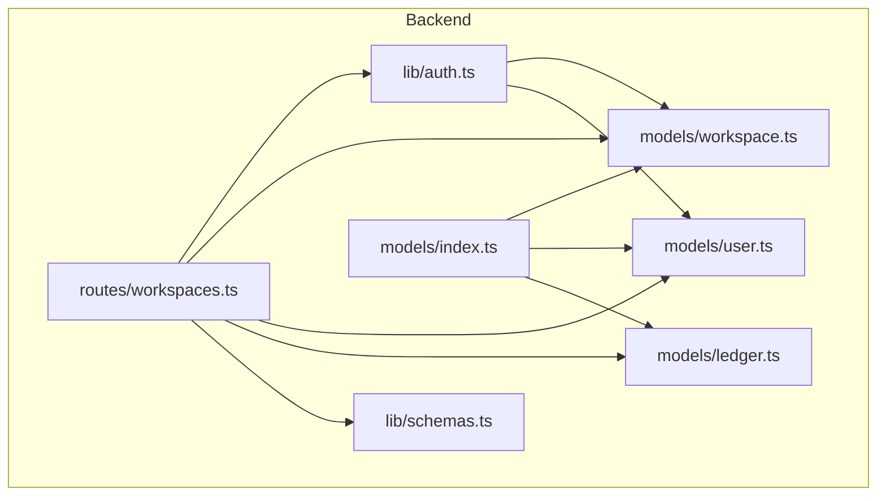
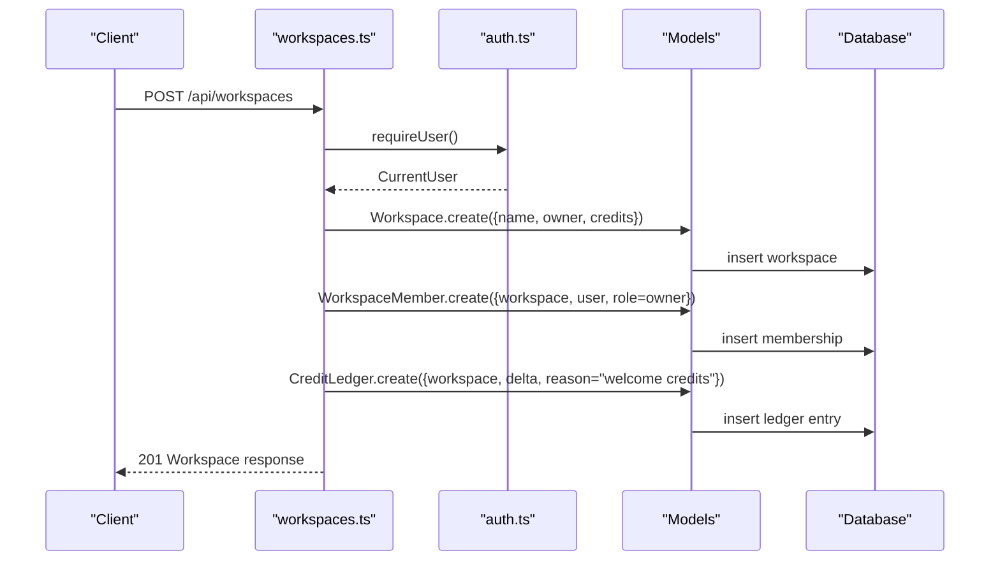
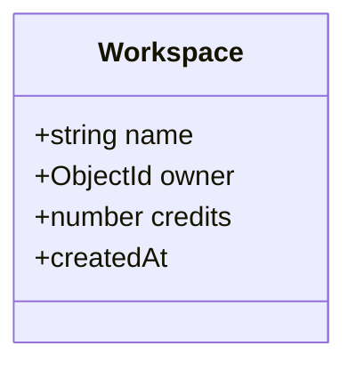
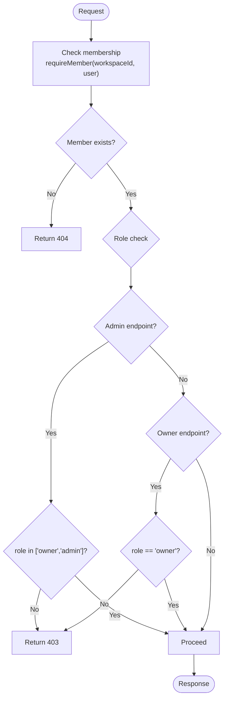
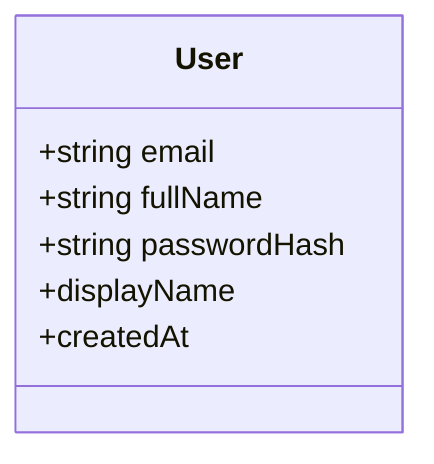
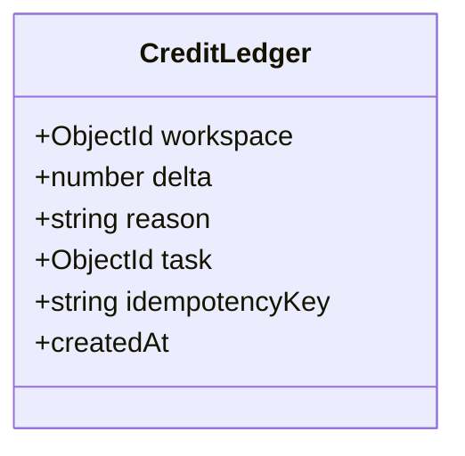
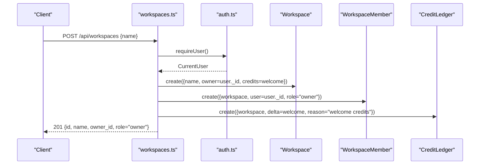
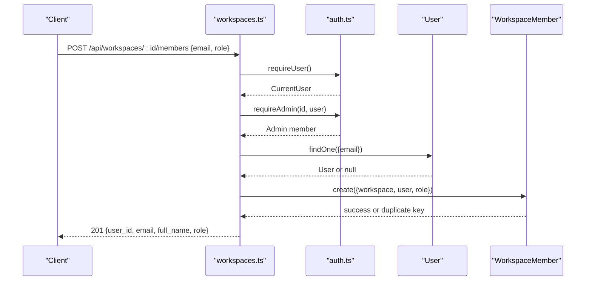
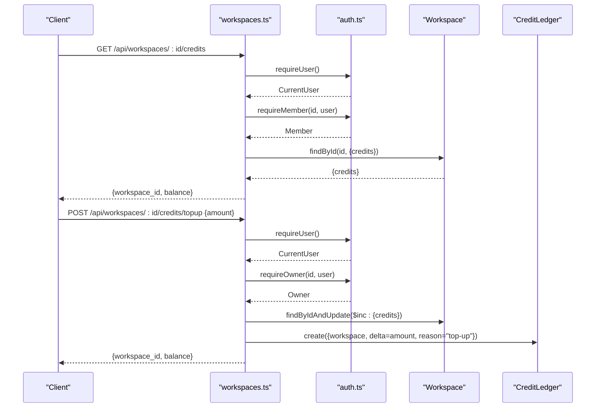
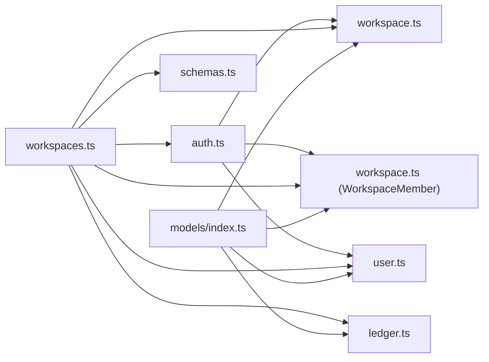

# Workspace Model

<cite>
**Referenced Files in This Document**
- [workspace.ts](file://phoenix-backend/src/models/workspace.ts)
- [user.ts](file://phoenix-backend/src/models/user.ts)
- [ledger.ts](file://phoenix-backend/src/models/ledger.ts)
- [auth.ts](file://phoenix-backend/src/lib/auth.ts)
- [workspaces.ts](file://phoenix-backend/src/routes/workspaces.ts)
- [schemas.ts](file://phoenix-backend/src/lib/schemas.ts)
- [index.ts](file://phoenix-backend/src/models/index.ts)
</cite>

## Table of Contents
1. [Introduction](#introduction)
2. [Project Structure](#project-structure)
3. [Core Components](#core-components)
4. [Architecture Overview](#architecture-overview)
5. [Detailed Component Analysis](#detailed-component-analysis)
6. [Dependency Analysis](#dependency-analysis)
7. [Performance Considerations](#performance-considerations)
8. [Troubleshooting Guide](#troubleshooting-guide)
9. [Conclusion](#conclusion)

## Introduction
This document describes the data model and access control design for Workspaces, including entity structure, role-based permissions, credit management, transaction tracking, and multi-tenancy patterns. It explains how workspaces are created, how members are invited, and how credits are tracked and enforced.

## Project Structure
The workspace-related functionality is implemented in the backend under:
- Data models: workspace, user, ledger
- Authorization helpers: auth middleware and role checks
- API routes: workspace CRUD, member management, and credit operations
- Input validation schemas: request shape definitions

**Diagram sources**
- [workspace.ts:1-22](file://phoenix-backend/src/models/workspace.ts#L1-L22)
- [user.ts:1-20](file://phoenix-backend/src/models/user.ts#L1-L20)
- [ledger.ts:1-19](file://phoenix-backend/src/models/ledger.ts#L1-L19)
- [auth.ts:1-58](file://phoenix-backend/src/lib/auth.ts#L1-L58)
- [workspaces.ts:1-128](file://phoenix-backend/src/routes/workspaces.ts#L1-L128)
- [schemas.ts:1-41](file://phoenix-backend/src/lib/schemas.ts#L1-L41)
- [index.ts:1-27](file://phoenix-backend/src/models/index.ts#L1-L27)

**Section sources**
- [workspace.ts:1-22](file://phoenix-backend/src/models/workspace.ts#L1-L22)
- [user.ts:1-20](file://phoenix-backend/src/models/user.ts#L1-L20)
- [ledger.ts:1-19](file://phoenix-backend/src/models/ledger.ts#L1-L19)
- [auth.ts:1-58](file://phoenix-backend/src/lib/auth.ts#L1-L58)
- [workspaces.ts:1-128](file://phoenix-backend/src/routes/workspaces.ts#L1-L128)
- [schemas.ts:1-41](file://phoenix-backend/src/lib/schemas.ts#L1-L41)
- [index.ts:1-27](file://phoenix-backend/src/models/index.ts#L1-L27)

## Core Components
- Workspace: Represents a tenant boundary with a name, an owner reference, and a numeric credits balance.
- WorkspaceMember: Links users to workspaces with a role (owner, admin, member).
- User: The authenticated user entity referenced by workspace ownership and membership.
- CreditLedger: Append-only audit trail for credit changes, supporting idempotency via optional keys.

Key responsibilities:
- Workspace defines the tenancy unit and holds the current credits balance.
- WorkspaceMember enforces RBAC per workspace.
- CreditLedger records every credit delta with reason and optional task linkage.
- Auth helpers enforce role-based access across endpoints.

**Section sources**
- [workspace.ts:1-22](file://phoenix-backend/src/models/workspace.ts#L1-L22)
- [user.ts:1-20](file://phoenix-backend/src/models/user.ts#L1-L20)
- [ledger.ts:1-19](file://phoenix-backend/src/models/ledger.ts#L1-L19)
- [auth.ts:29-50](file://phoenix-backend/src/lib/auth.ts#L29-L50)

## Architecture Overview
The workspace system follows a clear separation between data models, authorization, and HTTP routes. Routes validate inputs, enforce roles, update balances, and record transactions.

**Diagram sources**
- [workspaces.ts:31-42](file://phoenix-backend/src/routes/workspaces.ts#L31-L42)
- [auth.ts:8-23](file://phoenix-backend/src/lib/auth.ts#L8-L23)
- [workspace.ts:5-13](file://phoenix-backend/src/models/workspace.ts#L5-L13)
- [ledger.ts:4-18](file://phoenix-backend/src/models/ledger.ts#L4-L18)

## Detailed Component Analysis

### Workspace Entity
- Fields:
  - name: string, required, trimmed
  - owner: ObjectId reference to User, required
  - credits: number, default 0, minimum 0
- Timestamps: createdAt only; updatedAt disabled
- Purpose: Defines a workspace’s identity, primary owner, and current credit balance

**Diagram sources**
- [workspace.ts:5-13](file://phoenix-backend/src/models/workspace.ts#L5-L13)

**Section sources**
- [workspace.ts:5-13](file://phoenix-backend/src/models/workspace.ts#L5-L13)

### WorkspaceMember and Role-Based Access Control
- Fields:
  - workspace: ObjectId reference to Workspace, required
  - user: ObjectId reference to User, required
  - role: enum ["owner", "admin", "member"], default "member"
- Indexes: unique composite index on (workspace, user)
- Roles:
  - owner: full control over workspace settings and credits
  - admin: can manage members and read/write most workspace features
  - member: limited access, typically read or restricted write depending on feature

Permission enforcement:
- requireMember: ensures the user belongs to the workspace; returns 404 if not found to avoid leaking existence
- requireAdmin: requires owner or admin role
- requireOwner: requires owner role only

**Diagram sources**
- [auth.ts:29-50](file://phoenix-backend/src/lib/auth.ts#L29-L50)
- [workspace.ts:15-21](file://phoenix-backend/src/models/workspace.ts#L15-L21)

**Section sources**
- [workspace.ts:15-21](file://phoenix-backend/src/models/workspace.ts#L15-L21)
- [auth.ts:29-50](file://phoenix-backend/src/lib/auth.ts#L29-L50)

### User Entity
- Fields:
  - email: string, unique, lowercase, trimmed
  - fullName: string, required, trimmed
  - passwordHash: string, required
- Virtual: displayName derived from fullName or email
- Used by:
  - Workspace.owner reference
  - WorkspaceMember.user reference

**Diagram sources**
- [user.ts:3-19](file://phoenix-backend/src/models/user.ts#L3-L19)

**Section sources**
- [user.ts:3-19](file://phoenix-backend/src/models/user.ts#L3-L19)

### Credit Ledger and Transaction Tracking
- Fields:
  - workspace: ObjectId reference to Workspace, indexed
  - delta: number, required (positive or negative change)
  - reason: string, required (e.g., "welcome credits", "top-up")
  - task: optional ObjectId reference to Task
  - idempotencyKey: optional string, used for idempotent writes
- Indexes:
  - workspace indexed for fast queries
  - unique partial index on (workspace, idempotencyKey) when idempotencyKey is present

Behavior:
- Append-only history of credit changes
- Supports idempotency to prevent duplicate top-ups or credit adjustments
- Tracks reasons and optional task association for traceability

**Diagram sources**
- [ledger.ts:4-18](file://phoenix-backend/src/models/ledger.ts#L4-L18)

**Section sources**
- [ledger.ts:4-18](file://phoenix-backend/src/models/ledger.ts#L4-L18)

### Request Validation Schemas
- WorkspaceIn: validates workspace creation payload (name)
- MemberIn: validates member invitation payload (email, role)
- TopUpIn: validates credit top-up payload (amount must be positive integer up to 1000)

These schemas ensure consistent input shapes and constraints before database mutations.

**Section sources**
- [schemas.ts:15-22](file://phoenix-backend/src/lib/schemas.ts#L15-L22)

### Workspace Creation Flow
Steps:
1. Authenticate the user
2. Validate workspace name
3. Create workspace with initial welcome credits
4. Create membership with role "owner"
5. Record welcome credits in the ledger
6. Return workspace details including role

**Diagram sources**
- [workspaces.ts:31-42](file://phoenix-backend/src/routes/workspaces.ts#L31-L42)
- [auth.ts:8-23](file://phoenix-backend/src/lib/auth.ts#L8-L23)
- [workspace.ts:5-13](file://phoenix-backend/src/models/workspace.ts#L5-L13)
- [ledger.ts:4-18](file://phoenix-backend/src/models/ledger.ts#L4-L18)

**Section sources**
- [workspaces.ts:31-42](file://phoenix-backend/src/routes/workspaces.ts#L31-L42)
- [schemas.ts:15-15](file://phoenix-backend/src/lib/schemas.ts#L15-L15)

### Member Invitation Workflow
Steps:
1. Authenticate the user
2. Require admin role for the workspace
3. Validate invitation payload (email, role)
4. Reject attempts to assign "owner" role
5. Find target user by email
6. Create membership; handle duplicate key error gracefully
7. Return newly added member details

**Diagram sources**
- [workspaces.ts:77-102](file://phoenix-backend/src/routes/workspaces.ts#L77-L102)
- [auth.ts:36-42](file://phoenix-backend/src/lib/auth.ts#L36-L42)
- [schemas.ts:17-20](file://phoenix-backend/src/lib/schemas.ts#L17-L20)

**Section sources**
- [workspaces.ts:77-102](file://phoenix-backend/src/routes/workspaces.ts#L77-L102)
- [auth.ts:36-42](file://phoenix-backend/src/lib/auth.ts#L36-L42)
- [schemas.ts:17-20](file://phoenix-backend/src/lib/schemas.ts#L17-L20)

### Credit Operations
- Read balance:
  - Requires membership
  - Returns workspace_id and current balance
- Top-up credits:
  - Requires owner role
  - Validates amount using TopUpIn schema
  - Increments workspace.credits atomically
  - Records a ledger entry with reason "top-up"
  - Returns updated balance

**Diagram sources**
- [workspaces.ts:104-127](file://phoenix-backend/src/routes/workspaces.ts#L104-L127)
- [auth.ts:29-50](file://phoenix-backend/src/lib/auth.ts#L29-L50)
- [schemas.ts:22-22](file://phoenix-backend/src/lib/schemas.ts#L22-L22)
- [ledger.ts:4-18](file://phoenix-backend/src/models/ledger.ts#L4-L18)

**Section sources**
- [workspaces.ts:104-127](file://phoenix-backend/src/routes/workspaces.ts#L104-L127)
- [schemas.ts:22-22](file://phoenix-backend/src/lib/schemas.ts#L22-L22)

## Dependency Analysis
- Models:
  - Workspace depends on User via owner reference
  - WorkspaceMember references both Workspace and User
  - CreditLedger references Workspace and optionally Task
- Authorization:
  - requireUser authenticates requests
  - requireMember, requireAdmin, requireOwner enforce RBAC
- Routes:
  - workspaces.ts orchestrates workflows using schemas, auth, and models
- Registration:
  - models/index.ts registers all models for connection warm-up and index creation

**Diagram sources**
- [auth.ts:1-58](file://phoenix-backend/src/lib/auth.ts#L1-L58)
- [workspace.ts:1-22](file://phoenix-backend/src/models/workspace.ts#L1-L22)
- [user.ts:1-20](file://phoenix-backend/src/models/user.ts#L1-L20)
- [ledger.ts:1-19](file://phoenix-backend/src/models/ledger.ts#L1-L19)
- [workspaces.ts:1-128](file://phoenix-backend/src/routes/workspaces.ts#L1-L128)
- [schemas.ts:1-41](file://phoenix-backend/src/lib/schemas.ts#L1-L41)
- [index.ts:1-27](file://phoenix-backend/src/models/index.ts#L1-L27)

**Section sources**
- [auth.ts:1-58](file://phoenix-backend/src/lib/auth.ts#L1-L58)
- [workspace.ts:1-22](file://phoenix-backend/src/models/workspace.ts#L1-L22)
- [user.ts:1-20](file://phoenix-backend/src/models/user.ts#L1-L20)
- [ledger.ts:1-19](file://phoenix-backend/src/models/ledger.ts#L1-L19)
- [workspaces.ts:1-128](file://phoenix-backend/src/routes/workspaces.ts#L1-L128)
- [schemas.ts:1-41](file://phoenix-backend/src/lib/schemas.ts#L1-L41)
- [index.ts:1-27](file://phoenix-backend/src/models/index.ts#L1-L27)

## Performance Considerations
- Indexing:
  - WorkspaceMember has a unique composite index on (workspace, user), preventing duplicate memberships and optimizing lookups
  - CreditLedger indexes workspace for efficient per-workspace queries
  - Partial unique index on (workspace, idempotencyKey) prevents duplicate idempotent operations
- Query efficiency:
  - Workspace listing uses lean queries and precomputed role mapping to minimize overhead
  - Balance retrieval projects only the credits field
- Idempotency:
  - Optional idempotencyKey on ledger entries avoids accidental double-charging or duplicate credit adjustments

[No sources needed since this section provides general guidance]

## Troubleshooting Guide
Common issues and resolutions:
- Authentication failures:
  - Missing or invalid bearer token results in 401
  - Expired tokens or non-existent users also return 401
- Permission errors:
  - Attempting to invite members without admin role returns 403
  - Attempting to top-up credits without owner role returns 403
- Duplicate membership:
  - Inviting an existing member triggers a duplicate key error; route converts it to 409 Conflict
- Not found semantics:
  - Accessing a workspace you are not a member of returns 404 to avoid leaking workspace existence

Operational tips:
- Ensure the correct role is assigned during invitations
- Use idempotencyKey when calling credit operations to safely retry
- Validate payloads against schemas to catch invalid inputs early

**Section sources**
- [auth.ts:8-23](file://phoenix-backend/src/lib/auth.ts#L8-L23)
- [auth.ts:29-50](file://phoenix-backend/src/lib/auth.ts#L29-L50)
- [workspaces.ts:77-102](file://phoenix-backend/src/routes/workspaces.ts#L77-L102)
- [workspaces.ts:115-127](file://phoenix-backend/src/routes/workspaces.ts#L115-L127)

## Conclusion
The Workspace model establishes a robust multi-tenant foundation with clear boundaries, role-based access control, and auditable credit management. Workspaces encapsulate tenants, members define per-tenant permissions, and the ledger ensures transparent, idempotent credit tracking. Together, these components provide secure, scalable isolation and operational clarity for workspace-centric applications.

[No sources needed since this section summarizes without analyzing specific files]