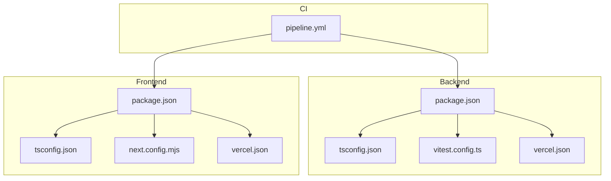
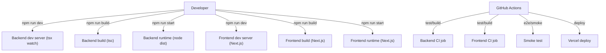
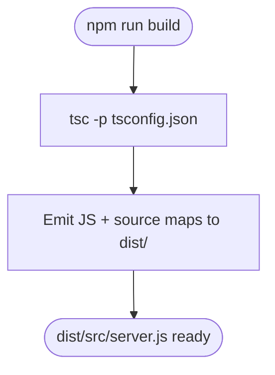
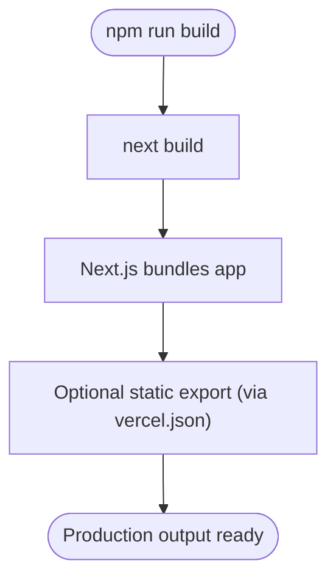
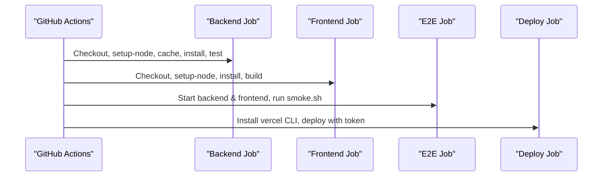
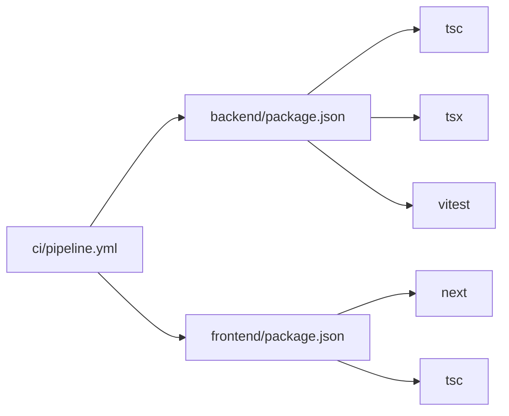

# Build Configuration

<cite>
**Referenced Files in This Document**
- [phoenix-backend/package.json](file://phoenix-backend/package.json)
- [phoenix-backend/tsconfig.json](file://phoenix-backend/tsconfig.json)
- [phoenix-backend/vitest.config.ts](file://phoenix-backend/vitest.config.ts)
- [phoenix-backend/vercel.json](file://phoenix-backend/vercel.json)
- [phoenix-backend/.github/workflows/ci.yml](file://phoenix-backend/.github/workflows/ci.yml)
- [phoenix-frontend/package.json](file://phoenix-frontend/package.json)
- [phoenix-frontend/tsconfig.json](file://phoenix-frontend/tsconfig.json)
- [phoenix-frontend/next.config.mjs](file://phoenix-frontend/next.config.mjs)
- [phoenix-frontend/vercel.json](file://phoenix-frontend/vercel.json)
- [phoenix-frontend/.github/workflows/ci.yml](file://phoenix-frontend/.github/workflows/ci.yml)
- [phoenix-ci/.github/workflows/pipeline.yml](file://phoenix-ci/.github/workflows/pipeline.yml)
</cite>

## Table of Contents
1. Introduction
2. Project Structure
3. Core Components
4. Architecture Overview
5. Detailed Component Analysis
6. Dependency Analysis
7. Performance Considerations
8. Troubleshooting Guide
9. Conclusion

## Introduction
This document explains the build configuration for Project Phoenix, covering both backend and frontend applications. It documents TypeScript compilation settings, module resolution, path mappings, package scripts, asset optimization strategies, bundle analysis options, environment-specific build variations, custom build steps, CI pipelines, and troubleshooting guidance for common issues.

## Project Structure
Project Phoenix is organized into three main areas:
- phoenix-backend: Node.js API built with TypeScript and Express.
- phoenix-frontend: Next.js application built with TypeScript.
- phoenix-ci: Shared GitHub Actions pipeline orchestrating tests, builds, smoke tests, and deployment.

**Diagram sources**
- [phoenix-backend/package.json:10-18](file://phoenix-backend/package.json#L10-L18)
- [phoenix-backend/tsconfig.json:1-18](file://phoenix-backend/tsconfig.json#L1-L18)
- [phoenix-backend/vitest.config.ts:1-12](file://phoenix-backend/vitest.config.ts#L1-L12)
- [phoenix-backend/vercel.json:1-5](file://phoenix-backend/vercel.json#L1-L5)
- [phoenix-frontend/package.json:1-27](file://phoenix-frontend/package.json#L1-L27)
- [phoenix-frontend/tsconfig.json:1-23](file://phoenix-frontend/tsconfig.json#L1-L23)
- [phoenix-frontend/next.config.mjs:1-9](file://phoenix-frontend/next.config.mjs#L1-L9)
- [phoenix-frontend/vercel.json:1-7](file://phoenix-frontend/vercel.json#L1-L7)
- [phoenix-ci/.github/workflows/pipeline.yml:1-73](file://phoenix-ci/.github/workflows/pipeline.yml#L1-L73)

**Section sources**
- [phoenix-backend/package.json:1-41](file://phoenix-backend/package.json#L1-L41)
- [phoenix-frontend/package.json:1-27](file://phoenix-frontend/package.json#L1-L27)
- [phoenix-ci/.github/workflows/pipeline.yml:1-73](file://phoenix-ci/.github/workflows/pipeline.yml#L1-L73)

## Core Components
- Backend build toolchain: TypeScript compiler (tsc), tsx for running TypeScript directly during development, Vitest for testing.
- Frontend build toolchain: Next.js (build/dev/start), TypeScript type checking via tsc.
- CI/CD: GitHub Actions workflows per component and a shared pipeline that coordinates backend/frontend jobs, e2e smoke tests, and deployment to Vercel.

Key responsibilities:
- Compile TypeScript to JavaScript for production runtime.
- Provide development-time hot reload and fast feedback loops.
- Run tests and type checks in CI.
- Configure platform-specific behavior for Vercel deployments.

**Section sources**
- [phoenix-backend/package.json:10-18](file://phoenix-backend/package.json#L10-L18)
- [phoenix-backend/tsconfig.json:1-18](file://phoenix-backend/tsconfig.json#L1-L18)
- [phoenix-backend/vitest.config.ts:1-12](file://phoenix-backend/vitest.config.ts#L1-L12)
- [phoenix-frontend/package.json:8-13](file://phoenix-frontend/package.json#L8-L13)
- [phoenix-frontend/tsconfig.json:1-23](file://phoenix-frontend/tsconfig.json#L1-L23)
- [phoenix-frontend/next.config.mjs:1-9](file://phoenix-frontend/next.config.mjs#L1-L9)

## Architecture Overview
The build architecture separates concerns between backend and frontend while sharing CI orchestration.

**Diagram sources**
- [phoenix-backend/package.json:10-18](file://phoenix-backend/package.json#L10-L18)
- [phoenix-frontend/package.json:8-13](file://phoenix-frontend/package.json#L8-L13)
- [phoenix-backend/.github/workflows/ci.yml:1-19](file://phoenix-backend/.github/workflows/ci.yml#L1-L19)
- [phoenix-frontend/.github/workflows/ci.yml:1-16](file://phoenix-frontend/.github/workflows/ci.yml#L1-L16)
- [phoenix-ci/.github/workflows/pipeline.yml:1-73](file://phoenix-ci/.github/workflows/pipeline.yml#L1-L73)

## Detailed Component Analysis

### Backend Build Configuration
- TypeScript compilation:
  - Target: ES2022
  - Module system: CommonJS
  - Module resolution: Node
  - Strict mode enabled
  - Source maps enabled
  - Output directory: dist
  - Includes src, scripts, api; excludes node_modules, dist, tests
- Scripts:
  - dev: runs TypeScript server with tsx watch
  - build: compiles TypeScript using tsc
  - start: runs compiled server from dist
  - typecheck: type-checks without emitting
  - seed/seed:reset: data seeding scripts
  - test/test:coverage: runs Vitest with optional coverage
- Testing:
  - Vitest config sets global setup and setup files, disables file parallelism, and defines timeouts.
- Platform integration:
  - Vercel rewrite routes all paths to /api/index for serverless entry.

**Diagram sources**
- [phoenix-backend/package.json:10-18](file://phoenix-backend/package.json#L10-L18)
- [phoenix-backend/tsconfig.json:1-18](file://phoenix-backend/tsconfig.json#L1-L18)

**Section sources**
- [phoenix-backend/package.json:10-18](file://phoenix-backend/package.json#L10-L18)
- [phoenix-backend/tsconfig.json:1-18](file://phoenix-backend/tsconfig.json#L1-L18)
- [phoenix-backend/vitest.config.ts:1-12](file://phoenix-backend/vitest.config.ts#L1-L12)
- [phoenix-backend/vercel.json:1-5](file://phoenix-backend/vercel.json#L1-L5)

### Frontend Build Configuration
- TypeScript compilation:
  - Target: ES2020
  - Module: esnext
  - Module resolution: bundler
  - Strict mode enabled
  - noEmit: true (Next.js handles emission)
  - JSX: preserve
  - Incremental builds enabled
  - Path mapping: @/* -> ./src/*
  - Plugins: next
- Next.js configuration:
  - React strict mode enabled
  - ESLint ignored during builds
  - App router enabled via experimental flag
- Scripts:
  - dev: starts Next.js dev server on port 3000
  - build: runs Next.js build
  - start: starts Next.js production server on port 3000
  - typecheck: runs tsc --noEmit
- Platform integration:
  - Vercel framework set to nextjs
  - Install command uses npm install --force
  - Build command uses npm run export (static export)

**Diagram sources**
- [phoenix-frontend/package.json:8-13](file://phoenix-frontend/package.json#L8-L13)
- [phoenix-frontend/tsconfig.json:1-23](file://phoenix-frontend/tsconfig.json#L1-L23)
- [phoenix-frontend/next.config.mjs:1-9](file://phoenix-frontend/next.config.mjs#L1-L9)
- [phoenix-frontend/vercel.json:1-7](file://phoenix-frontend/vercel.json#L1-L7)

**Section sources**
- [phoenix-frontend/package.json:1-27](file://phoenix-frontend/package.json#L1-L27)
- [phoenix-frontend/tsconfig.json:1-23](file://phoenix-frontend/tsconfig.json#L1-L23)
- [phoenix-frontend/next.config.mjs:1-9](file://phoenix-frontend/next.config.mjs#L1-L9)
- [phoenix-frontend/vercel.json:1-7](file://phoenix-frontend/vercel.json#L1-L7)

### CI/CD Pipelines
- Backend CI:
  - Runs on push/PR
  - Uses Node 16
  - Installs dependencies with legacy peer deps
  - Runs tests (non-fatal failure allowed)
- Frontend CI:
  - Runs on push/PR
  - Uses Node 16
  - Installs dependencies with legacy peer deps
  - Runs build (non-fatal failure allowed)
- Shared pipeline:
  - Jobs: backend, frontend, e2e, deploy
  - Backend job: caches npm, installs dependencies, runs tests
  - Frontend job: installs dependencies, runs build
  - E2E job: starts backend and frontend locally, then runs smoke script
  - Deploy job: deploys to Vercel using CLI and token

**Diagram sources**
- [phoenix-backend/.github/workflows/ci.yml:1-19](file://phoenix-backend/.github/workflows/ci.yml#L1-L19)
- [phoenix-frontend/.github/workflows/ci.yml:1-16](file://phoenix-frontend/.github/workflows/ci.yml#L1-L16)
- [phoenix-ci/.github/workflows/pipeline.yml:1-73](file://phoenix-ci/.github/workflows/pipeline.yml#L1-L73)

**Section sources**
- [phoenix-backend/.github/workflows/ci.yml:1-19](file://phoenix-backend/.github/workflows/ci.yml#L1-L19)
- [phoenix-frontend/.github/workflows/ci.yml:1-16](file://phoenix-frontend/.github/workflows/ci.yml#L1-L16)
- [phoenix-ci/.github/workflows/pipeline.yml:1-73](file://phoenix-ci/.github/workflows/pipeline.yml#L1-L73)

## Dependency Analysis
- Backend dependencies:
  - Runtime: express, mongoose, jsonwebtoken, cors, dotenv, zod
  - Dev: typescript, tsx, vitest, @vitest/coverage-v8, supertest, @types/*
- Frontend dependencies:
  - Runtime: next, react, react-dom, date-fns
  - Dev: typescript, @types/*
- Toolchain coupling:
  - Backend relies on tsc for compilation and tsx for dev-time execution.
  - Frontend relies on Next.js for bundling and type checking via tsc.
- CI considerations:
  - Both component CIs use Node 16 and install with legacy peer deps.
  - Shared pipeline uses Node 16 globally and caches npm.

**Diagram sources**
- [phoenix-backend/package.json:20-39](file://phoenix-backend/package.json#L20-L39)
- [phoenix-frontend/package.json:14-25](file://phoenix-frontend/package.json#L14-L25)
- [phoenix-ci/.github/workflows/pipeline.yml:1-73](file://phoenix-ci/.github/workflows/pipeline.yml#L1-L73)

**Section sources**
- [phoenix-backend/package.json:20-39](file://phoenix-backend/package.json#L20-L39)
- [phoenix-frontend/package.json:14-25](file://phoenix-frontend/package.json#L14-L25)
- [phoenix-ci/.github/workflows/pipeline.yml:1-73](file://phoenix-ci/.github/workflows/pipeline.yml#L1-L73)

## Performance Considerations
- Backend:
  - Use incremental builds by enabling incremental compilation if needed.
  - Keep source maps disabled in production to reduce artifact size.
  - Prefer CommonJS modules for Node runtime compatibility.
- Frontend:
  - Leverage Next.js automatic code splitting and image optimization.
  - Use static export when targeting static hosting (as configured in Vercel).
  - Enable incremental builds via Next.js defaults.
- CI:
  - Cache npm dependencies to speed up builds.
  - Pin Node versions consistently across local and CI environments.

[No sources needed since this section provides general guidance]

## Troubleshooting Guide
Common issues and resolutions:
- Node version mismatch:
  - Symptom: Build or runtime errors due to incompatible Node versions.
  - Resolution: Ensure local Node matches CI (Node 16 in current CIs). Update .nvmrc or engine fields accordingly.
- Peer dependency conflicts:
  - Symptom: Installation fails due to peer dependency mismatches.
  - Resolution: Use --legacy-peer-deps in CI and local installs where necessary.
- TypeScript errors:
  - Symptom: Type errors during build or typecheck.
  - Resolution: Run typecheck scripts to identify issues before building.
- Next.js build failures:
  - Symptom: Build fails in CI but passes locally.
  - Resolution: Align Node versions and ensure Next.js experimental flags match configuration.
- Vercel deployment issues:
  - Symptom: Deployment fails due to missing tokens or incorrect commands.
  - Resolution: Verify VERCEL_TOKEN and ensure buildCommand/installCommand are correct.

**Section sources**
- [phoenix-backend/.github/workflows/ci.yml:1-19](file://phoenix-backend/.github/workflows/ci.yml#L1-L19)
- [phoenix-frontend/.github/workflows/ci.yml:1-16](file://phoenix-frontend/.github/workflows/ci.yml#L1-L16)
- [phoenix-ci/.github/workflows/pipeline.yml:1-73](file://phoenix-ci/.github/workflows/pipeline.yml#L1-L73)

## Conclusion
Project Phoenix’s build configuration separates backend and frontend toolchains while coordinating them through shared CI pipelines. The backend uses TypeScript with CommonJS and tsx for development, while the frontend leverages Next.js with TypeScript and path aliases. Environment-specific configurations are handled via Vercel settings and environment variables validated at runtime. CI pipelines standardize dependency installation, testing, and deployment, with caching and consistent Node versions to improve reliability and performance.

[No sources needed since this section summarizes without analyzing specific files]