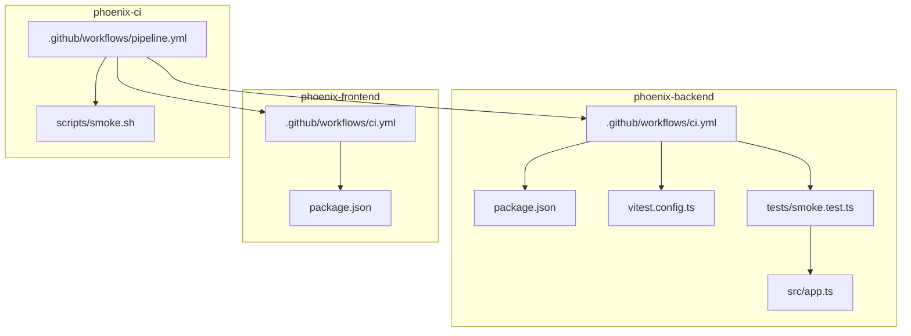
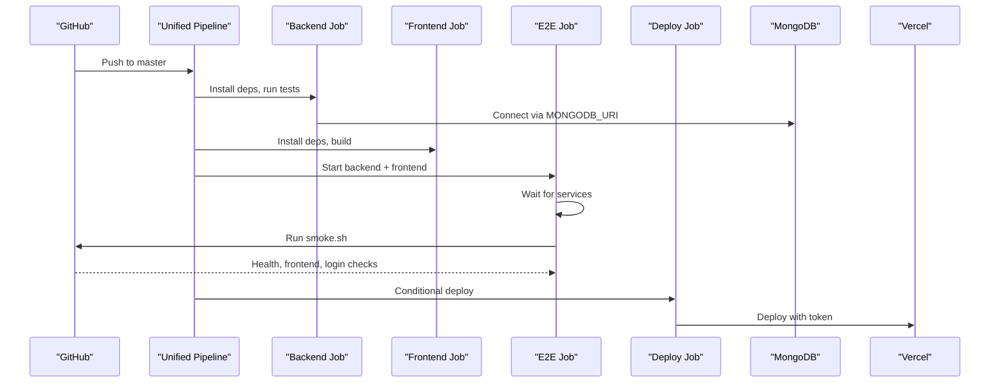
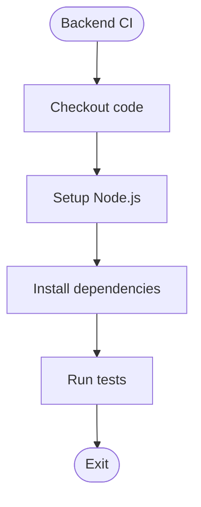
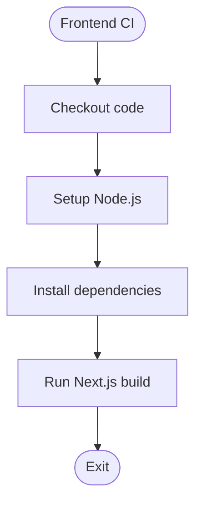
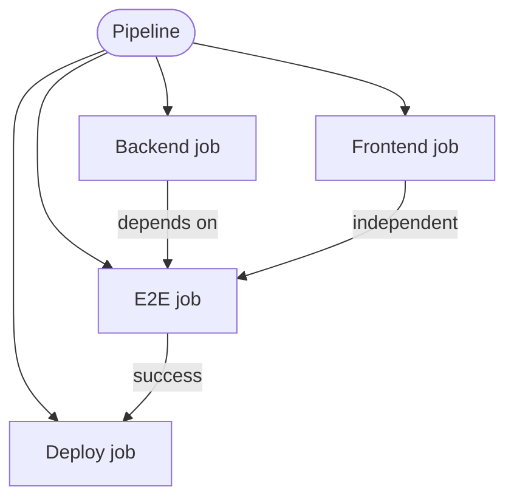
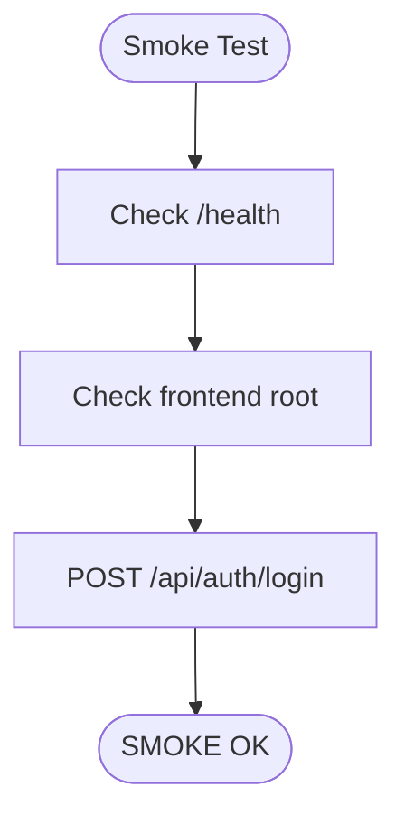
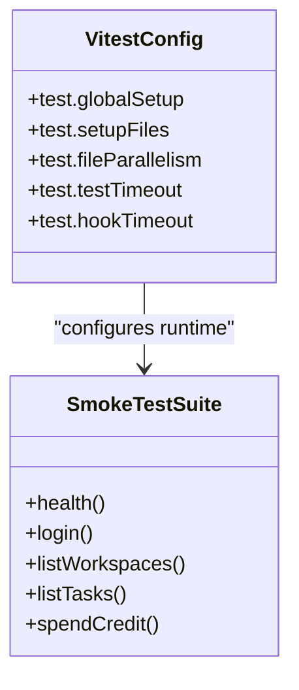
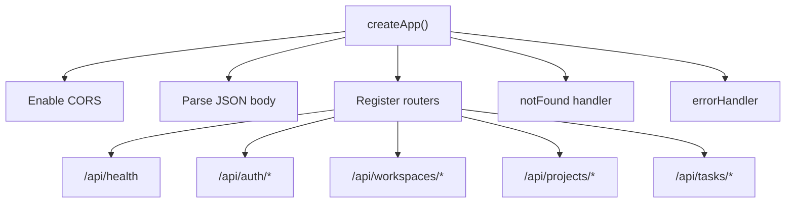
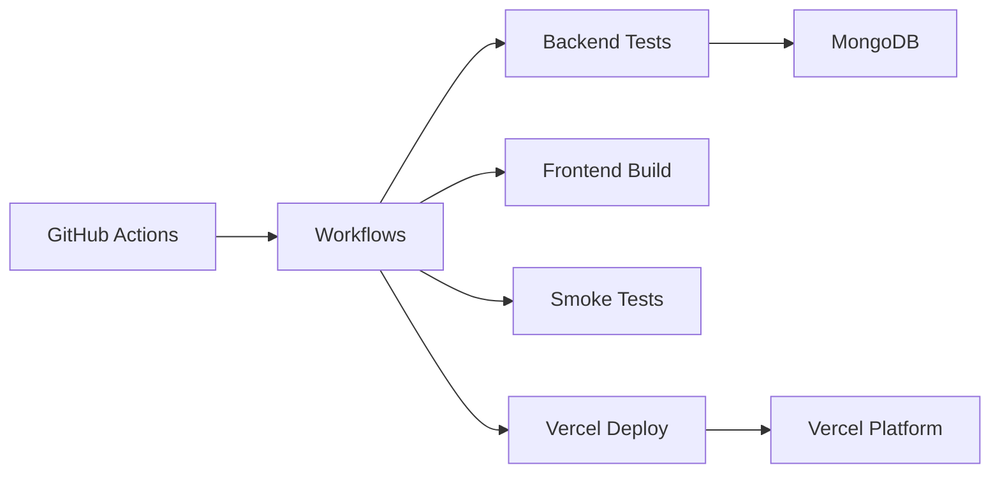

# CI/CD Pipeline

<cite>
**Referenced Files in This Document**
- [README.md](file://README.md)
- [phoenix-backend/.github/workflows/ci.yml](file://phoenix-backend/.github/workflows/ci.yml)
- [phoenix-frontend/.github/workflows/ci.yml](file://phoenix-frontend/.github/workflows/ci.yml)
- [phoenix-ci/.github/workflows/pipeline.yml](file://phoenix-ci/.github/workflows/pipeline.yml)
- [phoenix-ci/scripts/smoke.sh](file://phoenix-ci/scripts/smoke.sh)
- [phoenix-backend/package.json](file://phoenix-backend/package.json)
- [phoenix-frontend/package.json](file://phoenix-frontend/package.json)
- [phoenix-backend/tests/smoke.test.ts](file://phoenix-backend/tests/smoke.test.ts)
- [phoenix-backend/vitest.config.ts](file://phoenix-backend/vitest.config.ts)
- [phoenix-backend/src/app.ts](file://phoenix-backend/src/app.ts)
</cite>

## Table of Contents
1. [Introduction](#introduction)
2. [Project Structure](#project-structure)
3. [Core Components](#core-components)
4. [Architecture Overview](#architecture-overview)
5. [Detailed Component Analysis](#detailed-component-analysis)
6. [Dependency Analysis](#dependency-analysis)
7. [Performance Considerations](#performance-considerations)
8. [Troubleshooting Guide](#troubleshooting-guide)
9. [Conclusion](#conclusion)

## Introduction
This document describes the end-to-end CI/CD pipeline for Project Phoenix, including automated testing, code quality checks, security scanning, deployment automation, branch protection, pull request validation, and release procedures. It also provides guidance on debugging, logging, and monitoring to ensure continuous integration success.

The repository contains three main parts:
- phoenix-backend: Node.js 20, TypeScript, Express, MongoDB (Mongoose), deployed to Vercel serverless.
- phoenix-frontend: Next.js 14, React 18, TypeScript, deployed to Vercel.
- phoenix-ci: GitHub Actions workflows and a smoke test script used by the grader and local verification.

The top-level README defines acceptance criteria, including that both apps build, the backend starts against a fresh MongoDB, seed data is created, health endpoints are truthful, and the pipeline runs green on GitHub.

**Section sources**
- [README.md:1-15](file://README.md#L1-L15)
- [README.md:131-137](file://README.md#L131-L137)

## Project Structure
At a high level, the CI/CD surface area spans:
- Per-app CI workflows under each app’s .github/workflows directory.
- A unified pipeline orchestrating backend tests, frontend builds, e2e smoke tests, and deployment.
- A shared smoke test script validating basic API and UI availability.

**Diagram sources**
- [phoenix-backend/.github/workflows/ci.yml:1-19](file://phoenix-backend/.github/workflows/ci.yml#L1-L19)
- [phoenix-frontend/.github/workflows/ci.yml:1-16](file://phoenix-frontend/.github/workflows/ci.yml#L1-L16)
- [phoenix-ci/.github/workflows/pipeline.yml:1-73](file://phoenix-ci/.github/workflows/pipeline.yml#L1-L73)
- [phoenix-ci/scripts/smoke.sh:1-17](file://phoenix-ci/scripts/smoke.sh#L1-L17)
- [phoenix-backend/package.json:1-41](file://phoenix-backend/package.json#L1-L41)
- [phoenix-frontend/package.json:1-27](file://phoenix-frontend/package.json#L1-L27)
- [phoenix-backend/tests/smoke.test.ts:1-59](file://phoenix-backend/tests/smoke.test.ts#L1-L59)
- [phoenix-backend/vitest.config.ts:1-12](file://phoenix-backend/vitest.config.ts#L1-L12)
- [phoenix-backend/src/app.ts:1-33](file://phoenix-backend/src/app.ts#L1-L33)

**Section sources**
- [phoenix-backend/.github/workflows/ci.yml:1-19](file://phoenix-backend/.github/workflows/ci.yml#L1-L19)
- [phoenix-frontend/.github/workflows/ci.yml:1-16](file://phoenix-frontend/.github/workflows/ci.yml#L1-L16)
- [phoenix-ci/.github/workflows/pipeline.yml:1-73](file://phoenix-ci/.github/workflows/pipeline.yml#L1-L73)
- [phoenix-ci/scripts/smoke.sh:1-17](file://phoenix-ci/scripts/smoke.sh#L1-L17)

## Core Components
This section summarizes the core CI/CD components and their responsibilities.

- Backend CI workflow:
  - Triggers on push and pull requests.
  - Sets up Node.js and installs dependencies.
  - Runs tests via the backend scripts.
  - Uses an environment variable for the MongoDB connection string.

- Frontend CI workflow:
  - Triggers on push and pull requests.
  - Sets up Node.js and installs dependencies.
  - Runs the Next.js build.

- Unified pipeline:
  - Defines jobs for backend, frontend, e2e smoke tests, and deploy.
  - Uses working directories per job.
  - Starts services and executes the smoke test script.
  - Attempts deployment with Vercel CLI using a token from secrets.

- Smoke test script:
  - Validates backend health endpoint.
  - Checks frontend root page.
  - Performs a login flow against the backend.

- Test configuration:
  - Vitest config sets global setup and setup files, disables parallelism, and defines timeouts.
  - Smoke test suite exercises health, login, workspaces listing, tasks listing, and credit consumption.

- Application entrypoint:
  - Express app wires routers, CORS, body parsing, and error handling.

**Section sources**
- [phoenix-backend/.github/workflows/ci.yml:1-19](file://phoenix-backend/.github/workflows/ci.yml#L1-L19)
- [phoenix-frontend/.github/workflows/ci.yml:1-16](file://phoenix-frontend/.github/workflows/ci.yml#L1-L16)
- [phoenix-ci/.github/workflows/pipeline.yml:1-73](file://phoenix-ci/.github/workflows/pipeline.yml#L1-L73)
- [phoenix-ci/scripts/smoke.sh:1-17](file://phoenix-ci/scripts/smoke.sh#L1-L17)
- [phoenix-backend/vitest.config.ts:1-12](file://phoenix-backend/vitest.config.ts#L1-L12)
- [phoenix-backend/tests/smoke.test.ts:1-59](file://phoenix-backend/tests/smoke.test.ts#L1-L59)
- [phoenix-backend/src/app.ts:1-33](file://phoenix-backend/src/app.ts#L1-L33)

## Architecture Overview
The CI/CD architecture consists of:
- GitHub Actions runners executing per-app workflows and a unified pipeline.
- Backend tests running against an in-process Express app and a MongoDB instance.
- Frontend builds producing static assets via Next.js.
- E2E smoke tests verifying API and UI availability.
- Deployment step attempting production deployment to Vercel.

**Diagram sources**
- [phoenix-ci/.github/workflows/pipeline.yml:1-73](file://phoenix-ci/.github/workflows/pipeline.yml#L1-L73)
- [phoenix-backend/.github/workflows/ci.yml:1-19](file://phoenix-backend/.github/workflows/ci.yml#L1-L19)
- [phoenix-frontend/.github/workflows/ci.yml:1-16](file://phoenix-frontend/.github/workflows/ci.yml#L1-L16)
- [phoenix-ci/scripts/smoke.sh:1-17](file://phoenix-ci/scripts/smoke.sh#L1-L17)

## Detailed Component Analysis

### Backend CI Workflow
Responsibilities:
- Trigger on push and pull requests.
- Set up Node.js and install dependencies.
- Execute tests via npm test.
- Provide MONGODB_URI for test database connectivity.

Key observations:
- The workflow uses broad permissions and pinned action versions.
- Tests rely on Vitest and require a running MongoDB instance.
- The package engines specify Node >= 20, while the workflow sets Node 16; this mismatch must be resolved to ensure consistent environments.

**Diagram sources**
- [phoenix-backend/.github/workflows/ci.yml:1-19](file://phoenix-backend/.github/workflows/ci.yml#L1-L19)
- [phoenix-backend/package.json:10-18](file://phoenix-backend/package.json#L10-L18)

**Section sources**
- [phoenix-backend/.github/workflows/ci.yml:1-19](file://phoenix-backend/.github/workflows/ci.yml#L1-L19)
- [phoenix-backend/package.json:1-41](file://phoenix-backend/package.json#L1-L41)

### Frontend CI Workflow
Responsibilities:
- Trigger on push and pull requests.
- Set up Node.js and install dependencies.
- Build the Next.js application.

Key observations:
- The workflow uses broad permissions and pinned action versions.
- The build step has continue-on-error enabled, which masks failures; this should be removed to enforce strict CI.
- The package engines specify Node >= 20, while the workflow sets Node 16; this mismatch must be resolved.

**Diagram sources**
- [phoenix-frontend/.github/workflows/ci.yml:1-16](file://phoenix-frontend/.github/workflows/ci.yml#L1-L16)
- [phoenix-frontend/package.json:8-12](file://phoenix-frontend/package.json#L8-L12)

**Section sources**
- [phoenix-frontend/.github/workflows/ci.yml:1-16](file://phoenix-frontend/.github/workflows/ci.yml#L1-L16)
- [phoenix-frontend/package.json:1-27](file://phoenix-frontend/package.json#L1-L27)

### Unified Pipeline
Responsibilities:
- Orchestrate backend tests, frontend builds, e2e smoke tests, and deployment.
- Define working directories per job.
- Start backend and frontend services for e2e smoke tests.
- Attempt production deployment to Vercel.

Key observations:
- The pipeline triggers only on pushes to master.
- The deploy job condition references refs/heads/main, which will never match master; this prevents deployment.
- The e2e job starts services without waiting for readiness, relying on a fixed sleep; this is fragile.
- Secrets are echoed to logs; this is insecure and must be corrected.
- Working directories reference backend and frontend relative paths that do not match the repository structure; these must align with actual folder names.

**Diagram sources**
- [phoenix-ci/.github/workflows/pipeline.yml:1-73](file://phoenix-ci/.github/workflows/pipeline.yml#L1-L73)

**Section sources**
- [phoenix-ci/.github/workflows/pipeline.yml:1-73](file://phoenix-ci/.github/workflows/pipeline.yml#L1-L73)

### Smoke Test Script
Responsibilities:
- Validate backend health endpoint.
- Check frontend root page.
- Perform a login flow against the backend.

Behavior:
- Accepts optional arguments for backend and frontend URLs.
- Prints status messages and exits successfully if all checks pass.

**Diagram sources**
- [phoenix-ci/scripts/smoke.sh:1-17](file://phoenix-ci/scripts/smoke.sh#L1-L17)

**Section sources**
- [phoenix-ci/scripts/smoke.sh:1-17](file://phoenix-ci/scripts/smoke.sh#L1-L17)

### Backend Test Suite and Configuration
Responsibilities:
- Configure Vitest with global setup and setup files.
- Disable file parallelism to avoid concurrency issues with shared state or database.
- Define timeouts for tests and hooks.
- Exercise critical flows: health, login, workspace listing, task listing, and credit consumption.

**Diagram sources**
- [phoenix-backend/vitest.config.ts:1-12](file://phoenix-backend/vitest.config.ts#L1-L12)
- [phoenix-backend/tests/smoke.test.ts:1-59](file://phoenix-backend/tests/smoke.test.ts#L1-L59)

**Section sources**
- [phoenix-backend/vitest.config.ts:1-12](file://phoenix-backend/vitest.config.ts#L1-L12)
- [phoenix-backend/tests/smoke.test.ts:1-59](file://phoenix-backend/tests/smoke.test.ts#L1-L59)

### Express Application Wiring
Responsibilities:
- Create Express app with CORS, body parsing, and router registration.
- Register health, auth, workspaces, projects, and tasks routers.
- Attach notFound and errorHandler middleware.

**Diagram sources**
- [phoenix-backend/src/app.ts:1-33](file://phoenix-backend/src/app.ts#L1-L33)

**Section sources**
- [phoenix-backend/src/app.ts:1-33](file://phoenix-backend/src/app.ts#L1-L33)

## Dependency Analysis
The CI/CD system depends on:
- GitHub Actions runner images and actions.
- Node.js version specified in workflows versus package engines.
- MongoDB connection string provided via environment variables.
- Vercel CLI and token for deployment.

**Diagram sources**
- [phoenix-ci/.github/workflows/pipeline.yml:1-73](file://phoenix-ci/.github/workflows/pipeline.yml#L1-L73)
- [phoenix-backend/.github/workflows/ci.yml:1-19](file://phoenix-backend/.github/workflows/ci.yml#L1-L19)
- [phoenix-frontend/.github/workflows/ci.yml:1-16](file://phoenix-frontend/.github/workflows/ci.yml#L1-L16)

**Section sources**
- [phoenix-ci/.github/workflows/pipeline.yml:1-73](file://phoenix-ci/.github/workflows/pipeline.yml#L1-L73)
- [phoenix-backend/.github/workflows/ci.yml:1-19](file://phoenix-backend/.github/workflows/ci.yml#L1-L19)
- [phoenix-frontend/.github/workflows/ci.yml:1-16](file://phoenix-frontend/.github/workflows/ci.yml#L1-L16)

## Performance Considerations
- Use caching for npm dependencies to speed up installs across jobs.
- Pin Node.js versions consistently across workflows and package engines to reduce flakiness.
- Avoid broad permissions; scope permissions to required resources.
- Prefer service containers for MongoDB instead of starting processes inline to improve reliability and isolation.
- Replace fixed sleeps with readiness probes for backend and frontend services before running smoke tests.
- Avoid echoing secrets to logs; use masked outputs and secure secret management.

[No sources needed since this section provides general guidance]

## Troubleshooting Guide
Common issues and resolutions:
- Node.js version mismatch:
  - Ensure workflows set Node 20 to match package engines.
  - Remove legacy peer dependency flags unless absolutely necessary.

- Build masking failures:
  - Remove continue-on-error from build steps to fail fast on errors.

- Deployment not triggering:
  - Align branch references between trigger and deploy conditions.
  - Ensure secrets are configured and not echoed to logs.

- E2E flakiness:
  - Add readiness checks for backend and frontend before running smoke tests.
  - Use service containers for MongoDB and ensure proper connection strings.

- Logging and debugging:
  - Enable verbose logging for npm commands.
  - Capture artifacts for failed builds and tests.
  - Review job logs for dependency installation errors, build failures, and test output.

**Section sources**
- [phoenix-backend/package.json:7-18](file://phoenix-backend/package.json#L7-L18)
- [phoenix-frontend/package.json:5-12](file://phoenix-frontend/package.json#L5-L12)
- [phoenix-ci/.github/workflows/pipeline.yml:65-72](file://phoenix-ci/.github/workflows/pipeline.yml#L65-L72)

## Conclusion
To achieve a robust CI/CD pipeline for Project Phoenix:
- Standardize Node.js versions across workflows and package engines.
- Enforce strict CI by removing continue-on-error and broad permissions.
- Align branch references for triggers and deployment conditions.
- Secure secrets and avoid echoing them to logs.
- Improve e2e reliability with readiness checks and service containers.
- Add linting, type checking, and security scanning to strengthen code quality and safety.
- Implement branch protection rules and PR validation gates to prevent regressions.
- Establish clear rollback procedures and monitoring strategies for deployments.

[No sources needed since this section summarizes without analyzing specific files]