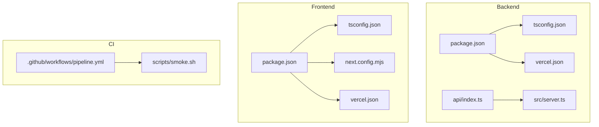
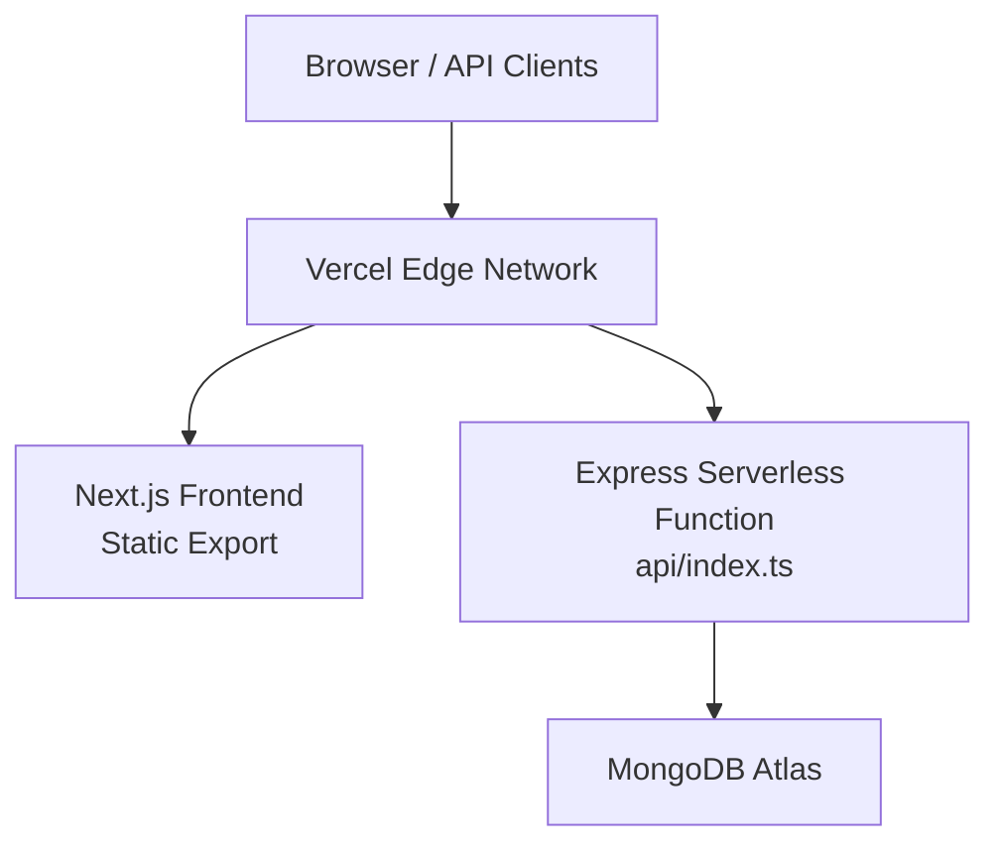
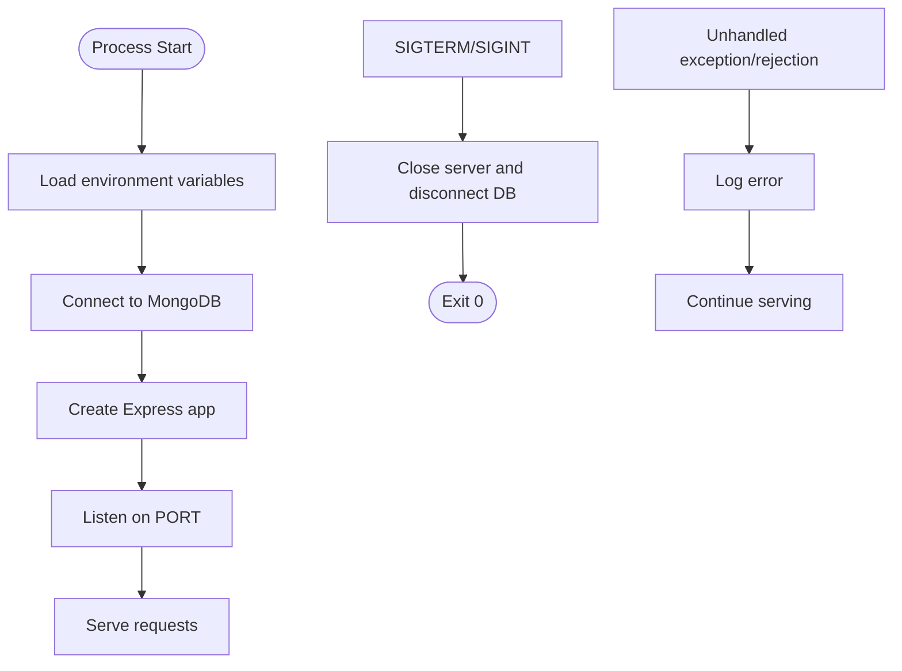
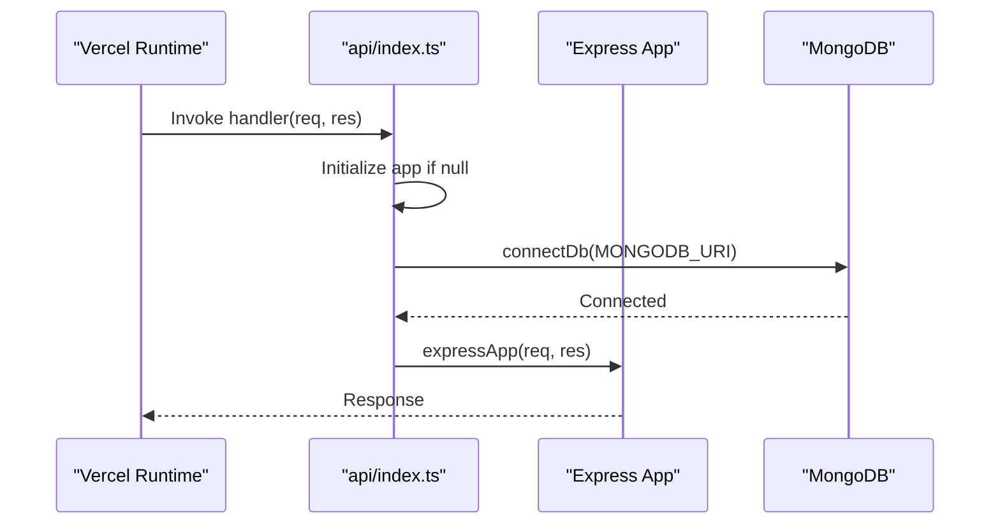
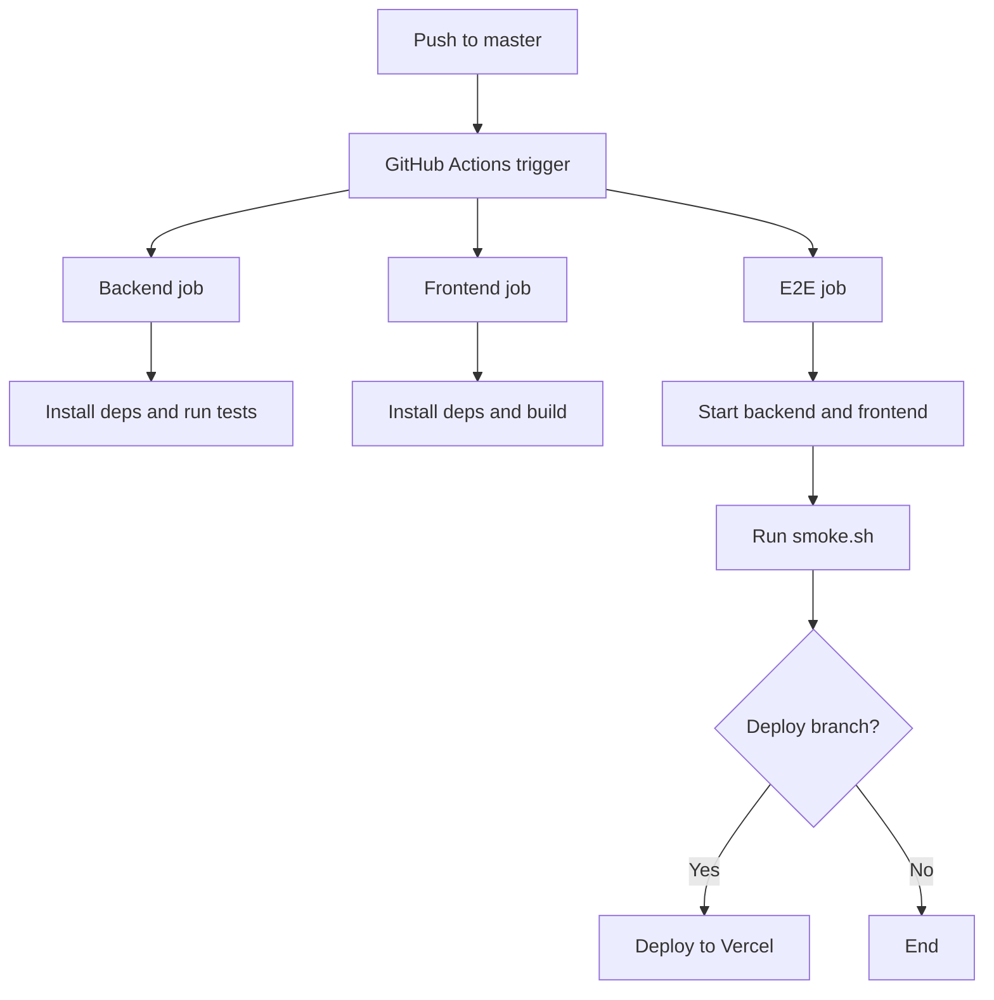
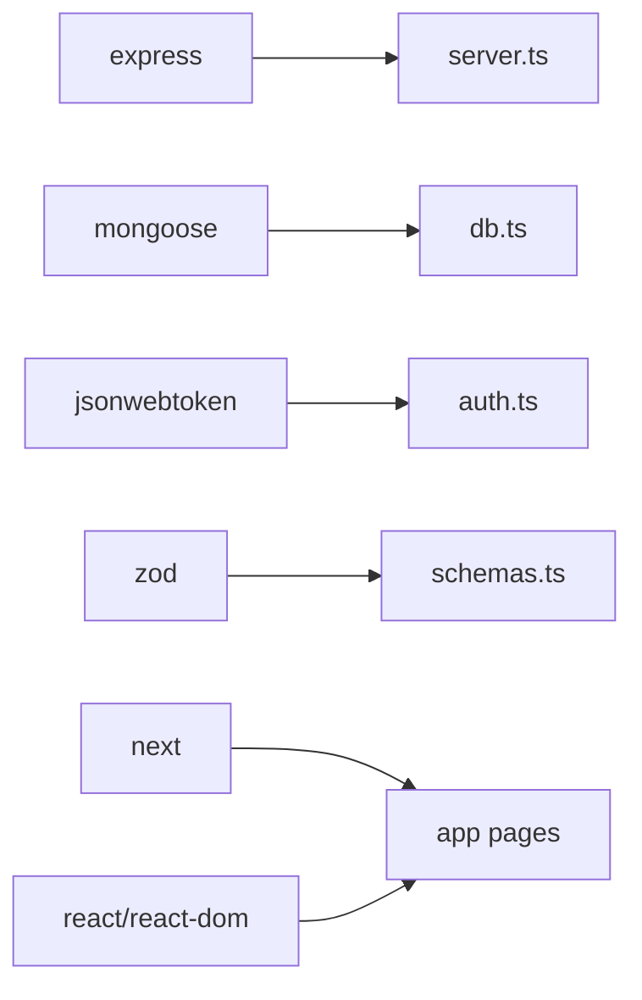

# Deployment & DevOps

<cite>
**Referenced Files in This Document**
- [README.md](file://README.md)
- [phoenix-backend/package.json](file://phoenix-backend/package.json)
- [phoenix-backend/tsconfig.json](file://phoenix-backend/tsconfig.json)
- [phoenix-backend/vercel.json](file://phoenix-backend/vercel.json)
- [phoenix-backend/.github/workflows/ci.yml](file://phoenix-backend/.github/workflows/ci.yml)
- [phoenix-backend/src/server.ts](file://phoenix-backend/src/server.ts)
- [phoenix-backend/api/index.ts](file://phoenix-backend/api/index.ts)
- [phoenix-frontend/package.json](file://phoenix-frontend/package.json)
- [phoenix-frontend/tsconfig.json](file://phoenix-frontend/tsconfig.json)
- [phoenix-frontend/next.config.mjs](file://phoenix-frontend/next.config.mjs)
- [phoenix-frontend/vercel.json](file://phoenix-frontend/vercel.json)
- [phoenix-frontend/.github/workflows/ci.yml](file://phoenix-frontend/.github/workflows/ci.yml)
- [phoenix-ci/.github/workflows/pipeline.yml](file://phoenix-ci/.github/workflows/pipeline.yml)
- [phoenix-ci/scripts/smoke.sh](file://phoenix-ci/scripts/smoke.sh)
</cite>

## Table of Contents
1. [Introduction](#introduction)
2. [Project Structure](#project-structure)
3. [Core Components](#core-components)
4. [Architecture Overview](#architecture-overview)
5. [Detailed Component Analysis](#detailed-component-analysis)
6. [Dependency Analysis](#dependency-analysis)
7. [Performance Considerations](#performance-considerations)
8. [Troubleshooting Guide](#troubleshooting-guide)
9. [Conclusion](#conclusion)

## Introduction
This document provides deployment and DevOps guidance for Project Phoenix, covering:
- Build configuration for the backend (Node.js + TypeScript + Express) and frontend (Next.js + React + TypeScript).
- TypeScript compilation settings and asset optimization strategies.
- Vercel deployment configuration for serverless functions and static site export.
- Environment variables management and domain setup.
- CI/CD using GitHub Actions with automated testing, code quality checks, and deployment automation.
- Troubleshooting common deployment issues, monitoring/logging strategies, and operational procedures for production maintenance.

The project consists of three repositories:
- phoenix-backend: API server deployed as a Vercel serverless function.
- phoenix-frontend: Next.js application deployed to Vercel.
- phoenix-ci: Centralized GitHub Actions pipeline orchestrating tests and smoke checks.

**Section sources**
- [README.md:7-13](file://README.md#L7-L13)

## Project Structure
Phoenix is organized into three main directories:
- phoenix-backend: Express API with Mongoose models, Zod schemas, and a Vercel serverless entrypoint.
- phoenix-frontend: Next.js app with App Router pages and shared components.
- phoenix-ci: GitHub Actions workflow and smoke test script.

**Diagram sources**
- [phoenix-backend/package.json:10-18](file://phoenix-backend/package.json#L10-L18)
- [phoenix-backend/tsconfig.json:1-18](file://phoenix-backend/tsconfig.json#L1-L18)
- [phoenix-backend/vercel.json:1-5](file://phoenix-backend/vercel.json#L1-L5)
- [phoenix-backend/api/index.ts:1-21](file://phoenix-backend/api/index.ts#L1-L21)
- [phoenix-backend/src/server.ts:1-32](file://phoenix-backend/src/server.ts#L1-L32)
- [phoenix-frontend/package.json:1-27](file://phoenix-frontend/package.json#L1-L27)
- [phoenix-frontend/tsconfig.json:1-23](file://phoenix-frontend/tsconfig.json#L1-L23)
- [phoenix-frontend/next.config.mjs:1-9](file://phoenix-frontend/next.config.mjs#L1-L9)
- [phoenix-frontend/vercel.json:1-7](file://phoenix-frontend/vercel.json#L1-L7)
- [phoenix-ci/.github/workflows/pipeline.yml:1-73](file://phoenix-ci/.github/workflows/pipeline.yml#L1-L73)
- [phoenix-ci/scripts/smoke.sh:1-17](file://phoenix-ci/scripts/smoke.sh#L1-L17)

**Section sources**
- [README.md:7-13](file://README.md#L7-L13)

## Core Components
- Backend build and runtime:
  - Node.js engine requirement and scripts for development, build, typecheck, seed, and tests.
  - TypeScript compilation targeting CommonJS output under dist.
  - Vercel serverless handler exposing an Express app without listening on a port.
- Frontend build and runtime:
  - Next.js build and start scripts.
  - TypeScript configuration for Next.js App Router.
  - Vercel framework detection and build command override.
- CI/CD:
  - Per-app CI workflows for quick feedback.
  - Central pipeline orchestrating backend tests, frontend builds, smoke tests, and deployment.

Key responsibilities:
- Ensure consistent Node.js versions across local and CI environments.
- Enforce strict TypeScript checks before building or deploying.
- Validate environment variables at startup and during tests.
- Provide robust error handling and graceful shutdowns.

**Section sources**
- [phoenix-backend/package.json:10-18](file://phoenix-backend/package.json#L10-L18)
- [phoenix-backend/tsconfig.json:1-18](file://phoenix-backend/tsconfig.json#L1-L18)
- [phoenix-backend/api/index.ts:11-20](file://phoenix-backend/api/index.ts#L11-L20)
- [phoenix-frontend/package.json:8-13](file://phoenix-frontend/package.json#L8-L13)
- [phoenix-frontend/tsconfig.json:1-23](file://phoenix-frontend/tsconfig.json#L1-L23)
- [phoenix-frontend/next.config.mjs:1-9](file://phoenix-frontend/next.config.mjs#L1-L9)
- [phoenix-ci/.github/workflows/pipeline.yml:12-73](file://phoenix-ci/.github/workflows/pipeline.yml#L12-L73)

## Architecture Overview
The system deploys two applications to Vercel:
- Backend: A serverless function that exports an Express request handler. All routes are rewritten to this handler via vercel.json.
- Frontend: A Next.js application configured for static export on Vercel.

**Diagram sources**
- [phoenix-backend/vercel.json:1-5](file://phoenix-backend/vercel.json#L1-L5)
- [phoenix-backend/api/index.ts:11-20](file://phoenix-backend/api/index.ts#L11-L20)
- [phoenix-frontend/vercel.json:1-7](file://phoenix-frontend/vercel.json#L1-L7)

**Section sources**
- [phoenix-backend/vercel.json:1-5](file://phoenix-backend/vercel.json#L1-L5)
- [phoenix-frontend/vercel.json:1-7](file://phoenix-frontend/vercel.json#L1-L7)

## Detailed Component Analysis

### Backend Build Configuration
- Node.js engine: Requires Node >= 20.
- Scripts:
  - dev: runs TypeScript directly with tsx watch.
  - build: compiles TypeScript to dist using tsc.
  - start: runs compiled server.
  - typecheck: validates types without emitting.
  - seed/seed:reset: seeds demo data.
  - test/test:coverage: runs Vitest unit tests.
- TypeScript:
  - Target ES2022, module CommonJS, output to dist.
  - Strict mode enabled, source maps included.
  - Includes src, scripts, and api; excludes node_modules, dist, tests.

Operational notes:
- The production server reads environment variables and fails fast if missing.
- Graceful shutdown handles SIGTERM/SIGINT and disconnects from MongoDB.
- Global handlers log unhandled rejections and exceptions to keep the process alive.

**Diagram sources**
- [phoenix-backend/src/server.ts:5-31](file://phoenix-backend/src/server.ts#L5-L31)

**Section sources**
- [phoenix-backend/package.json:10-18](file://phoenix-backend/package.json#L10-L18)
- [phoenix-backend/tsconfig.json:1-18](file://phoenix-backend/tsconfig.json#L1-L18)
- [phoenix-backend/src/server.ts:5-31](file://phoenix-backend/src/server.ts#L5-L31)

### Backend Serverless Handler
- Exports a default async handler compatible with Vercel Functions.
- Reuses the Express app instance and database connection across invocations when possible.
- Ensures the database connection is established before processing the request.
- Does not call app.listen() inside the handler.

**Diagram sources**
- [phoenix-backend/api/index.ts:11-20](file://phoenix-backend/api/index.ts#L11-L20)

**Section sources**
- [phoenix-backend/api/index.ts:1-21](file://phoenix-backend/api/index.ts#L1-L21)

### Frontend Build Configuration
- Node.js engine: Requires Node >= 18.17.0.
- Scripts:
  - dev: starts Next.js dev server on port 3000.
  - build: runs next build.
  - start: starts Next.js production server on port 3000.
  - typecheck: runs TypeScript check without emitting.
- TypeScript:
  - Target ES2020, lib includes DOM and modern features.
  - Strict mode enabled, noEmit true, incremental builds.
  - Next.js plugin and path alias @/* mapped to ./src.
- Next.js config:
  - Enables React Strict Mode.
  - Disables ESLint during builds.
  - Experimental appDir enabled.

Asset optimization:
- Use Next.js image optimization, automatic code splitting, and static generation where applicable.
- Prefer static export for performance and caching on Vercel’s CDN.

**Section sources**
- [phoenix-frontend/package.json:1-27](file://phoenix-frontend/package.json#L1-L27)
- [phoenix-frontend/tsconfig.json:1-23](file://phoenix-frontend/tsconfig.json#L1-L23)
- [phoenix-frontend/next.config.mjs:1-9](file://phoenix-frontend/next.config.mjs#L1-L9)

### Vercel Deployment Configuration
- Backend:
  - Rewrites all paths to the serverless function at api/index.
  - Ensure environment variables are set in Vercel dashboard or .env files per environment.
- Frontend:
  - Framework detected as nextjs.
  - installCommand uses npm install --force to resolve dependency conflicts.
  - buildCommand overrides to npm run export for static export.

Domain setup:
- Configure custom domains and redirects in Vercel project settings.
- Set environment variables for API base URLs and secrets in Vercel.

Environment variables:
- Backend requires MONGODB_URI, JWT_SECRET, APP_VERSION, PORT, etc.
- Frontend may require NEXT_PUBLIC_API_URL or similar public variables.

**Section sources**
- [phoenix-backend/vercel.json:1-5](file://phoenix-backend/vercel.json#L1-L5)
- [phoenix-frontend/vercel.json:1-7](file://phoenix-frontend/vercel.json#L1-L7)

### CI/CD Pipeline Using GitHub Actions
Per-app CI:
- Backend CI:
  - Triggers on push and pull_request.
  - Uses Node 16 (incompatible with engines requirement).
  - Installs dependencies with legacy-peer-deps.
  - Runs tests but masks failures with || true.
- Frontend CI:
  - Triggers on push and pull_request.
  - Uses Node 16 (incompatible with engines requirement).
  - Installs dependencies with legacy-peer-deps.
  - Builds but continues even on failure.

Central pipeline:
- Jobs:
  - backend: installs deps, caches npm, runs tests with legacy-peer-deps, sets JWT_SECRET env.
  - frontend: installs deps, builds with continue-on-error.
  - e2e: starts backend and frontend locally, waits, then runs smoke.sh against localhost endpoints.
  - deploy: conditionally deploys to Vercel using VERCEL_TOKEN secret.

Issues to address:
- Node version mismatch between engines and CI.
- Masked failures hiding broken builds/tests.
- Working directory mismatches in central pipeline.
- Smoke test endpoints should match actual ports and routes.

**Diagram sources**
- [phoenix-ci/.github/workflows/pipeline.yml:1-73](file://phoenix-ci/.github/workflows/pipeline.yml#L1-L73)

**Section sources**
- [phoenix-backend/.github/workflows/ci.yml:1-19](file://phoenix-backend/.github/workflows/ci.yml#L1-L19)
- [phoenix-frontend/.github/workflows/ci.yml:1-16](file://phoenix-frontend/.github/workflows/ci.yml#L1-L16)
- [phoenix-ci/.github/workflows/pipeline.yml:1-73](file://phoenix-ci/.github/workflows/pipeline.yml#L1-L73)

### Smoke Testing Strategy
- Script verifies:
  - Backend health endpoint.
  - Frontend root page loads.
  - Login endpoint returns a valid response with known credentials.
- Usage:
  - Accepts optional BACKEND and FRONTEND URLs.
  - Defaults to http://localhost:8000 for backend and http://localhost:3000 for frontend.

Recommendations:
- Align smoke.sh defaults with actual service ports.
- Add retries and timeouts for robustness in CI.
- Capture and upload logs/artifacts on failure.

**Section sources**
- [phoenix-ci/scripts/smoke.sh:1-17](file://phoenix-ci/scripts/smoke.sh#L1-L17)

## Dependency Analysis
Key dependencies and their roles:
- Backend:
  - express: HTTP server framework.
  - mongoose: MongoDB ODM.
  - jsonwebtoken: JWT signing and verification.
  - zod: Schema validation.
  - cors: Cross-origin resource sharing.
  - dotenv: Environment variable loading.
- Frontend:
  - next: React framework.
  - react/react-dom: UI libraries.
  - date-fns: Date utilities.
- Shared tooling:
  - typescript: Type checking and compilation.
  - vitest/supertest: Testing frameworks.
  - tsx: Running TypeScript directly in dev.

Potential coupling risks:
- Version mismatches between react and react-dom.
- Inconsistent Node.js versions across environments.
- Overuse of legacy-peer-deps masking dependency conflicts.

**Diagram sources**
- [phoenix-backend/package.json:20-39](file://phoenix-backend/package.json#L20-L39)
- [phoenix-frontend/package.json:14-25](file://phoenix-frontend/package.json#L14-L25)

**Section sources**
- [phoenix-backend/package.json:20-39](file://phoenix-backend/package.json#L20-L39)
- [phoenix-frontend/package.json:14-25](file://phoenix-frontend/package.json#L14-L25)

## Performance Considerations
- Backend:
  - Keep database connections warm in serverless functions by reusing instances.
  - Avoid heavy initialization per request; precompute where safe.
  - Use compression and caching headers appropriately.
- Frontend:
  - Leverage Next.js static export for faster load times and CDN caching.
  - Optimize images and fonts; use modern formats.
  - Minimize client-side JavaScript by code splitting and lazy loading.
- CI/CD:
  - Cache npm dependencies to speed up builds.
  - Run only necessary jobs based on changed files.
  - Parallelize independent jobs where possible.

[No sources needed since this section provides general guidance]

## Troubleshooting Guide
Common deployment issues and resolutions:
- Node.js version mismatch:
  - Symptom: CI fails due to unsupported Node version.
  - Resolution: Align CI Node version with engines field in package.json.
- Tests masked as passing:
  - Symptom: Broken tests do not fail the pipeline.
  - Resolution: Remove || true and continue-on-error flags.
- Working directory errors:
  - Symptom: Commands cannot find package.json.
  - Resolution: Set working-directory correctly in pipeline jobs.
- Database connectivity:
  - Symptom: Backend cannot connect to MongoDB.
  - Resolution: Verify MONGODB_URI and network access rules in Atlas.
- Serverless handler errors:
  - Symptom: Requests return 500 or timeout.
  - Resolution: Ensure db connection is awaited and app.listen is not called in handler.
- Frontend build failures:
  - Symptom: next build fails due to dependency conflicts.
  - Resolution: Resolve peer dependency conflicts instead of relying on --force.
- Smoke test failures:
  - Symptom: Smoke script reports unhealthy services.
  - Resolution: Confirm service ports and endpoints match smoke.sh expectations.

Monitoring and logging:
- Backend:
  - Use structured logging for requests and errors.
  - Integrate with Vercel logs and external observability platforms.
- Frontend:
  - Track client-side errors and performance metrics.
  - Use analytics and error tracking tools.

Operational procedures:
- Environment variable rotation:
  - Rotate secrets regularly and update Vercel environment variables.
- Rollback strategy:
  - Use Vercel deployments history to rollback to previous versions.
- Health checks:
  - Implement and monitor /health endpoint for uptime checks.

**Section sources**
- [phoenix-backend/src/server.ts:20-31](file://phoenix-backend/src/server.ts#L20-L31)
- [phoenix-backend/api/index.ts:11-20](file://phoenix-backend/api/index.ts#L11-L20)
- [phoenix-ci/scripts/smoke.sh:1-17](file://phoenix-ci/scripts/smoke.sh#L1-L17)

## Conclusion
Project Phoenix’s deployment and DevOps setup centers around:
- Consistent build configurations for backend and frontend.
- Robust TypeScript compilation and strict type checking.
- Vercel serverless functions for the API and static export for the frontend.
- Comprehensive CI/CD pipelines ensuring automated testing, quality checks, and deployment.
- Clear troubleshooting and operational procedures to maintain reliability in production.

By aligning Node.js versions, removing masked failures, correcting working directories, and validating environment variables, the platform can achieve stable and repeatable deployments.

[No sources needed since this section summarizes without analyzing specific files]