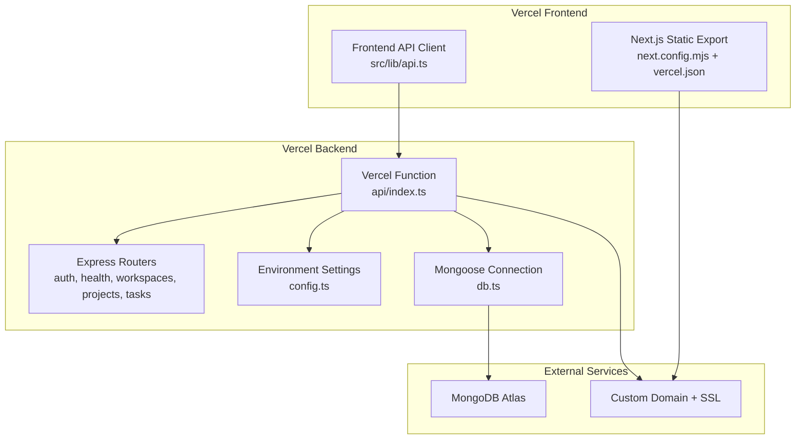
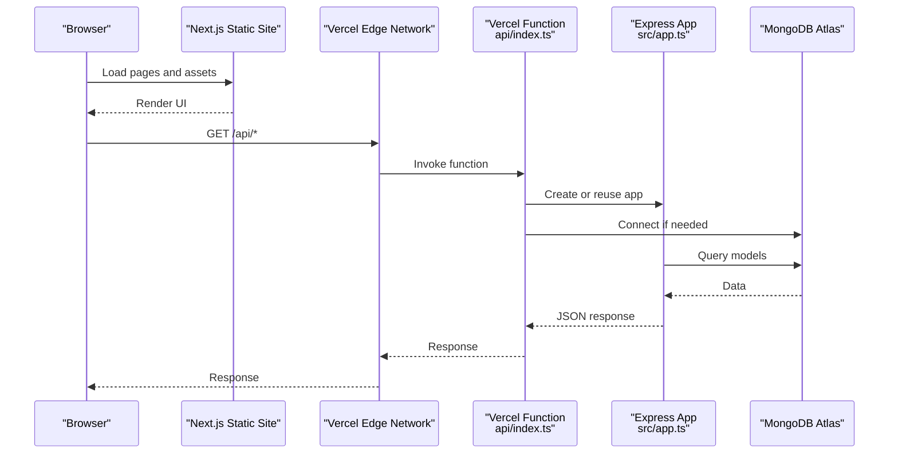
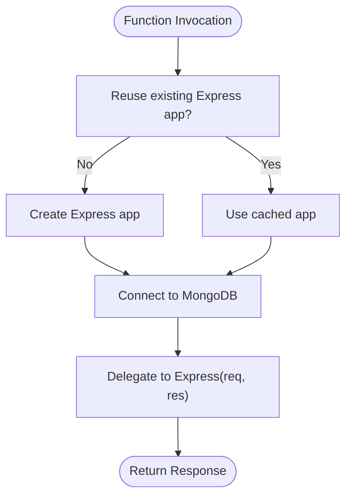
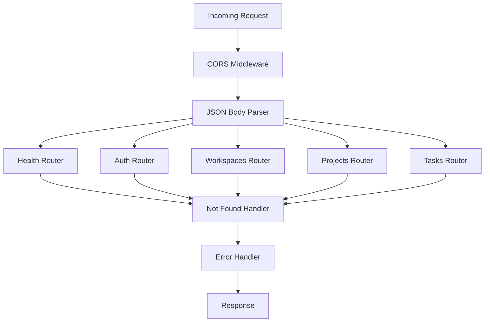
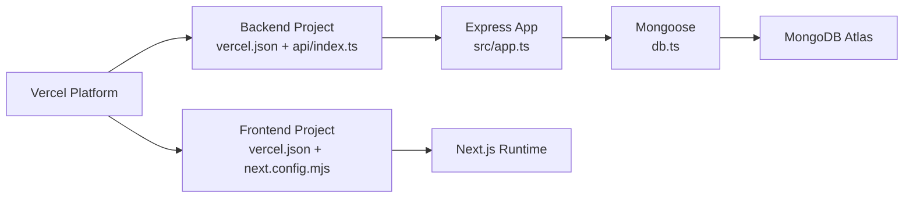

# Vercel Deployment

<cite>
**Referenced Files in This Document**
- [README.md](file://README.md)
- [phoenix-backend/vercel.json](file://phoenix-backend/vercel.json)
- [phoenix-backend/package.json](file://phoenix-backend/package.json)
- [phoenix-backend/src/app.ts](file://phoenix-backend/src/app.ts)
- [phoenix-backend/api/index.ts](file://phoenix-backend/api/index.ts)
- [phoenix-backend/src/config.ts](file://phoenix-backend/src/config.ts)
- [phoenix-backend/src/db.ts](file://phoenix-backend/src/db.ts)
- [phoenix-backend/src/server.ts](file://phoenix-backend/src/server.ts)
- [phoenix-frontend/vercel.json](file://phoenix-frontend/vercel.json)
- [phoenix-frontend/package.json](file://phoenix-frontend/package.json)
- [phoenix-frontend/next.config.mjs](file://phoenix-frontend/next.config.mjs)
- [phoenix-frontend/src/lib/api.ts](file://phoenix-frontend/src/lib/api.ts)
- [phoenix-ci/.github/workflows/pipeline.yml](file://phoenix-ci/.github/workflows/pipeline.yml)
- [phoenix-ci/README.md](file://phoenix-ci/README.md)
</cite>

## Table of Contents
1. [Introduction](#introduction)
2. [Project Structure](#project-structure)
3. [Core Components](#core-components)
4. [Architecture Overview](#architecture-overview)
5. [Detailed Component Analysis](#detailed-component-analysis)
6. [Dependency Analysis](#dependency-analysis)
7. [Performance Considerations](#performance-considerations)
8. [Troubleshooting Guide](#troubleshooting-guide)
9. [Conclusion](#conclusion)
10. [Appendices](#appendices)

## Introduction
This document explains how Project Phoenix deploys to Vercel. It covers:
- The Express backend as a Vercel serverless function, including API routing and environment configuration.
- The Next.js frontend deployment settings, static export behavior, and runtime URL resolution.
- Domain setup, SSL, custom domains, preview deployments, production releases, hooks, monitoring, and performance tuning on Vercel’s infrastructure.

The repository contains two deployable applications:
- `phoenix-backend`: Node.js 20, TypeScript, Express, Mongoose, deployed as a Vercel serverless function.
- `phoenix-frontend`: Next.js 14 with the App Router, configured for static export.

**Section sources**
- [README.md:7-14](file://README.md#L7-L14)

## Project Structure
At a high level, Vercel deploys two separate projects from this monorepo:

**Diagram sources**
- [phoenix-backend/api/index.ts:1-21](file://phoenix-backend/api/index.ts#L1-L21)
- [phoenix-backend/src/app.ts:11-32](file://phoenix-backend/src/app.ts#L11-L32)
- [phoenix-backend/src/config.ts:1-41](file://phoenix-backend/src/config.ts#L1-L41)
- [phoenix-backend/src/db.ts:1-36](file://phoenix-backend/src/db.ts#L1-L36)
- [phoenix-frontend/next.config.mjs:1-9](file://phoenix-frontend/next.config.mjs#L1-L9)
- [phoenix-frontend/src/lib/api.ts:1-86](file://phoenix-frontend/src/lib/api.ts#L1-L86)

**Section sources**
- [README.md:7-14](file://README.md#L7-L14)

## Core Components
- Backend entrypoint for Vercel is `phoenix-backend/api/index.ts`. It exports a default handler that creates an Express app once per warm invocation, connects to MongoDB, and delegates each request to Express without calling `app.listen()`.
- The Express application is created by `phoenix-backend/src/app.ts`, which configures CORS, body parsing, routes, and error handling.
- Environment variables are validated at startup by `phoenix-backend/src/config.ts` using Zod.
- Database connection reuse and initialization are handled by `phoenix-backend/src/db.ts`.
- Frontend deployment is defined by `phoenix-frontend/vercel.json` and `phoenix-frontend/next.config.mjs`. The build command runs a static export.
- The frontend resolves the backend URL through `NEXT_PUBLIC_BACKEND_URL`, falling back to a local development URL.

**Section sources**
- [phoenix-backend/api/index.ts:1-21](file://phoenix-backend/api/index.ts#L1-L21)
- [phoenix-backend/src/app.ts:11-32](file://phoenix-backend/src/app.ts#L11-L32)
- [phoenix-backend/src/config.ts:1-41](file://phoenix-backend/src/config.ts#L1-L41)
- [phoenix-backend/src/db.ts:1-36](file://phoenix-backend/src/db.ts#L1-L36)
- [phoenix-frontend/vercel.json:1-7](file://phoenix-frontend/vercel.json#L1-L7)
- [phoenix-frontend/next.config.mjs:1-9](file://phoenix-frontend/next.config.mjs#L1-L9)
- [phoenix-frontend/src/lib/api.ts:1-86](file://phoenix-frontend/src/lib/api.ts#L1-L86)

## Architecture Overview
The Vercel deployment architecture consists of:
- A Next.js frontend built as static assets.
- An Express backend exposed as a single serverless function.
- A shared MongoDB database (Atlas).
- Optional custom domain and SSL managed by Vercel.

**Diagram sources**
- [phoenix-backend/api/index.ts:11-20](file://phoenix-backend/api/index.ts#L11-L20)
- [phoenix-backend/src/app.ts:11-32](file://phoenix-backend/src/app.ts#L11-L32)
- [phoenix-backend/src/db.ts:13-30](file://phoenix-backend/src/db.ts#L13-L30)

## Detailed Component Analysis

### Backend Serverless Function Configuration
The backend is deployed as a Vercel serverless function. All requests are rewritten to `/api/index` via `vercel.json`. The handler:
- Lazily creates the Express app once per warm invocation.
- Ensures the MongoDB connection is established before serving requests.
- Delegates each request directly to Express without starting a persistent server.

**Diagram sources**
- [phoenix-backend/api/index.ts:11-20](file://phoenix-backend/api/index.ts#L11-L20)
- [phoenix-backend/src/db.ts:13-30](file://phoenix-backend/src/db.ts#L13-L30)

**Section sources**
- [phoenix-backend/vercel.json:1-5](file://phoenix-backend/vercel.json#L1-L5)
- [phoenix-backend/api/index.ts:1-21](file://phoenix-backend/api/index.ts#L1-L21)
- [phoenix-backend/src/db.ts:1-36](file://phoenix-backend/src/db.ts#L1-L36)

### API Route Handling
The Express application:
- Disables framework headers.
- Enables proxy trust.
- Configures CORS with a configurable origin list.
- Parses JSON bodies with a size limit.
- Mounts routers for health checks, authentication, workspaces, projects, and tasks.
- Uses not-found and error handlers.

**Diagram sources**
- [phoenix-backend/src/app.ts:11-32](file://phoenix-backend/src/app.ts#L11-L32)

**Section sources**
- [phoenix-backend/src/app.ts:11-32](file://phoenix-backend/src/app.ts#L11-L32)

### Environment Variable Management
Backend environment variables are validated at startup:
- Required: `MONGODB_URI`, `JWT_SECRET`.
- Optional with defaults: `JWT_ALGORITHM`, `JWT_EXPIRE_MINUTES`, `CORS_ORIGINS`, `TASK_CREDIT_COST`, `WELCOME_CREDITS`, `APP_VERSION`, `PORT`.
- `CORS_ORIGINS` is parsed into an array used by the CORS middleware.

For Vercel:
- Set these variables in the Vercel project settings under Environment Variables.
- Ensure `CORS_ORIGINS` includes the frontend’s production URL.
- Ensure `MONGODB_URI` points to a cluster allowing Vercel egress (typically allow all IPs or use VPC/Private Link where supported).

Frontend environment variable:
- `NEXT_PUBLIC_BACKEND_URL` controls the backend base URL used by the frontend API client. If unset, it falls back to a local development URL.

**Section sources**
- [phoenix-backend/src/config.ts:1-41](file://phoenix-backend/src/config.ts#L1-L41)
- [phoenix-frontend/src/lib/api.ts:1-86](file://phoenix-frontend/src/lib/api.ts#L1-L86)

### Next.js Frontend Deployment Settings
Frontend deployment is controlled by:
- `phoenix-frontend/vercel.json`: declares the framework, install command, and build command.
- `phoenix-frontend/next.config.mjs`: enables React Strict Mode, disables ESLint during builds, and enables the App Router experimentally.

Important notes:
- The build command uses a static export. This produces static HTML/CSS/JS suitable for CDN distribution.
- Any dynamic runtime features requiring Node.js must be avoided or moved to the backend.
- The frontend resolves the backend URL at runtime using `NEXT_PUBLIC_BACKEND_URL`.

**Section sources**
- [phoenix-frontend/vercel.json:1-7](file://phoenix-frontend/vercel.json#L1-L7)
- [phoenix-frontend/next.config.mjs:1-9](file://phoenix-frontend/next.config.mjs#L1-L9)
- [phoenix-frontend/package.json:8-13](file://phoenix-frontend/package.json#L8-L13)

### Domain Setup, SSL Certificates, and Custom Domains
On Vercel:
- Each project receives a default `.vercel.app` domain with automatic HTTPS.
- Add custom domains in the Vercel dashboard for both frontend and backend projects.
- Vercel provisions and renews SSL certificates automatically for custom domains.
- Configure DNS records (A/CNAME) as instructed by Vercel.
- For the frontend, set the custom domain in the Next.js project settings.
- For the backend, ensure CORS origins include the frontend’s custom domain.

**Section sources**
- [phoenix-backend/src/app.ts:17-17](file://phoenix-backend/src/app.ts#L17-L17)
- [phoenix-backend/src/config.ts:18-24](file://phoenix-backend/src/config.ts#L18-L24)

### Deployment Hooks, Preview Deployments, and Production Releases
- Preview deployments: Every branch push or pull request can create a preview deployment when importing the repository in Vercel.
- Production releases: Triggered by pushing to the configured production branch (commonly `main`).
- Build commands:
  - Backend: Vercel will run the default build process; ensure the function entrypoint remains at `api/index.ts`.
  - Frontend: The build command is explicitly set to perform a static export.
- CI integration: The repository includes a GitHub Actions pipeline skeleton. The current workflow has issues (wrong branches, outdated Node version, unsafe flags), so adjust it to match the documented requirements.

Recommended pipeline behavior:
- Run type checking, building, and testing for both apps.
- Deploy previews on PRs.
- Deploy production only on pushes to the main branch.
- Pin action versions and avoid hiding failures.
- Pass secrets securely and never log them.

**Section sources**
- [phoenix-backend/vercel.json:1-5](file://phoenix-backend/vercel.json#L1-L5)
- [phoenix-frontend/vercel.json:1-7](file://phoenix-frontend/vercel.json#L1-L7)
- [phoenix-ci/.github/workflows/pipeline.yml:1-72](file://phoenix-ci/.github/workflows/pipeline.yml#L1-L72)
- [phoenix-ci/README.md:15-31](file://phoenix-ci/README.md#L15-L31)

### Performance Optimization Techniques Specific to Vercel
- Keep the backend minimal and stateless. Reuse the Express app and database connection across invocations as implemented.
- Avoid heavy synchronous work in request handlers.
- Use caching strategies appropriate for serverless functions (e.g., Redis or Vercel KV if needed).
- Prefer static assets for the frontend; leverage Vercel’s global edge network.
- Minimize payload sizes and enable compression where applicable.
- Monitor cold starts and optimize dependencies to reduce bundle size.

[No sources needed since this section provides general guidance]

### Monitoring Setup
- Enable Vercel Analytics for the frontend to track page views and user interactions.
- Use Vercel Logs to inspect serverless function logs and errors.
- Set up alerts for failed builds and deployments.
- Integrate external observability tools (e.g., Sentry) for frontend error tracking and backend error logging.
- Add health check endpoints and monitor uptime externally.

[No sources needed since this section provides general guidance]

## Dependency Analysis
The backend depends on Express, Mongoose, JWT, and Zod. The frontend depends on Next.js and React. Vercel orchestrates the build and deployment based on the provided configuration files.

**Diagram sources**
- [phoenix-backend/vercel.json:1-5](file://phoenix-backend/vercel.json#L1-L5)
- [phoenix-backend/api/index.ts:1-21](file://phoenix-backend/api/index.ts#L1-L21)
- [phoenix-backend/src/app.ts:11-32](file://phoenix-backend/src/app.ts#L11-L32)
- [phoenix-backend/src/db.ts:1-36](file://phoenix-backend/src/db.ts#L1-L36)
- [phoenix-frontend/vercel.json:1-7](file://phoenix-frontend/vercel.json#L1-L7)
- [phoenix-frontend/next.config.mjs:1-9](file://phoenix-frontend/next.config.mjs#L1-L9)

**Section sources**
- [phoenix-backend/package.json:1-41](file://phoenix-backend/package.json#L1-L41)
- [phoenix-frontend/package.json:1-27](file://phoenix-frontend/package.json#L1-L27)

## Performance Considerations
- Backend:
  - Reuse the Express app and database connection to reduce cold start overhead.
  - Validate environment variables early to fail fast on misconfiguration.
  - Limit request body size to prevent abuse.
- Frontend:
  - Use static export to serve prebuilt assets from the edge.
  - Avoid runtime Node.js features; move logic to the backend.
  - Configure `NEXT_PUBLIC_BACKEND_URL` correctly for each environment.

[No sources needed since this section provides general guidance]

## Troubleshooting Guide
Common issues and resolutions:
- Backend fails to connect to MongoDB:
  - Verify `MONGODB_URI` is correct and includes the database name.
  - Ensure Atlas allows Vercel egress (network access rules).
  - Confirm environment variables are set in Vercel project settings.
- CORS errors:
  - Set `CORS_ORIGINS` to include the frontend’s production URL.
  - Ensure credentials are enabled where required.
- Frontend cannot reach the backend:
  - Set `NEXT_PUBLIC_BACKEND_URL` to the backend’s production URL.
  - Check browser console for network errors and verify CORS headers.
- Build failures:
  - Backend: Ensure TypeScript compiles and tests pass.
  - Frontend: Ensure static export succeeds and dependencies are compatible.
- Pipeline problems:
  - Fix branch triggers, Node versions, and remove unsafe flags like `--legacy-peer-deps` and `|| true`.
  - Pin action versions and avoid printing secrets.

**Section sources**
- [phoenix-backend/src/config.ts:28-40](file://phoenix-backend/src/config.ts#L28-L40)
- [phoenix-backend/src/app.ts:17-30](file://phoenix-backend/src/app.ts#L17-L30)
- [phoenix-frontend/src/lib/api.ts:3-3](file://phoenix-frontend/src/lib/api.ts#L3-L3)
- [phoenix-ci/.github/workflows/pipeline.yml:1-72](file://phoenix-ci/.github/workflows/pipeline.yml#L1-L72)

## Conclusion
Project Phoenix deploys cleanly to Vercel when:
- The backend is configured as a serverless function with proper environment variables and CORS settings.
- The frontend is configured for static export and resolves the backend URL correctly.
- Domains and SSL are configured in Vercel.
- CI pipelines are corrected to run safely and reliably.
- Performance and monitoring practices are applied according to Vercel’s capabilities.

[No sources needed since this section summarizes without analyzing specific files]

## Appendices

### Backend Environment Variables Reference
- `MONGODB_URI`: Required. MongoDB connection string.
- `JWT_SECRET`: Required. Secret for signing tokens.
- `JWT_ALGORITHM`: Optional. Defaults to HS256.
- `JWT_EXPIRE_MINUTES`: Optional. Token expiration in minutes.
- `CORS_ORIGINS`: Optional. Comma-separated allowed origins.
- `TASK_CREDIT_COST`: Optional. Credit cost per task.
- `WELCOME_CREDITS`: Optional. Initial credits for new users.
- `APP_VERSION`: Optional. Application version label.
- `PORT`: Optional. Local development port.

**Section sources**
- [phoenix-backend/src/config.ts:4-14](file://phoenix-backend/src/config.ts#L4-L14)

### Frontend Environment Variables Reference
- `NEXT_PUBLIC_BACKEND_URL`: Optional. Backend base URL for API calls. Falls back to localhost in development.

**Section sources**
- [phoenix-frontend/src/lib/api.ts:3-3](file://phoenix-frontend/src/lib/api.ts#L3-L3)