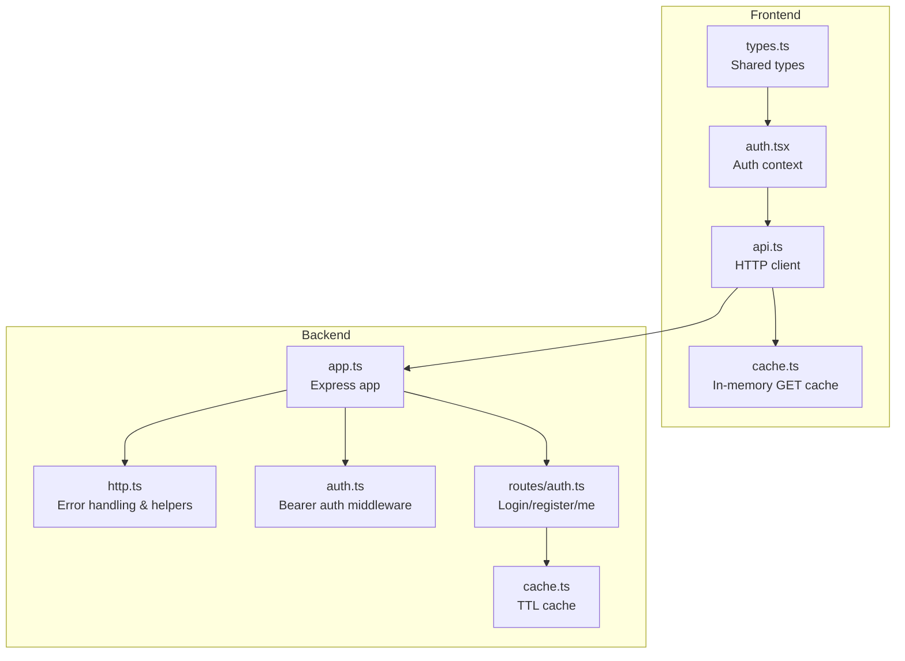
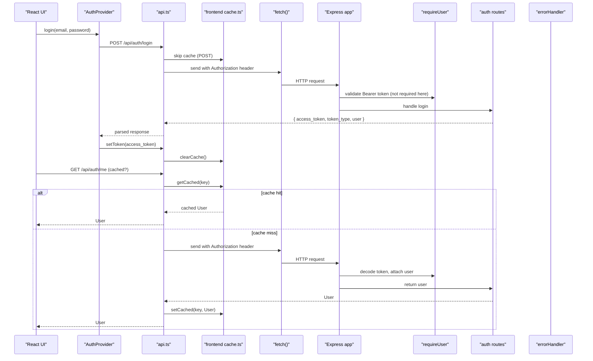
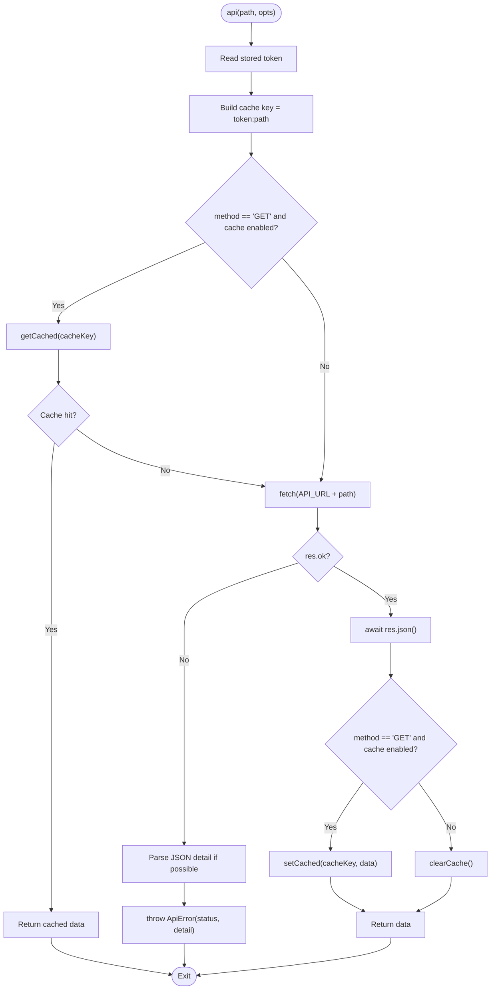
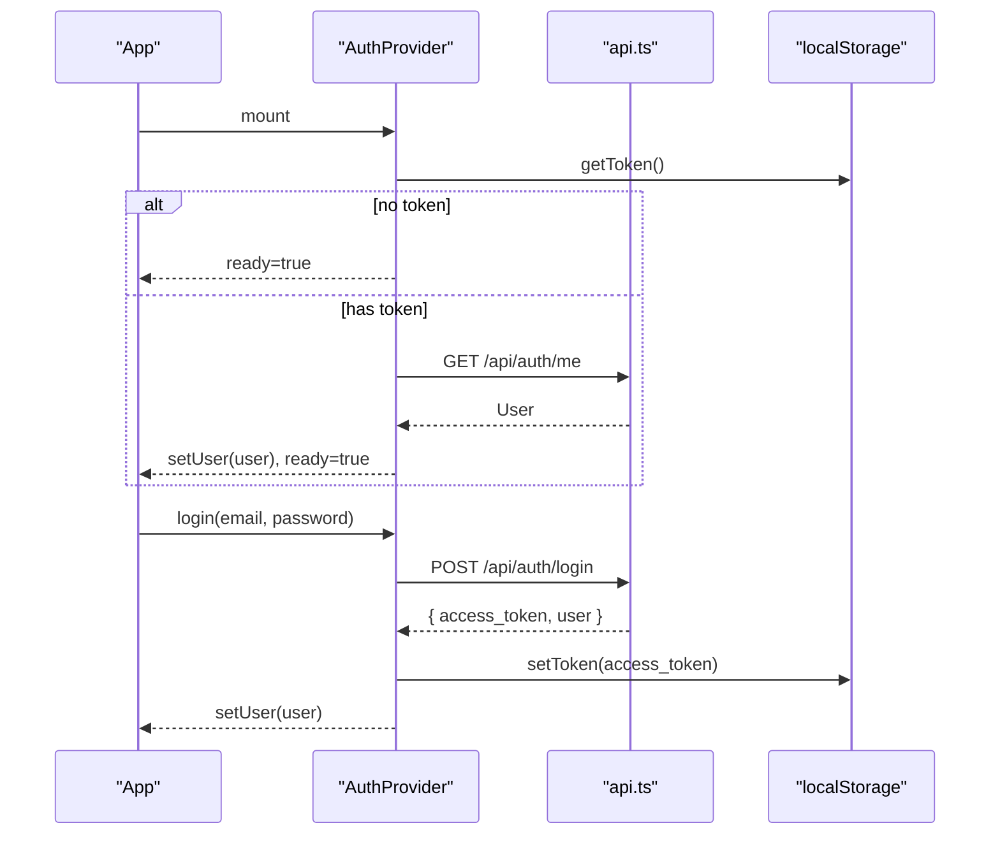
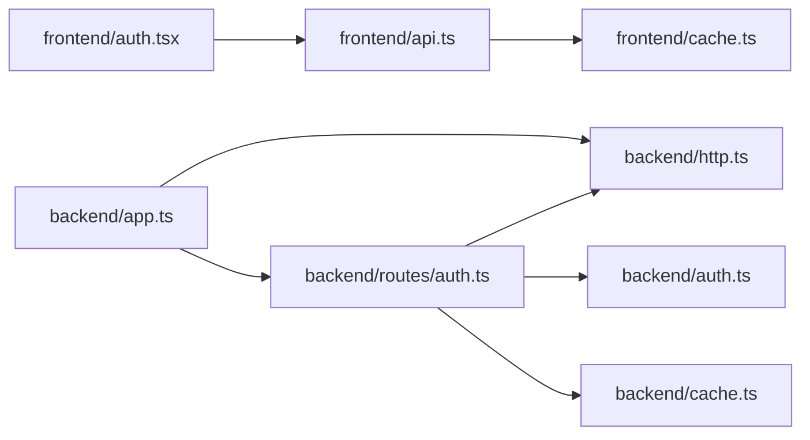

# API Client Layer

<cite>
**Referenced Files in This Document**
- [api.ts](file://phoenix-frontend/src/lib/api.ts)
- [cache.ts](file://phoenix-frontend/src/lib/cache.ts)
- [auth.tsx](file://phoenix-frontend/src/lib/auth.tsx)
- [types.ts](file://phoenix-frontend/src/lib/types.ts)
- [http.ts](file://phoenix-backend/src/lib/http.ts)
- [cache.ts](file://phoenix-backend/src/lib/cache.ts)
- [auth.ts](file://phoenix-backend/src/lib/auth.ts)
- [auth.ts](file://phoenix-backend/src/routes/auth.ts)
- [app.ts](file://phoenix-backend/src/app.ts)
</cite>

## Table of Contents
1. [Introduction](#introduction)
2. [Project Structure](#project-structure)
3. [Core Components](#core-components)
4. [Architecture Overview](#architecture-overview)
5. [Detailed Component Analysis](#detailed-component-analysis)
6. [Dependency Analysis](#dependency-analysis)
7. [Performance Considerations](#performance-considerations)
8. [Troubleshooting Guide](#troubleshooting-guide)
9. [Conclusion](#conclusion)

## Introduction
This document explains the API client layer that handles HTTP requests to the backend. It covers request/response processing, error handling strategies, caching mechanisms, authentication token attachment, response data transformation, and error propagation. It also includes examples of making API calls, handling different response types, implementing retry logic, performance optimizations, request interception patterns, and debugging techniques.

## Project Structure
The API client layer spans both frontend and backend:
- Frontend:
  - Central HTTP client with token management, caching, and error helpers.
  - In-memory cache for GET responses.
  - Authentication context integrating login/logout and session restoration.
  - Shared TypeScript types for API payloads.
- Backend:
  - Express middleware for parsing, validation, and standardized error responses.
  - Authorization middleware that validates bearer tokens and attaches user context.
  - Optional in-process TTL cache for hot read endpoints.

**Diagram sources**
- [api.ts:1-111](file://phoenix-frontend/src/lib/api.ts#L1-L111)
- [cache.ts:1-16](file://phoenix-frontend/src/lib/cache.ts#L1-L16)
- [auth.tsx:1-59](file://phoenix-frontend/src/lib/auth.tsx#L1-L59)
- [types.ts:1-54](file://phoenix-frontend/src/lib/types.ts#L1-L54)
- [app.ts:1-33](file://phoenix-backend/src/app.ts#L1-L33)
- [http.ts:1-81](file://phoenix-backend/src/lib/http.ts#L1-L81)
- [auth.ts:1-58](file://phoenix-backend/src/lib/auth.ts#L1-L58)
- [auth.ts:1-52](file://phoenix-backend/src/routes/auth.ts#L1-L52)
- [cache.ts:1-26](file://phoenix-backend/src/lib/cache.ts#L1-L26)

**Section sources**
- [api.ts:1-111](file://phoenix-frontend/src/lib/api.ts#L1-L111)
- [cache.ts:1-16](file://phoenix-frontend/src/lib/cache.ts#L1-L16)
- [auth.tsx:1-59](file://phoenix-frontend/src/lib/auth.tsx#L1-L59)
- [types.ts:1-54](file://phoenix-frontend/src/lib/types.ts#L1-L54)
- [app.ts:1-33](file://phoenix-backend/src/app.ts#L1-L33)
- [http.ts:1-81](file://phoenix-backend/src/lib/http.ts#L1-L81)
- [auth.ts:1-58](file://phoenix-backend/src/lib/auth.ts#L1-L58)
- [auth.ts:1-52](file://phoenix-backend/src/routes/auth.ts#L1-L52)
- [cache.ts:1-26](file://phoenix-backend/src/lib/cache.ts#L1-L26)

## Core Components
- Frontend HTTP client (api.ts):
  - Builds fetch requests, attaches Authorization headers, parses JSON, caches GET responses, clears cache on writes, and throws typed errors.
  - Provides a describeError helper for user-friendly messages.
- Frontend cache (cache.ts):
  - Simple in-memory Map-based cache keyed by token + path; cleared on write or session change.
- Frontend auth (auth.tsx):
  - Context provider for login/logout, restores session on load, stores token in localStorage, and updates UI state.
- Backend HTTP utilities (http.ts):
  - Standardized HttpError, async handler wrapper, Zod body parsing, ObjectId parsing, and global error handler mapping exceptions to consistent JSON responses.
- Backend auth (auth.ts):
  - requireUser middleware validates Bearer tokens, decodes them, loads user, and attaches it to res.locals.
- Backend routes (routes/auth.ts):
  - Login, register, and me endpoints returning standardized JSON payloads.
- Backend TTL cache (cache.ts):
  - In-process TTL cache for hot read endpoints.

**Section sources**
- [api.ts:1-111](file://phoenix-frontend/src/lib/api.ts#L1-L111)
- [cache.ts:1-16](file://phoenix-frontend/src/lib/cache.ts#L1-L16)
- [auth.tsx:1-59](file://phoenix-frontend/src/lib/auth.tsx#L1-L59)
- [http.ts:1-81](file://phoenix-backend/src/lib/http.ts#L1-L81)
- [auth.ts:1-58](file://phoenix-backend/src/lib/auth.ts#L1-L58)
- [auth.ts:1-52](file://phoenix-backend/src/routes/auth.ts#L1-L52)
- [cache.ts:1-26](file://phoenix-backend/src/lib/cache.ts#L1-L26)

## Architecture Overview
End-to-end flow for authenticated API calls:

**Diagram sources**
- [auth.tsx:35-42](file://phoenix-frontend/src/lib/auth.tsx#L35-L42)
- [api.ts:50-96](file://phoenix-frontend/src/lib/api.ts#L50-L96)
- [auth.ts:8-23](file://phoenix-backend/src/lib/auth.ts#L8-L23)
- [auth.ts:33-51](file://phoenix-backend/src/routes/auth.ts#L33-L51)
- [http.ts:47-80](file://phoenix-backend/src/lib/http.ts#L47-L80)

## Detailed Component Analysis

### Frontend HTTP Client (api.ts)
Responsibilities:
- Base URL configuration via environment variable.
- Token lifecycle: read from memory/local storage, attach to Authorization header.
- Request building: method, headers, body serialization, AbortSignal support.
- Response handling: parse JSON, throw ApiError with status and detail.
- Caching: optional GET cache keyed by token + path; invalidate on writes.
- Error description: map status codes to user-friendly messages.

Key behaviors:
- Token attachment: Authorization header is added when a token exists.
- Cache key includes token so sessions do not share entries.
- Non-GET requests clear the entire cache to avoid stale reads.
- Network failures throw ApiError with status 0 and a connection message.
- Non-OK responses attempt to extract detail from JSON body; otherwise use status text.

**Diagram sources**
- [api.ts:50-96](file://phoenix-frontend/src/lib/api.ts#L50-L96)

**Section sources**
- [api.ts:1-111](file://phoenix-frontend/src/lib/api.ts#L1-L111)

### Frontend Cache (cache.ts)
- In-memory Map storing values keyed by string.
- Exposes get/set/clear operations.
- Cleared on login/logout and after any write operation.

Complexity:
- O(1) average time for get/set/clear.
- Space proportional to number of cached keys.

**Section sources**
- [cache.ts:1-16](file://phoenix-frontend/src/lib/cache.ts#L1-L16)

### Frontend Auth Context (auth.tsx)
Responsibilities:
- Provide login/logout functions.
- Restore session on page load by calling /api/auth/me.
- Store token in localStorage and update React state.

Flow:
- On mount, if no token, mark ready.
- If token exists, call /api/auth/me; on success set user; on failure clear token and user.
- Login sets token and user from response.
- Logout clears token and user.

**Diagram sources**
- [auth.tsx:20-47](file://phoenix-frontend/src/lib/auth.tsx#L20-L47)
- [api.ts:17-34](file://phoenix-frontend/src/lib/api.ts#L17-L34)

**Section sources**
- [auth.tsx:1-59](file://phoenix-frontend/src/lib/auth.tsx#L1-L59)
- [api.ts:17-34](file://phoenix-frontend/src/lib/api.ts#L17-L34)

### Backend HTTP Utilities (http.ts)
Responsibilities:
- Define HttpError with status and detail.
- Wrap async handlers to catch rejections.
- Validate request bodies using Zod schemas.
- Parse and validate MongoDB ObjectIds.
- Global errorHandler maps various error types to consistent JSON responses.

Error mapping highlights:
- HttpError -> status/detail.
- ZodError -> 422 with issues.
- Mongoose CastError -> 404.
- Mongoose ValidationError -> 422.
- SyntaxError with body -> 400 malformed JSON.
- Body parser too large -> 413.
- Other body parser errors -> 400/4xx based on statusCode.
- Fallback -> 500 internal server error.

**Section sources**
- [http.ts:1-81](file://phoenix-backend/src/lib/http.ts#L1-L81)

### Backend Auth Middleware (auth.ts)
Responsibilities:
- Extract and validate Bearer token from Authorization header.
- Decode token and verify user existence.
- Attach user to res.locals for downstream handlers.
- Provide role-checking helpers for workspace membership/admin/owner.

Behavior:
- Missing or invalid scheme/token -> 401.
- Invalid/expired token -> 401.
- User not found -> 401.
- Success -> next() with user attached.

**Section sources**
- [auth.ts:1-58](file://phoenix-backend/src/lib/auth.ts#L1-L58)

### Backend Auth Routes (routes/auth.ts)
Endpoints:
- POST /api/auth/register: creates user, returns token and user.
- POST /api/auth/login: authenticates user, returns token and user.
- GET /api/auth/me: requires user, returns current user.

Response shape:
- access_token, token_type, user object.

Validation:
- Uses Zod schemas to parse and validate input.
- Duplicate email handled as 409 conflict.

**Section sources**
- [auth.ts:1-52](file://phoenix-backend/src/routes/auth.ts#L1-L52)

### Backend TTL Cache (cache.ts)
- In-process TTL cache for hot read endpoints.
- Default TTL of 30 seconds.
- Keyed by domain-specific functions (e.g., projectListKey).

Use cases:
- Reduce database load for frequently accessed lists.
- Must be invalidated on writes to maintain consistency.

**Section sources**
- [cache.ts:1-26](file://phoenix-backend/src/lib/cache.ts#L1-L26)

### Express App Setup (app.ts)
- Configures CORS with credentials.
- Parses JSON bodies up to 100kb.
- Mounts routers: health, auth, workspaces, projects, tasks.
- Applies notFound and errorHandler middlewares.

**Section sources**
- [app.ts:1-33](file://phoenix-backend/src/app.ts#L1-L33)

## Dependency Analysis
High-level dependencies:
- Frontend api.ts depends on frontend cache.ts and uses window.localStorage for token persistence.
- Frontend auth.tsx depends on api.ts for network calls and token management.
- Backend app.ts wires together routers and error handling.
- Backend routes depend on http.ts for validation and error handling, and auth.ts for authorization.
- Backend routes may optionally use backend cache.ts for read-heavy endpoints.

**Diagram sources**
- [api.ts:1-111](file://phoenix-frontend/src/lib/api.ts#L1-L111)
- [cache.ts:1-16](file://phoenix-frontend/src/lib/cache.ts#L1-L16)
- [auth.tsx:1-59](file://phoenix-frontend/src/lib/auth.tsx#L1-L59)
- [app.ts:1-33](file://phoenix-backend/src/app.ts#L1-L33)
- [http.ts:1-81](file://phoenix-backend/src/lib/http.ts#L1-L81)
- [auth.ts:1-58](file://phoenix-backend/src/lib/auth.ts#L1-L58)
- [auth.ts:1-52](file://phoenix-backend/src/routes/auth.ts#L1-L52)
- [cache.ts:1-26](file://phoenix-backend/src/lib/cache.ts#L1-L26)

**Section sources**
- [api.ts:1-111](file://phoenix-frontend/src/lib/api.ts#L1-L111)
- [cache.ts:1-16](file://phoenix-frontend/src/lib/cache.ts#L1-L16)
- [auth.tsx:1-59](file://phoenix-frontend/src/lib/auth.tsx#L1-L59)
- [app.ts:1-33](file://phoenix-backend/src/app.ts#L1-L33)
- [http.ts:1-81](file://phoenix-backend/src/lib/http.ts#L1-L81)
- [auth.ts:1-58](file://phoenix-backend/src/lib/auth.ts#L1-L58)
- [auth.ts:1-52](file://phoenix-backend/src/routes/auth.ts#L1-L52)
- [cache.ts:1-26](file://phoenix-backend/src/lib/cache.ts#L1-L26)

## Performance Considerations
- Frontend GET caching:
  - Use the cache option on GET requests to avoid redundant network calls.
  - Cache keys include the token to isolate sessions.
  - Writes automatically clear the cache to prevent stale data.
- Backend TTL cache:
  - Apply to hot read endpoints to reduce DB pressure.
  - Ensure proper invalidation on mutations.
- Request size limits:
  - Backend enforces 100kb JSON body limit; clients should avoid oversized payloads.
- Headers and content type:
  - Content-Type is set to application/json; ensure payloads are valid JSON.
- Abort signals:
  - Pass AbortSignal to cancel long-running requests during navigation or unmount.

[No sources needed since this section provides general guidance]

## Troubleshooting Guide
Common issues and resolutions:
- Network unreachable:
  - Frontend throws ApiError with status 0 and a connection message. Verify API_URL and connectivity.
- Authentication failures:
  - 401 indicates missing/invalid/expired token. Re-login to refresh token.
- Permission denied:
  - 403 indicates insufficient permissions. Check workspace roles.
- Not found:
  - 404 indicates resource not found or inaccessible.
- Server errors:
  - 5xx indicates backend issues; retry later or contact support.
- Validation errors:
  - 422 indicates invalid request body; check schema constraints.
- Malformed JSON:
  - 400 indicates malformed JSON body; ensure correct Content-Type and payload format.
- Request body too large:
  - 413 indicates payload exceeds limit; reduce size or paginate.

Debugging techniques:
- Inspect Authorization header presence and value.
- Log cache hits/misses by wrapping getCached/setCached temporarily.
- Use browser dev tools to inspect network requests/responses.
- On the backend, review errorHandler logs and structured error details.

**Section sources**
- [api.ts:73-110](file://phoenix-frontend/src/lib/api.ts#L73-L110)
- [http.ts:47-80](file://phoenix-backend/src/lib/http.ts#L47-L80)

## Conclusion
The API client layer provides a robust foundation for secure, efficient communication between the frontend and backend. It centralizes token handling, caching, error normalization, and response parsing while offering clear extension points for retries, interceptors, and advanced caching strategies. The backend complements this with standardized error handling, strict validation, and optional TTL caching for high-throughput scenarios.

[No sources needed since this section summarizes without analyzing specific files]