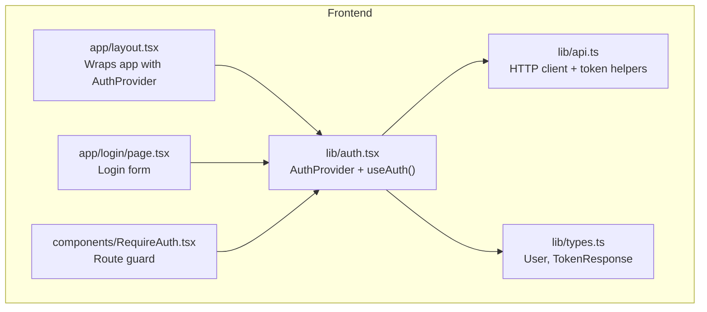
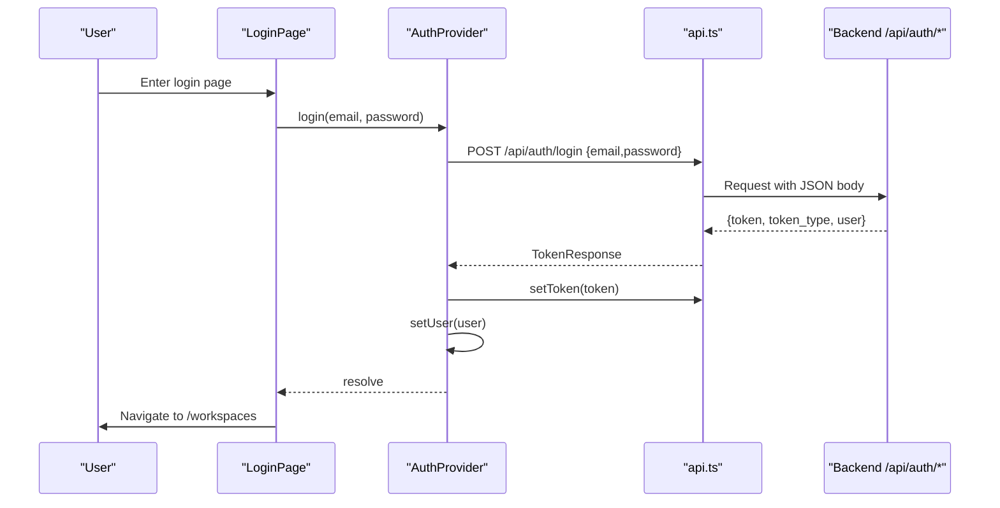
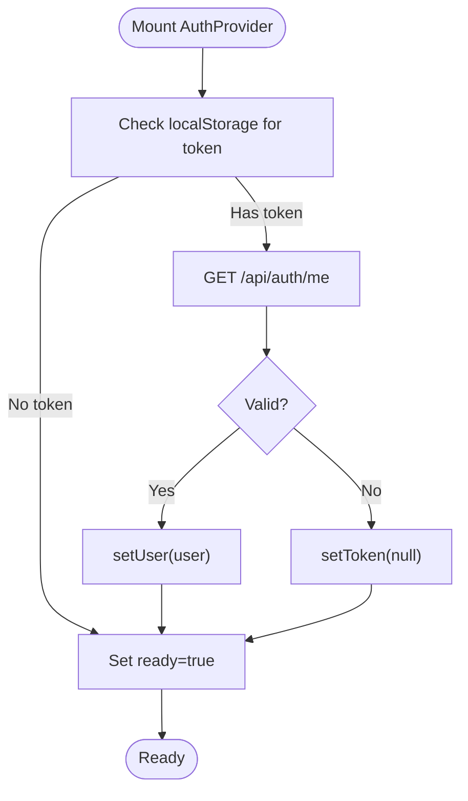
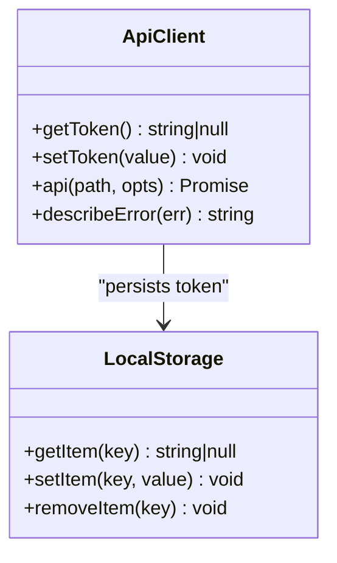
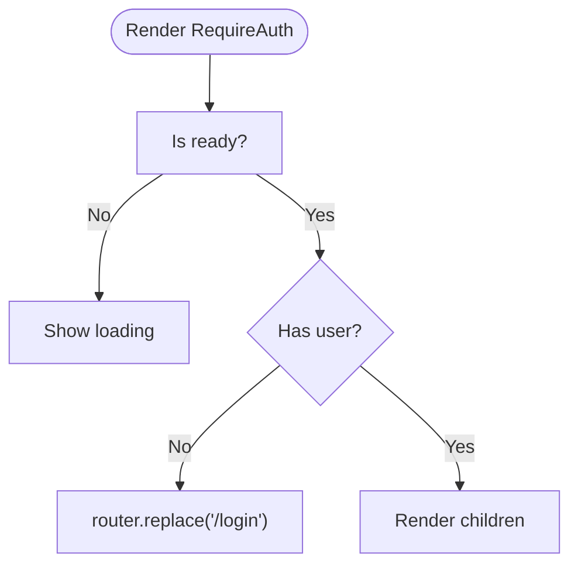
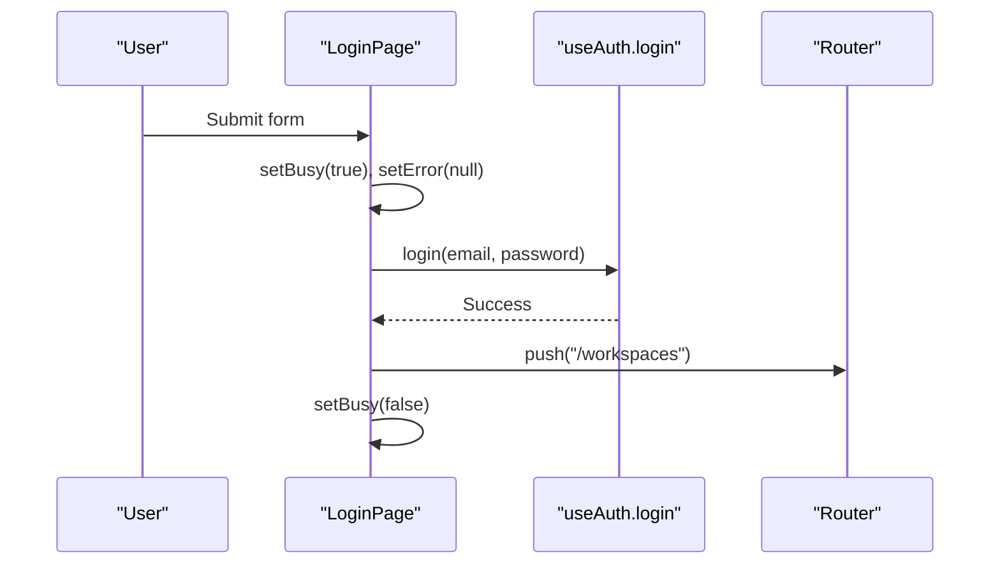
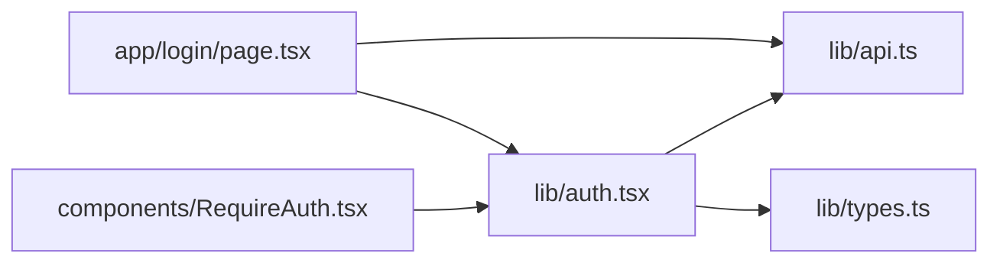

# Authentication System

<cite>
**Referenced Files in This Document**
- [auth.tsx](file://phoenix-frontend/src/lib/auth.tsx)
- [api.ts](file://phoenix-frontend/src/lib/api.ts)
- [RequireAuth.tsx](file://phoenix-frontend/src/components/RequireAuth.tsx)
- [page.tsx (Login)](file://phoenix-frontend/src/app/login/page.tsx)
- [layout.tsx](file://phoenix-frontend/src/app/layout.tsx)
- [types.ts](file://phoenix-frontend/src/lib/types.ts)
</cite>

## Table of Contents
1. [Introduction](#introduction)
2. [Project Structure](#project-structure)
3. [Core Components](#core-components)
4. [Architecture Overview](#architecture-overview)
5. [Detailed Component Analysis](#detailed-component-analysis)
6. [Dependency Analysis](#dependency-analysis)
7. [Performance Considerations](#performance-considerations)
8. [Security Considerations](#security-considerations)
9. [Troubleshooting Guide](#troubleshooting-guide)
10. [Conclusion](#conclusion)

## Introduction
This document explains the frontend authentication system implemented with React Context, Next.js routing, and localStorage-based session persistence. It covers:
- The AuthProvider that manages user state and login/logout flows
- Session management using a token stored in localStorage
- JWT-like token handling via Authorization headers on API requests
- The RequireAuth wrapper for protecting routes
- The Login page UI and error handling
- How to consume auth context in components and implement protected routes

## Project Structure
The authentication-related code lives under the Phoenix frontend application:
- lib/auth.tsx: React Context provider and hooks for authentication
- lib/api.ts: HTTP client, token getters/setters, and error helpers
- components/RequireAuth.tsx: Route guard component
- app/login/page.tsx: Login form and flow
- app/layout.tsx: Root layout wrapping the app with AuthProvider
- lib/types.ts: Shared types for User and TokenResponse

**Diagram sources**
- [layout.tsx:12-26](file://phoenix-frontend/src/app/layout.tsx#L12-L26)
- [auth.tsx:16-55](file://phoenix-frontend/src/lib/auth.tsx#L16-L55)
- [RequireAuth.tsx:7-17](file://phoenix-frontend/src/components/RequireAuth.tsx#L7-L17)
- [page.tsx (Login):8-53](file://phoenix-frontend/src/app/login/page.tsx#L8-L53)
- [api.ts:33-72](file://phoenix-frontend/src/lib/api.ts#L33-L72)
- [types.ts:4-14](file://phoenix-frontend/src/lib/types.ts#L4-L14)

**Section sources**
- [layout.tsx:12-26](file://phoenix-frontend/src/app/layout.tsx#L12-L26)
- [auth.tsx:16-55](file://phoenix-frontend/src/lib/auth.tsx#L16-L55)
- [RequireAuth.tsx:7-17](file://phoenix-frontend/src/components/RequireAuth.tsx#L7-L17)
- [page.tsx (Login):8-53](file://phoenix-frontend/src/app/login/page.tsx#L8-L53)
- [api.ts:33-72](file://phoenix-frontend/src/lib/api.ts#L33-L72)
- [types.ts:4-14](file://phoenix-frontend/src/lib/types.ts#L4-L14)

## Core Components
- AuthProvider (React Context): Manages user state, readiness, login, and logout. Restores session from localStorage on mount by validating the token against the backend.
- api.ts: Provides getToken/setToken for localStorage persistence, an HTTP client that attaches Authorization headers, and error utilities.
- RequireAuth: A route guard that redirects unauthenticated users to /login and shows a loading state while auth is resolving.
- Login Page: Collects credentials, calls login via useAuth, handles errors, and navigates after success.
- Types: Defines User and TokenResponse used across auth flows.

Key responsibilities:
- Session restoration and validation
- Storing and retrieving tokens
- Attaching tokens to outgoing requests
- Exposing login/logout and user state via context

**Section sources**
- [auth.tsx:7-14](file://phoenix-frontend/src/lib/auth.tsx#L7-L14)
- [auth.tsx:16-55](file://phoenix-frontend/src/lib/auth.tsx#L16-L55)
- [api.ts:16-23](file://phoenix-frontend/src/lib/api.ts#L16-L23)
- [api.ts:33-72](file://phoenix-frontend/src/lib/api.ts#L33-L72)
- [RequireAuth.tsx:7-17](file://phoenix-frontend/src/components/RequireAuth.tsx#L7-L17)
- [page.tsx (Login):8-53](file://phoenix-frontend/src/app/login/page.tsx#L8-L53)
- [types.ts:4-14](file://phoenix-frontend/src/lib/types.ts#L4-L14)

## Architecture Overview
The authentication architecture centers around a client-side context provider that coordinates with the backend through a typed HTTP client. Tokens are persisted in localStorage and attached to requests as Bearer tokens.

**Diagram sources**
- [page.tsx (Login):16-28](file://phoenix-frontend/src/app/login/page.tsx#L16-L28)
- [auth.tsx:38-45](file://phoenix-frontend/src/lib/auth.tsx#L38-L45)
- [api.ts:33-72](file://phoenix-frontend/src/lib/api.ts#L33-L72)

## Detailed Component Analysis

### AuthProvider and useAuth
- State:
  - user: Current authenticated user or null
  - ready: Whether initial session check has completed
- Lifecycle:
  - On mount, if a token exists, it validates the session by calling /api/auth/me; on failure, it clears the token
  - Listens for a custom window event to clear user state on logout
- Actions:
  - login(email, password): Calls /api/auth/login, persists token, sets user
  - logout(): Clears token and user state

**Diagram sources**
- [auth.tsx:20-30](file://phoenix-frontend/src/lib/auth.tsx#L20-L30)

**Section sources**
- [auth.tsx:7-14](file://phoenix-frontend/src/lib/auth.tsx#L7-L14)
- [auth.tsx:16-55](file://phoenix-frontend/src/lib/auth.tsx#L16-L55)

### Session Management and Token Handling
- Storage key: Uses a constant key for localStorage
- Getter/Setter:
  - getToken(): Returns current in-memory token value
  - setToken(value): Persists or removes the token from localStorage
- HTTP Client:
  - Automatically attaches Authorization: Bearer <token> header when present
  - Wraps fetch with error handling and optional caching for GET requests

**Diagram sources**
- [api.ts:16-23](file://phoenix-frontend/src/lib/api.ts#L16-L23)
- [api.ts:33-72](file://phoenix-frontend/src/lib/api.ts#L33-L72)

**Section sources**
- [api.ts:16-23](file://phoenix-frontend/src/lib/api.ts#L16-L23)
- [api.ts:33-72](file://phoenix-frontend/src/lib/api.ts#L33-L72)

### RequireAuth Wrapper
- Behavior:
  - While ready is false or user is null, displays a loading indicator
  - Once ready and no user is present, redirects to /login
- Usage:
  - Wrap any route content that requires authentication

**Diagram sources**
- [RequireAuth.tsx:7-17](file://phoenix-frontend/src/components/RequireAuth.tsx#L7-L17)

**Section sources**
- [RequireAuth.tsx:7-17](file://phoenix-frontend/src/components/RequireAuth.tsx#L7-L17)

### Login Page
- Form fields: email and password
- Submission:
  - Prevents default, sets busy state, clears previous errors
  - Calls login via useAuth
  - On success, navigates to /workspaces
  - On error, displays a user-friendly message via describeError
- UX:
  - Shows disabled button during submission
  - Displays inline error messages

**Diagram sources**
- [page.tsx (Login):16-28](file://phoenix-frontend/src/app/login/page.tsx#L16-L28)

**Section sources**
- [page.tsx (Login):8-53](file://phoenix-frontend/src/app/login/page.tsx#L8-L53)

### Root Layout Integration
- The root layout wraps the entire application with AuthProvider so all pages can access authentication state and actions.

**Section sources**
- [layout.tsx:12-26](file://phoenix-frontend/src/app/layout.tsx#L12-L26)

## Dependency Analysis
- AuthProvider depends on:
  - api.ts for getToken/setToken and making authenticated requests
  - types.ts for User and TokenResponse
- RequireAuth depends on:
  - useAuth from auth.tsx
  - Next navigation router
- Login page depends on:
  - useAuth for login
  - api.ts describeError for user-facing messages

**Diagram sources**
- [auth.tsx:1-5](file://phoenix-frontend/src/lib/auth.tsx#L1-L5)
- [api.ts:1-2](file://phoenix-frontend/src/lib/api.ts#L1-L2)
- [RequireAuth.tsx:1-6](file://phoenix-frontend/src/components/RequireAuth.tsx#L1-L6)
- [page.tsx (Login):1-7](file://phoenix-frontend/src/app/login/page.tsx#L1-L7)

**Section sources**
- [auth.tsx:1-5](file://phoenix-frontend/src/lib/auth.tsx#L1-L5)
- [api.ts:1-2](file://phoenix-frontend/src/lib/api.ts#L1-L2)
- [RequireAuth.tsx:1-6](file://phoenix-frontend/src/components/RequireAuth.tsx#L1-L6)
- [page.tsx (Login):1-7](file://phoenix-frontend/src/app/login/page.tsx#L1-L7)

## Performance Considerations
- Session validation occurs once on mount; subsequent renders avoid redundant network calls.
- Optional GET caching is available via the api helper for endpoints that support it.
- Avoid unnecessary re-renders by keeping user state minimal and derived where possible.

[No sources needed since this section provides general guidance]

## Security Considerations
- Token storage:
  - Tokens are stored in localStorage. For enhanced security, consider httpOnly cookies on the server and short-lived tokens with refresh strategies.
- Transport security:
  - Ensure all API calls use HTTPS to prevent token interception.
- Error exposure:
  - describeError maps specific status codes to user-friendly messages; avoid leaking internal details to the client.
- CSRF and XSS:
  - When moving to cookie-based sessions, implement CSRF protections and sanitize outputs to mitigate XSS.

[No sources needed since this section provides general guidance]

## Troubleshooting Guide
Common issues and resolutions:
- “Cannot reach the server”:
  - Indicates a network connectivity problem. Verify the backend URL and network availability.
- “Your session has expired. Please log in again.”:
  - Occurs on 401 responses. Clear stale tokens and redirect to login.
- “You don't have permission to do that.”:
  - Occurs on 403 responses. Check user roles and permissions.
- “Not found (or you don't have access).”:
  - Occurs on 404 responses. Verify resource existence and access rights.
- Server errors:
  - Occur on 5xx responses. Retry with backoff and report to monitoring.

**Section sources**
- [api.ts:74-85](file://phoenix-frontend/src/lib/api.ts#L74-L85)

## Conclusion
The frontend authentication system uses a React Context provider to manage user state and session lifecycle, with localStorage persisting tokens and the HTTP client attaching them to requests. RequireAuth protects routes, and the Login page orchestrates credential submission and navigation. The design is straightforward and extensible, with clear separation between UI, state, and networking concerns.

[No sources needed since this section summarizes without analyzing specific files]