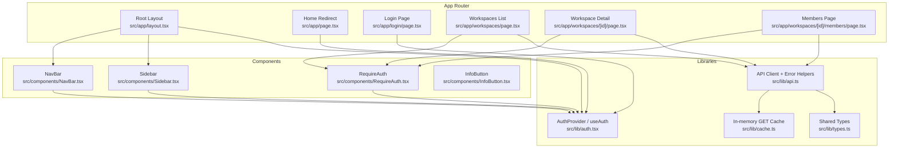
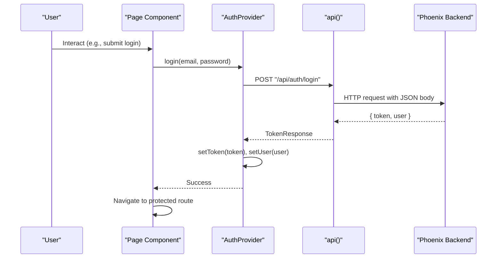
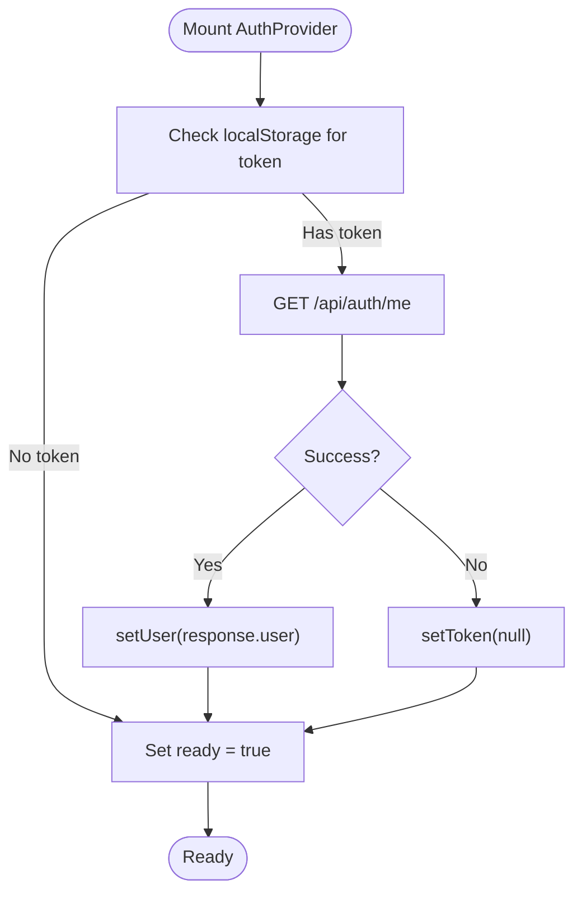
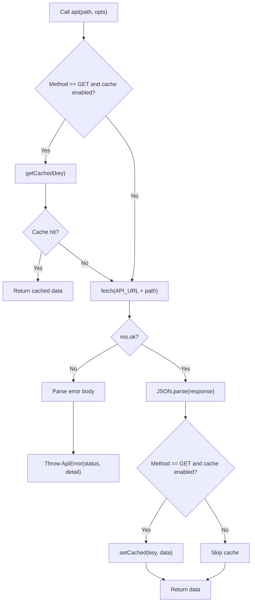
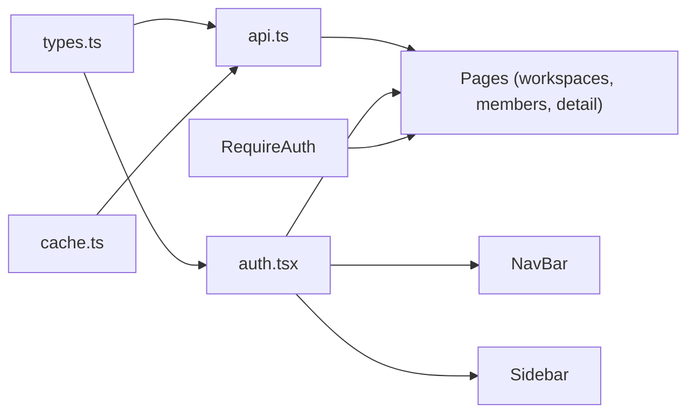

# Frontend Application

<cite>
**Referenced Files in This Document**
- [README.md](file://phoenix-frontend/README.md)
- [package.json](file://phoenix-frontend/package.json)
- [next.config.mjs](file://phoenix-frontend/next.config.mjs)
- [layout.tsx](file://phoenix-frontend/src/app/layout.tsx)
- [page.tsx](file://phoenix-frontend/src/app/page.tsx)
- [auth.tsx](file://phoenix-frontend/src/lib/auth.tsx)
- [api.ts](file://phoenix-frontend/src/lib/api.ts)
- [cache.ts](file://phoenix-frontend/src/lib/cache.ts)
- [types.ts](file://phoenix-frontend/src/lib/types.ts)
- [NavBar.tsx](file://phoenix-frontend/src/components/NavBar.tsx)
- [Sidebar.tsx](file://phoenix-frontend/src/components/Sidebar.tsx)
- [RequireAuth.tsx](file://phoenix-frontend/src/components/RequireAuth.tsx)
- [InfoButton.tsx](file://phoenix-frontend/src/components/InfoButton.tsx)
- [login/page.tsx](file://phoenix-frontend/src/app/login/page.tsx)
- [workspaces/page.tsx](file://phoenix-frontend/src/app/workspaces/page.tsx)
- [workspaces/[id]/page.tsx](file://phoenix-frontend/src/app/workspaces/[id]/page.tsx)
- [workspaces/[id]/members/page.tsx](file://phoenix-frontend/src/app/workspaces/[id]/members/page.tsx)
</cite>

## Table of Contents
1. [Introduction](#introduction)
2. [Project Structure](#project-structure)
3. [Core Components](#core-components)
4. [Architecture Overview](#architecture-overview)
5. [Detailed Component Analysis](#detailed-component-analysis)
6. [Dependency Analysis](#dependency-analysis)
7. [Performance Considerations](#performance-considerations)
8. [Troubleshooting Guide](#troubleshooting-guide)
9. [Conclusion](#conclusion)

## Introduction
This document describes the Project Phoenix frontend application built with Next.js 14 and React 18 using the App Router. It explains the application structure, component hierarchy, state management via React Context, authentication flow with session persistence, protected routes, API client layer for HTTP requests, error handling, and core UI components such as navigation bar, sidebar, layout shell, and reusable elements. It also includes usage examples, prop interfaces, customization options, responsive design patterns, accessibility considerations, and performance optimization techniques used throughout the frontend.

The application provides screens for login, workspace listing, workspace detail (projects and credits), members management, and a task board with search, status filter, pagination, and task creation that consumes credits.

**Section sources**
- [README.md:1-40](file://phoenix-frontend/README.md#L1-L40)

## Project Structure
The frontend follows Next.js App Router conventions under src/app. Shared logic resides in src/lib, UI components in src/components, and global styles are imported at the root layout.

**Diagram sources**
- [layout.tsx:1-27](file://phoenix-frontend/src/app/layout.tsx#L1-L27)
- [page.tsx:1-15](file://phoenix-frontend/src/app/page.tsx#L1-L15)
- [login/page.tsx:1-54](file://phoenix-frontend/src/app/login/page.tsx#L1-L54)
- [workspaces/page.tsx:1-73](file://phoenix-frontend/src/app/workspaces/page.tsx#L1-L73)
- [workspaces/[id]/page.tsx:1-137](file://phoenix-frontend/src/app/workspaces/[id]/page.tsx#L1-L137)
- [workspaces/[id]/members/page.tsx:1-95](file://phoenix-frontend/src/app/workspaces/[id]/members/page.tsx#L1-L95)
- [NavBar.tsx:1-36](file://phoenix-frontend/src/components/NavBar.tsx#L1-L36)
- [Sidebar.tsx:1-57](file://phoenix-frontend/src/components/Sidebar.tsx#L1-L57)
- [RequireAuth.tsx:1-18](file://phoenix-frontend/src/components/RequireAuth.tsx#L1-L18)
- [InfoButton.tsx:1-82](file://phoenix-frontend/src/components/InfoButton.tsx#L1-L82)
- [auth.tsx:1-62](file://phoenix-frontend/src/lib/auth.tsx#L1-L62)
- [api.ts:1-86](file://phoenix-frontend/src/lib/api.ts#L1-L86)
- [cache.ts:1-16](file://phoenix-frontend/src/lib/cache.ts#L1-L16)
- [types.ts:1-54](file://phoenix-frontend/src/lib/types.ts#L1-L54)

**Section sources**
- [layout.tsx:1-27](file://phoenix-frontend/src/app/layout.tsx#L1-L27)
- [next.config.mjs:1-9](file://phoenix-frontend/next.config.mjs#L1-L9)

## Core Components
This section documents the primary building blocks of the application:

- Root Layout and Shell
  - Provides metadata, wraps the app with AuthProvider, renders NavBar, Sidebar, and a main container for page content.
  - Global CSS is included here to style the shell and shared components.

- Authentication Provider and Hooks
  - Manages user session state, persists tokens, restores sessions on refresh, and exposes login/logout functions.
  - Emits a logout event to clear local UI state when needed.

- API Client Layer
  - Centralized fetch wrapper with automatic Authorization header injection, JSON parsing, error mapping, and optional in-memory GET caching.
  - Provides describeError for user-friendly messages based on HTTP status codes.

- Protected Route Wrapper
  - Ensures users are authenticated before rendering protected content; redirects to login if not ready or not logged in.

- Navigation Bar
  - Displays brand link, info modal trigger, current user email, and log out action.

- Sidebar
  - Renders navigation links for workspaces and workspace-specific sections (projects & credits, team). Highlights active route.

- Info Button and Modal
  - Accessible modal overlay rendered via portal with keyboard support (Escape to close).

- Pages
  - Login form with validation and error display.
  - Workspaces list with create functionality and cached reads.
  - Workspace detail showing projects, credits balance, and owner-only top-up form.
  - Members page for adding teammates with role selection.

**Section sources**
- [layout.tsx:1-27](file://phoenix-frontend/src/app/layout.tsx#L1-L27)
- [auth.tsx:1-62](file://phoenix-frontend/src/lib/auth.tsx#L1-L62)
- [api.ts:1-86](file://phoenix-frontend/src/lib/api.ts#L1-L86)
- [RequireAuth.tsx:1-18](file://phoenix-frontend/src/components/RequireAuth.tsx#L1-L18)
- [NavBar.tsx:1-36](file://phoenix-frontend/src/components/NavBar.tsx#L1-L36)
- [Sidebar.tsx:1-57](file://phoenix-frontend/src/components/Sidebar.tsx#L1-L57)
- [InfoButton.tsx:1-82](file://phoenix-frontend/src/components/InfoButton.tsx#L1-L82)
- [login/page.tsx:1-54](file://phoenix-frontend/src/app/login/page.tsx#L1-L54)
- [workspaces/page.tsx:1-73](file://phoenix-frontend/src/app/workspaces/page.tsx#L1-L73)
- [workspaces/[id]/page.tsx:1-137](file://phoenix-frontend/src/app/workspaces/[id]/page.tsx#L1-L137)
- [workspaces/[id]/members/page.tsx:1-95](file://phoenix-frontend/src/app/workspaces/[id]/members/page.tsx#L1-L95)

## Architecture Overview
The frontend uses a layered architecture:

- Presentation Layer: Next.js pages and UI components render views and handle user interactions.
- State Layer: React Context provides global auth state and lifecycle hooks.
- Data Layer: A centralized API client handles HTTP communication, token injection, caching, and error normalization.
- Persistence: Tokens are stored in localStorage; an in-memory cache accelerates repeated GET requests within a session.

**Diagram sources**
- [auth.tsx:38-45](file://phoenix-frontend/src/lib/auth.tsx#L38-L45)
- [api.ts:33-71](file://phoenix-frontend/src/lib/api.ts#L33-L71)
- [login/page.tsx:16-28](file://phoenix-frontend/src/app/login/page.tsx#L16-L28)

## Detailed Component Analysis

### Authentication System (React Context, Session Persistence, Protected Routes)
- AuthProvider maintains user state and readiness flag. On mount, it attempts to restore the session by calling the backend’s “me” endpoint if a token exists. If invalid, it clears the token and marks ready.
- Login calls the backend’s login endpoint, stores the token, and sets the user object. Logout clears both token and user state.
- The provider emits a custom window event to allow other parts of the app to react to logout.
- RequireAuth ensures that only authenticated users can access protected routes; otherwise, it redirects to login.

**Diagram sources**
- [auth.tsx:20-30](file://phoenix-frontend/src/lib/auth.tsx#L20-L30)

Usage example:
- Wrap any page with RequireAuth to protect it from unauthenticated access.
- Use useAuth() to access user, ready, login, and logout across components.

Prop interfaces and behavior:
- AuthState exposes user, ready, login(email, password), and logout().
- RequireAuth accepts children and renders a loading placeholder while not ready or not authenticated.

Customization options:
- Replace the default redirect target in RequireAuth to customize post-login routing.
- Extend AuthProvider to integrate additional session storage or analytics.

Accessibility:
- InfoButton modal uses aria-modal and Escape key handling for focus management.

**Section sources**
- [auth.tsx:1-62](file://phoenix-frontend/src/lib/auth.tsx#L1-L62)
- [RequireAuth.tsx:1-18](file://phoenix-frontend/src/components/RequireAuth.tsx#L1-L18)
- [InfoButton.tsx:1-82](file://phoenix-frontend/src/components/InfoButton.tsx#L1-L82)

### API Client Layer (HTTP Requests, Error Handling, Response Processing)
- api(path, opts) performs fetch with JSON headers, injects Authorization Bearer token when present, supports AbortSignal, and parses JSON responses.
- Optional GET caching: when opts.cache is true, successful GET responses are stored in memory and returned immediately on subsequent identical requests.
- Errors are wrapped in ApiError with status and message; describeError maps common statuses to user-friendly strings.

**Diagram sources**
- [api.ts:33-71](file://phoenix-frontend/src/lib/api.ts#L33-L71)
- [cache.ts:1-16](file://phoenix-frontend/src/lib/cache.ts#L1-L16)

Usage example:
- Read endpoints: api("/api/workspaces", { cache: true })
- Write endpoints: api("/api/workspaces", { method: "POST", body: { name } })

Error handling:
- Catch ApiError and display describeError(err) to the user.

**Section sources**
- [api.ts:1-86](file://phoenix-frontend/src/lib/api.ts#L1-L86)
- [cache.ts:1-16](file://phoenix-frontend/src/lib/cache.ts#L1-L16)

### Core UI Components

#### Navigation Bar
- Displays brand link to workspaces, InfoButton, current user email, and Log out button.
- Uses useAuth() to read user and call logout, then navigates to login.

Props and behavior:
- No props; relies on global auth context.

Customization:
- Add more nav actions by extending the right-side container.

Accessibility:
- InfoButton has aria-label for screen readers.

**Section sources**
- [NavBar.tsx:1-36](file://phoenix-frontend/src/components/NavBar.tsx#L1-L36)

#### Sidebar
- Renders navigation links for All workspaces and per-workspace sections (Projects & credits, Team).
- Highlights active link based on pathname matching.

Props and behavior:
- No props; derives workspace id from URL and hides itself if no user.

Customization:
- Extend icons and add new links for additional features.

Accessibility:
- Icons are decorative and marked aria-hidden.

**Section sources**
- [Sidebar.tsx:1-57](file://phoenix-frontend/src/components/Sidebar.tsx#L1-L57)

#### InfoButton and Modal
- Opens a modal overlay rendered via createPortal to document.body.
- Supports closing via backdrop click and Escape key.

Props and behavior:
- No props; manages open state internally.

Accessibility:
- Modal uses role="dialog" and aria-modal="true". Close button has aria-label.

**Section sources**
- [InfoButton.tsx:1-82](file://phoenix-frontend/src/components/InfoButton.tsx#L1-L82)

#### Reusable Elements
- Forms and lists follow consistent styling classes (stack, row, list, badge, muted, card, narrow).
- Buttons include disabled states during async operations.

**Section sources**
- [workspaces/page.tsx:27-61](file://phoenix-frontend/src/app/workspaces/page.tsx#L27-L61)
- [workspaces/[id]/page.tsx:15-49](file://phoenix-frontend/src/app/workspaces/[id]/page.tsx#L15-L49)
- [workspaces/[id]/members/page.tsx:34-82](file://phoenix-frontend/src/app/workspaces/[id]/members/page.tsx#L34-L82)

### Pages and Routing

#### Home Redirect
- Redirects authenticated users to workspaces and unauthenticated users to login once auth state is ready.

**Section sources**
- [page.tsx:1-15](file://phoenix-frontend/src/app/page.tsx#L1-L15)

#### Login Page
- Form collects email and password, calls login(), navigates to workspaces on success, and displays errors via describeError.

**Section sources**
- [login/page.tsx:1-54](file://phoenix-frontend/src/app/login/page.tsx#L1-L54)

#### Workspaces List
- Loads workspaces with caching, allows creating new workspaces, and shows errors.

**Section sources**
- [workspaces/page.tsx:1-73](file://phoenix-frontend/src/app/workspaces/page.tsx#L1-L73)

#### Workspace Detail
- Loads workspace, projects, and credits balance concurrently.
- Owner-only Top Up form validates amount and updates balance after success.

**Section sources**
- [workspaces/[id]/page.tsx:1-137](file://phoenix-frontend/src/app/workspaces/[id]/page.tsx#L1-L137)

#### Members Page
- Loads workspace and members, allows adding members with role selection.

**Section sources**
- [workspaces/[id]/members/page.tsx:1-95](file://phoenix-frontend/src/app/workspaces/[id]/members/page.tsx#L1-L95)

## Dependency Analysis
The following diagram highlights key dependencies between modules:

**Diagram sources**
- [types.ts:1-54](file://phoenix-frontend/src/lib/types.ts#L1-L54)
- [auth.tsx:1-62](file://phoenix-frontend/src/lib/auth.tsx#L1-L62)
- [api.ts:1-86](file://phoenix-frontend/src/lib/api.ts#L1-L86)
- [cache.ts:1-16](file://phoenix-frontend/src/lib/cache.ts#L1-L16)
- [workspaces/page.tsx:1-73](file://phoenix-frontend/src/app/workspaces/page.tsx#L1-L73)
- [workspaces/[id]/page.tsx:1-137](file://phoenix-frontend/src/app/workspaces/[id]/page.tsx#L1-L137)
- [workspaces/[id]/members/page.tsx:1-95](file://phoenix-frontend/src/app/workspaces/[id]/members/page.tsx#L1-L95)
- [NavBar.tsx:1-36](file://phoenix-frontend/src/components/NavBar.tsx#L1-L36)
- [Sidebar.tsx:1-57](file://phoenix-frontend/src/components/Sidebar.tsx#L1-L57)
- [RequireAuth.tsx:1-18](file://phoenix-frontend/src/components/RequireAuth.tsx#L1-L18)

**Section sources**
- [types.ts:1-54](file://phoenix-frontend/src/lib/types.ts#L1-L54)
- [auth.tsx:1-62](file://phoenix-frontend/src/lib/auth.tsx#L1-L62)
- [api.ts:1-86](file://phoenix-frontend/src/lib/api.ts#L1-L86)
- [cache.ts:1-16](file://phoenix-frontend/src/lib/cache.ts#L1-L16)

## Performance Considerations
- In-memory GET caching: Enable cache option for read-only endpoints to avoid redundant network calls within a session.
- Concurrent data fetching: Use Promise.all to fetch related resources in parallel (workspace, projects, credits).
- Minimal re-renders: Keep UI state local to components where possible; rely on Context only for global auth state.
- Build-time environment variables: NEXT_PUBLIC_* variables are inlined at build time; ensure correct configuration for production deployments.
- Strict mode: Enabled in Next config to help catch issues during development.

[No sources needed since this section provides general guidance]

## Troubleshooting Guide
Common issues and resolutions:

- Cannot reach the server:
  - Ensure NEXT_PUBLIC_BACKEND_URL points to a running backend instance.
  - Verify CORS settings on the backend include the frontend origin.

- Session expired or unauthorized:
  - The API client maps 401 to a friendly message prompting re-login.
  - Confirm token persistence and that the backend validates tokens correctly.

- Not enough credits:
  - The API client maps 402 to a user-friendly message instructing to contact the workspace owner.

- Permission denied:
  - The API client maps 403 to a permission error message.

- Server errors:
  - The API client maps 5xx to a generic server error message.

- Empty results vs. real errors:
  - Distinguish between genuinely empty lists and error states by checking error flags and loading states in components.

**Section sources**
- [api.ts:74-85](file://phoenix-frontend/src/lib/api.ts#L74-L85)
- [README.md:33-40](file://phoenix-frontend/README.md#L33-L40)

## Conclusion
The Project Phoenix frontend leverages Next.js App Router and React 18 to deliver a modern, type-safe user interface. Authentication is managed through React Context with session persistence, and protected routes ensure secure access. The API client centralizes HTTP concerns, including token injection, caching, and robust error handling. Core UI components provide a consistent experience across navigation, layouts, and modals. With careful attention to responsive design, accessibility, and performance optimizations like caching and concurrent fetching, the application offers a solid foundation for further feature development and maintenance.

[No sources needed since this section summarizes without analyzing specific files]