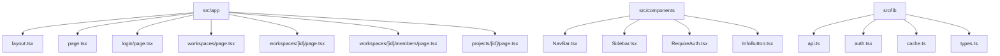
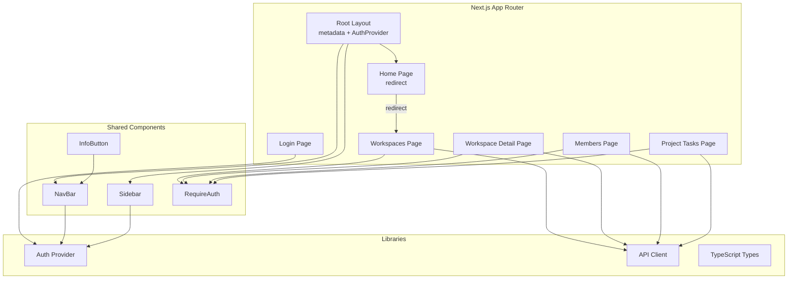
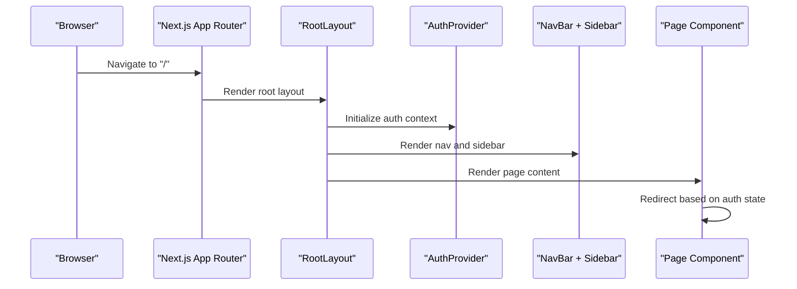
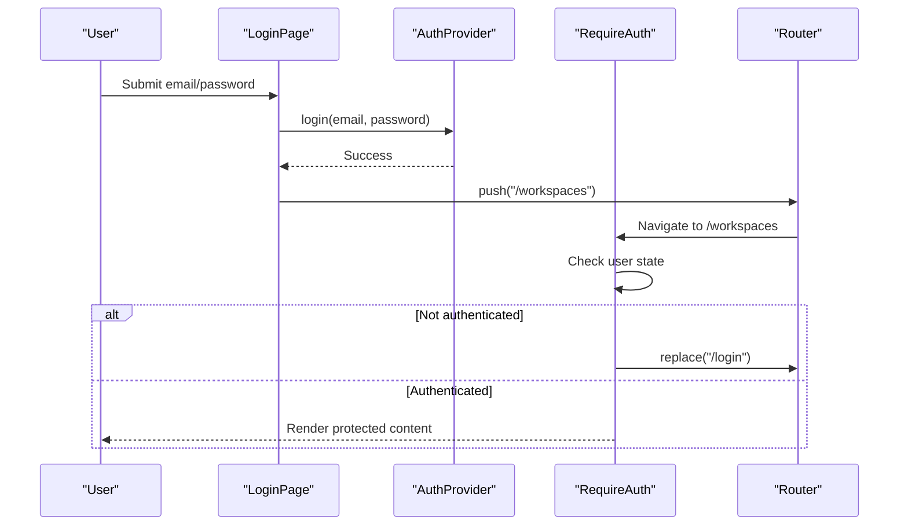
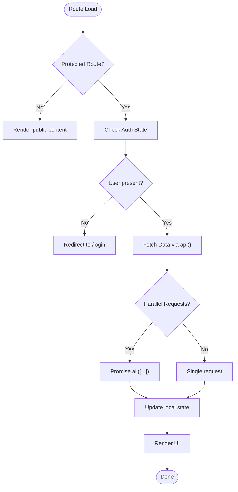
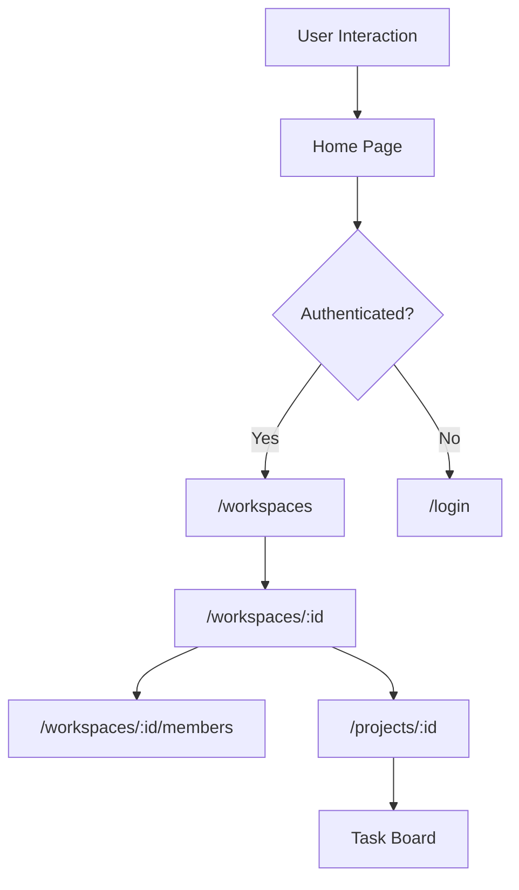
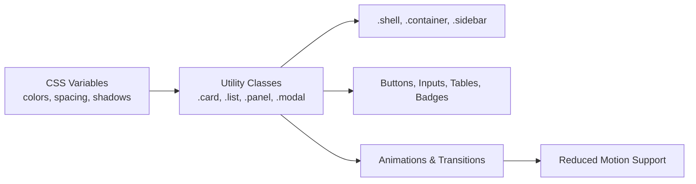
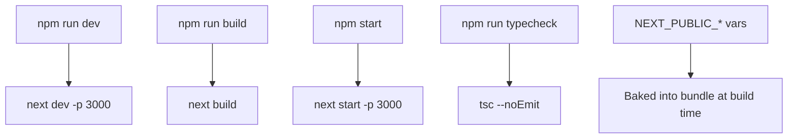
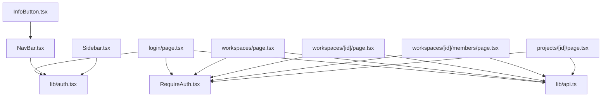

# Frontend Architecture & Structure

<cite>
**Referenced Files in This Document**
- [README.md](file://phoenix-frontend/README.md)
- [package.json](file://phoenix-frontend/package.json)
- [next.config.mjs](file://phoenix-frontend/next.config.mjs)
- [layout.tsx](file://phoenix-frontend/src/app/layout.tsx)
- [page.tsx](file://phoenix-frontend/src/app/page.tsx)
- [globals.css](file://phoenix-frontend/src/app/globals.css)
- [login/page.tsx](file://phoenix-frontend/src/app/login/page.tsx)
- [workspaces/page.tsx](file://phoenix-frontend/src/app/workspaces/page.tsx)
- [workspaces/[id]/page.tsx](file://phoenix-frontend/src/app/workspaces/[id]/page.tsx)
- [workspaces/[id]/members/page.tsx](file://phoenix-frontend/src/app/workspaces/[id]/members/page.tsx)
- [projects/[id]/page.tsx](file://phoenix-frontend/src/app/projects/[id]/page.tsx)
- [NavBar.tsx](file://phoenix-frontend/src/components/NavBar.tsx)
- [Sidebar.tsx](file://phoenix-frontend/src/components/Sidebar.tsx)
- [RequireAuth.tsx](file://phoenix-frontend/src/components/RequireAuth.tsx)
- [InfoButton.tsx](file://phoenix-frontend/src/components/InfoButton.tsx)
</cite>

## Table of Contents
1. Introduction
2. Project Structure
3. Core Components
4. Architecture Overview
5. Detailed Component Analysis
6. Dependency Analysis
7. Performance Considerations
8. Troubleshooting Guide
9. Conclusion

## Introduction
This document explains the Phoenix frontend architecture and application structure built with Next.js 14 (App Router), React 18, and TypeScript. It covers directory organization, component hierarchy, global layout configuration, CSS architecture, application bootstrap flow, authentication integration, data fetching patterns, build configuration, asset management, and deployment considerations for the Next.js environment.

The frontend provides screens for login, workspace listing, workspace detail (projects and credits), members management, and a task board with search, status filtering, pagination, and task creation.

**Section sources**
- [README.md:1-40](file://phoenix-frontend/README.md#L1-L40)

## Project Structure
The project follows the Next.js App Router conventions under src/app, with shared UI components under src/components and shared utilities under src/lib.

Key observations:
- The root layout defines global metadata, wraps the app with AuthProvider, renders NavBar and Sidebar, and injects page content into a main container.
- Pages are organized by feature: login, workspaces, projects, and nested workspace members.
- Shared UI is encapsulated in reusable components (NavBar, Sidebar, RequireAuth, InfoButton).
- Global styles are centralized in globals.css using CSS variables and utility classes.

**Diagram sources**
- [layout.tsx:1-27](file://phoenix-frontend/src/app/layout.tsx#L1-L27)
- [page.tsx:1-15](file://phoenix-frontend/src/app/page.tsx#L1-L15)
- [login/page.tsx:1-54](file://phoenix-frontend/src/app/login/page.tsx#L1-L54)
- [workspaces/page.tsx:1-73](file://phoenix-frontend/src/app/workspaces/page.tsx#L1-L73)
- [workspaces/[id]/page.tsx:1-137](file://phoenix-frontend/src/app/workspaces/[id]/page.tsx#L1-L137)
- [workspaces/[id]/members/page.tsx:1-95](file://phoenix-frontend/src/app/workspaces/[id]/members/page.tsx#L1-L95)
- [projects/[id]/page.tsx:1-168](file://phoenix-frontend/src/app/projects/[id]/page.tsx#L1-L168)
- [NavBar.tsx:1-36](file://phoenix-frontend/src/components/NavBar.tsx#L1-L36)
- [Sidebar.tsx:1-57](file://phoenix-frontend/src/components/Sidebar.tsx#L1-L57)
- [RequireAuth.tsx:1-18](file://phoenix-frontend/src/components/RequireAuth.tsx#L1-L18)
- [InfoButton.tsx:1-82](file://phoenix-frontend/src/components/InfoButton.tsx#L1-L82)

**Section sources**
- [layout.tsx:1-27](file://phoenix-frontend/src/app/layout.tsx#L1-L27)
- [globals.css:1-136](file://phoenix-frontend/src/app/globals.css#L1-L136)

## Core Components
- RootLayout: Provides global metadata, wraps the application with AuthProvider, renders NavBar and Sidebar, and mounts page content inside a responsive container.
- Home Page: Client-side redirect to /workspaces if authenticated, otherwise to /login once auth state is ready.
- Login Page: Handles email/password submission, calls the auth provider, and navigates on success; displays errors via a shared error describer.
- Workspaces List: Fetches workspaces, supports creating new workspaces, and uses RequireAuth to guard access.
- Workspace Detail: Loads workspace info, projects, and credit balance concurrently; allows owners to top up credits and create projects.
- Members Page: Lists workspace members and allows adding new members with roles; guarded by RequireAuth.
- Project Task Board: Displays tasks with search, status filter, pagination, and creation; debounces search input and resets filters on navigation.
- NavBar: Shows brand, user email, logout action, and an Info modal trigger.
- Sidebar: Renders navigation links based on current path and active workspace context.
- RequireAuth: Guards routes by redirecting unauthenticated users to /login.
- InfoButton: Renders an accessible modal overlay describing the application and usage.

**Section sources**
- [layout.tsx:1-27](file://phoenix-frontend/src/app/layout.tsx#L1-L27)
- [page.tsx:1-15](file://phoenix-frontend/src/app/page.tsx#L1-L15)
- [login/page.tsx:1-54](file://phoenix-frontend/src/app/login/page.tsx#L1-L54)
- [workspaces/page.tsx:1-73](file://phoenix-frontend/src/app/workspaces/page.tsx#L1-L73)
- [workspaces/[id]/page.tsx:1-137](file://phoenix-frontend/src/app/workspaces/[id]/page.tsx#L1-L137)
- [workspaces/[id]/members/page.tsx:1-95](file://phoenix-frontend/src/app/workspaces/[id]/members/page.tsx#L1-L95)
- [projects/[id]/page.tsx:1-168](file://phoenix-frontend/src/app/projects/[id]/page.tsx#L1-L168)
- [NavBar.tsx:1-36](file://phoenix-frontend/src/components/NavBar.tsx#L1-L36)
- [Sidebar.tsx:1-57](file://phoenix-frontend/src/components/Sidebar.tsx#L1-L57)
- [RequireAuth.tsx:1-18](file://phoenix-frontend/src/components/RequireAuth.tsx#L1-L18)
- [InfoButton.tsx:1-82](file://phoenix-frontend/src/components/InfoButton.tsx#L1-L82)

## Architecture Overview
The application bootstraps through the Next.js App Router. The root layout initializes global providers and shell layout. Client pages handle routing, authentication checks, and API interactions. Shared components provide consistent UI and behavior across routes.

**Diagram sources**
- [layout.tsx:1-27](file://phoenix-frontend/src/app/layout.tsx#L1-L27)
- [page.tsx:1-15](file://phoenix-frontend/src/app/page.tsx#L1-L15)
- [login/page.tsx:1-54](file://phoenix-frontend/src/app/login/page.tsx#L1-L54)
- [workspaces/page.tsx:1-73](file://phoenix-frontend/src/app/workspaces/page.tsx#L1-L73)
- [workspaces/[id]/page.tsx:1-137](file://phoenix-frontend/src/app/workspaces/[id]/page.tsx#L1-L137)
- [workspaces/[id]/members/page.tsx:1-95](file://phoenix-frontend/src/app/workspaces/[id]/members/page.tsx#L1-L95)
- [projects/[id]/page.tsx:1-168](file://phoenix-frontend/src/app/projects/[id]/page.tsx#L1-L168)
- [NavBar.tsx:1-36](file://phoenix-frontend/src/components/NavBar.tsx#L1-L36)
- [Sidebar.tsx:1-57](file://phoenix-frontend/src/components/Sidebar.tsx#L1-L57)
- [RequireAuth.tsx:1-18](file://phoenix-frontend/src/components/RequireAuth.tsx#L1-L18)
- [InfoButton.tsx:1-82](file://phoenix-frontend/src/components/InfoButton.tsx#L1-L82)

## Detailed Component Analysis

### Application Bootstrap and Global Layout
- Metadata is defined at the root layout level for SEO and browser tab titles.
- AuthProvider wraps the entire tree to expose user state and actions globally.
- NavBar and Sidebar are rendered once per route change, providing persistent navigation.
- The main container applies responsive constraints and animations.

**Diagram sources**
- [layout.tsx:1-27](file://phoenix-frontend/src/app/layout.tsx#L1-L27)
- [page.tsx:1-15](file://phoenix-frontend/src/app/page.tsx#L1-L15)

**Section sources**
- [layout.tsx:1-27](file://phoenix-frontend/src/app/layout.tsx#L1-L27)

### Authentication Flow
- Login Page submits credentials to the auth provider and navigates to /workspaces upon success.
- RequireAuth guards protected routes, redirecting unauthenticated users to /login.
- NavBar exposes logout and clears session state, then redirects to /login.

**Diagram sources**
- [login/page.tsx:1-54](file://phoenix-frontend/src/app/login/page.tsx#L1-L54)
- [RequireAuth.tsx:1-18](file://phoenix-frontend/src/components/RequireAuth.tsx#L1-L18)
- [NavBar.tsx:1-36](file://phoenix-frontend/src/components/NavBar.tsx#L1-L36)

**Section sources**
- [login/page.tsx:1-54](file://phoenix-frontend/src/app/login/page.tsx#L1-L54)
- [RequireAuth.tsx:1-18](file://phoenix-frontend/src/components/RequireAuth.tsx#L1-L18)
- [NavBar.tsx:1-36](file://phoenix-frontend/src/components/NavBar.tsx#L1-L36)

### Data Fetching Patterns
- Workspaces list fetches workspaces and supports creation via POST.
- Workspace detail loads workspace, projects, and credits concurrently using Promise.all.
- Members page loads workspace and members concurrently and supports adding members.
- Project tasks page fetches project details and paginated tasks with optional query and status filters; includes debounce logic for search.

**Diagram sources**
- [workspaces/page.tsx:1-73](file://phoenix-frontend/src/app/workspaces/page.tsx#L1-L73)
- [workspaces/[id]/page.tsx:1-137](file://phoenix-frontend/src/app/workspaces/[id]/page.tsx#L1-L137)
- [workspaces/[id]/members/page.tsx:1-95](file://phoenix-frontend/src/app/workspaces/[id]/members/page.tsx#L1-L95)
- [projects/[id]/page.tsx:1-168](file://phoenix-frontend/src/app/projects/[id]/page.tsx#L1-L168)

**Section sources**
- [workspaces/page.tsx:1-73](file://phoenix-frontend/src/app/workspaces/page.tsx#L1-L73)
- [workspaces/[id]/page.tsx:1-137](file://phoenix-frontend/src/app/workspaces/[id]/page.tsx#L1-L137)
- [workspaces/[id]/members/page.tsx:1-95](file://phoenix-frontend/src/app/workspaces/[id]/members/page.tsx#L1-L95)
- [projects/[id]/page.tsx:1-168](file://phoenix-frontend/src/app/projects/[id]/page.tsx#L1-L168)

### Navigation and Routing
- Home page redirects to /workspaces or /login based on auth readiness and user presence.
- Sidebar highlights active links based on pathname matching and workspace context.
- Protected routes use RequireAuth to ensure only authenticated users can view content.

**Diagram sources**
- [page.tsx:1-15](file://phoenix-frontend/src/app/page.tsx#L1-L15)
- [Sidebar.tsx:1-57](file://phoenix-frontend/src/components/Sidebar.tsx#L1-L57)
- [RequireAuth.tsx:1-18](file://phoenix-frontend/src/components/RequireAuth.tsx#L1-L18)

**Section sources**
- [page.tsx:1-15](file://phoenix-frontend/src/app/page.tsx#L1-L15)
- [Sidebar.tsx:1-57](file://phoenix-frontend/src/components/Sidebar.tsx#L1-L57)
- [RequireAuth.tsx:1-18](file://phoenix-frontend/src/components/RequireAuth.tsx#L1-L18)

### Styling and CSS Architecture
- Global CSS defines design tokens (colors, spacing, shadows, typography) via CSS variables.
- Utility classes standardize layout shells, cards, lists, tables, buttons, forms, badges, panels, and modals.
- Animations and transitions enhance UX while respecting reduced motion preferences.
- Responsive rules adapt layout for small screens, stacking sidebar and adjusting sizes.

**Diagram sources**
- [globals.css:1-136](file://phoenix-frontend/src/app/globals.css#L1-L136)

**Section sources**
- [globals.css:1-136](file://phoenix-frontend/src/app/globals.css#L1-L136)

### Build Configuration and Environment
- Next.js configuration enables strict mode and disables ESLint during builds; experimental appDir flag is set.
- Package scripts define dev, build, start, and typecheck commands.
- Environment variables prefixed NEXT_PUBLIC_ are inlined at build time; NEXT_PUBLIC_API_URL must be configured for production.

**Diagram sources**
- [next.config.mjs:1-9](file://phoenix-frontend/next.config.mjs#L1-L9)
- [package.json:1-27](file://phoenix-frontend/package.json#L1-L27)
- [README.md:20-31](file://phoenix-frontend/README.md#L20-L31)

**Section sources**
- [next.config.mjs:1-9](file://phoenix-frontend/next.config.mjs#L1-L9)
- [package.json:1-27](file://phoenix-frontend/package.json#L1-L27)
- [README.md:20-31](file://phoenix-frontend/README.md#L20-L31)

### Asset Management
- Static assets should be placed under the public directory and referenced from there.
- Fonts and system fonts are declared in global CSS; no custom font loaders are configured in next.config.mjs.
- Images and other static resources are served directly by Next.js without additional optimization steps in this repository.

[No sources needed since this section provides general guidance]

### Deployment Considerations
- Deploy to Vercel with framework preset Next.js.
- Configure NEXT_PUBLIC_API_URL in Vercel environment variables; redeploy after changes because values are baked into the bundle.
- Ensure backend CORS settings include the frontend URL.

**Section sources**
- [README.md:26-31](file://phoenix-frontend/README.md#L26-L31)

## Dependency Analysis
The following diagram shows how pages depend on shared components and libraries for authentication and API interactions.

**Diagram sources**
- [login/page.tsx:1-54](file://phoenix-frontend/src/app/login/page.tsx#L1-L54)
- [workspaces/page.tsx:1-73](file://phoenix-frontend/src/app/workspaces/page.tsx#L1-L73)
- [workspaces/[id]/page.tsx:1-137](file://phoenix-frontend/src/app/workspaces/[id]/page.tsx#L1-L137)
- [workspaces/[id]/members/page.tsx:1-95](file://phoenix-frontend/src/app/workspaces/[id]/members/page.tsx#L1-L95)
- [projects/[id]/page.tsx:1-168](file://phoenix-frontend/src/app/projects/[id]/page.tsx#L1-L168)
- [NavBar.tsx:1-36](file://phoenix-frontend/src/components/NavBar.tsx#L1-L36)
- [Sidebar.tsx:1-57](file://phoenix-frontend/src/components/Sidebar.tsx#L1-L57)
- [RequireAuth.tsx:1-18](file://phoenix-frontend/src/components/RequireAuth.tsx#L1-L18)
- [InfoButton.tsx:1-82](file://phoenix-frontend/src/components/InfoButton.tsx#L1-L82)

**Section sources**
- [login/page.tsx:1-54](file://phoenix-frontend/src/app/login/page.tsx#L1-L54)
- [workspaces/page.tsx:1-73](file://phoenix-frontend/src/app/workspaces/page.tsx#L1-L73)
- [workspaces/[id]/page.tsx:1-137](file://phoenix-frontend/src/app/workspaces/[id]/page.tsx#L1-L137)
- [workspaces/[id]/members/page.tsx:1-95](file://phoenix-frontend/src/app/workspaces/[id]/members/page.tsx#L1-L95)
- [projects/[id]/page.tsx:1-168](file://phoenix-frontend/src/app/projects/[id]/page.tsx#L1-L168)
- [NavBar.tsx:1-36](file://phoenix-frontend/src/components/NavBar.tsx#L1-L36)
- [Sidebar.tsx:1-57](file://phoenix-frontend/src/components/Sidebar.tsx#L1-L57)
- [RequireAuth.tsx:1-18](file://phoenix-frontend/src/components/RequireAuth.tsx#L1-L18)
- [InfoButton.tsx:1-82](file://phoenix-frontend/src/components/InfoButton.tsx#L1-L82)

## Performance Considerations
- Use client-side routing and conditional rendering to avoid unnecessary server requests for protected routes.
- Debounce search inputs to reduce API calls during rapid typing.
- Batch independent data fetches using Promise.all to minimize round-trips.
- Keep global styles minimal and leverage CSS variables for efficient theme updates.
- Avoid heavy client-side computations; offload formatting and simple transformations to lightweight functions.

[No sources needed since this section provides general guidance]

## Troubleshooting Guide
Common issues and resolutions:
- Unauthenticated redirects not working: Verify RequireAuth is wrapping protected routes and that auth state is initialized before navigation decisions.
- API errors displayed incorrectly: Ensure describeError is used consistently to convert raw errors into user-friendly messages.
- Build-time environment variables not applied: Confirm NEXT_PUBLIC_* variables are set in the deployment platform and redeploy after changes.
- Styles not applying: Check that globals.css is imported in the root layout and class names match the utility classes defined.

**Section sources**
- [RequireAuth.tsx:1-18](file://phoenix-frontend/src/components/RequireAuth.tsx#L1-L18)
- [login/page.tsx:1-54](file://phoenix-frontend/src/app/login/page.tsx#L1-L54)
- [workspaces/page.tsx:1-73](file://phoenix-frontend/src/app/workspaces/page.tsx#L1-L73)
- [workspaces/[id]/page.tsx:1-137](file://phoenix-frontend/src/app/workspaces/[id]/page.tsx#L1-L137)
- [workspaces/[id]/members/page.tsx:1-95](file://phoenix-frontend/src/app/workspaces/[id]/members/page.tsx#L1-L95)
- [projects/[id]/page.tsx:1-168](file://phoenix-frontend/src/app/projects/[id]/page.tsx#L1-L168)
- [layout.tsx:1-27](file://phoenix-frontend/src/app/layout.tsx#L1-L27)
- [globals.css:1-136](file://phoenix-frontend/src/app/globals.css#L1-L136)

## Conclusion
The Phoenix frontend leverages Next.js App Router for structured routing, a global layout for consistent shell and metadata, and client-side components for interactive features. Authentication is centralized via AuthProvider and enforced with RequireAuth. Data fetching is performed on the client with caching hints where appropriate. Global CSS provides a cohesive design system with responsive layouts and accessible interactions. Build and deployment are straightforward with Next.js and Vercel, requiring environment variables for API connectivity.

[No sources needed since this section summarizes without analyzing specific files]