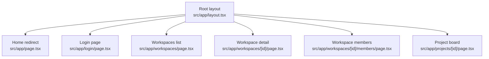
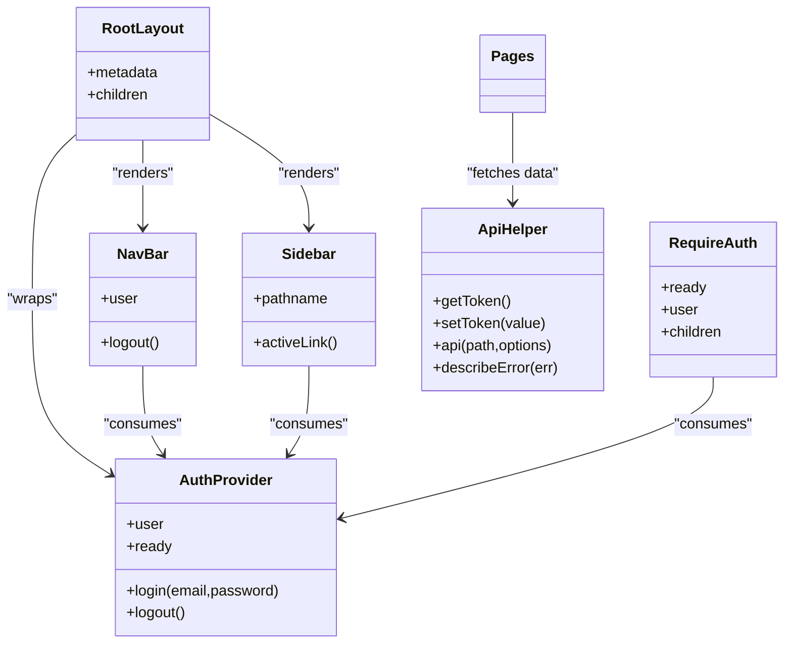
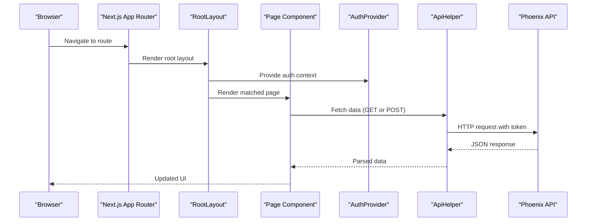
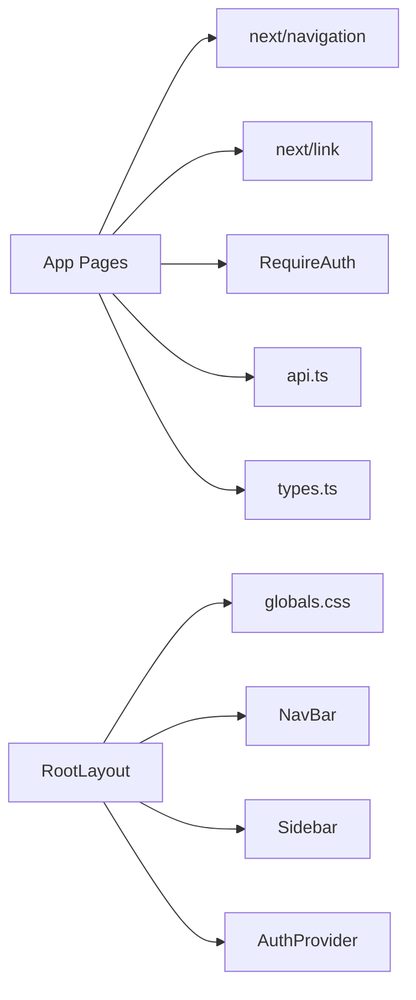

# Page Routes & Layouts

<cite>
**Referenced Files in This Document**
- [layout.tsx](file://phoenix-frontend/src/app/layout.tsx)
- [page.tsx](file://phoenix-frontend/src/app/page.tsx)
- [login/page.tsx](file://phoenix-frontend/src/app/login/page.tsx)
- [workspaces/page.tsx](file://phoenix-frontend/src/app/workspaces/page.tsx)
- [workspaces/[id]/page.tsx](file://phoenix-frontend/src/app/workspaces/[id]/page.tsx)
- [workspaces/[id]/members/page.tsx](file://phoenix-frontend/src/app/workspaces/[id]/members/page.tsx)
- [projects/[id]/page.tsx](file://phoenix-frontend/src/app/projects/[id]/page.tsx)
- [NavBar.tsx](file://phoenix-frontend/src/components/NavBar.tsx)
- [Sidebar.tsx](file://phoenix-frontend/src/components/Sidebar.tsx)
- [RequireAuth.tsx](file://phoenix-frontend/src/components/RequireAuth.tsx)
- [auth.tsx](file://phoenix-frontend/src/lib/auth.tsx)
- [api.ts](file://phoenix-frontend/src/lib/api.ts)
- [types.ts](file://phoenix-frontend/src/lib/types.ts)
- [next.config.mjs](file://phoenix-frontend/next.config.mjs)
- [package.json](file://phoenix-frontend/package.json)
- [README.md](file://phoenix-frontend/README.md)
</cite>

## Table of Contents
1. [Introduction](#introduction)
2. [Project Structure](#project-structure)
3. [Core Components](#core-components)
4. [Architecture Overview](#architecture-overview)
5. [Detailed Component Analysis](#detailed-component-analysis)
6. [Dependency Analysis](#dependency-analysis)
7. [Performance Considerations](#performance-considerations)
8. [Troubleshooting Guide](#troubleshooting-guide)
9. [Conclusion](#conclusion)

## Introduction
This document explains the Next.js App Router page structure and routing implementation for the Phoenix frontend. It covers workspace management, project boards, user interfaces, dynamic routes, server-side versus client-side rendering decisions, data fetching patterns, page composition, layout nesting, navigation, SEO metadata, and performance optimizations.

The application is a Next.js 14 App Router site using React 18 and TypeScript. The root layout defines global UI and metadata, while feature pages live under `src/app`. All interactive pages are implemented as client components that fetch data from the Phoenix backend API.

**Section sources**
- [README.md:1-40](file://phoenix-frontend/README.md#L1-L40)
- [package.json:1-27](file://phoenix-frontend/package.json#L1-L27)

## Project Structure
The App Router file system maps directly to URL paths:

- `/` → Root redirect page
- `/login` → Sign-in page
- `/workspaces` → Workspace list and creation
- `/workspaces/[id]` → Workspace detail, projects, credits
- `/workspaces/[id]/members` → Workspace member management
- `/projects/[id]` → Task board with search, filter, pagination, and task creation

**Diagram sources**
- [layout.tsx:12-26](file://phoenix-frontend/src/app/layout.tsx#L12-L26)
- [page.tsx:7-14](file://phoenix-frontend/src/app/page.tsx#L7-L14)
- [login/page.tsx:8-53](file://phoenix-frontend/src/app/login/page.tsx#L8-L53)
- [workspaces/page.tsx:66-72](file://phoenix-frontend/src/app/workspaces/page.tsx#L66-L72)
- [workspaces/[id]/page.tsx:129-136](file://phoenix-frontend/src/app/workspaces/[id]/page.tsx#L129-L136)
- [workspaces/[id]/members/page.tsx:89-96](file://phoenix-frontend/src/app/workspaces/[id]/members/page.tsx#L89-L96)
- [projects/[id]/page.tsx:208-215](file://phoenix-frontend/src/app/projects/[id]/page.tsx#L208-L215)

**Section sources**
- [layout.tsx:1-26](file://phoenix-frontend/src/app/layout.tsx#L1-L26)
- [page.tsx:1-15](file://phoenix-frontend/src/app/page.tsx#L1-L15)
- [login/page.tsx:1-54](file://phoenix-frontend/src/app/login/page.tsx#L1-L54)
- [workspaces/page.tsx:1-73](file://phoenix-frontend/src/app/workspaces/page.tsx#L1-L73)
- [workspaces/[id]/page.tsx:1-137](file://phoenix-frontend/src/app/workspaces/[id]/page.tsx#L1-L137)
- [workspaces/[id]/members/page.tsx:1-97](file://phoenix-frontend/src/app/workspaces/[id]/members/page.tsx#L1-L97)
- [projects/[id]/page.tsx:1-216](file://phoenix-frontend/src/app/projects/[id]/page.tsx#L1-L216)

## Core Components
The following shared components support routing, authentication, and navigation:

- Root layout: Defines HTML shell, global metadata, navigation bar, sidebar, and auth provider.
- Navigation bar: Shows brand link, info button, current user email, and logout action.
- Sidebar: Provides contextual links for workspaces and their subpages.
- RequireAuth: Client-side guard that redirects unauthenticated users to login.
- Auth context: Manages session restoration, login, and logout.
- API helper: Centralized fetch wrapper with token handling, error mapping, and optional GET caching.

**Diagram sources**
- [layout.tsx:1-26](file://phoenix-frontend/src/app/layout.tsx#L1-L26)
- [NavBar.tsx:1-36](file://phoenix-frontend/src/components/NavBar.tsx#L1-L36)
- [Sidebar.tsx:1-57](file://phoenix-frontend/src/components/Sidebar.tsx#L1-L57)
- [RequireAuth.tsx:1-17](file://phoenix-frontend/src/components/RequireAuth.tsx#L1-L17)
- [auth.tsx:1-61](file://phoenix-frontend/src/lib/auth.tsx#L1-L61)
- [api.ts:1-111](file://phoenix-frontend/src/lib/api.ts#L1-L111)

**Section sources**
- [layout.tsx:1-26](file://phoenix-frontend/src/app/layout.tsx#L1-L26)
- [NavBar.tsx:1-36](file://phoenix-frontend/src/components/NavBar.tsx#L1-L36)
- [Sidebar.tsx:1-57](file://phoenix-frontend/src/components/Sidebar.tsx#L1-L57)
- [RequireAuth.tsx:1-17](file://phoenix-frontend/src/components/RequireAuth.tsx#L1-L17)
- [auth.tsx:1-61](file://phoenix-frontend/src/lib/auth.tsx#L1-L61)
- [api.ts:1-111](file://phoenix-frontend/src/lib/api.ts#L1-L111)

## Architecture Overview
The application uses a client-first approach for all pages. Data fetching occurs in React components using the centralized API helper. Authentication state is provided globally through a context provider in the root layout. Navigation between routes uses Next.js Link and router APIs.

**Diagram sources**
- [layout.tsx:12-26](file://phoenix-frontend/src/app/layout.tsx#L12-L26)
- [auth.tsx:16-51](file://phoenix-frontend/src/lib/auth.tsx#L16-L51)
- [api.ts:50-96](file://phoenix-frontend/src/lib/api.ts#L50-L96)

## Detailed Component Analysis

### Root Layout and Global Metadata
The root layout sets the document language, wraps the app in an auth provider, renders the navigation bar and sidebar, and defines global metadata including title and description.

Key behaviors:
- Global metadata is exported for SEO.
- Auth provider wraps all children to share authentication state.
- Navigation and sidebar are rendered once per layout.

SEO considerations:
- Title and description are defined at the root level.
- No per-page metadata overrides are present in this codebase.

**Section sources**
- [layout.tsx:1-26](file://phoenix-frontend/src/app/layout.tsx#L1-L26)

### Home Redirect Page
The home page is a client component that waits for authentication readiness and then redirects to either the workspace list or login page.

Routing behavior:
- Uses `useRouter.replace` to avoid stacking history entries.
- Redirects based on whether a user exists after session restoration.

**Section sources**
- [page.tsx:1-15](file://phoenix-frontend/src/app/page.tsx#L1-L15)

### Login Page
The login page is a client component that submits credentials to the backend via the auth context. On success, it navigates to the workspace list.

Data flow:
- Form submission calls `login`, which posts to `/api/auth/login`.
- Token and user are stored in memory and local storage by the API helper.
- Error messages are derived from the API helper’s error mapper.

Navigation:
- Uses `router.push` to navigate after successful login.

**Section sources**
- [login/page.tsx:1-54](file://phoenix-frontend/src/app/login/page.tsx#L1-L54)
- [auth.tsx:35-47](file://phoenix-frontend/src/lib/auth.tsx#L35-L47)
- [api.ts:17-34](file://phoenix-frontend/src/lib/api.ts#L17-L34)

### Workspaces List Page
The workspaces list page shows available workspaces, allows creating new ones, and links into workspace details.

Rendering model:
- Client component with local state for workspaces, errors, and form input.
- Loads workspaces on mount using `api("/api/workspaces", { cache: true })`.
- Creates workspaces via POST and refreshes the list.

Authentication:
- Wrapped in `RequireAuth` to ensure only authenticated users can access.

Navigation:
- Uses `next/link` to navigate to `/workspaces/:id`.

**Section sources**
- [workspaces/page.tsx:1-73](file://phoenix-frontend/src/app/workspaces/page.tsx#L1-L73)
- [RequireAuth.tsx:1-17](file://phoenix-frontend/src/components/RequireAuth.tsx#L1-L17)

### Workspace Detail Page
The workspace detail page displays workspace information, credit balance, projects, and owner-only top-up functionality.

Dynamic route parameters:
- Reads `id` from `useParams<{ id: string }>()`.

Data fetching:
- Concurrently loads workspace, projects, and credits using `Promise.all`.
- Projects endpoint uses `{ cache: true }` for client-side caching.

User roles:
- Owner-only controls such as credit top-up are conditionally rendered.

Navigation:
- Links back to the workspace list and into workspace members.

**Section sources**
- [workspaces/[id]/page.tsx:1-137](file://phoenix-frontend/src/app/workspaces/[id]/page.tsx#L1-L137)

### Workspace Members Page
The workspace members page lists members and allows adding new members with a chosen role.

Dynamic route parameters:
- Reads `id` from `useParams<{ id: string }>()`.

Data fetching:
- Concurrently loads workspace and members.
- Adds members via POST and refreshes the list.

Role-based UI:
- Non-owner/admin users see a message indicating they cannot invite people.

Navigation:
- Links back to the parent workspace detail page.

**Section sources**
- [workspaces/[id]/members/page.tsx:1-97](file://phoenix-frontend/src/app/workspaces/[id]/members/page.tsx#L1-L97)

### Project Board Page
The project board page manages tasks within a project, including search, status filtering, pagination, and task creation.

Dynamic route parameters:
- Reads `id` from `useParams<{ id: string }>()`.

Search and filtering:
- Debounced query updates trigger a single request; older requests are aborted.
- Changing filters resets pagination to page 1.

Pagination:
- Server-driven pagination with `page` and `page_size` parameters.
- UI calculates total pages and enables/disables previous/next buttons.

Task creation:
- Idempotency key prevents duplicate submissions when double-clicking create.
- Successful creation triggers a reload tick to refetch tasks.

Navigation:
- Links back to the workspace detail page.

**Section sources**
- [projects/[id]/page.tsx:1-216](file://phoenix-frontend/src/app/projects/[id]/page.tsx#L1-L216)

### Navigation Bar and Sidebar
The navigation bar provides branding, user info, and logout. The sidebar highlights the current workspace context and offers quick links.

Behavior:
- Navbar uses `router.replace` for logout to avoid extra history entries.
- Sidebar computes active links based on pathname and workspace ID.

**Section sources**
- [NavBar.tsx:1-36](file://phoenix-frontend/src/components/NavBar.tsx#L1-L36)
- [Sidebar.tsx:1-57](file://phoenix-frontend/src/components/Sidebar.tsx#L1-L57)

### Authentication Guard
The `RequireAuth` component ensures that only authenticated users can render protected content.

Behavior:
- Waits for auth readiness before deciding whether to show loading or children.
- Redirects unauthenticated users to `/login`.

**Section sources**
- [RequireAuth.tsx:1-17](file://phoenix-frontend/src/components/RequireAuth.tsx#L1-L17)

### Authentication Context
The auth context manages session restoration, login, and logout.

Session restoration:
- On mount, if a token exists, it verifies the session by calling `/api/auth/me`.
- If verification fails, clears token and user state.

Login/logout:
- Login stores token and user.
- Logout clears token and user.

**Section sources**
- [auth.tsx:1-61](file://phoenix-frontend/src/lib/auth.tsx#L1-L61)

### API Helper and Caching
The API helper centralizes HTTP requests, token injection, error mapping, and optional GET caching.

Key behaviors:
- Reads and writes tokens from local storage safely.
- Attaches Authorization header when a token exists.
- For GET requests with `{ cache: true }`, caches responses keyed by token and path.
- Clears cache on write operations to prevent stale data.
- Maps common HTTP statuses to user-friendly messages.

Abort handling:
- Propagates abort signals so rapid searches do not overwrite results.

**Section sources**
- [api.ts:1-111](file://phoenix-frontend/src/lib/api.ts#L1-L111)

### Data Types
Shared TypeScript types define the shape of API responses used across pages.

Types include:
- User, TokenResponse
- Workspace, Member
- Project, Task, TaskPage
- Role and TaskStatus enums

**Section sources**
- [types.ts:1-54](file://phoenix-frontend/src/lib/types.ts#L1-L54)

## Dependency Analysis
Pages depend on shared components and libraries:

- Pages use `next/link` and `next/navigation` for routing.
- Pages consume `RequireAuth` for protection.
- Pages call `api` for data fetching.
- Root layout imports global CSS and shared components.

**Diagram sources**
- [workspaces/page.tsx:1-73](file://phoenix-frontend/src/app/workspaces/page.tsx#L1-L73)
- [workspaces/[id]/page.tsx:1-137](file://phoenix-frontend/src/app/workspaces/[id]/page.tsx#L1-L137)
- [workspaces/[id]/members/page.tsx:1-97](file://phoenix-frontend/src/app/workspaces/[id]/members/page.tsx#L1-L97)
- [projects/[id]/page.tsx:1-216](file://phoenix-frontend/src/app/projects/[id]/page.tsx#L1-L216)
- [layout.tsx:1-26](file://phoenix-frontend/src/app/layout.tsx#L1-L26)

**Section sources**
- [workspaces/page.tsx:1-73](file://phoenix-frontend/src/app/workspaces/page.tsx#L1-L73)
- [workspaces/[id]/page.tsx:1-137](file://phoenix-frontend/src/app/workspaces/[id]/page.tsx#L1-L137)
- [workspaces/[id]/members/page.tsx:1-97](file://phoenix-frontend/src/app/workspaces/[id]/members/page.tsx#L1-L97)
- [projects/[id]/page.tsx:1-216](file://phoenix-frontend/src/app/projects/[id]/page.tsx#L1-L216)
- [layout.tsx:1-26](file://phoenix-frontend/src/app/layout.tsx#L1-L26)

## Performance Considerations
- Client-side rendering: All pages are marked as client components. This enables interactivity but means no server-rendered HTML for these routes.
- Concurrent data fetching: Workspace detail uses `Promise.all` to load related resources in parallel.
- Client-side caching: Optional GET caching reduces repeated network calls for stable data like project lists.
- Abort signals: Search queries cancel outdated requests to avoid race conditions.
- Debounced search: Reduces unnecessary network traffic during typing.
- Pagination: Limits payload size and improves perceived performance.
- Idempotent writes: Prevents duplicate charges when users double-click create actions.
- Build-time environment variables: Public API URL is inlined at build time, avoiding runtime configuration overhead.

Recommendations:
- Consider server components for read-heavy pages to improve initial load and SEO.
- Add per-page metadata where appropriate to improve SEO.
- Use route-level streaming and suspense boundaries for large dashboards.
- Optimize images and static assets if added later.

[No sources needed since this section provides general guidance]

## Troubleshooting Guide
Common issues and resolutions:

- Session expired:
  - The API helper maps 401 to a friendly message prompting re-login.
  - Ensure the token is present and valid; clearing cache on logout prevents cross-user data leaks.

- Not enough credits:
  - The API helper maps 402 to a message instructing users to ask the workspace owner to top up.

- Permission denied:
  - The API helper maps 403 to a permission error message.

- Not found:
  - The API helper maps 404 to a not found or access error message.

- Server error:
  - The API helper maps 5xx to a retry suggestion.

- Cannot reach the server:
  - Network failures map to a connection error.

- Double-click creates duplicate tasks:
  - The project board uses an idempotency key to prevent duplicate submissions.

- Stale data after writes:
  - The API helper clears cache on non-GET requests to invalidate cached GET results.

**Section sources**
- [api.ts:36-111](file://phoenix-frontend/src/lib/api.ts#L36-L111)
- [projects/[id]/page.tsx:166-206](file://phoenix-frontend/src/app/projects/[id]/page.tsx#L166-L206)

## Conclusion
The Phoenix frontend implements a clear App Router structure with client-side pages, shared authentication, and a centralized API helper. Dynamic routes power workspace and project contexts, while robust error handling and caching strategies improve reliability and performance. The root layout provides global metadata and UI scaffolding. To further improve SEO and performance, consider adopting server components for read-heavy routes and adding per-page metadata.

[No sources needed since this section summarizes without analyzing specific files]