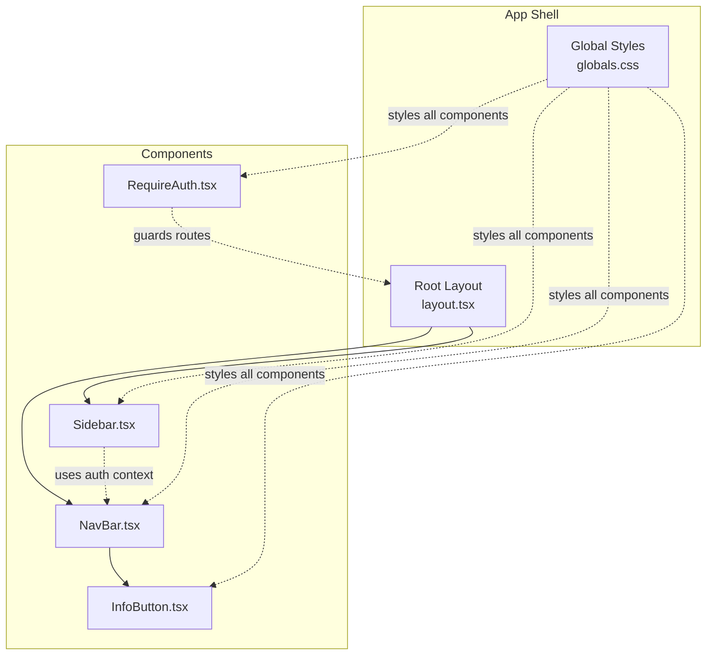
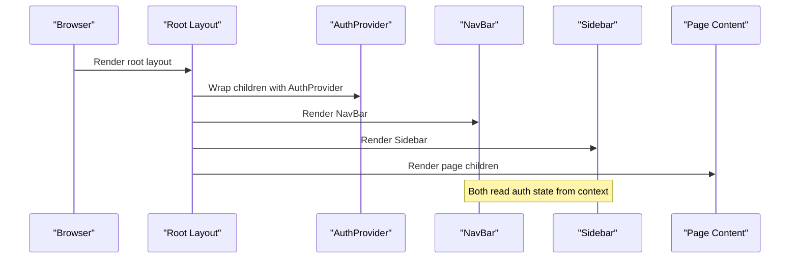
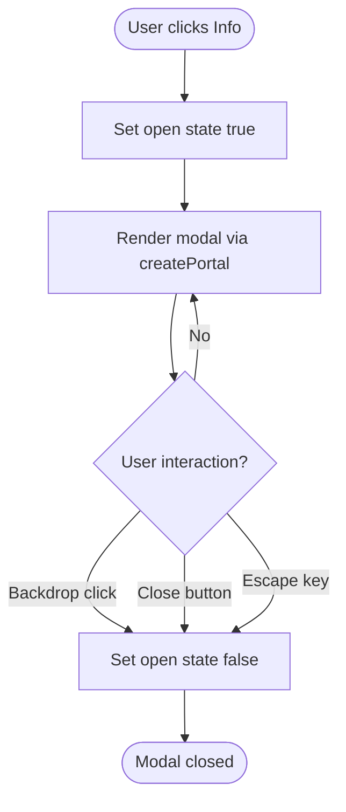
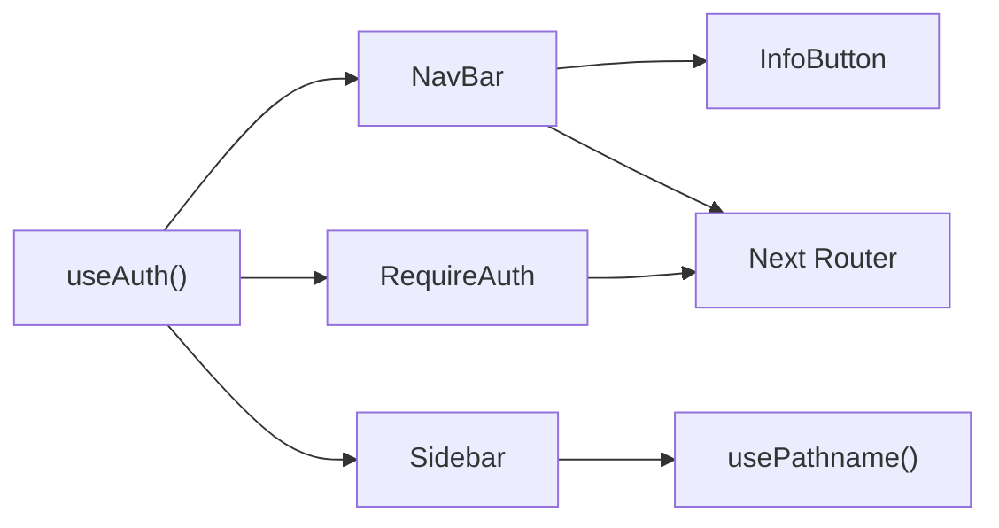

# UI Components Library

<cite>
**Referenced Files in This Document**
- [NavBar.tsx](file://phoenix-frontend/src/components/NavBar.tsx)
- [Sidebar.tsx](file://phoenix-frontend/src/components/Sidebar.tsx)
- [InfoButton.tsx](file://phoenix-frontend/src/components/InfoButton.tsx)
- [RequireAuth.tsx](file://phoenix-frontend/src/components/RequireAuth.tsx)
- [layout.tsx](file://phoenix-frontend/src/app/layout.tsx)
- [globals.css](file://phoenix-frontend/src/app/globals.css)
</cite>

## Table of Contents
1. [Introduction](#introduction)
2. [Project Structure](#project-structure)
3. [Core Components](#core-components)
4. [Architecture Overview](#architecture-overview)
5. [Detailed Component Analysis](#detailed-component-analysis)
6. [Dependency Analysis](#dependency-analysis)
7. [Performance Considerations](#performance-considerations)
8. [Troubleshooting Guide](#troubleshooting-guide)
9. [Conclusion](#conclusion)

## Introduction
This document describes the reusable UI components library used by the Phoenix frontend. It covers the navigation bar, sidebar, info button (with modal), and an authentication guard component. For each component, you will find:
- Visual appearance and behavior
- Props interface and customization options
- Usage examples with code snippet paths
- Responsive design patterns
- Accessibility features
- Styling approach and theming support
- Performance considerations for large applications

The library is built on Next.js App Router, React client components, and a shared CSS file that defines the visual system.

## Project Structure
The UI components live under `phoenix-frontend/src/components`. The root layout composes the global shell, navigation bar, and sidebar, while pages consume these components to render application screens.

**Diagram sources**
- [layout.tsx:1-27](file://phoenix-frontend/src/app/layout.tsx#L1-L27)
- [NavBar.tsx:1-36](file://phoenix-frontend/src/components/NavBar.tsx#L1-L36)
- [Sidebar.tsx:1-57](file://phoenix-frontend/src/components/Sidebar.tsx#L1-L57)
- [InfoButton.tsx:1-82](file://phoenix-frontend/src/components/InfoButton.tsx#L1-L82)
- [RequireAuth.tsx:1-18](file://phoenix-frontend/src/components/RequireAuth.tsx#L1-L18)
- [globals.css:1-137](file://phoenix-frontend/src/app/globals.css#L1-L137)

**Section sources**
- [layout.tsx:1-27](file://phoenix-frontend/src/app/layout.tsx#L1-L27)
- [globals.css:1-137](file://phoenix-frontend/src/app/globals.css#L1-L137)

## Core Components
- NavBar: Top application header with branding, user email, logout action, and Info button.
- Sidebar: Left navigation panel with contextual links per workspace.
- InfoButton: Trigger for an accessible modal overlay with help content.
- RequireAuth: Route-level guard that redirects unauthenticated users and shows a loading state.

These components are styled via shared CSS classes defined in the global stylesheet. They rely on the Next.js router and a shared authentication context.

**Section sources**
- [NavBar.tsx:1-36](file://phoenix-frontend/src/components/NavBar.tsx#L1-L36)
- [Sidebar.tsx:1-57](file://phoenix-frontend/src/components/Sidebar.tsx#L1-L57)
- [InfoButton.tsx:1-82](file://phoenix-frontend/src/components/InfoButton.tsx#L1-L82)
- [RequireAuth.tsx:1-18](file://phoenix-frontend/src/components/RequireAuth.tsx#L1-L18)

## Architecture Overview
The app shell composes the global layout and wraps the application in an authentication provider. The NavBar and Sidebar are present on every page. The InfoButton renders a portal-based modal overlay. RequireAuth guards protected routes.

**Diagram sources**
- [layout.tsx:12-26](file://phoenix-frontend/src/app/layout.tsx#L12-L26)
- [NavBar.tsx:8-35](file://phoenix-frontend/src/components/NavBar.tsx#L8-L35)
- [Sidebar.tsx:26-55](file://phoenix-frontend/src/components/Sidebar.tsx#L26-L55)

## Detailed Component Analysis

### NavBar
Visual appearance and behavior:
- Sticky top header with brand logo and right-aligned controls.
- Displays logged-in user email and a secondary “Log out” button.
- Includes the InfoButton for quick help access.

Props interface:
- No props; behavior is driven by the shared authentication context and Next.js router.

Customization options:
- Brand text and link target can be changed within the component.
- Logout action navigates to `/login` after calling the provided logout function.

Usage example:
- Composed automatically by the root layout. See usage path: [layout.tsx:17](file://phoenix-frontend/src/app/layout.tsx#L17).

Responsive design:
- On small screens, the nav remains sticky and adapts padding. User email badge hides on narrow viewports.

Accessibility:
- Uses semantic `<header>` element.
- Links use Next.js Link for accessibility and performance.

Styling approach:
- Styled via `.nav`, `.brand`, `.nav-right`, and utility classes defined in globals.css.

Theming support:
- Colors and spacing derive from CSS variables in globals.css.

Performance considerations:
- Client component due to interactivity.
- Avoid heavy logic inside NavBar to keep header rendering fast.

**Section sources**
- [NavBar.tsx:1-36](file://phoenix-frontend/src/components/NavBar.tsx#L1-L36)
- [globals.css:28-34](file://phoenix-frontend/src/app/globals.css#L28-L34)
- [globals.css:117-130](file://phoenix-frontend/src/app/globals.css#L117-L130)

### Sidebar
Visual appearance and behavior:
- Left-side navigation panel with section titles and icon-prefixed links.
- Highlights the active route based on current pathname.
- Shows contextual sections when inside a workspace route.

Props interface:
- No props; derives active state from the current URL.

Customization options:
- Navigation items are defined inline; extend or replace the item generator to add new routes.

Usage example:
- Composed automatically by the root layout. See usage path: [layout.tsx:19](file://phoenix-frontend/src/app/layout.tsx#L19).

Responsive design:
- On small screens, the sidebar collapses into a horizontal row with hidden titles and hints.

Accessibility:
- Uses semantic `<aside>` element.
- Icons are decorative and marked `aria-hidden="true"`.

Styling approach:
- Styled via `.sidebar`, `.side-title`, `.side-link`, and related utilities in globals.css.

Theming support:
- Active states and colors come from CSS variables.

Performance considerations:
- Lightweight; uses Next.js navigation hooks to compute active state without extra network calls.

**Section sources**
- [Sidebar.tsx:1-57](file://phoenix-frontend/src/components/Sidebar.tsx#L1-L57)
- [globals.css:41-51](file://phoenix-frontend/src/app/globals.css#L41-L51)
- [globals.css:117-127](file://phoenix-frontend/src/app/globals.css#L117-L127)

### InfoButton
Visual appearance and behavior:
- Secondary button with an attention indicator.
- Opens a modal overlay rendered via React Portal into `document.body`.
- Closes on backdrop click, close button click, or Escape key press.

Props interface:
- No props; modal content is embedded in the component.

Customization options:
- Modal content can be refactored into a separate component and passed as children or props.
- Focus management and trap can be enhanced for better accessibility.

Usage example:
- Placed inside NavBar. See usage path: [NavBar.tsx:17](file://phoenix-frontend/src/components/NavBar.tsx#L17).

Responsive design:
- Modal adapts width and padding on small screens.

Accessibility:
- Button has `aria-label`.
- Modal has `role="dialog"` and `aria-modal="true"`.
- Escape key closes the modal.

Styling approach:
- Backdrop and modal styles defined in globals.css.

Theming support:
- Modal and button styling use CSS variables.

Performance considerations:
- Modal is conditionally rendered only when open.
- Uses `createPortal` to avoid z-index stacking issues.

**Diagram sources**
- [InfoButton.tsx:6-81](file://phoenix-frontend/src/components/InfoButton.tsx#L6-L81)

**Section sources**
- [InfoButton.tsx:1-82](file://phoenix-frontend/src/components/InfoButton.tsx#L1-L82)
- [globals.css:98-107](file://phoenix-frontend/src/app/globals.css#L98-L107)
- [globals.css:117-132](file://phoenix-frontend/src/app/globals.css#L117-L132)

### RequireAuth
Visual appearance and behavior:
- Renders a loading message while authentication state is resolving.
- Redirects unauthenticated users to `/login`.
- Renders protected children when authenticated.

Props interface:
- `children: React.ReactNode`

Customization options:
- Customize redirect destination and loading UI.

Usage example:
- Can wrap protected routes or page components.

Responsive design:
- Not applicable; it is a layout guard.

Accessibility:
- Loading text is plain; consider adding ARIA live region if needed.

Styling approach:
- Uses `.muted` class from globals.css.

Theming support:
- Inherits theme via CSS variables.

Performance considerations:
- Minimal re-renders; relies on auth context state.

**Section sources**
- [RequireAuth.tsx:1-18](file://phoenix-frontend/src/components/RequireAuth.tsx#L1-L18)
- [globals.css:85-86](file://phoenix-frontend/src/app/globals.css#L85-L86)

## Dependency Analysis
Component relationships and data flow:
- NavBar depends on the authentication context and InfoButton.
- Sidebar depends on the authentication context and Next.js navigation.
- RequireAuth depends on the authentication context and Next.js router.
- All components share styling from globals.css.

**Diagram sources**
- [NavBar.tsx:4-10](file://phoenix-frontend/src/components/NavBar.tsx#L4-L10)
- [Sidebar.tsx:3-5](file://phoenix-frontend/src/components/Sidebar.tsx#L3-L5)
- [RequireAuth.tsx:3-5](file://phoenix-frontend/src/components/RequireAuth.tsx#L3-L5)
- [InfoButton.tsx:1-4](file://phoenix-frontend/src/components/InfoButton.tsx#L1-L4)

**Section sources**
- [NavBar.tsx:1-36](file://phoenix-frontend/src/components/NavBar.tsx#L1-L36)
- [Sidebar.tsx:1-57](file://phoenix-frontend/src/components/Sidebar.tsx#L1-L57)
- [RequireAuth.tsx:1-18](file://phoenix-frontend/src/components/RequireAuth.tsx#L1-L18)
- [InfoButton.tsx:1-82](file://phoenix-frontend/src/components/InfoButton.tsx#L1-L82)

## Performance Considerations
- Prefer client components only where interactivity is required (NavBar, Sidebar, InfoButton, RequireAuth).
- Keep modal content minimal; render only when open.
- Use CSS variables for theming to avoid runtime style computations.
- Avoid heavy computations in header/sidebar; offload to contexts or server components where possible.
- Leverage Next.js Link for prefetching and reduced navigation overhead.
- Respect `prefers-reduced-motion` to disable animations for users who prefer reduced motion.

[No sources needed since this section provides general guidance]

## Troubleshooting Guide
Common issues and resolutions:
- Modal not closing on Escape: Ensure the keydown listener is attached and removed correctly. Verify the event handler scope.
- Modal focus management: Add focus trap and initial focus to modal head for keyboard accessibility.
- Sidebar active state mismatch: Confirm pathname matching logic aligns with route structure.
- Authentication redirect loops: Ensure the auth context’s ready state resolves before redirect logic runs.
- Z-index stacking issues with modal: Ensure portal is appended to body and backdrop has higher z-index than page content.

**Section sources**
- [InfoButton.tsx:9-14](file://phoenix-frontend/src/components/InfoButton.tsx#L9-L14)
- [RequireAuth.tsx:11-16](file://phoenix-frontend/src/components/RequireAuth.tsx#L11-L16)
- [Sidebar.tsx:28-31](file://phoenix-frontend/src/components/Sidebar.tsx#L28-L31)

## Conclusion
The Phoenix UI components library provides a cohesive set of shared elements for navigation, information delivery, and route protection. They are styled consistently through CSS variables and responsive rules, integrate cleanly with Next.js routing and authentication, and offer clear extension points for customization. For large applications, prioritize minimal client-side logic, efficient modal rendering, and robust accessibility practices to maintain performance and usability.

[No sources needed since this section summarizes without analyzing specific files]