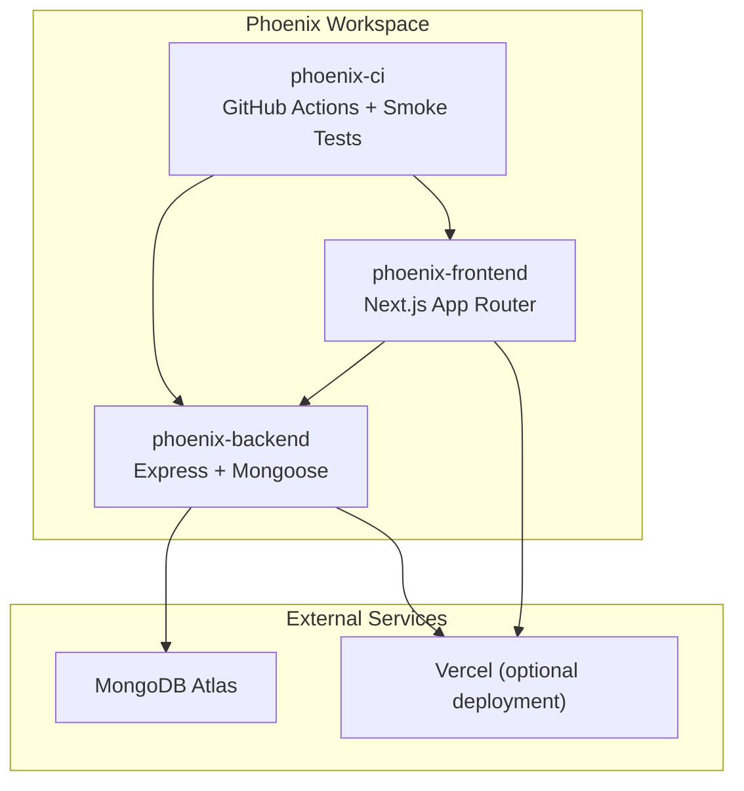
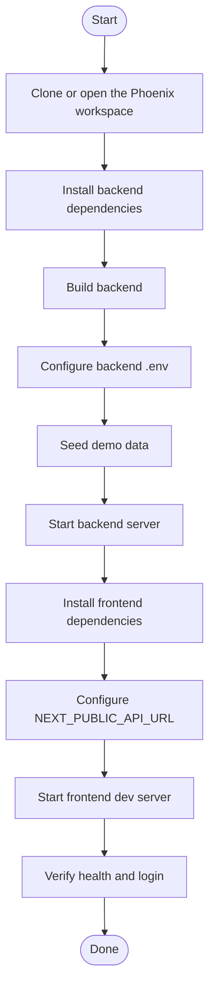
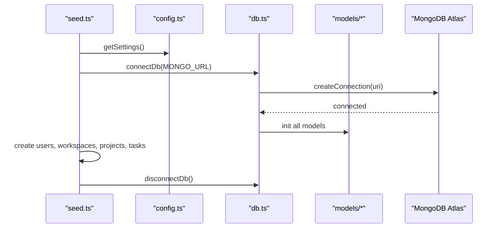
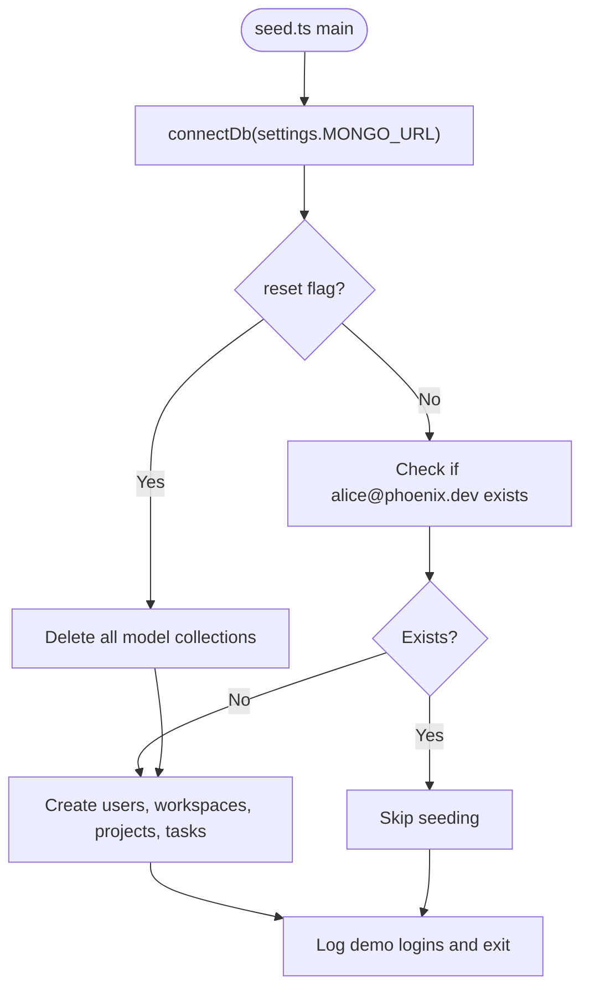
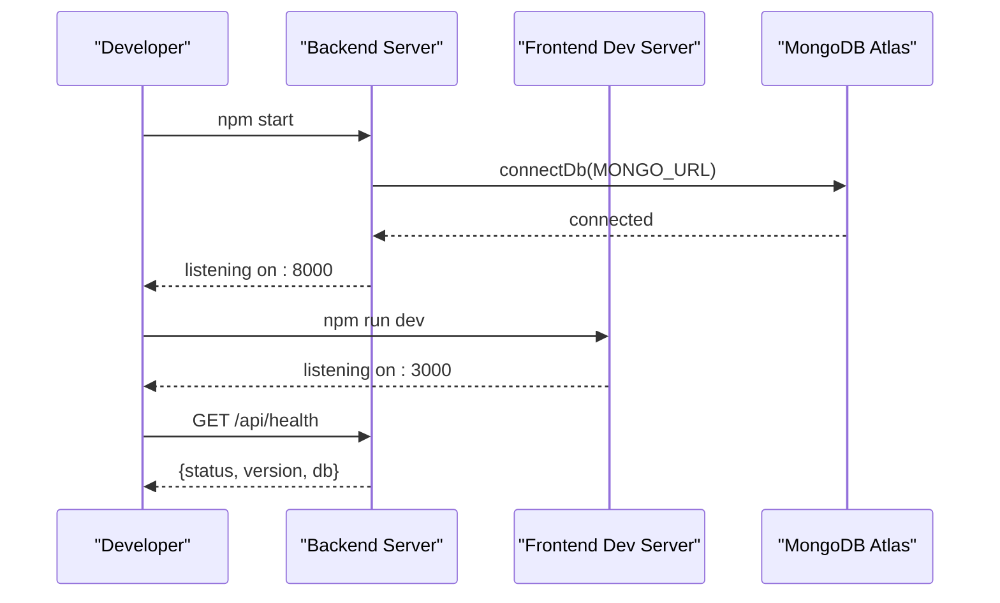
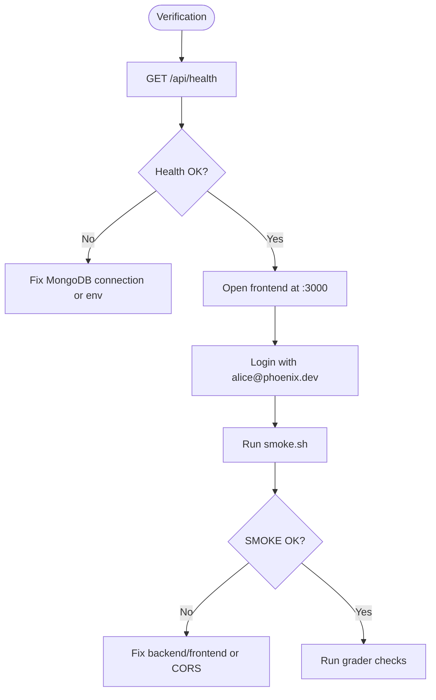

# Getting Started Guide

<cite>
**Referenced Files in This Document**
- [README.md](file://README.md)
- [phoenix-backend/README.md](file://phoenix-backend/README.md)
- [phoenix-frontend/README.md](file://phoenix-frontend/README.md)
- [phoenix-ci/README.md](file://phoenix-ci/README.md)
- [phoenix-backend/package.json](file://phoenix-backend/package.json)
- [phoenix-frontend/package.json](file://phoenix-frontend/package.json)
- [phoenix-backend/src/config.ts](file://phoenix-backend/src/config.ts)
- [phoenix-backend/src/db.ts](file://phoenix-backend/src/db.ts)
- [phoenix-backend/scripts/seed.ts](file://phoenix-backend/scripts/seed.ts)
- [phoenix-backend/src/server.ts](file://phoenix-backend/src/server.ts)
- [phoenix-frontend/next.config.mjs](file://phoenix-frontend/next.config.mjs)
- [phoenix-ci/.github/workflows/pipeline.yml](file://phoenix-ci/.github/workflows/pipeline.yml)
- [phoenix-ci/scripts/smoke.sh](file://phoenix-ci/scripts/smoke.sh)
</cite>

## Table of Contents
1. [Introduction](#introduction)
2. [Prerequisites](#prerequisites)
3. [Project Structure](#project-structure)
4. [Environment Setup](#environment-setup)
5. [Installation and Initial Configuration](#installation-and-initial-configuration)
6. [Database Connection Setup](#database-connection-setup)
7. [Seed Demo Data](#seed-demo-data)
8. [Run the Application](#run-the-application)
9. [Verify Everything Works](#verify-everything-works)
10. [Troubleshooting](#troubleshooting)
11. [Next Steps](#next-steps)

## Introduction
This guide helps you set up Project Phoenix locally, including all three repositories: backend, frontend, and CI configuration. You will install dependencies, configure environment variables, connect to MongoDB, seed demo data, start both apps, and verify that everything is working.

The project uses:
- Backend: Node.js 20, TypeScript, Express, Mongoose with MongoDB
- Frontend: Next.js 14, React 18, TypeScript
- CI: GitHub Actions pipeline and smoke tests

**Section sources**
- [README.md:1-15](file://README.md#L1-L15)
- [phoenix-backend/README.md:1-8](file://phoenix-backend/README.md#L1-L8)
- [phoenix-frontend/README.md:1-7](file://phoenix-frontend/README.md#L1-L7)
- [phoenix-ci/README.md:1-13](file://phoenix-ci/README.md#L1-L13)

## Prerequisites
Before starting, ensure your machine has:
- Node.js 20 (the project targets Node.js 20; engines allow >= 18.17 locally)
- Git installed and configured
- A MongoDB Atlas account for a free cluster
- Access to ports 8000 (backend) and 3000 (frontend) on your machine

MongoDB Atlas setup steps:
1. Create a free cluster.
2. Add a database user with a password.
3. Allow your IP address under Network Access (or `0.0.0.0/0` if needed).
4. Copy the connection string from Connect -> Drivers.
5. Append `/phoenix` to the connection string.

Node.js version notes:
- The backend package declares engines for Node.js >= 18.17.
- The frontend package also declares engines for Node.js >= 18.17.
- The documentation recommends Node.js 20 for consistency.

**Section sources**
- [README.md:18-26](file://README.md#L18-L26)
- [phoenix-backend/README.md:9-13](file://phoenix-backend/README.md#L9-L13)
- [phoenix-backend/package.json:7-9](file://phoenix-backend/package.json#L7-L9)
- [phoenix-frontend/package.json:5-7](file://phoenix-frontend/package.json#L5-L7)

## Project Structure
Phoenix consists of three repositories in one workspace:
- phoenix-backend: API server, models, routes, config, database connection, and seed script
- phoenix-frontend: Next.js application for login, workspaces, projects, tasks, and credits
- phoenix-ci: GitHub Actions workflow and smoke test scripts

**Diagram sources**
- [README.md:7-14](file://README.md#L7-L14)
- [phoenix-backend/README.md:32-41](file://phoenix-backend/README.md#L32-L41)
- [phoenix-frontend/README.md:26-31](file://phoenix-frontend/README.md#L26-L31)
- [phoenix-ci/README.md:15-27](file://phoenix-ci/README.md#L15-L27)

**Section sources**
- [README.md:7-14](file://README.md#L7-L14)

## Environment Setup
You must configure environment variables before running or building either app.

Backend environment variables:
- MONGO_URL: MongoDB connection string including the database name
- JWT_SECRET: Random string, at least 32 characters
- JWT_ALGORITHM: One of HS256, HS384, HS512 (default HS256)
- JWT_EXPIRE_MINUTES: Positive integer minutes (default 120)
- CORS_ORIGINS: JSON array string of allowed origins (default http://localhost:3000)
- TASK_CREDIT_COST: Positive integer cost per task (default 1)
- WELCOME_CREDITS: Non-negative integer welcome credits (default 3)
- APP_VERSION: String version tag (default dev)
- PORT: Integer port number (default 8000)

Frontend environment variable:
- NEXT_PUBLIC_API_URL: URL of the running backend API

Important notes:
- The backend validates environment variables using a schema and fails fast if anything is invalid.
- The frontend reads NEXT_PUBLIC_API_URL at build time.
- Never commit secrets like JWT_SECRET or MONGO_URL.

**Section sources**
- [phoenix-backend/README.md:15-21](file://phoenix-backend/README.md#L15-L21)
- [phoenix-frontend/README.md:13-18](file://phoenix-frontend/README.md#L13-L18)
- [phoenix-backend/src/config.ts:3-13](file://phoenix-backend/src/config.ts#L3-L13)
- [phoenix-backend/src/config.ts:19-31](file://phoenix-backend/src/config.ts#L19-L31)
- [phoenix-frontend/next.config.mjs:1-6](file://phoenix-frontend/next.config.mjs#L1-L6)

## Installation and Initial Configuration
Follow these steps for each repository.

Backend installation:
1. Navigate to phoenix-backend.
2. Install dependencies with npm ci.
3. Build the TypeScript code.
4. Configure environment variables in .env.
5. Seed demo data.
6. Start the server.

Frontend installation:
1. Navigate to phoenix-frontend.
2. Install dependencies with npm ci.
3. Copy the example environment file to .env.local.
4. Set NEXT_PUBLIC_API_URL to point at your backend.
5. Start the development server.

CI verification:
- Use the smoke script against your local or deployed endpoints.

**Diagram sources**
- [phoenix-backend/README.md:23-30](file://phoenix-backend/README.md#L23-L30)
- [phoenix-frontend/README.md:13-18](file://phoenix-frontend/README.md#L13-L18)
- [phoenix-ci/scripts/smoke.sh:1-17](file://phoenix-ci/scripts/smoke.sh#L1-L17)

**Section sources**
- [phoenix-backend/README.md:23-30](file://phoenix-backend/README.md#L23-L30)
- [phoenix-frontend/README.md:13-18](file://phoenix-frontend/README.md#L13-L18)
- [phoenix-ci/README.md:33-38](file://phoenix-ci/README.md#L33-L38)

## Database Connection Setup
The backend connects to MongoDB using Mongoose. It creates a connection and initializes models.

Key points:
- The connection uses createConnection with legacy options for compatibility.
- Models are initialized after the connection is established.
- The seed script connects, seeds data, and disconnects cleanly.

**Diagram sources**
- [phoenix-backend/scripts/seed.ts:75-83](file://phoenix-backend/scripts/seed.ts#L75-L83)
- [phoenix-backend/src/db.ts:12-22](file://phoenix-backend/src/db.ts#L12-L22)

**Section sources**
- [phoenix-backend/src/db.ts:1-27](file://phoenix-backend/src/db.ts#L1-L27)
- [phoenix-backend/scripts/seed.ts:1-84](file://phoenix-backend/scripts/seed.ts#L1-L84)

## Seed Demo Data
The seed script creates demo users, workspaces, projects, and tasks. It is safe to run multiple times unless you use reset mode.

Demo accounts:
- alice@phoenix.dev: owner of Acme Corp with 3 credits
- bob@phoenix.dev: member of Acme Corp
- carol@phoenix.dev: owner of Globex Secret Lab, not part of Acme

All demo passwords are phoenix123.

Seed behavior:
- Without reset: skips seeding if demo data already exists.
- With reset: deletes existing collections and recreates demo data.

**Diagram sources**
- [phoenix-backend/scripts/seed.ts:11-17](file://phoenix-backend/scripts/seed.ts#L11-L17)
- [phoenix-backend/scripts/seed.ts:19-73](file://phoenix-backend/scripts/seed.ts#L19-L73)
- [phoenix-backend/scripts/seed.ts:75-83](file://phoenix-backend/scripts/seed.ts#L75-L83)

**Section sources**
- [phoenix-backend/scripts/seed.ts:1-84](file://phoenix-backend/scripts/seed.ts#L1-L84)
- [README.md:28-38](file://README.md#L28-L38)
- [phoenix-backend/README.md:43-51](file://phoenix-backend/README.md#L43-L51)

## Run the Application
After installing and configuring both apps:

Backend:
- Start the server on port 8000 by default.
- Health endpoint is available at /api/health.

Frontend:
- Start the development server on port 3000 by default.
- Ensure NEXT_PUBLIC_API_URL points to the backend URL.

**Diagram sources**
- [phoenix-backend/src/server.ts:5-10](file://phoenix-backend/src/server.ts#L5-L10)
- [phoenix-backend/package.json:10-18](file://phoenix-backend/package.json#L10-L18)
- [phoenix-frontend/package.json:8-13](file://phoenix-frontend/package.json#L8-L13)

**Section sources**
- [phoenix-backend/README.md:23-30](file://phoenix-backend/README.md#L23-L30)
- [phoenix-frontend/README.md:13-18](file://phoenix-frontend/README.md#L13-L18)
- [phoenix-backend/src/server.ts:5-10](file://phoenix-backend/src/server.ts#L5-L10)

## Verify Everything Works
Use these checks to confirm the setup is correct.

Basic checks:
- Backend health endpoint returns success only when MongoDB responds.
- Frontend loads at localhost:3000.
- Login works with alice@phoenix.dev and password phoenix123.

Smoke test:
- Run the smoke script against your local backend and frontend URLs.
- The script checks health, frontend availability, and login.

Grader and acceptance criteria:
- The top-level README describes how to use the grader and what “done” means.
- Acceptance includes successful npm ci, typecheck, build, seed, health check, and smoke test.

**Diagram sources**
- [phoenix-backend/README.md:59-63](file://phoenix-backend/README.md#L59-L63)
- [phoenix-ci/scripts/smoke.sh:1-17](file://phoenix-ci/scripts/smoke.sh#L1-L17)
- [README.md:131-137](file://README.md#L131-L137)

**Section sources**
- [phoenix-backend/README.md:59-63](file://phoenix-backend/README.md#L59-L63)
- [phoenix-ci/scripts/smoke.sh:1-17](file://phoenix-ci/scripts/smoke.sh#L1-L17)
- [README.md:131-137](file://README.md#L131-L137)

## Troubleshooting
Common issues and fixes:

MongoDB connection problems:
- Confirm MONGO_URL is correct and includes the database name.
- Ensure Network Access allows your IP or 0.0.0.0/0.
- Validate that the connection string starts with mongodb:// or mongodb+srv://.
- If the health endpoint fails, check MongoDB connectivity and environment variables.

Dependency conflicts:
- Use npm ci to install exact versions from the lockfile.
- Avoid --legacy-peer-deps unless absolutely necessary.
- Keep Node.js consistent across environments.

Port conflicts:
- Backend defaults to port 8000.
- Frontend defaults to port 3000.
- Change PORT in backend env if needed, and update smoke test URLs accordingly.

CORS issues:
- Set CORS_ORIGINS to include the frontend URL.
- When deploying to Vercel, add the frontend URL to CORS_ORIGINS and redeploy the backend.

Frontend build-time variables:
- NEXT_PUBLIC_API_URL is baked into the bundle at build time.
- After changing it, rebuild the frontend.

CI and pipeline notes:
- The pipeline README describes required jobs, secrets, and variables.
- The smoke script should print SMOKE OK and exit non-zero on failure.

**Section sources**
- [phoenix-backend/src/config.ts:3-13](file://phoenix-backend/src/config.ts#L3-L13)
- [phoenix-backend/src/config.ts:19-31](file://phoenix-backend/src/config.ts#L19-L31)
- [phoenix-backend/README.md:32-41](file://phoenix-backend/README.md#L32-L41)
- [phoenix-frontend/README.md:20-31](file://phoenix-frontend/README.md#L20-L31)
- [phoenix-ci/README.md:29-38](file://phoenix-ci/README.md#L29-L38)

## Next Steps
Once your local environment is working:
- Explore the API endpoints documented in the backend README.
- Try logging in as different demo users.
- Test creating tasks and observe credit changes.
- Prepare for deployment to Vercel by setting environment variables in the platform settings.
- Review the CI pipeline requirements and ensure your workflow matches the expected jobs and rules.

**Section sources**
- [phoenix-backend/README.md:59-76](file://phoenix-backend/README.md#L59-L76)
- [phoenix-frontend/README.md:33-40](file://phoenix-frontend/README.md#L33-L40)
- [phoenix-ci/README.md:15-27](file://phoenix-ci/README.md#L15-L27)