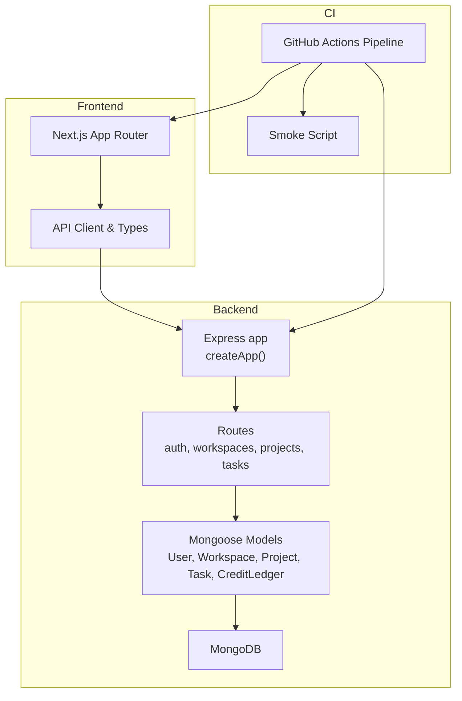
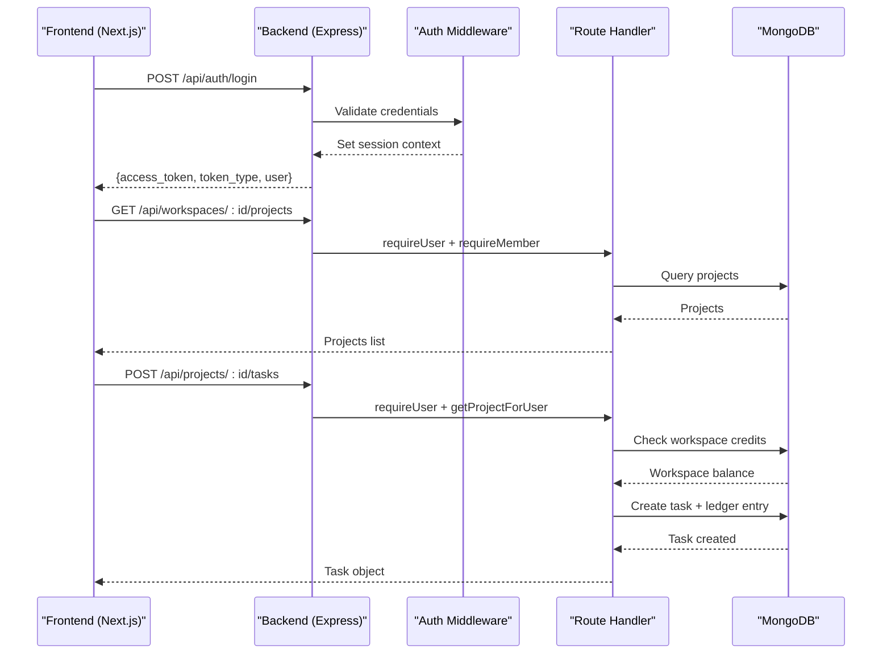
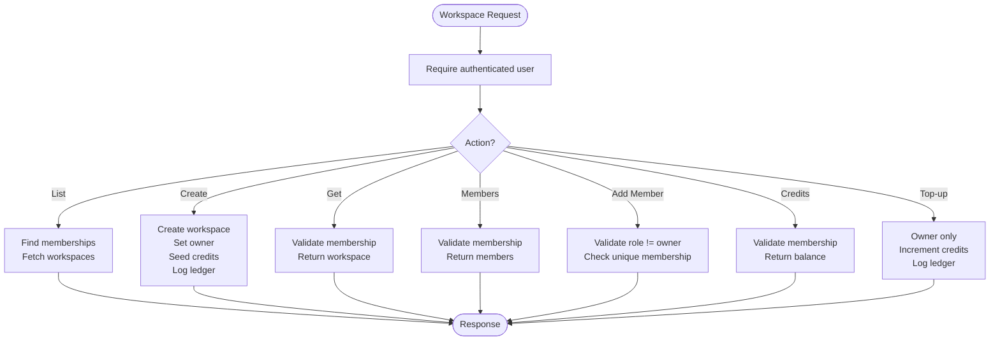
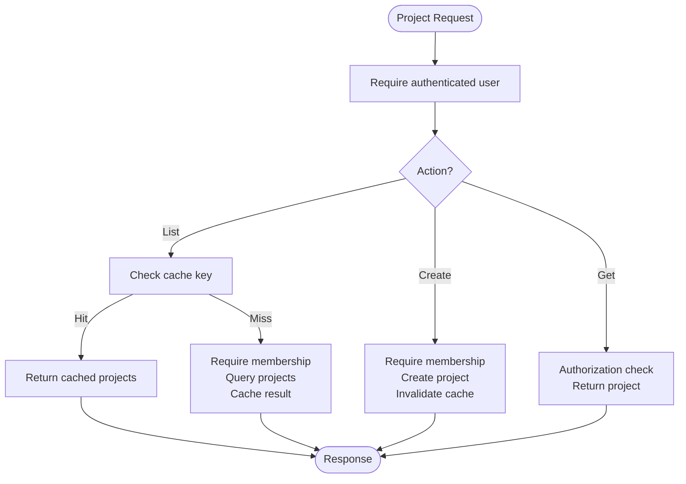
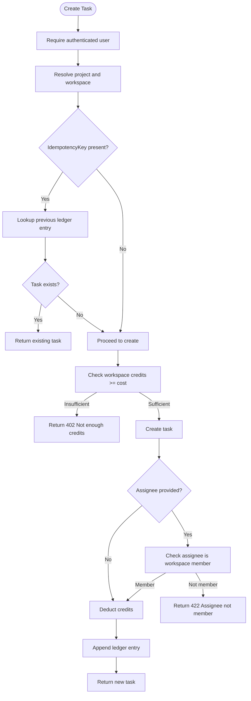
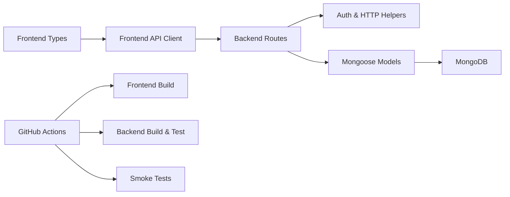

# Project Overview

<cite>
**Referenced Files in This Document**
- [README.md](file://README.md)
- [phoenix-backend/README.md](file://phoenix-backend/README.md)
- [phoenix-frontend/README.md](file://phoenix-frontend/README.md)
- [phoenix-ci/README.md](file://phoenix-ci/README.md)
- [app.ts](file://phoenix-backend/src/app.ts)
- [models/index.ts](file://phoenix-backend/src/models/index.ts)
- [workspace.ts](file://phoenix-backend/src/models/workspace.ts)
- [project.ts](file://phoenix-backend/src/models/project.ts)
- [task.ts](file://phoenix-backend/src/models/task.ts)
- [user.ts](file://phoenix-backend/src/models/user.ts)
- [ledger.ts](file://phoenix-backend/src/models/ledger.ts)
- [workspaces.ts](file://phoenix-backend/src/routes/workspaces.ts)
- [projects.ts](file://phoenix-backend/src/routes/projects.ts)
- [tasks.ts](file://phoenix-backend/src/routes/tasks.ts)
- [types.ts](file://phoenix-frontend/src/lib/types.ts)
</cite>

## Table of Contents
1. [Introduction](#introduction)
2. [Project Structure](#project-structure)
3. [Core Components](#core-components)
4. [Architecture Overview](#architecture-overview)
5. [Detailed Component Analysis](#detailed-component-analysis)
6. [Dependency Analysis](#dependency-analysis)
7. [Performance Considerations](#performance-considerations)
8. [Troubleshooting Guide](#troubleshooting-guide)
9. [Conclusion](#conclusion)

## Introduction
Project Phoenix is a multi-tenant project tracking platform presented as a broken codebase challenge. The goal is to diagnose and fix issues across three repositories: backend, frontend, and CI. The system models workspaces (teams), projects within workspaces, tasks within projects, and a credit system that charges for creating tasks. Access control is role-based using roles such as owner, admin, and member.

Purpose as a challenge:
- You inherit a platform where the READMEs describe intended behavior, but the code and configuration are intentionally broken.
- The challenge tests your ability to reconcile schema definitions, API contracts, caching, authentication, authorization, idempotency, and deployment configuration.
- Success means making the stack install, build, seed, run, and pass both local smoke checks and the grader.

Learning objectives:
- Understand how workspaces, projects, tasks, credits, and roles interact end-to-end.
- Practice debugging across multiple layers: Express routes, Mongoose models, Next.js pages, environment variables, and GitHub Actions.
- Learn to identify mismatches between server-side snake_case JSON and client-side types, and to align them consistently.
- Gain experience with idempotent task creation, credit ledgering, and safe concurrency patterns.

Practical examples:
- Alice owns Acme Corp workspace, starts with 3 credits, and can create projects and tasks.
- Bob is a member of Acme Corp and can view and contribute to its projects and tasks.
- Carol owns Globex Secret Lab and cannot access Acme data due to workspace isolation.
- Creating a task costs 1 credit; if the workspace has insufficient credits, the request fails with a payment-required response.

How this documentation helps fix the implementation:
- It maps business concepts to concrete files so you can trace where workspaces, projects, tasks, credits, and roles are defined and used.
- It highlights common failure modes hinted by the repository’s clues, such as mismatched schemas, incorrect middleware order, wrong environment variables, and unsafe cache keys.
- It provides diagrams and section sources to quickly locate the relevant route handlers, models, and frontend types during debugging.

**Section sources**
- [README.md:1-140](file://README.md#L1-L140)
- [phoenix-backend/README.md:1-76](file://phoenix-backend/README.md#L1-L76)
- [phoenix-frontend/README.md:1-40](file://phoenix-frontend/README.md#L1-L40)
- [phoenix-ci/README.md:1-39](file://phoenix-ci/README.md#L1-L39)

## Project Structure
Phoenix uses a three-repository architecture:
- phoenix-backend: Node.js 20, TypeScript, Express, MongoDB via Mongoose. Provides REST endpoints for health, auth, workspaces, projects, and tasks.
- phoenix-frontend: Next.js 14 App Router with React 18 and TypeScript. Provides login, workspace list/detail, members management, and task board UI.
- phoenix-ci: GitHub Actions pipeline and smoke test script to validate builds, e2e flows, deployments, and production verification.

**Diagram sources**
- [app.ts:11-28](file://phoenix-backend/src/app.ts#L11-L28)
- [workspaces.ts:1-126](file://phoenix-backend/src/routes/workspaces.ts#L1-L126)
- [projects.ts:1-50](file://phoenix-backend/src/routes/projects.ts#L1-L50)
- [tasks.ts:1-82](file://phoenix-backend/src/routes/tasks.ts#L1-L82)
- [phoenix-ci/README.md:15-27](file://phoenix-ci/README.md#L15-L27)

**Section sources**
- [README.md:7-14](file://README.md#L7-L14)
- [phoenix-backend/README.md:1-76](file://phoenix-backend/README.md#L1-L76)
- [phoenix-frontend/README.md:1-40](file://phoenix-frontend/README.md#L1-L40)
- [phoenix-ci/README.md:1-39](file://phoenix-ci/README.md#L1-L39)

## Core Components
This section explains the core business components and their responsibilities.

- Workspaces: Multi-tenant containers representing organizations or teams. Each workspace has an owner, a set of members with roles, and a credit balance.
- Projects: Items belonging to a workspace. Users must be members of the workspace to access projects.
- Tasks: Items belonging to a project. Creating a task costs 1 credit and is recorded in the credit ledger. Tasks support search, status filtering, and pagination.
- Credits: A numeric balance per workspace. Top-ups increase the balance; task creation decreases it. All changes are appended to the ledger.
- Roles: Role-based access control with owner, admin, and member. Owners can top up credits; admins and owners can manage members; all members can view workspace resources according to permissions.

Key data structures:
- User: email, fullName, password.
- Workspace: name, owner, credits (stored as string in schema).
- WorkspaceMember: workspace, user, role.
- Project: workspace, name, description.
- Task: project, title, status, createdBy, assignee, createdAt.
- CreditLedger: workspace, delta, reason, task, idempotencyKey.

Conceptual overview for beginners:
- Think of a workspace as a company or team. Only invited users can see its projects and tasks.
- Projects group related work. Tasks are actionable items within a project.
- Credits act like a budget. Every new task deducts from the budget. If the budget is negative or insufficient, task creation is blocked.
- Roles determine who can do what: owners have full control, admins can manage members, members participate.

Technical overview for experienced developers:
- The Express app wires routers and middleware, including CORS and error handling.
- Mongoose models define schemas, indexes, and virtuals. Some fields use strings for numeric values (credits), which requires careful conversion.
- Routes enforce membership and ownership, parse inputs, handle idempotency via idempotencyKey, and update the credit ledger atomically.
- Frontend types define expected shapes for API responses, ensuring consistent snake_case naming.

**Section sources**
- [workspace.ts:1-22](file://phoenix-backend/src/models/workspace.ts#L1-L22)
- [project.ts:1-12](file://phoenix-backend/src/models/project.ts#L1-L12)
- [task.ts:1-15](file://phoenix-backend/src/models/task.ts#L1-L15)
- [user.ts:1-14](file://phoenix-backend/src/models/user.ts#L1-L14)
- [ledger.ts:1-19](file://phoenix-backend/src/models/ledger.ts#L1-L19)
- [types.ts:1-54](file://phoenix-frontend/src/lib/types.ts#L1-L54)

## Architecture Overview
The system follows a layered architecture:
- Frontend: Next.js pages call the backend API and render workspace lists, project details, task boards, and member management.
- Backend: Express application exposes REST endpoints. Middleware handles CORS, JSON parsing, and error handling. Route handlers enforce authentication and authorization.
- Data Layer: Mongoose models map to MongoDB collections. Indexes optimize queries for tasks and credit ledgers.
- CI: GitHub Actions runs tests, seeds data, starts apps, executes smoke tests, deploys to Vercel, and verifies production.

**Diagram sources**
- [app.ts:11-28](file://phoenix-backend/src/app.ts#L11-L28)
- [projects.ts:11-43](file://phoenix-backend/src/routes/projects.ts#L11-L43)
- [tasks.ts:34-80](file://phoenix-backend/src/routes/tasks.ts#L34-L80)

## Detailed Component Analysis

### Workspace Management
Responsibilities:
- List workspaces for the current user.
- Create a workspace with initial welcome credits and log the credit change.
- Fetch workspace details and membership information.
- Add members with role validation (only one owner allowed).
- Read workspace credit balance and perform top-ups.

Key behaviors:
- Membership is enforced via WorkspaceMember; only members can access workspace resources.
- Owner-only operations include topping up credits.
- Welcome credits are seeded when creating a workspace and recorded in the ledger.

**Diagram sources**
- [workspaces.ts:18-126](file://phoenix-backend/src/routes/workspaces.ts#L18-L126)

**Section sources**
- [workspaces.ts:1-126](file://phoenix-backend/src/routes/workspaces.ts#L1-L126)
- [workspace.ts:1-22](file://phoenix-backend/src/models/workspace.ts#L1-L22)
- [ledger.ts:1-19](file://phoenix-backend/src/models/ledger.ts#L1-L19)

### Project Tracking
Responsibilities:
- List projects within a workspace.
- Create projects within a workspace.
- Fetch a single project with authorization checks.

Key behaviors:
- Project listing is cached; cache invalidation occurs on project creation.
- Authorization ensures only workspace members can access projects.

**Diagram sources**
- [projects.ts:11-43](file://phoenix-backend/src/routes/projects.ts#L11-L43)

**Section sources**
- [projects.ts:1-50](file://phoenix-backend/src/routes/projects.ts#L1-L50)
- [project.ts:1-12](file://phoenix-backend/src/models/project.ts#L1-L12)

### Task Creation and Credit System
Responsibilities:
- List tasks with search, status filter, and pagination.
- Create tasks with credit deduction and idempotency support.
- Enforce assignee membership within the workspace.

Key behaviors:
- Task creation costs 1 credit; insufficient credits return a payment-required error.
- IdempotencyKey prevents duplicate charges and duplicate tasks.
- Ledger records every credit change with reason and optional task reference.

**Diagram sources**
- [tasks.ts:34-80](file://phoenix-backend/src/routes/tasks.ts#L34-L80)
- [ledger.ts:1-19](file://phoenix-backend/src/models/ledger.ts#L1-L19)

**Section sources**
- [tasks.ts:1-82](file://phoenix-backend/src/routes/tasks.ts#L1-L82)
- [task.ts:1-15](file://phoenix-backend/src/models/task.ts#L1-L15)
- [ledger.ts:1-19](file://phoenix-backend/src/models/ledger.ts#L1-L19)

### Authentication and Authorization
Responsibilities:
- Authenticate users and issue tokens.
- Protect routes with requireUser and requireMember.
- Ensure workspace isolation and role-based permissions.

Key behaviors:
- Health endpoint should reflect database connectivity truthfully.
- Authorization guards prevent unauthorized access to workspaces and projects.
- Ownership constraints protect sensitive operations like topping up credits.

**Section sources**
- [app.ts:11-28](file://phoenix-backend/src/app.ts#L11-L28)
- [workspaces.ts:1-126](file://phoenix-backend/src/routes/workspaces.ts#L1-L126)
- [projects.ts:1-50](file://phoenix-backend/src/routes/projects.ts#L1-L50)

### Frontend Type Contracts
Responsibilities:
- Define TypeScript interfaces matching backend snake_case JSON.
- Provide types for roles, tasks, workspaces, and members.

Key behaviors:
- TaskStatus type must align with backend TASK_STATUSES.
- Field names like created_at, access_token, and snake_case properties must match backend serialization.

**Section sources**
- [types.ts:1-54](file://phoenix-frontend/src/lib/types.ts#L1-L54)

## Dependency Analysis
High-level dependencies:
- Express app depends on routers for routing logic.
- Routers depend on models for data persistence and on auth/cache utilities for security and performance.
- Models depend on Mongoose and MongoDB.
- Frontend depends on backend API and uses typed interfaces for consistency.
- CI pipeline orchestrates builds, tests, smoke checks, and deployments.

**Diagram sources**
- [app.ts:11-28](file://phoenix-backend/src/app.ts#L11-L28)
- [models/index.ts:1-14](file://phoenix-backend/src/models/index.ts#L1-L14)
- [phoenix-ci/README.md:15-27](file://phoenix-ci/README.md#L15-L27)

**Section sources**
- [models/index.ts:1-14](file://phoenix-backend/src/models/index.ts#L1-L14)
- [phoenix-ci/README.md:15-27](file://phoenix-ci/README.md#L15-L27)

## Performance Considerations
- Caching: Project listing uses an in-memory cache keyed by workspace ID. Ensure cache keys are consistent and invalidated on writes.
- Pagination: Task listing uses page and page_size parameters; ensure correct offset calculation and sorting.
- Database indexing: Task queries benefit from indexes on project and createdAt; credit ledger queries benefit from workspace and idempotencyKey indexes.
- Concurrency: Use atomic updates and ledger entries to avoid race conditions when spending credits.

[No sources needed since this section provides general guidance]

## Troubleshooting Guide
Common symptoms and where to look:
- Health endpoint always healthy: Inspect health route logic and database connectivity checks.
- Wrong language or missing front door: Verify Express middleware order and JSON body parser placement.
- Schema mismatches: Compare model schemas with API contracts and frontend types.
- Seed reports success but data missing: Check seed script and database connection string.
- Duplicate key errors: Validate unique constraints and idempotency handling.
- Unauthorized access: Review requireUser and requireMember guards.
- Cache inconsistencies: Audit cache keys and invalidation points.
- CI pipeline never fails: Check step error handling and secret exposure.

**Section sources**
- [README.md:53-105](file://README.md#L53-L105)
- [phoenix-backend/README.md:59-76](file://phoenix-backend/README.md#L59-L76)
- [phoenix-frontend/README.md:33-40](file://phoenix-frontend/README.md#L33-L40)
- [phoenix-ci/README.md:25-39](file://phoenix-ci/README.md#L25-L39)

## Conclusion
Project Phoenix challenges you to repair a realistic, multi-tenant platform spanning backend, frontend, and CI. By understanding the relationships among workspaces, projects, tasks, credits, and roles—and by tracing those relationships through the code—you can systematically identify and fix misconfigurations, schema mismatches, authorization gaps, and pipeline failures. Use the diagrams and section sources to navigate the codebase efficiently, and focus on aligning behavior with the documented contracts in each README.

[No sources needed since this section summarizes without analyzing specific files]