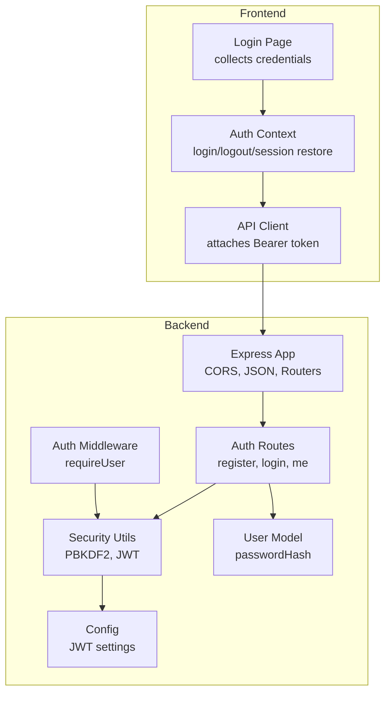
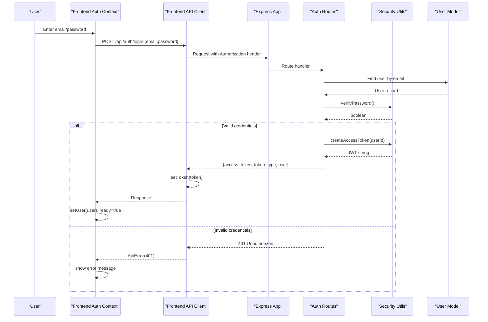
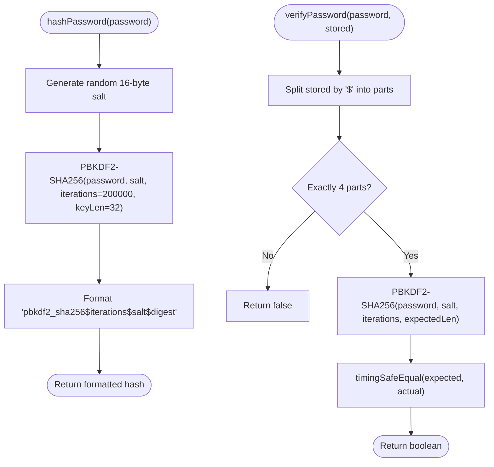
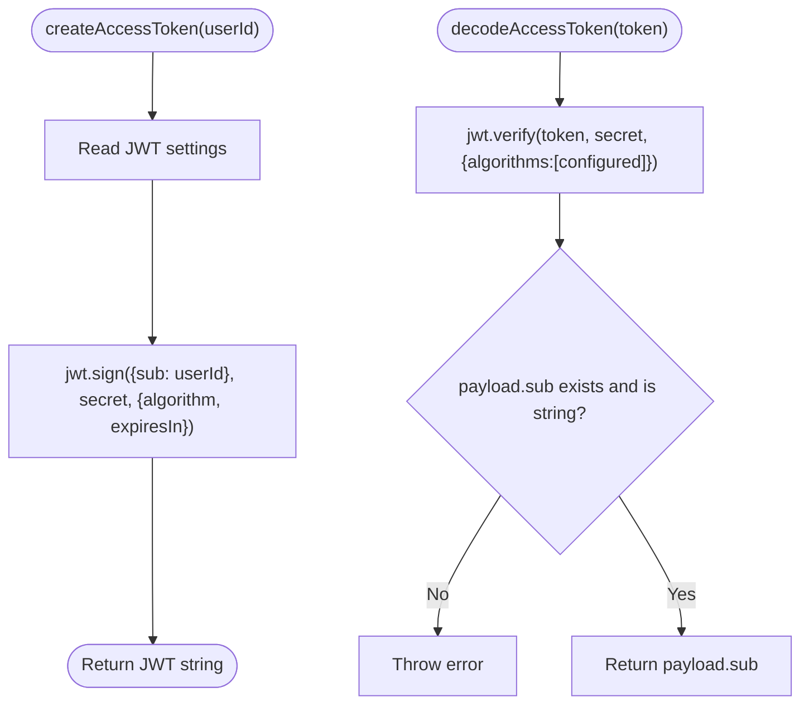
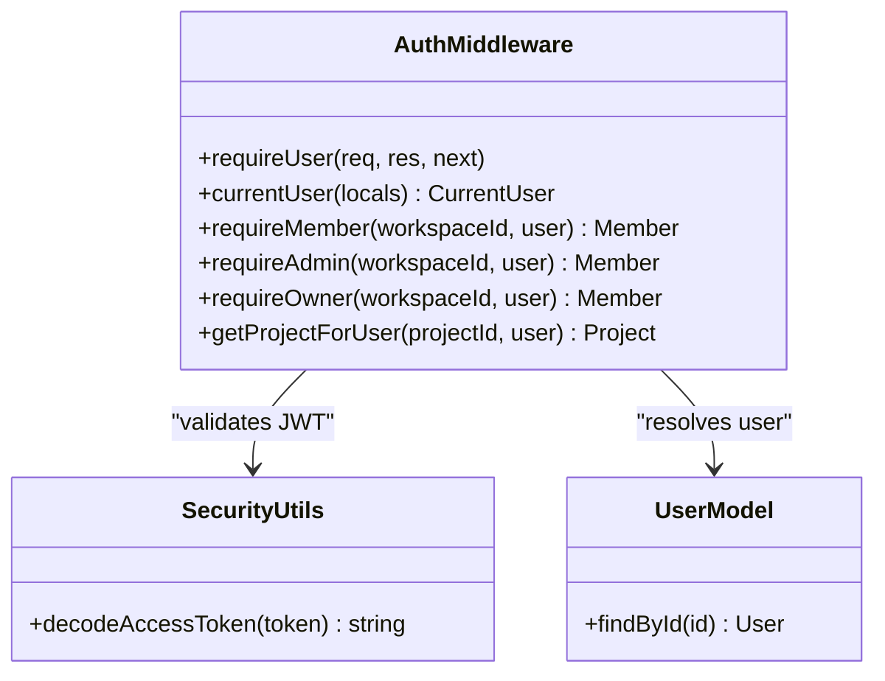
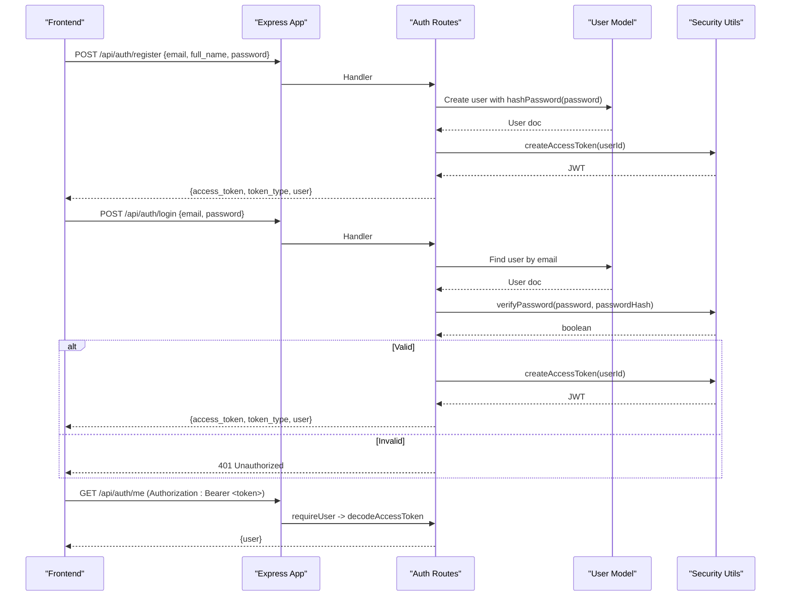
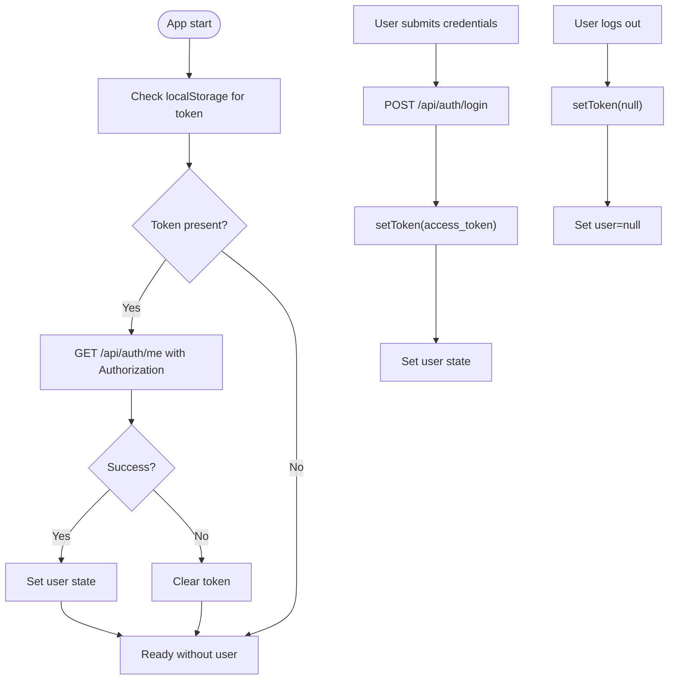
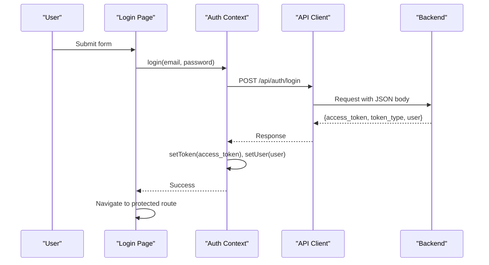
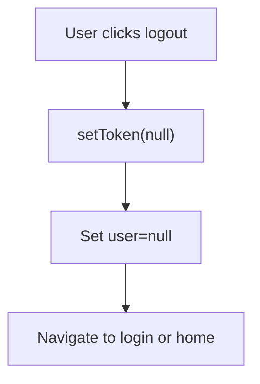
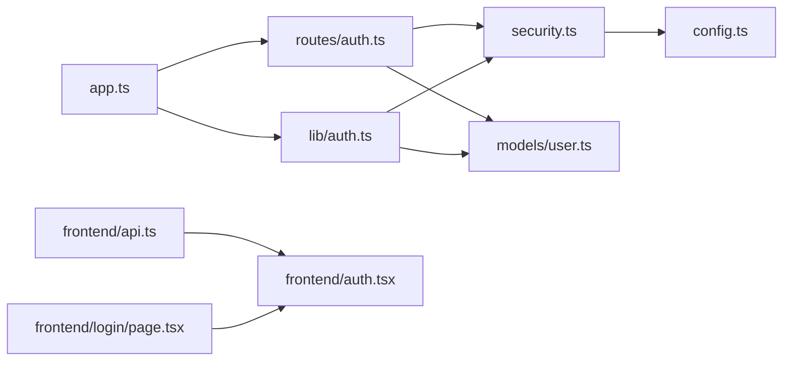

# Authentication System

<cite>
**Referenced Files in This Document**
- [auth.ts](file://phoenix-backend/src/lib/auth.ts)
- [security.ts](file://phoenix-backend/src/lib/security.ts)
- [http.ts](file://phoenix-backend/src/lib/http.ts)
- [config.ts](file://phoenix-backend/src/config.ts)
- [app.ts](file://phoenix-backend/src/app.ts)
- [auth.ts](file://phoenix-backend/src/routes/auth.ts)
- [user.ts](file://phoenix-backend/src/models/user.ts)
- [api.ts](file://phoenix-frontend/src/lib/api.ts)
- [auth.tsx](file://phoenix-frontend/src/lib/auth.tsx)
- [page.tsx](file://phoenix-frontend/src/app/login/page.tsx)
</cite>

## Table of Contents
1. [Introduction](#introduction)
2. [Project Structure](#project-structure)
3. [Core Components](#core-components)
4. [Architecture Overview](#architecture-overview)
5. [Detailed Component Analysis](#detailed-component-analysis)
6. [Dependency Analysis](#dependency-analysis)
7. [Performance Considerations](#performance-considerations)
8. [Troubleshooting Guide](#troubleshooting-guide)
9. [Conclusion](#conclusion)

## Introduction
This document explains the authentication system implemented across the Phoenix backend and frontend. It covers JWT token generation, validation, and lifecycle management; password hashing with PBKDF2 including salt handling and verification; session storage strategies on both client and server; route protection via middleware; and practical flows for login, logout, and token refresh considerations. Security aspects such as token expiration, secure storage practices, and protections against common attacks are also addressed.

## Project Structure
The authentication implementation spans two main areas:
- Backend (Express + TypeScript):
  - Route handlers for registration, login, and current user retrieval
  - Middleware to validate bearer tokens and attach the current user to requests
  - Security utilities for password hashing and JWT operations
  - Configuration for JWT algorithm, secret, and expiration
  - Application bootstrap wiring CORS, body parsing, routers, and error handling
- Frontend (Next.js + React):
  - API client that attaches Authorization headers and stores tokens
  - Auth context provider managing login state, session restoration, and logout
  - Login page UI that triggers authentication and handles errors

**Diagram sources**
- [app.ts:11-31](file://phoenix-backend/src/app.ts#L11-L31)
- [auth.ts](file://phoenix-backend/src/routes/auth.ts)
- [auth.ts](file://phoenix-backend/src/lib/auth.ts)
- [security.ts](file://phoenix-backend/src/lib/security.ts)
- [config.ts](file://phoenix-backend/src/config.ts)
- [user.ts](file://phoenix-backend/src/models/user.ts)
- [api.ts](file://phoenix-frontend/src/lib/api.ts)
- [auth.tsx](file://phoenix-frontend/src/lib/auth.tsx)
- [page.tsx](file://phoenix-frontend/src/app/login/page.tsx)

**Section sources**
- [app.ts:11-31](file://phoenix-backend/src/app.ts#L11-L31)
- [auth.ts](file://phoenix-backend/src/routes/auth.ts)
- [auth.ts](file://phoenix-backend/src/lib/auth.ts)
- [security.ts](file://phoenix-backend/src/lib/security.ts)
- [config.ts](file://phoenix-backend/src/config.ts)
- [user.ts](file://phoenix-backend/src/models/user.ts)
- [api.ts](file://phoenix-frontend/src/lib/api.ts)
- [auth.tsx](file://phoenix-frontend/src/lib/auth.tsx)
- [page.tsx](file://phoenix-frontend/src/app/login/page.tsx)

## Core Components
- Password hashing and verification using PBKDF2 with random salt and timing-safe comparison
- JWT access token creation and decoding with configurable algorithm and expiration
- Express middleware to require a valid bearer token and attach the current user
- Auth routes for registration, login, and fetching the current user
- Frontend API client that injects Authorization headers and persists tokens
- Frontend auth context that manages login, logout, and session restoration

Key responsibilities:
- security.ts: PBKDF2 hashing/verification and JWT sign/verify
- config.ts: JWT algorithm, secret, and expiration configuration
- routes/auth.ts: Registration, login, and /me endpoints
- lib/auth.ts: requireUser middleware and helpers for current user
- app.ts: CORS, body parser, router mounting, and error handling
- frontend api.ts: Token persistence and Authorization header injection
- frontend auth.tsx: Session state, login flow, and logout behavior

**Section sources**
- [security.ts:1-38](file://phoenix-backend/src/lib/security.ts#L1-L38)
- [config.ts:1-41](file://phoenix-backend/src/config.ts#L1-L41)
- [auth.ts](file://phoenix-backend/src/routes/auth.ts)
- [auth.ts](file://phoenix-backend/src/lib/auth.ts)
- [app.ts:11-31](file://phoenix-backend/src/app.ts#L11-L31)
- [api.ts:1-86](file://phoenix-frontend/src/lib/api.ts#L1-L86)
- [auth.tsx:1-62](file://phoenix-frontend/src/lib/auth.tsx#L1-L62)

## Architecture Overview
The authentication architecture uses short-lived JWT access tokens sent via HTTP Authorization headers. The frontend stores the token in local storage and includes it on every request. The backend validates the token, resolves the user, and attaches it to the request for downstream handlers.

**Diagram sources**
- [auth.tsx:38-45](file://phoenix-frontend/src/lib/auth.tsx#L38-L45)
- [api.ts:33-72](file://phoenix-frontend/src/lib/api.ts#L33-L72)
- [auth.ts](file://phoenix-backend/src/routes/auth.ts)
- [security.ts:13-21](file://phoenix-backend/src/lib/security.ts#L13-L21)
- [security.ts:23-29](file://phoenix-backend/src/lib/security.ts#L23-L29)
- [user.ts:1-20](file://phoenix-backend/src/models/user.ts#L1-L20)

## Detailed Component Analysis

### Password Hashing and Verification (PBKDF2)
- Hashing:
  - Generates a random 16-byte salt
  - Derives a 32-byte digest using PBKDF2-SHA256 with a fixed iteration count
  - Stores a composite string containing algorithm, iterations, salt, and digest
- Verification:
  - Parses the stored format
  - Recomputes the digest with the same parameters
  - Uses timing-safe comparison to prevent timing attacks

**Diagram sources**
- [security.ts:7-21](file://phoenix-backend/src/lib/security.ts#L7-L21)

**Section sources**
- [security.ts:1-21](file://phoenix-backend/src/lib/security.ts#L1-L21)

### JWT Token Generation and Validation
- Creation:
  - Signs a payload containing only the user ID (sub)
  - Uses configured algorithm and secret
  - Sets expiration based on minutes from configuration
- Decoding/Validation:
  - Verifies signature and algorithm strictly
  - Ensures payload contains a valid sub field
  - Returns the user ID for further lookup

**Diagram sources**
- [security.ts:23-37](file://phoenix-backend/src/lib/security.ts#L23-L37)
- [config.ts:4-14](file://phoenix-backend/src/config.ts#L4-L14)

**Section sources**
- [security.ts:23-37](file://phoenix-backend/src/lib/security.ts#L23-L37)
- [config.ts:4-14](file://phoenix-backend/src/config.ts#L4-L14)

### Authentication Middleware and Route Protection
- requireUser:
  - Extracts the Authorization header and expects a Bearer scheme
  - Decodes and verifies the JWT
  - Looks up the user by ID and ensures existence
  - Attaches the user object to res.locals for downstream handlers
- Role-based helpers:
  - requireMember, requireAdmin, requireOwner enforce workspace membership and roles
  - getProjectForUser enforces project ownership checks through workspace membership

**Diagram sources**
- [auth.ts](file://phoenix-backend/src/lib/auth.ts)
- [security.ts:31-37](file://phoenix-backend/src/lib/security.ts#L31-L37)
- [user.ts:1-20](file://phoenix-backend/src/models/user.ts#L1-L20)

**Section sources**
- [auth.ts](file://phoenix-backend/src/lib/auth.ts)

### Auth Routes: Registration, Login, and Current User
- Registration:
  - Validates input schema
  - Creates user with hashed password
  - Returns access token, token type, and serialized user
- Login:
  - Validates input schema
  - Finds user by email and verifies password
  - Returns access token, token type, and serialized user
- Current User:
  - Protected by requireUser middleware
  - Returns serialized current user

**Diagram sources**
- [auth.ts](file://phoenix-backend/src/routes/auth.ts)
- [security.ts:7-21](file://phoenix-backend/src/lib/security.ts#L7-L21)
- [security.ts:23-37](file://phoenix-backend/src/lib/security.ts#L23-L37)
- [user.ts:1-20](file://phoenix-backend/src/models/user.ts#L1-L20)

**Section sources**
- [auth.ts](file://phoenix-backend/src/routes/auth.ts)

### Frontend Session Management and Token Storage
- Token storage:
  - Stored in localStorage under a dedicated key
  - A module-level variable caches the token at load time for immediate use
- API client:
  - Automatically attaches Authorization: Bearer <token> when present
  - Centralizes error mapping and network failure handling
- Auth context:
  - On mount, restores session by calling /api/auth/me if a token exists
  - On successful login, sets token and user state
  - On logout, clears token and user state

**Diagram sources**
- [api.ts:1-23](file://phoenix-frontend/src/lib/api.ts#L1-L23)
- [api.ts:33-72](file://phoenix-frontend/src/lib/api.ts#L33-L72)
- [auth.tsx:16-50](file://phoenix-frontend/src/lib/auth.tsx#L16-L50)

**Section sources**
- [api.ts:1-86](file://phoenix-frontend/src/lib/api.ts#L1-L86)
- [auth.tsx:16-50](file://phoenix-frontend/src/lib/auth.tsx#L16-L50)

### Login Flow Example
- User enters email and password on the login page
- Frontend calls the login endpoint via the API client
- Backend verifies credentials, issues a JWT, and returns user data
- Frontend stores the token and updates application state
- Subsequent requests include the Authorization header automatically

**Diagram sources**
- [page.tsx:16-28](file://phoenix-frontend/src/app/login/page.tsx#L16-L28)
- [auth.tsx:38-45](file://phoenix-frontend/src/lib/auth.tsx#L38-L45)
- [api.ts:33-72](file://phoenix-frontend/src/lib/api.ts#L33-L72)
- [auth.ts](file://phoenix-backend/src/routes/auth.ts)

**Section sources**
- [page.tsx:16-28](file://phoenix-frontend/src/app/login/page.tsx#L16-L28)
- [auth.tsx:38-45](file://phoenix-frontend/src/lib/auth.tsx#L38-L45)
- [api.ts:33-72](file://phoenix-frontend/src/lib/api.ts#L33-L72)
- [auth.ts](file://phoenix-backend/src/routes/auth.ts)

### Logout Procedure
- Frontend clears the stored token and user state
- No explicit server-side logout endpoint is required because tokens are stateless and will expire per configuration

**Diagram sources**
- [auth.tsx:47-50](file://phoenix-frontend/src/lib/auth.tsx#L47-L50)
- [api.ts:20-23](file://phoenix-frontend/src/lib/api.ts#L20-L23)

**Section sources**
- [auth.tsx:47-50](file://phoenix-frontend/src/lib/auth.tsx#L47-L50)
- [api.ts:20-23](file://phoenix-frontend/src/lib/api.ts#L20-L23)

### Token Refresh Mechanism
- Current implementation does not include a refresh token flow
- Access tokens are short-lived based on configuration
- To implement refresh:
  - Introduce a separate refresh token (e.g., httpOnly cookie or secure storage)
  - Add a /api/auth/refresh endpoint that exchanges a valid refresh token for a new access token
  - Update the frontend API client to retry failed requests after refreshing the access token

[No sources needed since this section provides general guidance]

## Dependency Analysis
The authentication subsystem has clear boundaries and minimal coupling:
- Routes depend on security utilities and models
- Middleware depends on security utilities and models
- Frontend API client depends on environment variables and local storage
- Frontend auth context depends on the API client

**Diagram sources**
- [security.ts:1-38](file://phoenix-backend/src/lib/security.ts#L1-L38)
- [config.ts:1-41](file://phoenix-backend/src/config.ts#L1-L41)
- [auth.ts](file://phoenix-backend/src/routes/auth.ts)
- [user.ts:1-20](file://phoenix-backend/src/models/user.ts#L1-L20)
- [auth.ts](file://phoenix-backend/src/lib/auth.ts)
- [app.ts:11-31](file://phoenix-backend/src/app.ts#L11-L31)
- [api.ts:1-86](file://phoenix-frontend/src/lib/api.ts#L1-L86)
- [auth.tsx:1-62](file://phoenix-frontend/src/lib/auth.tsx#L1-L62)
- [page.tsx:1-54](file://phoenix-frontend/src/app/login/page.tsx#L1-L54)

**Section sources**
- [security.ts:1-38](file://phoenix-backend/src/lib/security.ts#L1-L38)
- [config.ts:1-41](file://phoenix-backend/src/config.ts#L1-L41)
- [auth.ts](file://phoenix-backend/src/routes/auth.ts)
- [user.ts:1-20](file://phoenix-backend/src/models/user.ts#L1-L20)
- [auth.ts](file://phoenix-backend/src/lib/auth.ts)
- [app.ts:11-31](file://phoenix-backend/src/app.ts#L11-L31)
- [api.ts:1-86](file://phoenix-frontend/src/lib/api.ts#L1-L86)
- [auth.tsx:1-62](file://phoenix-frontend/src/lib/auth.tsx#L1-L62)
- [page.tsx:1-54](file://phoenix-frontend/src/app/login/page.tsx#L1-L54)

## Performance Considerations
- PBKDF2 iterations:
  - The iteration count is fixed at a high value to resist brute-force attacks
  - Consider tuning iterations based on deployment hardware while maintaining security targets
- JWT size and overhead:
  - Tokens contain only the user ID, minimizing payload size
  - Expiration is configured in minutes to balance security and usability
- Database lookups:
  - Login and registration perform targeted queries; ensure indexes exist on email
- Frontend caching:
  - Optional GET caching is available in the API client; use cautiously for sensitive data

[No sources needed since this section provides general guidance]

## Troubleshooting Guide
Common issues and resolutions:
- 401 Unauthorized during login:
  - Verify credentials and ensure the user exists
  - Confirm the backend’s password hashing matches the stored format
- 401 on protected routes:
  - Ensure the Authorization header is present and correctly formatted as Bearer <token>
  - Check token expiration and re-authenticate if expired
- CORS errors:
  - Verify CORS_ORIGINS includes the frontend origin
  - Ensure credentials are allowed if cookies are used elsewhere
- Duplicate email registration:
  - The backend maps duplicate key errors to 409 Conflict

Operational notes:
- Error responses are standardized with a detail field
- Network failures return a specific status code and user-friendly message

**Section sources**
- [http.ts:42-80](file://phoenix-backend/src/lib/http.ts#L42-L80)
- [api.ts:58-85](file://phoenix-frontend/src/lib/api.ts#L58-L85)
- [auth.ts](file://phoenix-backend/src/routes/auth.ts)

## Conclusion
The authentication system implements a robust, stateless approach using short-lived JWT access tokens and strong password hashing with PBKDF2. The frontend manages sessions via local storage and automatically attaches tokens to requests. The backend validates tokens and enforces authorization through middleware. While there is no refresh token flow currently, the design supports adding one. Security best practices are followed, including timing-safe comparisons, strict algorithm enforcement, and controlled CORS. For production hardening, consider adding CSRF protections where applicable, securing tokens with httpOnly cookies for refresh flows, and implementing rate limiting and account lockout policies.