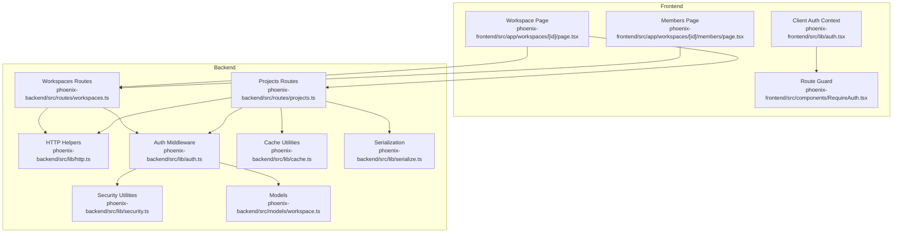
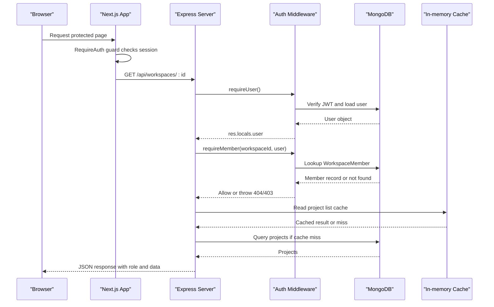
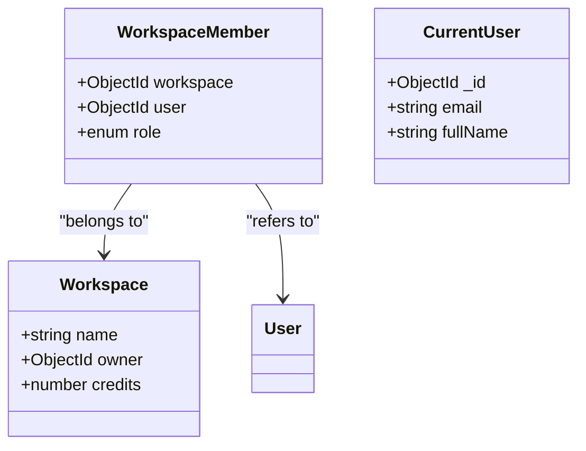
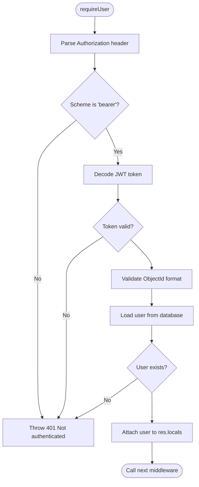
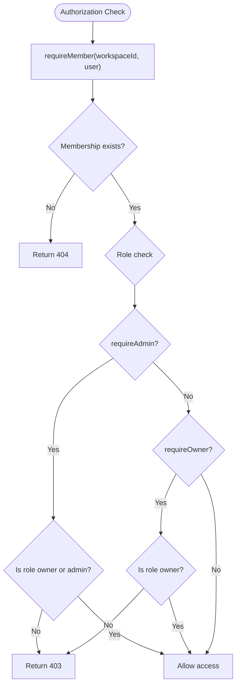
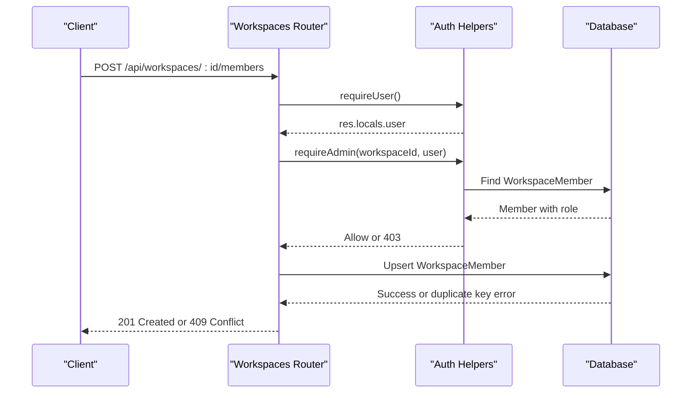
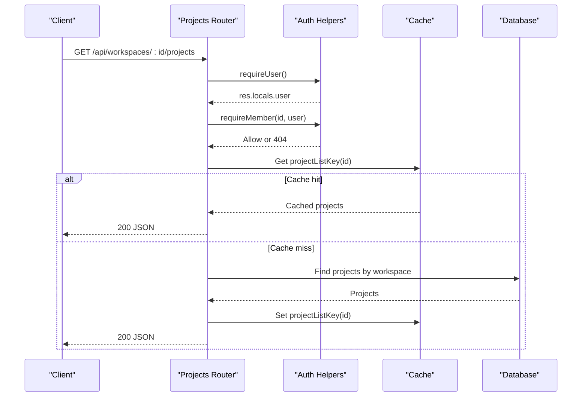
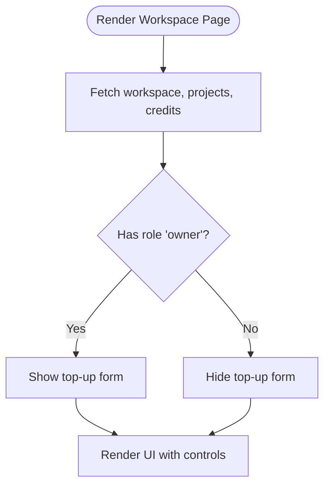
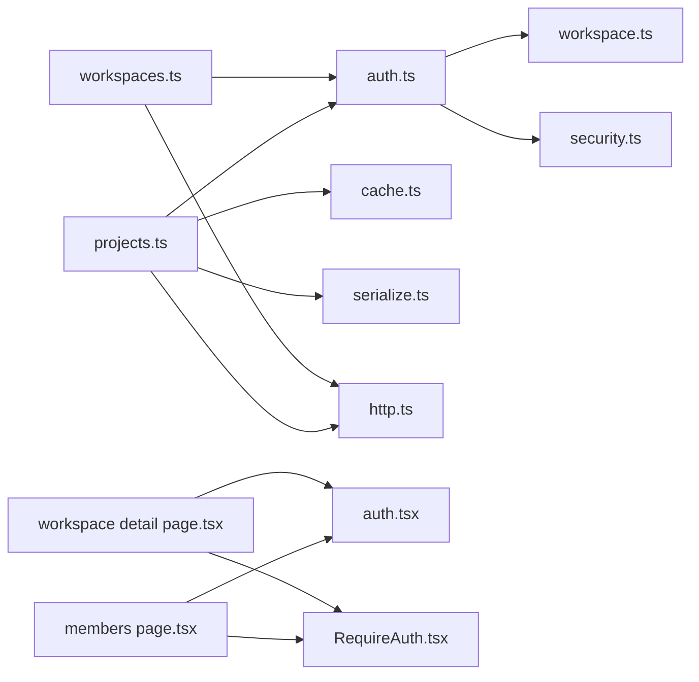

# Authorization System

<cite>
**Referenced Files in This Document**
- [auth.ts](file://phoenix-backend/src/lib/auth.ts)
- [workspace.ts](file://phoenix-backend/src/models/workspace.ts)
- [workspaces.ts](file://phoenix-backend/src/routes/workspaces.ts)
- [projects.ts](file://phoenix-backend/src/routes/projects.ts)
- [http.ts](file://phoenix-backend/src/lib/http.ts)
- [security.ts](file://phoenix-backend/src/lib/security.ts)
- [index.ts](file://phoenix-backend/src/models/index.ts)
- [cache.ts](file://phoenix-backend/src/lib/cache.ts)
- [serialize.ts](file://phoenix-backend/src/lib/serialize.ts)
- [auth.tsx](file://phoenix-frontend/src/lib/auth.tsx)
- [RequireAuth.tsx](file://phoenix-frontend/src/components/RequireAuth.tsx)
- [members page.tsx](file://phoenix-frontend/src/app/workspaces/[id]/members/page.tsx)
- [workspace detail page.tsx](file://phoenix-frontend/src/app/workspaces/[id]/page.tsx)
</cite>

## Table of Contents
1. [Introduction](#introduction)
2. [Project Structure](#project-structure)
3. [Core Components](#core-components)
4. [Architecture Overview](#architecture-overview)
5. [Detailed Component Analysis](#detailed-component-analysis)
6. [Dependency Analysis](#dependency-analysis)
7. [Performance Considerations](#performance-considerations)
8. [Troubleshooting Guide](#troubleshooting-guide)
9. [Conclusion](#conclusion)

## Introduction
This document explains the role-based authorization system used by Phoenix across workspaces, projects, and tasks. It covers the three-tier permission model (owner, admin, member), how roles are assigned and enforced on the server, how middleware protects routes, how workspace membership is checked for data access, and how the frontend renders permissions. It also documents edge cases such as preventing unauthorized role escalation, caching strategies around authorization checks, and where audit logging should be applied to authorization decisions.

## Project Structure
The authorization logic spans both backend and frontend:

- Backend
  - Role definitions and workspace membership live in the workspace model.
  - Authentication and authorization helpers enforce user identity and role checks.
  - Route handlers use these helpers to protect endpoints.
  - HTTP utilities normalize errors and parse inputs safely.
  - Security utilities handle password hashing and JWT token operations.
  - Cache utilities provide read-through caching for project lists.
  - Serialization helpers convert database objects into API responses.

- Frontend
  - Client-side authentication context manages login state and tokens.
  - A route guard ensures unauthenticated users are redirected.
  - Workspace and members pages call protected APIs and render UI based on the returned role.

**Diagram sources**
- [auth.tsx:16-54](file://phoenix-frontend/src/lib/auth.tsx#L16-L54)
- [RequireAuth.tsx:7-16](file://phoenix-frontend/src/components/RequireAuth.tsx#L7-L16)
- [workspace detail page.tsx:52-104](file://phoenix-frontend/src/app/workspaces/[id]/page.tsx#L52-L104)
- [members page.tsx:10-44](file://phoenix-frontend/src/app/workspaces/[id]/members/page.tsx#L10-L44)
- [auth.ts:8-57](file://phoenix-backend/src/lib/auth.ts#L8-L57)
- [workspace.ts:3-21](file://phoenix-backend/src/models/workspace.ts#L3-L21)
- [workspaces.ts:8-127](file://phoenix-backend/src/routes/workspaces.ts#L8-L127)
- [projects.ts:11-57](file://phoenix-backend/src/routes/projects.ts#L11-L57)
- [security.ts:23-37](file://phoenix-backend/src/lib/security.ts#L23-L37)
- [http.ts:5-40](file://phoenix-backend/src/lib/http.ts#L5-L40)
- [cache.ts](file://phoenix-backend/src/lib/cache.ts)
- [serialize.ts](file://phoenix-backend/src/lib/serialize.ts)

**Section sources**
- [auth.ts:8-57](file://phoenix-backend/src/lib/auth.ts#L8-L57)
- [workspace.ts:3-21](file://phoenix-backend/src/models/workspace.ts#L3-L21)
- [workspaces.ts:8-127](file://phoenix-backend/src/routes/workspaces.ts#L8-L127)
- [projects.ts:11-57](file://phoenix-backend/src/routes/projects.ts#L11-L57)
- [auth.tsx:16-54](file://phoenix-frontend/src/lib/auth.tsx#L16-L54)
- [RequireAuth.tsx:7-16](file://phoenix-frontend/src/components/RequireAuth.tsx#L7-L16)
- [workspace detail page.tsx:52-104](file://phoenix-frontend/src/app/workspaces/[id]/page.tsx#L52-L104)
- [members page.tsx:10-44](file://phoenix-frontend/src/app/workspaces/[id]/members/page.tsx#L10-L44)

## Core Components
- Three-tier role model
  - Roles: owner, admin, member.
  - Defined as a typed enum in the workspace model.
  - Default role for new memberships is member.

- Workspace membership
  - Each user-role pair per workspace is unique via a composite index.
  - Membership lookup returns the member record with its role.

- Authentication middleware
  - Extracts and validates a Bearer JWT.
  - Decodes the token to obtain the user ID.
  - Loads the user from the database and attaches it to the request.

- Authorization helpers
  - requireMember: verifies that the current user belongs to the workspace.
  - requireAdmin: requires owner or admin role.
  - requireOwner: requires owner role.
  - getProjectForUser: loads a project and enforces workspace membership.

- Route protection
  - Workspaces and projects routers apply requireUser globally or per route.
  - Sensitive endpoints additionally call requireAdmin or requireOwner.

- Frontend auth guard
  - Requires an authenticated session before rendering protected pages.
  - Redirects unauthenticated users to the login page.

**Section sources**
- [workspace.ts:3-21](file://phoenix-backend/src/models/workspace.ts#L3-L21)
- [auth.ts:8-57](file://phoenix-backend/src/lib/auth.ts#L8-L57)
- [workspaces.ts:8-127](file://phoenix-backend/src/routes/workspaces.ts#L8-L127)
- [projects.ts:11-57](file://phoenix-backend/src/routes/projects.ts#L11-L57)
- [RequireAuth.tsx:7-16](file://phoenix-frontend/src/components/RequireAuth.tsx#L7-L16)

## Architecture Overview
The authorization flow combines client-side session management with server-side JWT validation and role checks.

**Diagram sources**
- [RequireAuth.tsx:7-16](file://phoenix-frontend/src/components/RequireAuth.tsx#L7-L16)
- [auth.ts:8-57](file://phoenix-backend/src/lib/auth.ts#L8-L57)
- [projects.ts:11-30](file://phoenix-backend/src/routes/projects.ts#L11-L30)
- [cache.ts](file://phoenix-backend/src/lib/cache.ts)

## Detailed Component Analysis

### Permission Model and Data Structures
- Roles
  - The workspace model defines the allowed roles: owner, admin, member.
  - New memberships default to member unless explicitly set.

- WorkspaceMember
  - Stores workspace, user, and role.
  - Enforces uniqueness per workspace-user pair through a unique index.

- CurrentUser
  - Lightweight representation attached to Express requests after authentication.

**Diagram sources**
- [workspace.ts:3-21](file://phoenix-backend/src/models/workspace.ts#L3-L21)
- [auth.ts:6-6](file://phoenix-backend/src/lib/auth.ts#L6-L6)

**Section sources**
- [workspace.ts:3-21](file://phoenix-backend/src/models/workspace.ts#L3-L21)
- [index.ts:18-26](file://phoenix-backend/src/models/index.ts#L18-L26)

### Authentication Middleware
- Token extraction and validation
  - Expects Authorization header with scheme bearer.
  - Decodes JWT using configured algorithm and secret.
  - Rejects invalid or expired tokens with 401.

- User resolution
  - Validates the decoded user ID format.
  - Loads user from database; rejects if user does not exist.
  - Attaches user to res.locals for downstream handlers.

**Diagram sources**
- [auth.ts:8-23](file://phoenix-backend/src/lib/auth.ts#L8-L23)
- [security.ts:23-37](file://phoenix-backend/src/lib/security.ts#L23-L37)

**Section sources**
- [auth.ts:8-23](file://phoenix-backend/src/lib/auth.ts#L8-L23)
- [security.ts:23-37](file://phoenix-backend/src/lib/security.ts#L23-L37)

### Authorization Helpers and Role Enforcement
- requireMember
  - Checks that the user has a membership record for the requested workspace.
  - Returns 404 instead of 403 to avoid leaking workspace existence.

- requireAdmin
  - Requires the member’s role to be owner or admin.
  - Throws 403 otherwise.

- requireOwner
  - Requires the member’s role to be owner.
  - Throws 403 otherwise.

- getProjectForUser
  - Loads a project and then enforces workspace membership.

**Diagram sources**
- [auth.ts:29-57](file://phoenix-backend/src/lib/auth.ts#L29-L57)

**Section sources**
- [auth.ts:29-57](file://phoenix-backend/src/lib/auth.ts#L29-L57)

### Workspace Route Handlers and Permission Inheritance
- List workspaces
  - Requires authentication.
  - Returns all workspaces the user belongs to, including their role.

- Create workspace
  - Requires authentication.
  - Creates workspace and sets creator as owner.
  - Records welcome credits in the ledger.

- Get workspace details
  - Requires authentication and workspace membership.
  - Returns workspace metadata along with the caller’s role.

- List members
  - Requires authentication and workspace membership.
  - Returns populated member records with user details.

- Add member
  - Requires authentication and admin role.
  - Prevents assigning owner role to another user.
  - Handles duplicate membership conflicts.

- Get workspace credits
  - Requires authentication and workspace membership.
  - Returns only the credits balance.

- Top up credits
  - Requires authentication and owner role.
  - Increments workspace credits atomically and records a ledger entry.

**Diagram sources**
- [workspaces.ts:77-101](file://phoenix-backend/src/routes/workspaces.ts#L77-L101)
- [auth.ts:36-42](file://phoenix-backend/src/lib/auth.ts#L36-L42)

**Section sources**
- [workspaces.ts:18-127](file://phoenix-backend/src/routes/workspaces.ts#L18-L127)

### Project Route Handlers and Data Access Patterns
- List projects in a workspace
  - Requires authentication and workspace membership.
  - Uses a read-through cache keyed by workspace ID.
  - If cached, returns immediately; otherwise queries database and caches result.

- Create project in a workspace
  - Requires authentication and workspace membership.
  - Invalidates the project list cache after creation.

- Get single project
  - Requires authentication.
  - Uses getProjectForUser to ensure the project belongs to a workspace the user can access.

**Diagram sources**
- [projects.ts:11-30](file://phoenix-backend/src/routes/projects.ts#L11-L30)
- [cache.ts](file://phoenix-backend/src/lib/cache.ts)

**Section sources**
- [projects.ts:11-57](file://phoenix-backend/src/routes/projects.ts#L11-L57)

### Frontend Permission Rendering
- RequireAuth guard
  - Ensures the user is authenticated before rendering protected content.
  - Redirects to login when no session is present.

- Workspace detail page
  - Displays workspace role badge.
  - Conditionally shows the top-up form only when the user’s role is owner.

- Members page
  - Calls workspace and members endpoints.
  - Renders member list with role badges.
  - Allows adding members with member or admin roles.

**Diagram sources**
- [workspace detail page.tsx:52-104](file://phoenix-frontend/src/app/workspaces/[id]/page.tsx#L52-L104)
- [RequireAuth.tsx:7-16](file://phoenix-frontend/src/components/RequireAuth.tsx#L7-L16)

**Section sources**
- [workspace detail page.tsx:52-104](file://phoenix-frontend/src/app/workspaces/[id]/page.tsx#L52-L104)
- [members page.tsx:10-44](file://phoenix-frontend/src/app/workspaces/[id]/members/page.tsx#L10-L44)
- [RequireAuth.tsx:7-16](file://phoenix-frontend/src/components/RequireAuth.tsx#L7-L16)

## Dependency Analysis
- Backend dependencies
  - Routes depend on auth helpers for identity and role enforcement.
  - Auth helpers depend on security utilities for JWT decoding and models for user and membership lookups.
  - Projects router depends on cache utilities for read-through caching and serialization for output formatting.
  - HTTP utilities centralize error handling and input parsing.

- Frontend dependencies
  - Pages depend on the client auth context for session state.
  - RequireAuth depends on Next.js navigation for redirects.

**Diagram sources**
- [workspaces.ts:1-6](file://phoenix-backend/src/routes/workspaces.ts#L1-L6)
- [projects.ts:1-7](file://phoenix-backend/src/routes/projects.ts#L1-L7)
- [auth.ts:1-4](file://phoenix-backend/src/lib/auth.ts#L1-L4)
- [workspace.ts:1-21](file://phoenix-backend/src/models/workspace.ts#L1-L21)
- [security.ts:1-3](file://phoenix-backend/src/lib/security.ts#L1-L3)
- [cache.ts](file://phoenix-backend/src/lib/cache.ts)
- [serialize.ts](file://phoenix-backend/src/lib/serialize.ts)
- [http.ts:1-3](file://phoenix-backend/src/lib/http.ts#L1-L3)
- [auth.tsx:1-5](file://phoenix-frontend/src/lib/auth.tsx#L1-L5)
- [RequireAuth.tsx:1-5](file://phoenix-frontend/src/components/RequireAuth.tsx#L1-L5)

**Section sources**
- [workspaces.ts:1-6](file://phoenix-backend/src/routes/workspaces.ts#L1-L6)
- [projects.ts:1-7](file://phoenix-backend/src/routes/projects.ts#L1-L7)
- [auth.ts:1-4](file://phoenix-backend/src/lib/auth.ts#L1-L4)
- [workspace.ts:1-21](file://phoenix-backend/src/models/workspace.ts#L1-L21)
- [security.ts:1-3](file://phoenix-backend/src/lib/security.ts#L1-L3)
- [http.ts:1-3](file://phoenix-backend/src/lib/http.ts#L1-L3)
- [auth.tsx:1-5](file://phoenix-frontend/src/lib/auth.tsx#L1-L5)
- [RequireAuth.tsx:1-5](file://phoenix-frontend/src/components/RequireAuth.tsx#L1-L5)

## Performance Considerations
- Caching strategy
  - Project lists are cached per workspace to reduce database reads.
  - Cache keys are invalidated on project creation to maintain consistency.
  - Authorization is performed before reading from cache to prevent leaking data to unauthorized users.

- Database indexing
  - WorkspaceMember uses a unique index on workspace and user to enforce membership constraints efficiently.

- Input validation and safe parsing
  - Body parsing and ID parsing return consistent HTTP errors, reducing unexpected exceptions and improving reliability.

[No sources needed since this section provides general guidance]

## Troubleshooting Guide
- Common authorization errors
  - 401 Not authenticated: Missing or malformed Authorization header, invalid/expired JWT, or deleted user.
  - 404 Workspace not found: User is not a member of the workspace; intentionally used to avoid leaking workspace existence.
  - 403 Admin role required: User lacks owner or admin role for the workspace.
  - 403 Owner role required: User is not the workspace owner.
  - 409 Conflict: Attempting to add a user who is already a member.

- Error handling pipeline
  - HttpError instances map to specific status codes and messages.
  - Zod validation errors produce 422 responses.
  - Mongoose cast/validation errors are normalized to appropriate HTTP statuses.

- Audit logging recommendations
  - Log successful and failed authorization decisions at the middleware level.
  - Record actor user ID, target resource type and ID, requested role, and outcome.
  - Avoid logging sensitive payloads; include timestamps and correlation IDs.

**Section sources**
- [http.ts:5-80](file://phoenix-backend/src/lib/http.ts#L5-L80)
- [auth.ts:8-57](file://phoenix-backend/src/lib/auth.ts#L8-L57)
- [workspaces.ts:77-101](file://phoenix-backend/src/routes/workspaces.ts#L77-L101)

## Conclusion
Phoenix implements a clear three-tier role model centered on workspace membership. Authentication is enforced via JWT, and authorization is enforced through helper functions that check membership and role privileges. Route handlers consistently apply these checks before accessing data, and the frontend respects server-provided roles to conditionally render privileged UI. Caching improves performance while preserving authorization boundaries. To strengthen the system further, consider adding centralized audit logging for authorization decisions and expanding role checks to additional resources beyond workspaces and projects.