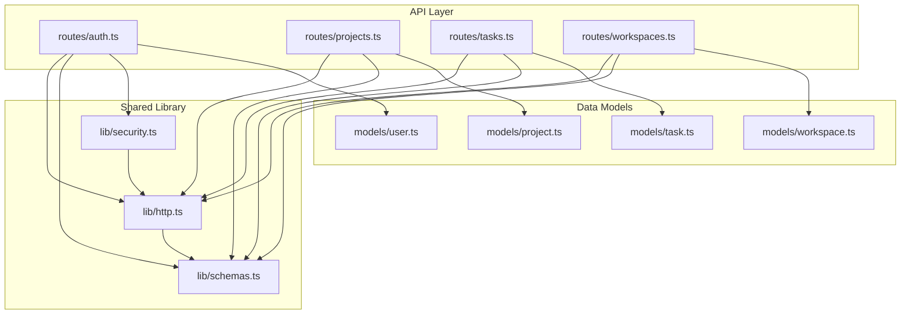
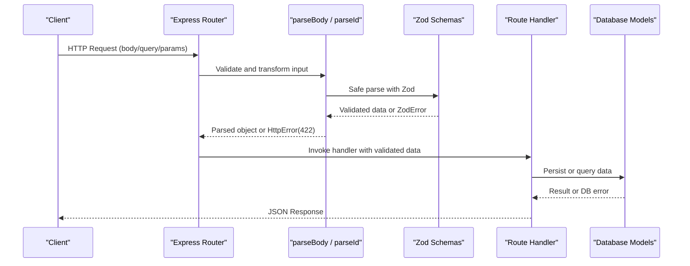
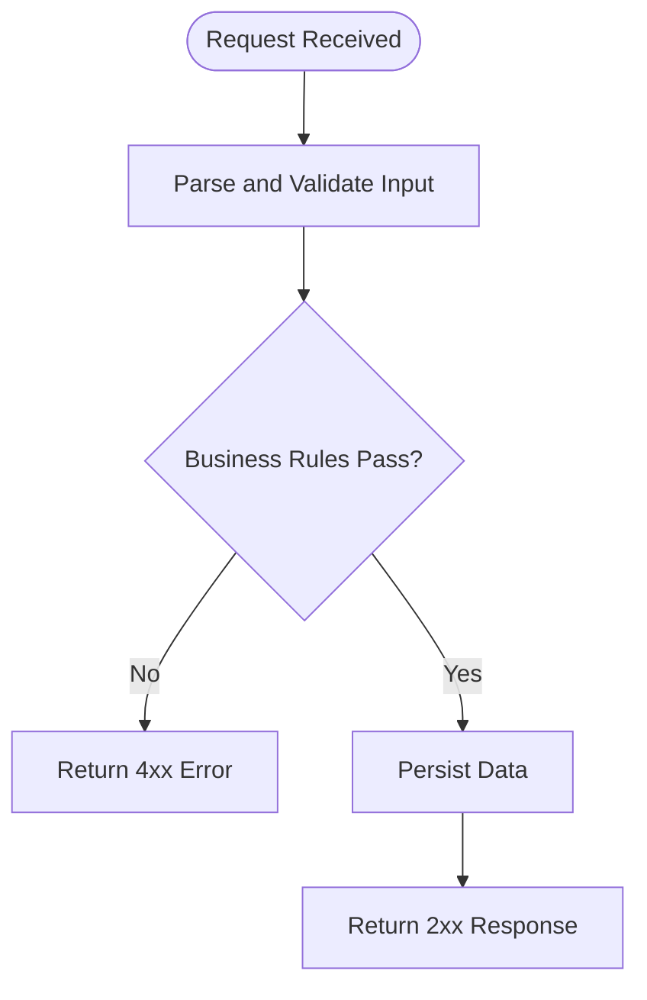
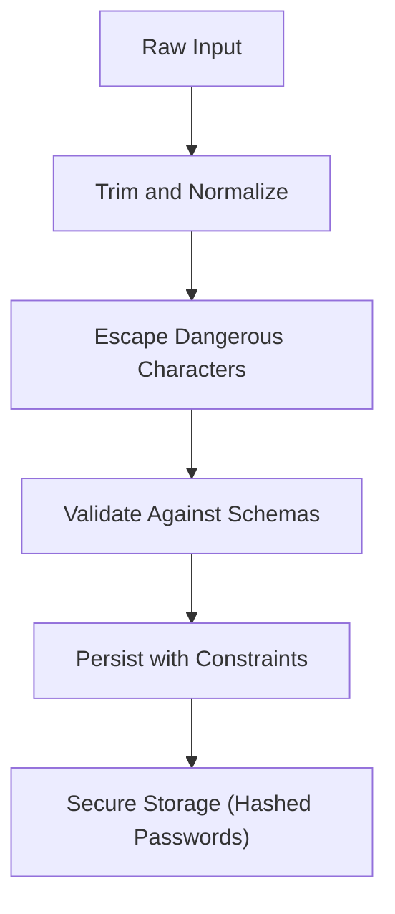
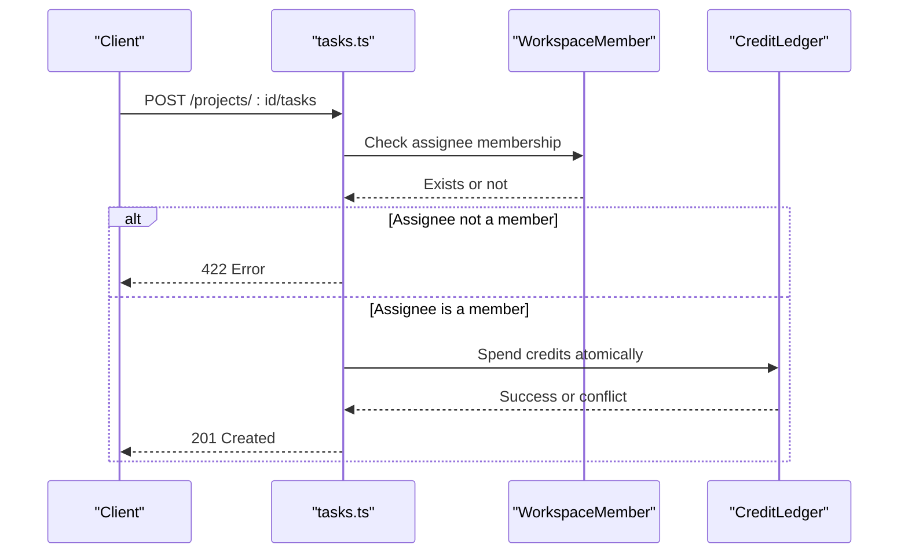
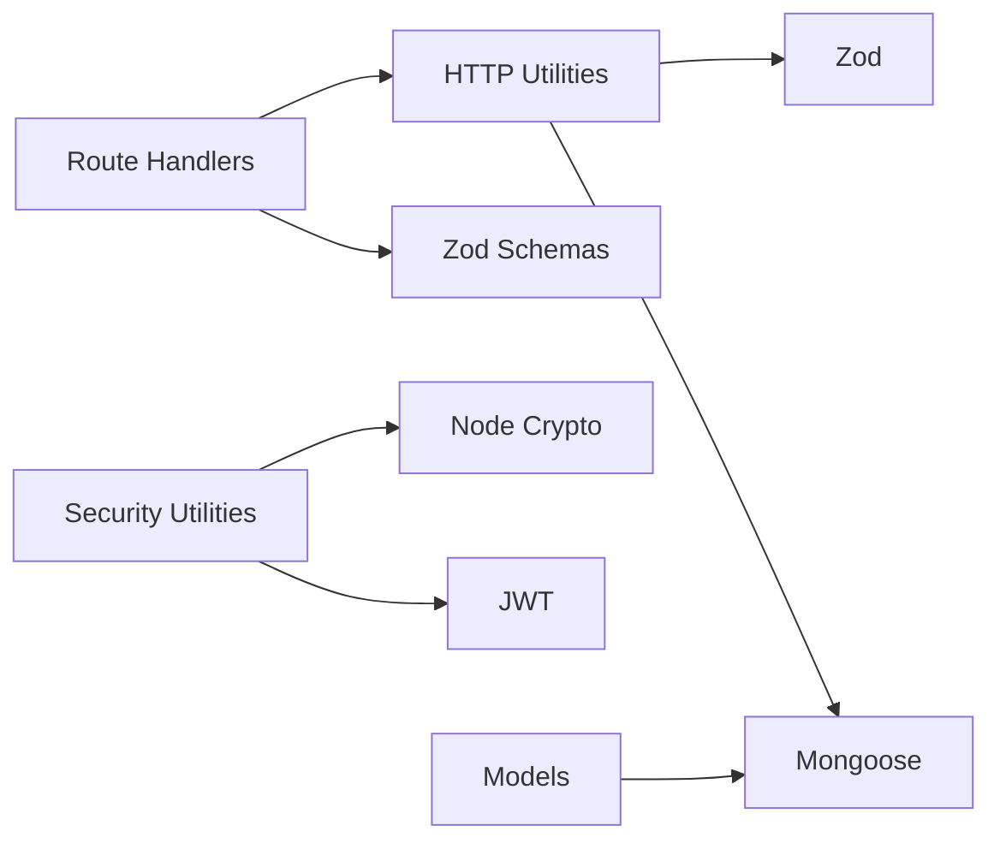

# Input Validation & Sanitization

<cite>
**Referenced Files in This Document**
- [schemas.ts](file://phoenix-backend/src/lib/schemas.ts)
- [http.ts](file://phoenix-backend/src/lib/http.ts)
- [security.ts](file://phoenix-backend/src/lib/security.ts)
- [auth.ts](file://phoenix-backend/src/routes/auth.ts)
- [projects.ts](file://phoenix-backend/src/routes/projects.ts)
- [tasks.ts](file://phoenix-backend/src/routes/tasks.ts)
- [workspaces.ts](file://phoenix-backend/src/routes/workspaces.ts)
- [user.ts](file://phoenix-backend/src/models/user.ts)
- [project.ts](file://phoenix-backend/src/models/project.ts)
- [task.ts](file://phoenix-backend/src/models/task.ts)
- [workspace.ts](file://phoenix-backend/src/models/workspace.ts)
</cite>

## Table of Contents
1. [Introduction](#introduction)
2. [Project Structure](#project-structure)
3. [Core Components](#core-components)
4. [Architecture Overview](#architecture-overview)
5. [Detailed Component Analysis](#detailed-component-analysis)
6. [Dependency Analysis](#dependency-analysis)
7. [Performance Considerations](#performance-considerations)
8. [Troubleshooting Guide](#troubleshooting-guide)
9. [Conclusion](#conclusion)

## Introduction
This document explains the input validation and sanitization mechanisms used across the backend API. It focuses on:
- Zod schema validation for request bodies, query parameters, and path parameters
- Custom validators that enforce business rules and data integrity
- Sanitization techniques to prevent SQL injection, XSS, and other input-based vulnerabilities
- Error handling strategies for validation failures
- Performance considerations and optimization techniques
- Advanced validation scenarios such as conditional validation, cross-field validation, and async patterns

The system uses a layered approach:
- Route handlers receive raw HTTP inputs
- A shared parser validates and transforms inputs using Zod schemas
- Business logic enforces additional constraints
- Database models provide final integrity guarantees
- Centralized error handling converts validation errors into consistent HTTP responses

## Project Structure
The validation and sanitization logic is primarily located under `phoenix-backend/src`:
- Shared validation and parsing utilities live in `src/lib`
- Route handlers in `src/routes` use these utilities to validate inputs before processing
- Data models in `src/models` define database-level constraints and types
- Security utilities handle password hashing and JWT operations



**Diagram sources**
- [auth.ts:1-52](file://phoenix-backend/src/routes/auth.ts#L1-L52)
- [projects.ts:1-58](file://phoenix-backend/src/routes/projects.ts#L1-L58)
- [tasks.ts:1-127](file://phoenix-backend/src/routes/tasks.ts#L1-L127)
- [workspaces.ts:1-128](file://phoenix-backend/src/routes/workspaces.ts#L1-L128)
- [schemas.ts:1-41](file://phoenix-backend/src/lib/schemas.ts#L1-L41)
- [http.ts:1-81](file://phoenix-backend/src/lib/http.ts#L1-L81)
- [security.ts:1-38](file://phoenix-backend/src/lib/security.ts#L1-L38)
- [user.ts:1-20](file://phoenix-backend/src/models/user.ts#L1-L20)
- [project.ts:1-12](file://phoenix-backend/src/models/project.ts#L1-L12)
- [task.ts:1-15](file://phoenix-backend/src/models/task.ts#L1-L15)
- [workspace.ts:1-22](file://phoenix-backend/src/models/workspace.ts#L1-L22)

**Section sources**
- [auth.ts:1-52](file://phoenix-backend/src/routes/auth.ts#L1-L52)
- [projects.ts:1-58](file://phoenix-backend/src/routes/projects.ts#L1-L58)
- [tasks.ts:1-127](file://phoenix-backend/src/routes/tasks.ts#L1-L127)
- [workspaces.ts:1-128](file://phoenix-backend/src/routes/workspaces.ts#L1-L128)
- [schemas.ts:1-41](file://phoenix-backend/src/lib/schemas.ts#L1-L41)
- [http.ts:1-81](file://phoenix-backend/src/lib/http.ts#L1-L81)
- [security.ts:1-38](file://phoenix-backend/src/lib/security.ts#L1-L38)
- [user.ts:1-20](file://phoenix-backend/src/models/user.ts#L1-L20)
- [project.ts:1-12](file://phoenix-backend/src/models/project.ts#L1-L12)
- [task.ts:1-15](file://phoenix-backend/src/models/task.ts#L1-L15)
- [workspace.ts:1-22](file://phoenix-backend/src/models/workspace.ts#L1-L22)

## Core Components
This section documents the core validation and sanitization components:
- Zod schemas for request body and query validation
- Shared HTTP helpers for parsing and error handling
- Security utilities for password hashing and token management
- Model-level constraints for data integrity

Key responsibilities:
- `schemas.ts`: Defines Zod schemas for all incoming payloads and queries
- `http.ts`: Provides `parseBody`, `parseId`, `escapeRegex`, and centralized error handling
- `security.ts`: Implements secure password hashing and JWT creation/verification
- Models: Enforce required fields, enums, defaults, indexes, and uniqueness at the database layer

**Section sources**
- [schemas.ts:1-41](file://phoenix-backend/src/lib/schemas.ts#L1-L41)
- [http.ts:1-81](file://phoenix-backend/src/lib/http.ts#L1-L81)
- [security.ts:1-38](file://phoenix-backend/src/lib/security.ts#L1-L38)
- [user.ts:1-20](file://phoenix-backend/src/models/user.ts#L1-L20)
- [project.ts:1-12](file://phoenix-backend/src/models/project.ts#L1-L12)
- [task.ts:1-15](file://phoenix-backend/src/models/task.ts#L1-L15)
- [workspace.ts:1-22](file://phoenix-backend/src/models/workspace.ts#L1-L22)

## Architecture Overview
The validation pipeline follows a clear flow from HTTP request to persistence:



**Diagram sources**
- [http.ts:20-32](file://phoenix-backend/src/lib/http.ts#L20-L32)
- [schemas.ts:7-40](file://phoenix-backend/src/lib/schemas.ts#L7-L40)
- [auth.ts:11-47](file://phoenix-backend/src/routes/auth.ts#L11-L47)
- [projects.ts:33-46](file://phoenix-backend/src/routes/projects.ts#L33-L46)
- [tasks.ts:39-126](file://phoenix-backend/src/routes/tasks.ts#L39-L126)
- [workspaces.ts:31-42](file://phoenix-backend/src/routes/workspaces.ts#L31-L42)

## Detailed Component Analysis

### Zod Schema Validation System
The application defines reusable Zod schemas for different entity types and operations:
- Registration and login payloads
- Workspace creation and member invitations
- Project creation
- Task creation and query parameters

Reusable helpers include:
- Text field validator with min/max length and trimming
- Object ID validator enforcing MongoDB ObjectId format
- Enumerated values for roles and task statuses
- Coercion and defaults for pagination parameters

Examples of schema definitions:
- Registration input schema
- Login input schema
- Workspace input schema
- Member invitation schema
- Top-up amount schema
- Project input schema
- Task input schema
- Task query schema

Validation behavior:
- All strings are trimmed where appropriate
- Email addresses are validated via regex
- IDs must match a 24-hex pattern
- Enums restrict allowed values
- Defaults are applied when fields are missing
- Pagination parameters are coerced to numbers with bounds

**Section sources**
- [schemas.ts:4-40](file://phoenix-backend/src/lib/schemas.ts#L4-L40)

### Request Body Parsing and Parameter Validation
The shared HTTP library provides:
- `parseBody(schema, body)`: Validates request bodies against Zod schemas and throws structured HTTP errors on failure
- `parseId(raw, what)`: Validates path parameters as 24-hex ObjectIds; invalid IDs return 404 instead of 500
- `escapeRegex(input)`: Escapes user-supplied text to prevent regular expression injection

Usage patterns:
- Authentication routes parse registration and login bodies
- Project routes parse project creation bodies
- Task routes parse task creation bodies and query parameters
- Workspace routes parse workspace creation and member invitation bodies

Path parameter validation ensures:
- Only valid ObjectIds reach business logic
- Invalid IDs are treated as not found rather than server errors

Query parameter validation ensures:
- Search terms are safely escaped before being used in filters
- Status filters are restricted to allowed enum values
- Pagination parameters are bounded and coerced

**Section sources**
- [http.ts:20-36](file://phoenix-backend/src/lib/http.ts#L20-L36)
- [auth.ts:11-47](file://phoenix-backend/src/routes/auth.ts#L11-L47)
- [projects.ts:33-46](file://phoenix-backend/src/routes/projects.ts#L33-L46)
- [tasks.ts:12-36](file://phoenix-backend/src/routes/tasks.ts#L12-L36)
- [workspaces.ts:31-42](file://phoenix-backend/src/routes/workspaces.ts#L31-L42)

### Custom Validators and Business Rules
Beyond basic type checks, the code enforces business rules:
- Email uniqueness at the database level
- Role restrictions for workspace membership and ownership
- Assignee must be a workspace member before creating tasks
- Workspace owners only can top up credits
- Exactly one owner per workspace

These validations occur after schema parsing but before persistence:
- Membership checks ensure authorization boundaries
- Role checks prevent unauthorized actions
- Cross-entity checks validate relationships (e.g., assignee exists and belongs to the workspace)



**Diagram sources**
- [tasks.ts:68-72](file://phoenix-backend/src/routes/tasks.ts#L68-L72)
- [workspaces.ts:82-86](file://phoenix-backend/src/routes/workspaces.ts#L82-L86)
- [workspaces.ts:120-125](file://phoenix-backend/src/routes/workspaces.ts#L120-L125)

**Section sources**
- [tasks.ts:68-72](file://phoenix-backend/src/routes/tasks.ts#L68-L72)
- [workspaces.ts:82-86](file://phoenix-backend/src/routes/workspaces.ts#L82-L86)
- [workspaces.ts:120-125](file://phoenix-backend/src/routes/workspaces.ts#L120-L125)

### Sanitization Processes
Sanitization is implemented at multiple layers:
- Input trimming and normalization in Zod schemas
- Regex escaping for search queries to prevent injection
- Database model constraints (trimming, lowercasing, enums, defaults)
- Secure password hashing and timing-safe comparison
- Strict JWT verification with algorithm whitelisting

Specific measures:
- Email addresses are normalized to lowercase
- Strings are trimmed to remove whitespace
- Search queries are escaped before constructing RegExp filters
- Passwords are hashed with PBKDF2 using a random salt and high iteration count
- Token verification strictly enforces expected algorithms and payload structure



**Diagram sources**
- [schemas.ts:4-10](file://phoenix-backend/src/lib/schemas.ts#L4-L10)
- [http.ts:34-36](file://phoenix-backend/src/lib/http.ts#L34-L36)
- [user.ts:3-10](file://phoenix-backend/src/models/user.ts#L3-L10)
- [security.ts:7-21](file://phoenix-backend/src/lib/security.ts#L7-L21)
- [security.ts:23-37](file://phoenix-backend/src/lib/security.ts#L23-L37)

**Section sources**
- [schemas.ts:4-10](file://phoenix-backend/src/lib/schemas.ts#L4-L10)
- [http.ts:34-36](file://phoenix-backend/src/lib/http.ts#L34-L36)
- [user.ts:3-10](file://phoenix-backend/src/models/user.ts#L3-L10)
- [security.ts:7-21](file://phoenix-backend/src/lib/security.ts#L7-L21)
- [security.ts:23-37](file://phoenix-backend/src/lib/security.ts#L23-L37)

### Validation Error Handling
All validation errors are converted into consistent HTTP responses:
- Zod validation failures return 422 with detailed issues
- Path parameter validation failures return 404
- Duplicate key violations return 409
- Malformed JSON returns 400
- Too-large request bodies return 413
- Unknown errors return 500 with minimal details

Centralized error handling ensures:
- Clients receive predictable error shapes
- Internal stack traces are not exposed
- Specific error categories map to appropriate status codes

```mermaid
flowchart TD
Err["Error Occurs"] --> Type{"Error Type"}
Type --> |HttpError| HttpResp["Respond with HttpError.status"]
Type --> |ZodError| ZErr["Respond 422 with issues"]
Type --> |CastError| NotFound["Respond 404"]
Type --> |ValidationError| ValErr["Respond 422 with message"]
Type --> |SyntaxError(body)| BadJSON["Respond 400"]
Type --> |TooLarge| TooBig["Respond 413"]
Type --> |Other| ServerErr["Respond 500"]
```

**Diagram sources**
- [http.ts:47-80](file://phoenix-backend/src/lib/http.ts#L47-L80)

**Section sources**
- [http.ts:47-80](file://phoenix-backend/src/lib/http.ts#L47-L80)

### Advanced Validation Scenarios
Conditional and cross-field validation:
- Assignee validation depends on whether an assignee is provided and must belong to the workspace
- Role restrictions depend on current user’s role and target resource ownership
- Credit top-ups require workspace ownership

Async validation patterns:
- Checking assignee membership requires a database lookup
- Verifying workspace membership and ownership involves async queries
- Idempotency checks for task creation involve ledger lookups

Cross-entity validation:
- Ensuring assignees are workspace members before spending credits
- Preventing duplicate memberships
- Ensuring exactly one workspace owner



**Diagram sources**
- [tasks.ts:68-81](file://phoenix-backend/src/routes/tasks.ts#L68-L81)
- [tasks.ts:101-124](file://phoenix-backend/src/routes/tasks.ts#L101-L124)

**Section sources**
- [tasks.ts:68-81](file://phoenix-backend/src/routes/tasks.ts#L68-L81)
- [tasks.ts:101-124](file://phoenix-backend/src/routes/tasks.ts#L101-L124)

## Dependency Analysis
The validation and sanitization components have clear dependencies:
- Route handlers depend on shared HTTP utilities and Zod schemas
- HTTP utilities depend on Zod for validation and Mongoose for ObjectId handling
- Security utilities depend on Node crypto and JWT libraries
- Models depend on Mongoose for schema definitions and constraints



**Diagram sources**
- [http.ts:1-81](file://phoenix-backend/src/lib/http.ts#L1-L81)
- [security.ts:1-38](file://phoenix-backend/src/lib/security.ts#L1-L38)
- [schemas.ts:1-41](file://phoenix-backend/src/lib/schemas.ts#L1-L41)
- [user.ts:1-20](file://phoenix-backend/src/models/user.ts#L1-L20)
- [project.ts:1-12](file://phoenix-backend/src/models/project.ts#L1-L12)
- [task.ts:1-15](file://phoenix-backend/src/models/task.ts#L1-L15)
- [workspace.ts:1-22](file://phoenix-backend/src/models/workspace.ts#L1-L22)

**Section sources**
- [http.ts:1-81](file://phoenix-backend/src/lib/http.ts#L1-L81)
- [security.ts:1-38](file://phoenix-backend/src/lib/security.ts#L1-L38)
- [schemas.ts:1-41](file://phoenix-backend/src/lib/schemas.ts#L1-L41)
- [user.ts:1-20](file://phoenix-backend/src/models/user.ts#L1-L20)
- [project.ts:1-12](file://phoenix-backend/src/models/project.ts#L1-L12)
- [task.ts:1-15](file://phoenix-backend/src/models/task.ts#L1-L15)
- [workspace.ts:1-22](file://phoenix-backend/src/models/workspace.ts#L1-L22)

## Performance Considerations
Optimization techniques used in validation and sanitization:
- Reusable Zod helper functions reduce schema definition overhead
- Query parameter coercion avoids manual type conversions
- Pagination limits prevent excessive data retrieval
- Database indexes support efficient filtering and sorting
- Cache usage for project listings reduces repeated queries

Recommendations:
- Keep schemas focused and composable to minimize validation cost
- Use `.lean()` for read-only queries to improve performance
- Apply pagination consistently to limit result sets
- Leverage database indexes for frequently filtered fields
- Avoid unnecessary string manipulations by validating early

[No sources needed since this section provides general guidance]

## Troubleshooting Guide
Common validation and sanitization issues:
- Invalid email formats: Ensure emails match the expected pattern and are trimmed
- Missing or malformed IDs: Verify path parameters are 24-hex ObjectIds
- Unauthorized actions: Check user roles and membership before mutations
- Duplicate keys: Handle 409 conflicts for unique constraints
- Malformed JSON: Return 400 with clear messages
- Oversized requests: Return 413 when request bodies exceed limits

Debugging steps:
- Inspect Zod error issues for detailed validation failures
- Log route handler inputs after parsing to confirm transformations
- Verify database constraints align with application-level validations
- Test edge cases for pagination and search queries

**Section sources**
- [http.ts:47-80](file://phoenix-backend/src/lib/http.ts#L47-L80)
- [auth.ts:26-29](file://phoenix-backend/src/routes/auth.ts#L26-L29)
- [tasks.ts:113-121](file://phoenix-backend/src/routes/tasks.ts#L113-L121)
- [workspaces.ts:89-94](file://phoenix-backend/src/routes/workspaces.ts#L89-L94)

## Conclusion
The backend employs a robust, multi-layered approach to input validation and sanitization:
- Zod schemas enforce type safety, constraints, and defaults
- Shared HTTP utilities centralize parsing and error handling
- Security utilities protect sensitive operations like password hashing and JWT verification
- Database models provide final integrity guarantees
- Business rules enforce authorization and cross-entity constraints

This design ensures security, consistency, and maintainability while providing clear error responses and performance optimizations.

[No sources needed since this section summarizes without analyzing specific files]