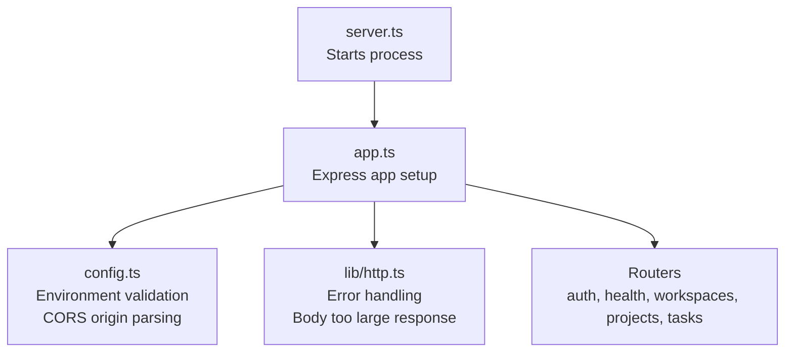
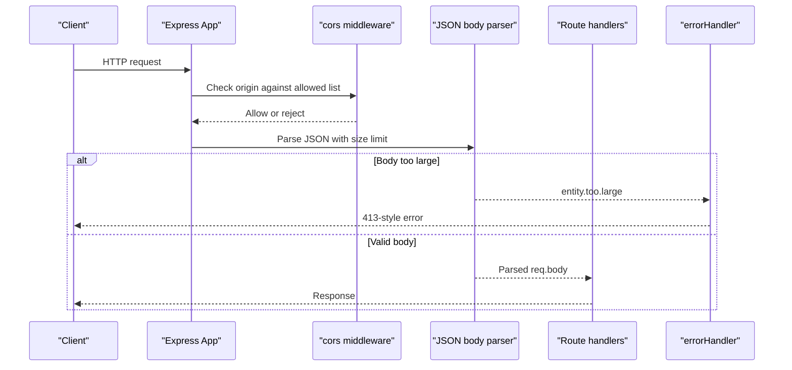
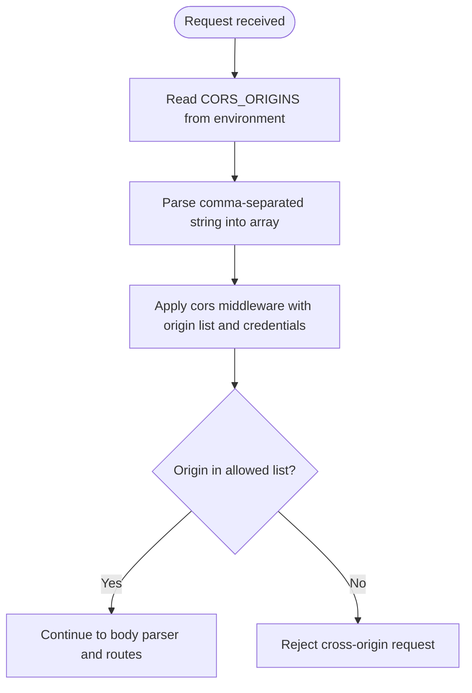
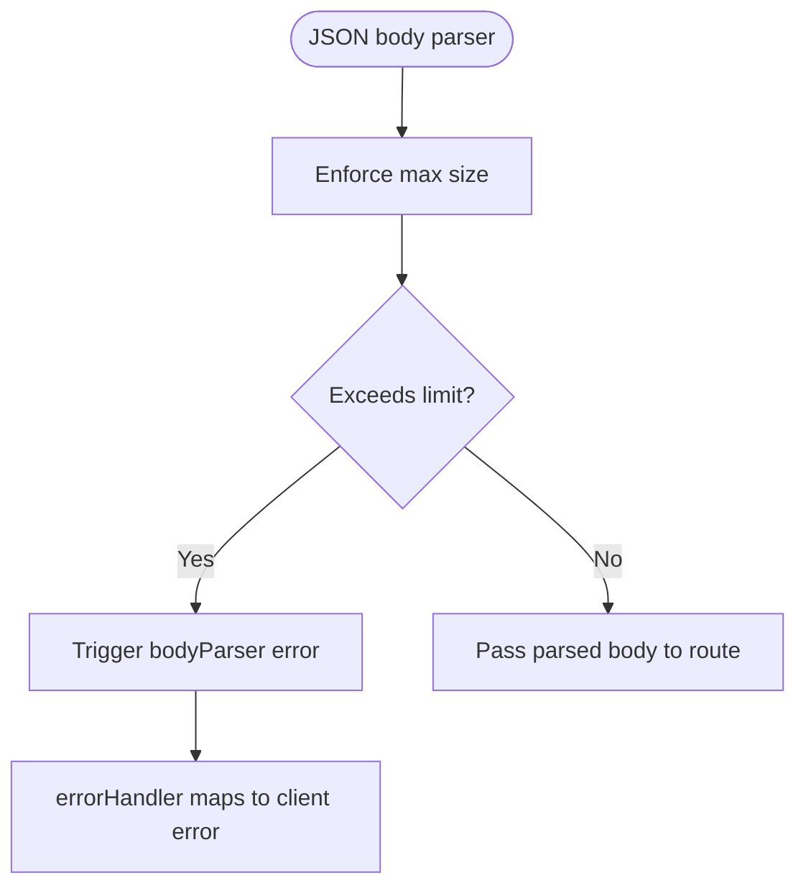
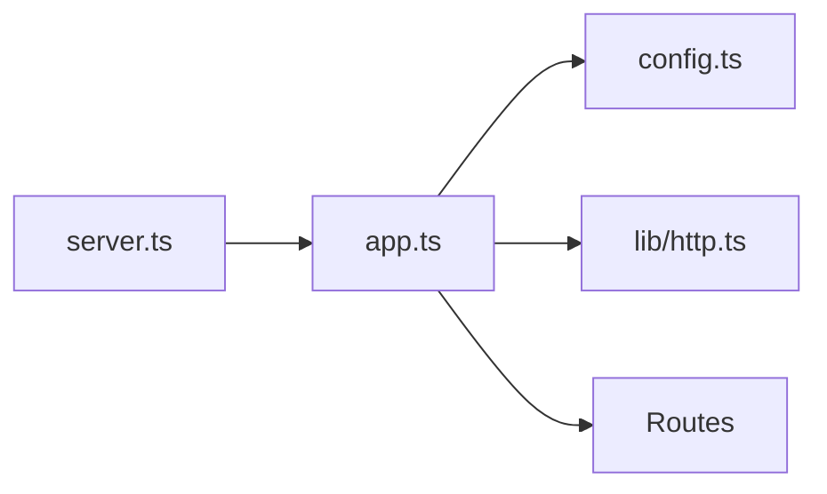

# Security Headers & CORS Configuration

<cite>
**Referenced Files in This Document**
- [app.ts](file://phoenix-backend/src/app.ts)
- [config.ts](file://phoenix-backend/src/config.ts)
- [http.ts](file://phoenix-backend/src/lib/http.ts)
- [server.ts](file://phoenix-backend/src/server.ts)
</cite>

## Table of Contents
1. [Introduction](#introduction)
2. [Project Structure](#project-structure)
3. [Core Components](#core-components)
4. [Architecture Overview](#architecture-overview)
5. [Detailed Component Analysis](#detailed-component-analysis)
6. [Dependency Analysis](#dependency-analysis)
7. [Performance Considerations](#performance-considerations)
8. [Troubleshooting Guide](#troubleshooting-guide)
9. [Conclusion](#conclusion)

## Introduction
This document explains how the backend configures cross-origin resource sharing (CORS), request size limits, and error handling, and it outlines where security headers should be added. It also provides guidance for environment-specific configuration, testing security headers, troubleshooting CORS issues, and production best practices.

The current implementation:
- Configures CORS using a comma-separated list of trusted origins from environment variables.
- Limits JSON request bodies to a fixed size.
- Does not yet add explicit security headers such as Content-Security-Policy, X-Frame-Options, X-Content-Type-Options, or Strict-Transport-Security at the application layer.

## Project Structure
Security-related behavior is primarily defined in the Express application setup and configuration modules:
- Application bootstrap wires up CORS, body parsing, routers, and error handlers.
- Configuration validates environment variables and parses the allowed CORS origins.
- HTTP utilities provide standardized error responses, including handling oversized requests.
- The server entry point starts the app and handles graceful shutdown.

**Diagram sources**
- [server.ts:5-10](file://phoenix-backend/src/server.ts#L5-L10)
- [app.ts:11-31](file://phoenix-backend/src/app.ts#L11-L31)
- [config.ts:28-40](file://phoenix-backend/src/config.ts#L28-L40)
- [http.ts:42-80](file://phoenix-backend/src/lib/http.ts#L42-L80)

**Section sources**
- [server.ts:5-10](file://phoenix-backend/src/server.ts#L5-L10)
- [app.ts:11-31](file://phoenix-backend/src/app.ts#L11-L31)
- [config.ts:28-40](file://phoenix-backend/src/config.ts#L28-L40)
- [http.ts:42-80](file://phoenix-backend/src/lib/http.ts#L42-L80)

## Core Components
- CORS policy: Controlled by an environment variable that lists trusted origins. Credentials are enabled for authenticated cross-origin requests.
- Request size limit: JSON body parsing is limited to a fixed size; oversized payloads return a specific client error.
- Error handling: Centralized error middleware normalizes errors and returns consistent JSON responses.
- Environment configuration: Strongly typed with validation; missing or invalid values fail fast at startup.

Key behaviors:
- CORS allows only configured origins and supports credentials.
- Body parser enforces a maximum payload size and triggers a 413-like response path through the error handler.
- The application disables default framework version exposure and trusts the reverse proxy for IP resolution.

**Section sources**
- [app.ts:11-21](file://phoenix-backend/src/app.ts#L11-L21)
- [config.ts:4-14](file://phoenix-backend/src/config.ts#L4-L14)
- [http.ts:42-80](file://phoenix-backend/src/lib/http.ts#L42-L80)

## Architecture Overview
The request lifecycle relevant to security and CORS:

**Diagram sources**
- [app.ts:17-21](file://phoenix-backend/src/app.ts#L17-L21)
- [http.ts:64-73](file://phoenix-backend/src/lib/http.ts#L64-L73)

## Detailed Component Analysis

### CORS Policy
- Allowed origins are read from a comma-separated environment variable and parsed into an array.
- The CORS middleware is applied globally with credentials enabled.
- Development defaults allow the local frontend; production should restrict this to approved domains.

**Diagram sources**
- [config.ts:18-24](file://phoenix-backend/src/config.ts#L18-L24)
- [app.ts:17-17](file://phoenix-backend/src/app.ts#L17-L17)

**Section sources**
- [config.ts:4-14](file://phoenix-backend/src/config.ts#L4-L14)
- [config.ts:18-24](file://phoenix-backend/src/config.ts#L18-L24)
- [app.ts:17-17](file://phoenix-backend/src/app.ts#L17-L17)

### Request Size Limits
- JSON body parsing is limited to a fixed size.
- Oversized bodies trigger a specific error path that returns a client-facing error indicating the request body is too large.

**Diagram sources**
- [app.ts:21-21](file://phoenix-backend/src/app.ts#L21-L21)
- [http.ts:64-73](file://phoenix-backend/src/lib/http.ts#L64-L73)

**Section sources**
- [app.ts:21-21](file://phoenix-backend/src/app.ts#L21-L21)
- [http.ts:64-73](file://phoenix-backend/src/lib/http.ts#L64-L73)

### Security Headers Middleware
- The application currently does not add explicit security headers such as Content-Security-Policy, X-Frame-Options, X-Content-Type-Options, or Strict-Transport-Security.
- To implement these headers, add a global middleware before routes that sets the required headers on every response.
- Recommended placement is immediately after CORS and body parsing so all responses include them.

Implementation guidance:
- Add a middleware function that sets:
  - Content-Security-Policy
  - X-Frame-Options
  - X-Content-Type-Options
  - Strict-Transport-Security
- Register it early in the Express pipeline.
- Ensure the header values are configurable via environment variables for different environments.

[No sources needed since this section proposes future changes not present in the codebase]

### Rate Limiting Strategies
- No rate limiting middleware is currently configured in the application.
- For production, consider adding a rate limiter at the application level or at the reverse proxy/load balancer.
- Strategies may include:
  - Per-IP request caps
  - Per-user token-based limits
  - Endpoint-specific throttling for sensitive routes like authentication

[No sources needed since this section provides general guidance]

### IP Whitelisting Capabilities
- There is no built-in IP whitelist in the application.
- If required, implement an IP allowlist middleware that checks the client IP against a configured list and rejects non-whitelisted requests.
- When behind a reverse proxy, ensure trust proxy settings are correct so the real client IP is available.

Current trust proxy setting:
- The application trusts one hop for proxy headers, which is typical when running behind a reverse proxy.

**Section sources**
- [app.ts:15-15](file://phoenix-backend/src/app.ts#L15-L15)

### Environment-Specific Configuration
- CORS_ORIGINS: Comma-separated list of allowed origins. Defaults to a development-friendly value.
- Other security-relevant environment variables include JWT settings used elsewhere in the application.

Examples:
- Development:
  - CORS_ORIGINS=http://localhost:3000
- Staging/Production:
  - CORS_ORIGINS=https://app.example.com,https://admin.example.com

Validation:
- Missing or invalid environment variables cause the application to fail fast during startup.

**Section sources**
- [config.ts:4-14](file://phoenix-backend/src/config.ts#L4-L14)
- [config.ts:28-40](file://phoenix-backend/src/config.ts#L28-L40)

### Testing Security Headers
- Since explicit security headers are not yet set in the application, tests should assert their presence once implemented.
- Suggested test cases:
  - Verify Content-Security-Policy is present and restrictive.
  - Verify X-Frame-Options prevents framing.
  - Verify X-Content-Type-Options prevents MIME sniffing.
  - Verify Strict-Transport-Security enforces HTTPS.
- Use integration tests that send requests to the running server and inspect response headers.

[No sources needed since this section provides general guidance]

### Troubleshooting CORS Issues
Common causes and resolutions:
- Origin mismatch:
  - Ensure the browser’s request origin exactly matches one of the entries in CORS_ORIGINS.
  - Include protocol and port if they differ from defaults.
- Credentials:
  - When sending cookies or Authorization headers, credentials must be enabled on both client and server.
  - Avoid wildcard origins when credentials are enabled.
- Preflight requests:
  - Ensure preflight OPTIONS requests are allowed and respond correctly.
- Reverse proxy:
  - Confirm the proxy forwards the Host and Origin headers unchanged.
  - Validate trust proxy configuration so the server sees the correct client IP.

**Section sources**
- [app.ts:15-17](file://phoenix-backend/src/app.ts#L15-L17)
- [config.ts:18-24](file://phoenix-backend/src/config.ts#L18-L24)

## Dependency Analysis
The following diagram shows how the core files interact around security and CORS:

**Diagram sources**
- [server.ts:1-10](file://phoenix-backend/src/server.ts#L1-L10)
- [app.ts:1-31](file://phoenix-backend/src/app.ts#L1-L31)
- [config.ts:28-40](file://phoenix-backend/src/config.ts#L28-L40)
- [http.ts:42-80](file://phoenix-backend/src/lib/http.ts#L42-L80)

**Section sources**
- [server.ts:1-10](file://phoenix-backend/src/server.ts#L1-L10)
- [app.ts:1-31](file://phoenix-backend/src/app.ts#L1-L31)
- [config.ts:28-40](file://phoenix-backend/src/config.ts#L28-L40)
- [http.ts:42-80](file://phoenix-backend/src/lib/http.ts#L42-L80)

## Performance Considerations
- CORS checks occur per request; keep the allowed origin list small and exact to minimize processing overhead.
- Enabling credentials increases the complexity of CORS preflight handling; use it only when necessary.
- Body size limits protect memory and CPU; tune the limit based on expected payload sizes.
- Adding security headers has negligible performance impact but improves security posture.
- Consider implementing rate limiting at the edge (reverse proxy or CDN) to reduce load on the application.

[No sources needed since this section provides general guidance]

## Troubleshooting Guide
- 413 Request Entity Too Large:
  - Indicates the request body exceeds the configured limit.
  - Reduce payload size or increase the limit if appropriate.
- CORS failures:
  - Verify CORS_ORIGINS includes the exact origin making the request.
  - Ensure credentials are enabled consistently on client and server.
- Unexpected client IP:
  - Confirm trust proxy is set appropriately when behind a reverse proxy.
- Missing security headers:
  - Once implemented, verify headers are present on all responses, including error responses.

**Section sources**
- [http.ts:64-73](file://phoenix-backend/src/lib/http.ts#L64-L73)
- [app.ts:15-21](file://phoenix-backend/src/app.ts#L15-L21)

## Conclusion
The backend currently implements a robust CORS policy driven by environment configuration and enforces request body size limits. It does not yet apply explicit security headers such as Content-Security-Policy, X-Frame-Options, X-Content-Type-Options, or Strict-Transport-Security. To harden the application:
- Add a global security headers middleware early in the Express pipeline.
- Keep CORS_ORIGINS tightly scoped to trusted domains in production.
- Implement rate limiting at the application or edge layer.
- Add IP whitelisting if required for sensitive endpoints.
- Test headers and CORS behavior across environments and validate configuration at startup.

[No sources needed since this section summarizes without analyzing specific files]