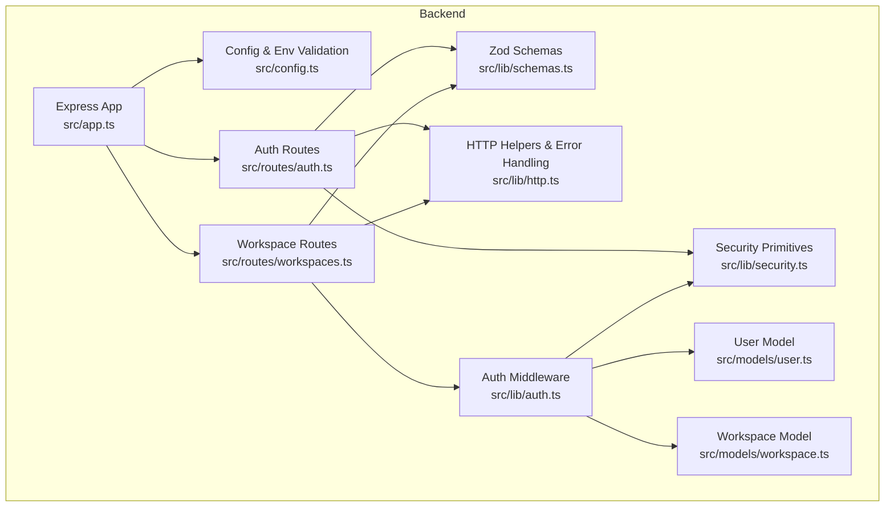
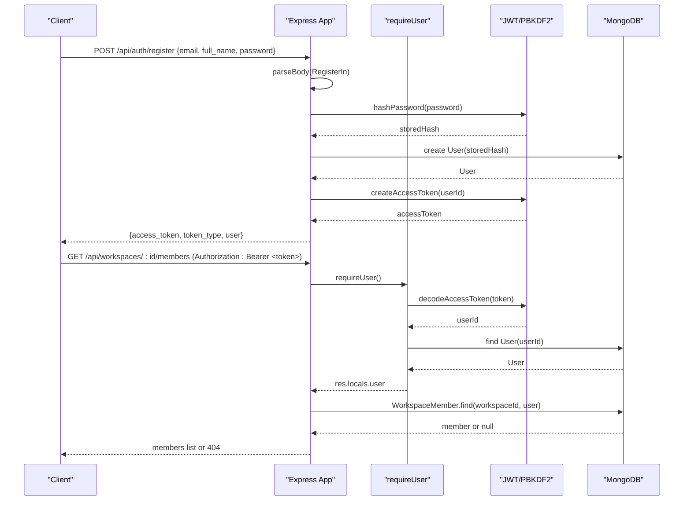
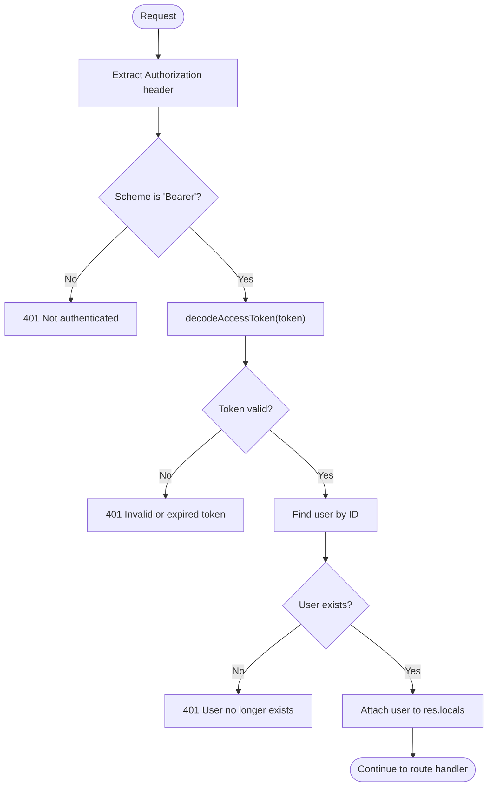
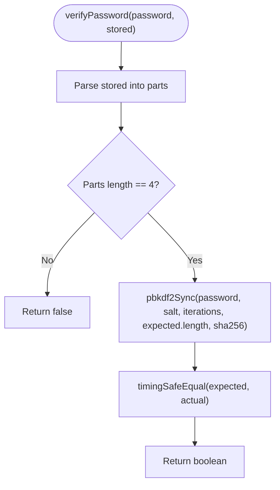
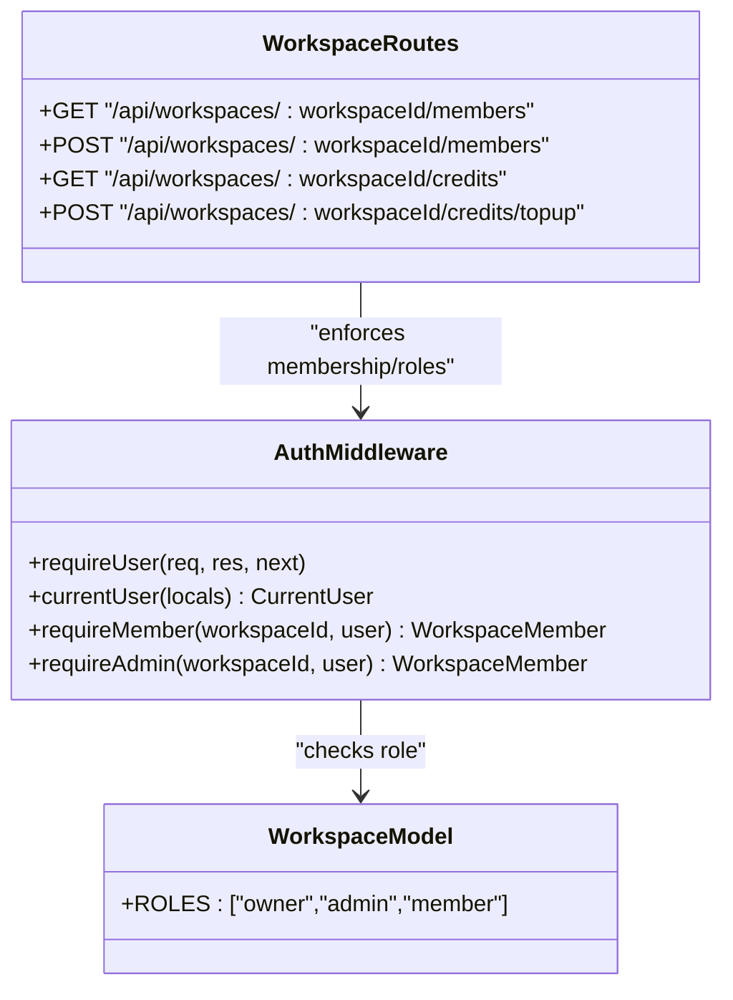
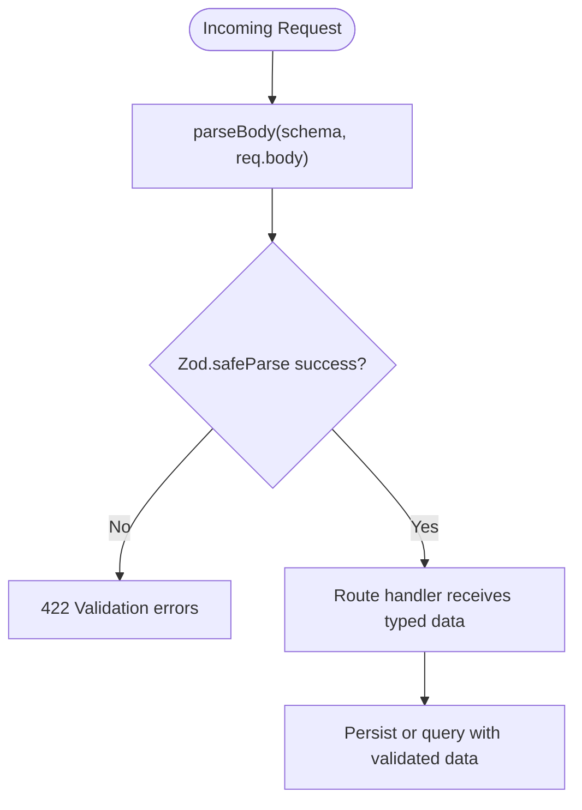
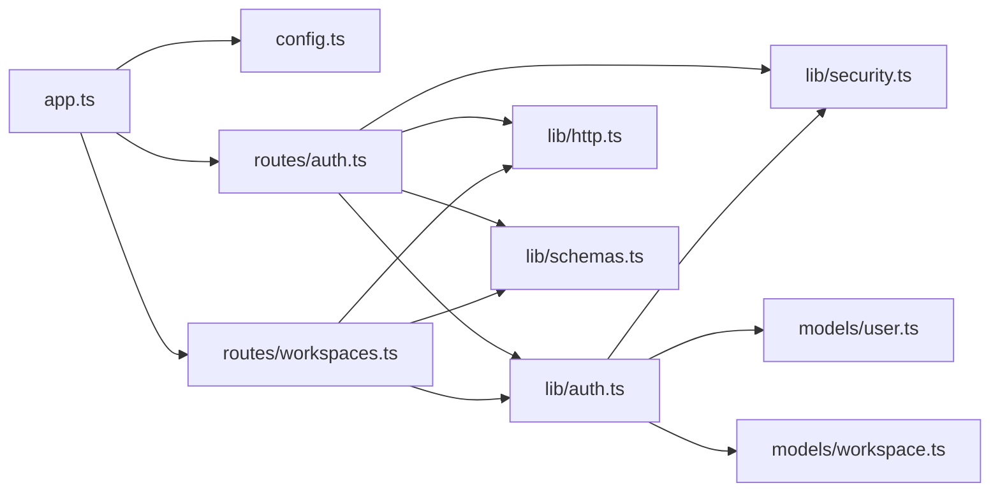

# Security Implementation

<cite>
**Referenced Files in This Document**
- [app.ts](file://phoenix-backend/src/app.ts)
- [config.ts](file://phoenix-backend/src/config.ts)
- [auth.ts](file://phoenix-backend/src/lib/auth.ts)
- [security.ts](file://phoenix-backend/src/lib/security.ts)
- [http.ts](file://phoenix-backend/src/lib/http.ts)
- [schemas.ts](file://phoenix-backend/src/lib/schemas.ts)
- [auth.ts](file://phoenix-backend/src/routes/auth.ts)
- [workspaces.ts](file://phoenix-backend/src/routes/workspaces.ts)
- [workspace.ts](file://phoenix-backend/src/models/workspace.ts)
- [user.ts](file://phoenix-backend/src/models/user.ts)
</cite>

## Table of Contents
1. [Introduction](#introduction)
2. [Project Structure](#project-structure)
3. [Core Components](#core-components)
4. [Architecture Overview](#architecture-overview)
5. [Detailed Component Analysis](#detailed-component-analysis)
6. [Dependency Analysis](#dependency-analysis)
7. [Performance Considerations](#performance-considerations)
8. [Troubleshooting Guide](#troubleshooting-guide)
9. [Conclusion](#conclusion)

## Introduction
This document explains the security implementation for Project Phoenix’s backend. It covers authentication with JWT, password hashing using PBKDF2, session-less token-based authorization, role-based access control (RBAC) for workspaces, input validation and sanitization via Zod, request parsing and size limits, CORS configuration, and error handling strategies that reduce information leakage. The goal is to provide both a high-level understanding and actionable guidance for secure coding patterns used throughout the application.

## Project Structure
The security-relevant code is primarily located under the backend package:
- Application bootstrap and middleware setup
- Configuration and environment validation
- Authentication and authorization helpers
- Security primitives (password hashing, JWT)
- Request body parsing and parameter validation
- Route handlers enforcing RBAC
- Data models defining roles and user attributes

**Diagram sources**
- [app.ts:11-31](file://phoenix-backend/src/app.ts#L11-L31)
- [config.ts:4-14](file://phoenix-backend/src/config.ts#L4-L14)
- [auth.ts:8-49](file://phoenix-backend/src/lib/auth.ts#L8-L49)
- [security.ts:7-37](file://phoenix-backend/src/lib/security.ts#L7-L37)
- [http.ts:5-66](file://phoenix-backend/src/lib/http.ts#L5-L66)
- [schemas.ts:1-40](file://phoenix-backend/src/lib/schemas.ts#L1-L40)
- [auth.ts:11-51](file://phoenix-backend/src/routes/auth.ts#L11-L51)
- [workspaces.ts:8-125](file://phoenix-backend/src/routes/workspaces.ts#L8-L125)
- [user.ts:3-19](file://phoenix-backend/src/models/user.ts#L3-L19)
- [workspace.ts:3-21](file://phoenix-backend/src/models/workspace.ts#L3-L21)

**Section sources**
- [app.ts:11-31](file://phoenix-backend/src/app.ts#L11-L31)
- [config.ts:4-14](file://phoenix-backend/src/config.ts#L4-L14)

## Core Components
- Authentication: JWT bearer tokens issued on register/login; validated by middleware before protected routes.
- Password Hashing: PBKDF2 with random salt, fixed iterations, and constant-time comparison.
- Authorization: Role-based checks for workspace membership and admin/owner permissions.
- Input Validation: Zod schemas validate and sanitize all incoming request bodies and query parameters.
- Request Parsing & Limits: Express JSON parser with explicit size limit; safe ID parsing to prevent injection.
- CORS & Headers: Strict origin allowlist; server identity hidden; proxy trust enabled.
- Error Handling: Centralized handler normalizes errors and avoids leaking internals.

**Section sources**
- [auth.ts:8-49](file://phoenix-backend/src/lib/auth.ts#L8-L49)
- [security.ts:7-37](file://phoenix-backend/src/lib/security.ts#L7-L37)
- [schemas.ts:1-40](file://phoenix-backend/src/lib/schemas.ts#L1-L40)
- [http.ts:20-32](file://phoenix-backend/src/lib/http.ts#L20-L32)
- [app.ts:14-21](file://phoenix-backend/src/app.ts#L14-L21)
- [config.ts:4-14](file://phoenix-backend/src/config.ts#L4-L14)

## Architecture Overview
The backend uses an Express application with centralized middleware and route modules. Authentication is enforced at the route level using middleware that validates JWTs and attaches the current user. Authorization is enforced per resource using role checks against workspace memberships. All inputs are validated through Zod before being processed.

**Diagram sources**
- [auth.ts:11-51](file://phoenix-backend/src/routes/auth.ts#L11-L51)
- [auth.ts:8-27](file://phoenix-backend/src/lib/auth.ts#L8-L27)
- [security.ts:7-37](file://phoenix-backend/src/lib/security.ts#L7-L37)
- [workspaces.ts:56-74](file://phoenix-backend/src/routes/workspaces.ts#L56-L74)

## Detailed Component Analysis

### Authentication System (JWT)
- Token issuance: On successful registration or login, the server issues a short-lived JWT containing the user ID.
- Token validation: The `requireUser` middleware extracts the bearer token, decodes it using the configured algorithm and secret, and attaches the resolved user to the response locals.
- Security properties:
  - Algorithm is explicitly set from configuration.
  - Secret length is enforced at startup.
  - Expiration is configurable and defaults to a bounded value.
  - Invalid or expired tokens result in 401 responses without stack traces.

**Diagram sources**
- [auth.ts:8-27](file://phoenix-backend/src/lib/auth.ts#L8-L27)
- [security.ts:23-37](file://phoenix-backend/src/lib/security.ts#L23-L37)

**Section sources**
- [auth.ts:8-27](file://phoenix-backend/src/lib/auth.ts#L8-L27)
- [security.ts:23-37](file://phoenix-backend/src/lib/security.ts#L23-L37)
- [auth.ts:11-51](file://phoenix-backend/src/routes/auth.ts#L11-L51)

### Password Hashing with PBKDF2
- Storage format: A structured string containing algorithm identifier, iteration count, hex-encoded salt, and hex-encoded digest.
- Verification: Parses the stored format, recomputes PBKDF2 with the same parameters, and compares digests using constant-time comparison to mitigate timing attacks.
- Hardening: Iteration count is defined centrally; salt is randomly generated per password.

**Diagram sources**
- [security.ts:13-21](file://phoenix-backend/src/lib/security.ts#L13-L21)

**Section sources**
- [security.ts:7-21](file://phoenix-backend/src/lib/security.ts#L7-L21)

### Session Management
- Stateless design: No server-side sessions; state is carried in JWTs.
- Rotation strategy: Tokens expire after a configurable number of minutes. Clients should refresh tokens upon expiration.
- Best practice: Store tokens securely on the client side and send them only over HTTPS.

**Section sources**
- [security.ts:23-37](file://phoenix-backend/src/lib/security.ts#L23-L37)
- [config.ts:6-8](file://phoenix-backend/src/config.ts#L6-L8)

### Authorization System (Role-Based Access Control)
- Roles: owner, admin, member defined in the workspace model.
- Membership checks:
  - `requireMember`: Ensures the current user belongs to the workspace; returns 404 to avoid leaking existence.
  - `requireAdmin`: Extends membership check and enforces owner/admin roles.
- Resource scoping:
  - Workspace endpoints enforce membership before returning data.
  - Member addition prevents setting another user as owner and rejects duplicates.

**Diagram sources**
- [auth.ts:29-49](file://phoenix-backend/src/lib/auth.ts#L29-L49)
- [workspace.ts:3-21](file://phoenix-backend/src/models/workspace.ts#L3-L21)
- [workspaces.ts:56-125](file://phoenix-backend/src/routes/workspaces.ts#L56-L125)

**Section sources**
- [auth.ts:29-49](file://phoenix-backend/src/lib/auth.ts#L29-L49)
- [workspace.ts:3-21](file://phoenix-backend/src/models/workspace.ts#L3-L21)
- [workspaces.ts:56-125](file://phoenix-backend/src/routes/workspaces.ts#L56-L125)

### Input Validation and Sanitization (Zod)
- Registration and login payloads are validated with strict schemas:
  - Email normalized to lowercase where appropriate.
  - Passwords constrained by minimum and maximum lengths.
  - Names trimmed and length-limited.
- Workspace and project creation use typed schemas to prevent unexpected fields.
- Query parameters for tasks include pagination constraints and allowed status enums.
- Body parsing helper converts Zod validation failures into standardized 422 responses.

**Diagram sources**
- [http.ts:20-24](file://phoenix-backend/src/lib/http.ts#L20-L24)
- [schemas.ts:7-40](file://phoenix-backend/src/lib/schemas.ts#L7-L40)
- [auth.ts:11-46](file://phoenix-backend/src/routes/auth.ts#L11-L46)
- [workspaces.ts:31-41](file://phoenix-backend/src/routes/workspaces.ts#L31-L41)

**Section sources**
- [schemas.ts:1-40](file://phoenix-backend/src/lib/schemas.ts#L1-L40)
- [http.ts:20-24](file://phoenix-backend/src/lib/http.ts#L20-L24)
- [auth.ts:11-46](file://phoenix-backend/src/routes/auth.ts#L11-L46)
- [workspaces.ts:31-41](file://phoenix-backend/src/routes/workspaces.ts#L31-L41)

### Request Body Parsing and Parameter Validation
- JSON body limit: Set to 100KB to mitigate large payload attacks.
- Path parameter IDs: Parsed and validated as 24-character hex ObjectIds; invalid IDs return 404 instead of 500.
- Query parameters: Enforced via Zod with coercion, ranges, and enum constraints.

**Section sources**
- [app.ts:19-21](file://phoenix-backend/src/app.ts#L19-L21)
- [http.ts:26-32](file://phoenix-backend/src/lib/http.ts#L26-L32)
- [schemas.ts:35-40](file://phoenix-backend/src/lib/schemas.ts#L35-L40)

### Security Headers and CORS Policy
- Server identity: X-Powered-By disabled to reduce fingerprinting.
- Proxy trust: Enabled for correct IP resolution behind reverse proxies.
- CORS: Configured with an allowlist of origins parsed from environment variables; credentials enabled for cross-origin requests when needed.

**Section sources**
- [app.ts:14-17](file://phoenix-backend/src/app.ts#L14-L17)
- [config.ts:9-10](file://phoenix-backend/src/config.ts#L9-L10)

### Request Size Limits
- JSON body limited to 100KB globally to protect against denial-of-service via oversized payloads.

**Section sources**
- [app.ts:19-21](file://phoenix-backend/src/app.ts#L19-L21)

## Dependency Analysis
The following diagram shows how security-related modules depend on each other:

**Diagram sources**
- [app.ts:1-31](file://phoenix-backend/src/app.ts#L1-L31)
- [config.ts:1-41](file://phoenix-backend/src/config.ts#L1-L41)
- [auth.ts:1-51](file://phoenix-backend/src/routes/auth.ts#L1-L51)
- [workspaces.ts:1-125](file://phoenix-backend/src/routes/workspaces.ts#L1-L125)
- [auth.ts:1-49](file://phoenix-backend/src/lib/auth.ts#L1-L49)
- [http.ts:1-66](file://phoenix-backend/src/lib/http.ts#L1-L66)
- [schemas.ts:1-40](file://phoenix-backend/src/lib/schemas.ts#L1-L40)
- [security.ts:1-37](file://phoenix-backend/src/lib/security.ts#L1-L37)
- [user.ts:1-19](file://phoenix-backend/src/models/user.ts#L1-L19)
- [workspace.ts:1-21](file://phoenix-backend/src/models/workspace.ts#L1-L21)

**Section sources**
- [app.ts:1-31](file://phoenix-backend/src/app.ts#L1-L31)
- [auth.ts:1-51](file://phoenix-backend/src/routes/auth.ts#L1-L51)
- [workspaces.ts:1-125](file://phoenix-backend/src/routes/workspaces.ts#L1-L125)

## Performance Considerations
- PBKDF2 iterations: Tuned for security vs. latency; consider benchmarking in your deployment environment.
- JWT verification: Lightweight and stateless; ensure clients cache tokens appropriately to minimize re-authentication overhead.
- Database queries: Use lean queries and selective field projection where possible to reduce payload sizes.

[No sources needed since this section provides general guidance]

## Troubleshooting Guide
Common issues and their likely causes:
- 401 Not authenticated: Missing or malformed Authorization header.
- 401 Invalid or expired token: Incorrect secret, wrong algorithm, or expired token.
- 401 User no longer exists: Token references a deleted user.
- 404 Workspace not found: Either the workspace does not exist or the user is not a member; the API intentionally returns 404 to avoid leaking existence.
- 403 Admin role required: User is a member but lacks owner/admin role.
- 422 Validation errors: Check request body against Zod schemas.
- 400 Malformed JSON body: Ensure Content-Type is application/json and payload is valid JSON.
- 500 Internal server error: Unexpected exceptions; review logs.

Centralized error handling maps internal errors to consistent JSON responses and hides stack traces from clients.

**Section sources**
- [http.ts:42-66](file://phoenix-backend/src/lib/http.ts#L42-L66)
- [auth.ts:8-27](file://phoenix-backend/src/lib/auth.ts#L8-L27)
- [workspaces.ts:44-53](file://phoenix-backend/src/routes/workspaces.ts#L44-L53)

## Conclusion
Project Phoenix implements a robust, layered security model:
- Stateless JWT authentication with strong hashing and strict algorithm enforcement.
- Role-based authorization scoped to workspaces with careful error messages to prevent information disclosure.
- Comprehensive input validation and sanitization via Zod, combined with safe ID parsing and request size limits.
- Secure defaults for headers and CORS, with environment-driven configuration.

Following these patterns helps defend against common vulnerabilities such as injection, broken access control, excessive data exposure, and denial-of-service via large payloads.

[No sources needed since this section summarizes without analyzing specific files]