# Backend Architecture

<cite>
**Referenced Files in This Document**
- [README.md](file://phoenix-backend/README.md)
- [package.json](file://phoenix-backend/package.json)
- [vercel.json](file://phoenix-backend/vercel.json)
- [api/index.ts](file://phoenix-backend/api/index.ts)
- [src/app.ts](file://phoenix-backend/src/app.ts)
- [src/server.ts](file://phoenix-backend/src/server.ts)
- [src/config.ts](file://phoenix-backend/src/config.ts)
- [src/db.ts](file://phoenix-backend/src/db.ts)
- [src/lib/http.ts](file://phoenix-backend/src/lib/http.ts)
- [src/lib/auth.ts](file://phoenix-backend/src/lib/auth.ts)
- [src/lib/schemas.ts](file://phoenix-backend/src/lib/schemas.ts)
- [src/lib/cache.ts](file://phoenix-backend/src/lib/cache.ts)
- [src/routes/auth.ts](file://phoenix-backend/src/routes/auth.ts)
- [src/routes/health.ts](file://phoenix-backend/src/routes/health.ts)
- [src/routes/projects.ts](file://phoenix-backend/src/routes/projects.ts)
- [src/routes/tasks.ts](file://phoenix-backend/src/routes/tasks.ts)
- [src/routes/workspaces.ts](file://phoenix-backend/src/routes/workspaces.ts)
</cite>

## Table of Contents
1. Introduction
2. Project Structure
3. Core Components
4. Architecture Overview
5. Detailed Component Analysis
6. Dependency Analysis
7. Performance Considerations
8. Troubleshooting Guide
9. Conclusion

## Introduction
This document describes the Phoenix backend architecture: an Express.js API built with TypeScript, Mongoose, and Zod for validation. It explains the serverless deployment pattern on Vercel, environment configuration, database connection management, middleware pipeline, route organization, and service-layer separation. It also covers performance considerations such as connection reuse, caching strategies, and memory management in serverless environments.

## Project Structure
The backend is organized by feature and layer:
- Entry points:
  - Server process entry point for local development
  - Vercel serverless function handler
- Application bootstrap:
  - Express app creation and middleware wiring
- Configuration:
  - Environment schema validation and settings cache
- Database:
  - Connection lifecycle and model initialization
- Shared libraries:
  - HTTP utilities, authentication helpers, request schemas, in-process cache
- Routes:
  - Health, authentication, workspaces, projects, tasks

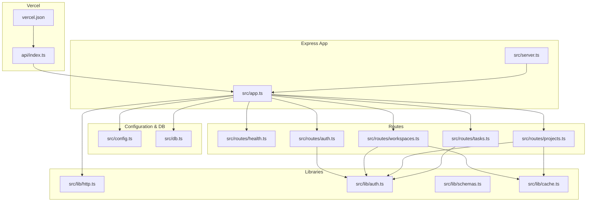

**Diagram sources**
- [vercel.json:1-5](file://phoenix-backend/vercel.json#L1-L5)
- [api/index.ts:1-21](file://phoenix-backend/api/index.ts#L1-L21)
- [src/app.ts:1-33](file://phoenix-backend/src/app.ts#L1-L33)
- [src/server.ts:1-32](file://phoenix-backend/src/server.ts#L1-L32)
- [src/config.ts:1-41](file://phoenix-backend/src/config.ts#L1-L41)
- [src/db.ts:1-36](file://phoenix-backend/src/db.ts#L1-L36)
- [src/lib/http.ts:1-81](file://phoenix-backend/src/lib/http.ts#L1-L81)
- [src/lib/auth.ts:1-58](file://phoenix-backend/src/lib/auth.ts#L1-L58)
- [src/lib/schemas.ts:1-41](file://phoenix-backend/src/lib/schemas.ts#L1-L41)
- [src/lib/cache.ts:1-26](file://phoenix-backend/src/lib/cache.ts#L1-L26)
- [src/routes/health.ts:1-27](file://phoenix-backend/src/routes/health.ts#L1-L27)
- [src/routes/auth.ts:1-52](file://phoenix-backend/src/routes/auth.ts#L1-L52)
- [src/routes/workspaces.ts:1-128](file://phoenix-backend/src/routes/workspaces.ts#L1-L128)
- [src/routes/projects.ts:1-58](file://phoenix-backend/src/routes/projects.ts#L1-L58)
- [src/routes/tasks.ts:1-127](file://phoenix-backend/src/routes/tasks.ts#L1-L127)

**Section sources**
- [README.md:1-76](file://phoenix-backend/README.md#L1-L76)
- [package.json:1-41](file://phoenix-backend/package.json#L1-L41)

## Core Components
- Express application factory:
  - Creates the Express app, disables server headers, enables proxy trust, configures CORS, body parsing, registers routers, and installs global error handlers.
- Serverless handler:
  - Reuses a single Express app instance per warm container and reuses the database connection promise to avoid repeated connections.
- Configuration manager:
  - Validates environment variables using a strict schema, caches parsed settings, and computes derived values like allowed CORS origins.
- Database connector:
  - Manages a single Mongoose default connection, ensures idempotent connect calls, initializes models, and provides disconnect for graceful shutdowns.
- HTTP utilities:
  - Provides async handler wrapper, Zod-based body parsing, ObjectId validation, regex escaping, duplicate key detection, not-found fallback, and centralized error handling.
- Authentication middleware:
  - Validates bearer tokens, loads current user, enforces workspace membership and roles (member/admin/owner), and resolves project access by workspace membership.
- Request schemas:
  - Centralized Zod schemas for all inputs across routes.
- In-process cache:
  - Lightweight TTL cache keyed by workspace for read-mostly endpoints.

**Section sources**
- [src/app.ts:11-31](file://phoenix-backend/src/app.ts#L11-L31)
- [api/index.ts:6-19](file://phoenix-backend/api/index.ts#L6-L19)
- [src/config.ts:4-40](file://phoenix-backend/src/config.ts#L4-L40)
- [src/db.ts:6-35](file://phoenix-backend/src/db.ts#L6-L35)
- [src/lib/http.ts:5-80](file://phoenix-backend/src/lib/http.ts#L5-L80)
- [src/lib/auth.ts:8-57](file://phoenix-backend/src/lib/auth.ts#L8-L57)
- [src/lib/schemas.ts:1-41](file://phoenix-backend/src/lib/schemas.ts#L1-L41)
- [src/lib/cache.ts:1-26](file://phoenix-backend/src/lib/cache.ts#L1-L26)

## Architecture Overview
The system follows a layered design:
- HTTP layer: Express app with CORS, JSON body parser, and router registration.
- Middleware layer: Authentication and authorization helpers applied per route or globally within route groups.
- Route handlers: Feature-specific routers that validate input, enforce permissions, and perform business logic.
- Service/data layer: Mongoose models and ledger operations for multi-tenant data and credit accounting.
- Cross-cutting concerns: Validation, error normalization, caching, and configuration.

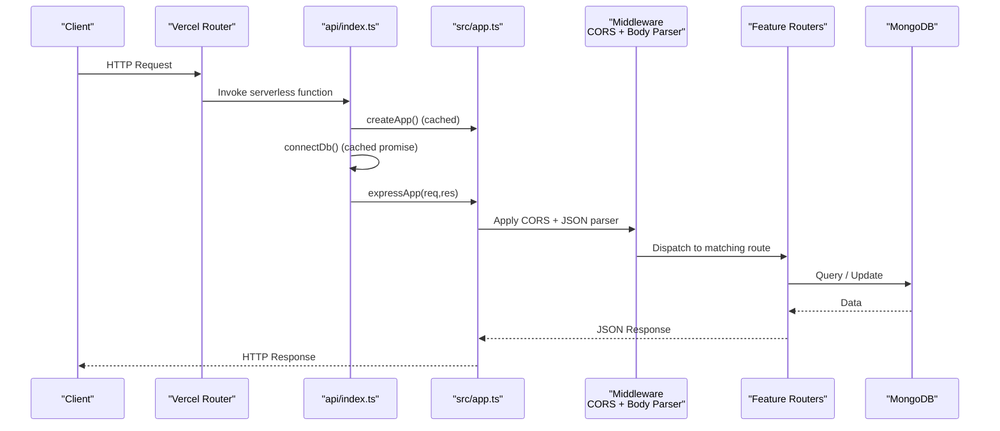

**Diagram sources**
- [vercel.json:1-5](file://phoenix-backend/vercel.json#L1-L5)
- [api/index.ts:11-19](file://phoenix-backend/api/index.ts#L11-L19)
- [src/app.ts:11-31](file://phoenix-backend/src/app.ts#L11-L31)
- [src/db.ts:13-29](file://phoenix-backend/src/db.ts#L13-L29)

## Detailed Component Analysis

### Express Application and Middleware Pipeline
- The application factory configures:
  - Security: disables x-powered-by, trusts reverse proxy headers.
  - CORS: configured from validated settings.
  - Body parsing: JSON with size limit before any route handler.
  - Routers: health, auth, workspaces, projects, tasks.
  - Global error handling: notFound and errorHandler at the end.

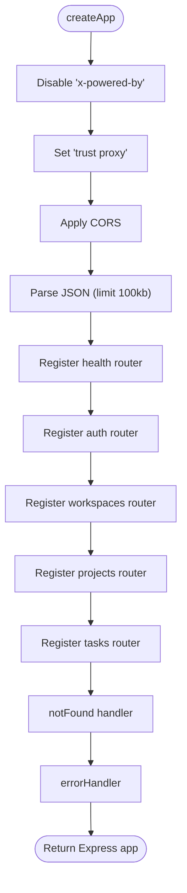

**Diagram sources**
- [src/app.ts:11-31](file://phoenix-backend/src/app.ts#L11-L31)

**Section sources**
- [src/app.ts:11-31](file://phoenix-backend/src/app.ts#L11-L31)

### Serverless Deployment on Vercel
- All requests are rewritten to the serverless function via vercel.json.
- The handler:
  - Lazily creates and caches the Express app instance.
  - Ensures the database connection is established once per warm container.
  - Invokes the Express app directly without listening on a port.

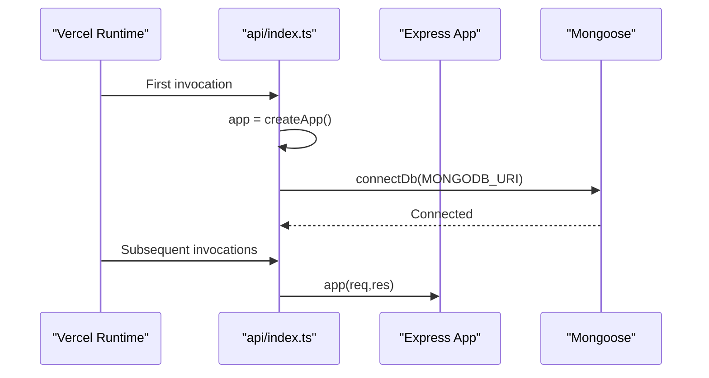

**Diagram sources**
- [vercel.json:1-5](file://phoenix-backend/vercel.json#L1-L5)
- [api/index.ts:6-19](file://phoenix-backend/api/index.ts#L6-L19)

**Section sources**
- [vercel.json:1-5](file://phoenix-backend/vercel.json#L1-L5)
- [api/index.ts:1-21](file://phoenix-backend/api/index.ts#L1-L21)

### Environment Configuration Management
- Strict schema validation for all environment variables.
- Cached parsed settings to avoid repeated parsing.
- Derived fields computed (e.g., CORS origin list).

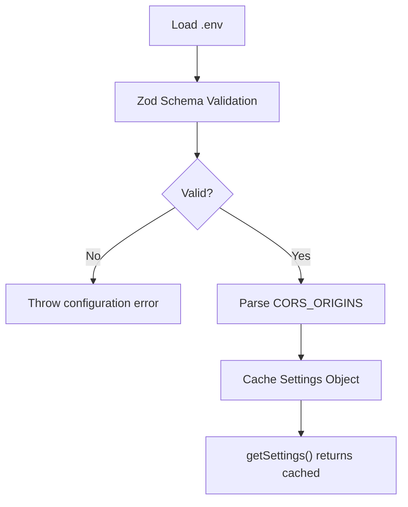

**Diagram sources**
- [src/config.ts:4-40](file://phoenix-backend/src/config.ts#L4-L40)

**Section sources**
- [src/config.ts:1-41](file://phoenix-backend/src/config.ts#L1-L41)

### Database Connection Management
- Single default Mongoose connection reused across invocations.
- Idempotent connect with pending promise deduplication.
- Model initialization after connection established.
- Graceful disconnect for shutdown.

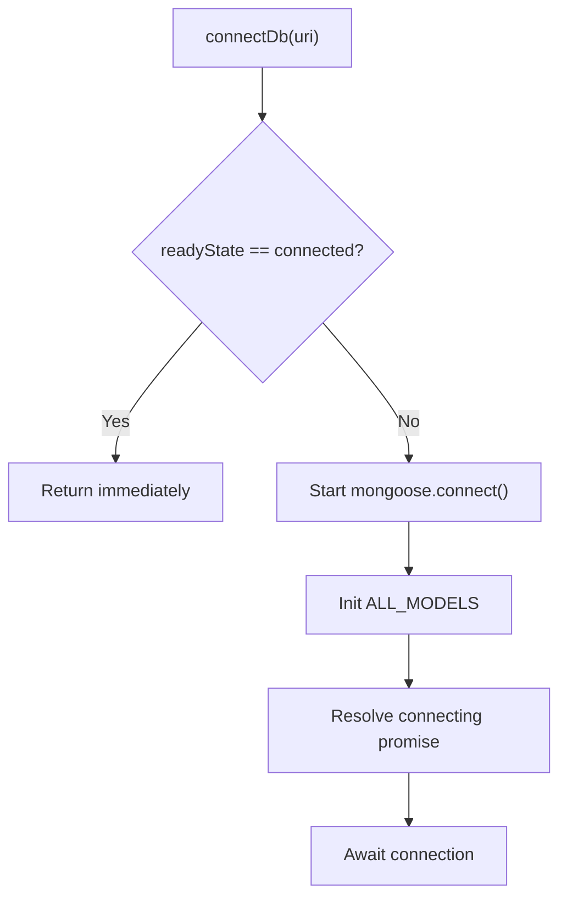

**Diagram sources**
- [src/db.ts:6-35](file://phoenix-backend/src/db.ts#L6-L35)

**Section sources**
- [src/db.ts:1-36](file://phoenix-backend/src/db.ts#L1-L36)

### Authentication and Authorization
- Bearer token validation and user resolution.
- Workspace membership checks with consistent 404 semantics to avoid information leakage.
- Role enforcement for admin and owner actions.
- Project access resolved through workspace membership.

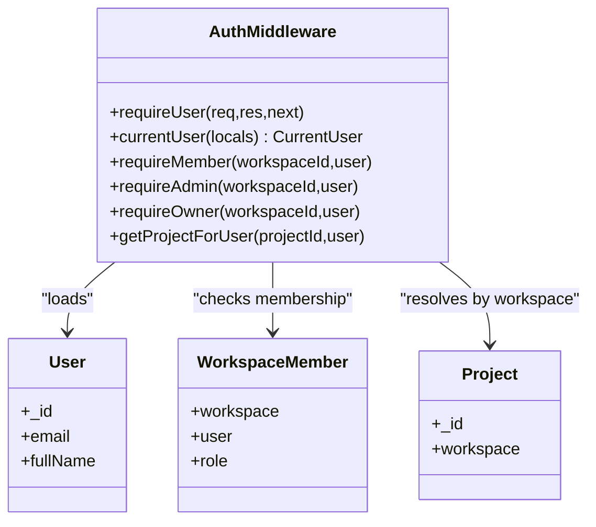

**Diagram sources**
- [src/lib/auth.ts:8-57](file://phoenix-backend/src/lib/auth.ts#L8-L57)

**Section sources**
- [src/lib/auth.ts:1-58](file://phoenix-backend/src/lib/auth.ts#L1-L58)

### Request Validation and Error Handling
- Zod schemas define strict contracts for all inputs.
- parseBody throws structured errors for invalid payloads.
- parseId validates MongoDB ObjectIds and returns 404 for malformed IDs.
- Centralized errorHandler normalizes domain errors, validation errors, cast errors, syntax errors, and body-parser errors into consistent JSON responses.

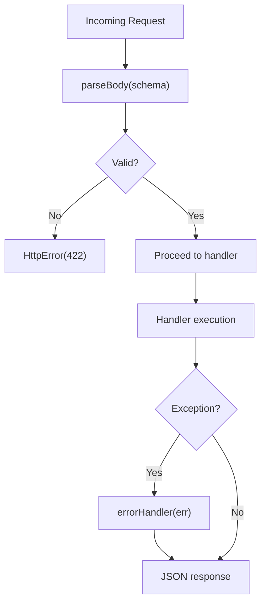

**Diagram sources**
- [src/lib/http.ts:20-80](file://phoenix-backend/src/lib/http.ts#L20-L80)
- [src/lib/schemas.ts:1-41](file://phoenix-backend/src/lib/schemas.ts#L1-L41)

**Section sources**
- [src/lib/http.ts:1-81](file://phoenix-backend/src/lib/http.ts#L1-L81)
- [src/lib/schemas.ts:1-41](file://phoenix-backend/src/lib/schemas.ts#L1-L41)

### Route Organization and Business Logic

#### Health Endpoint
- Pings MongoDB to report real connectivity status.

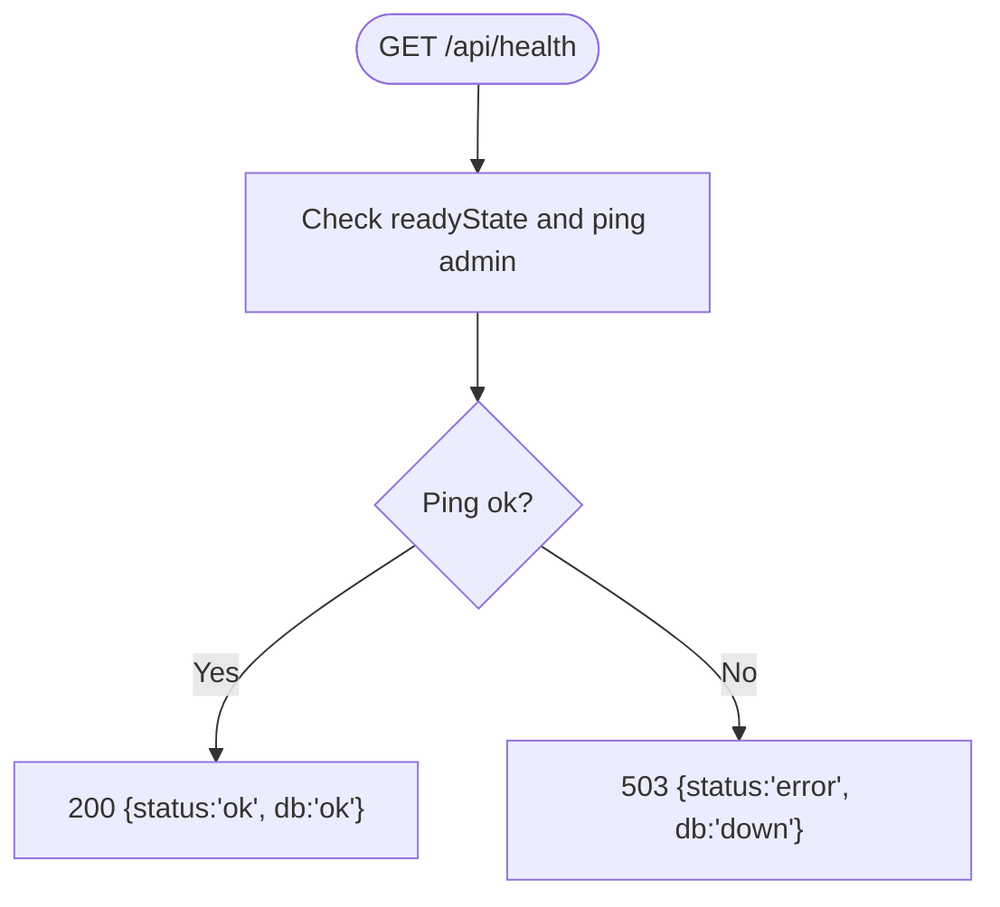

**Diagram sources**
- [src/routes/health.ts:11-26](file://phoenix-backend/src/routes/health.ts#L11-L26)

**Section sources**
- [src/routes/health.ts:1-27](file://phoenix-backend/src/routes/health.ts#L1-L27)

#### Authentication Routes
- Registration and login return JWT access tokens and user payload.
- Protected profile endpoint requires valid bearer token.

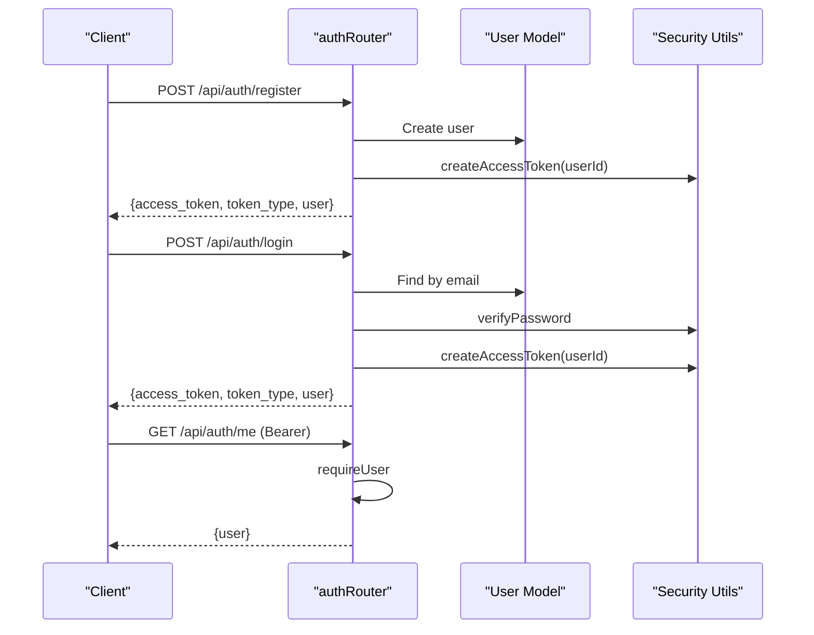

**Diagram sources**
- [src/routes/auth.ts:11-51](file://phoenix-backend/src/routes/auth.ts#L11-L51)

**Section sources**
- [src/routes/auth.ts:1-52](file://phoenix-backend/src/routes/auth.ts#L1-L52)

#### Workspaces Routes
- List, create, get, manage members, view credits, top-up credits.
- Enforces role-based access: member, admin, owner.
- Uses CreditLedger for auditability.

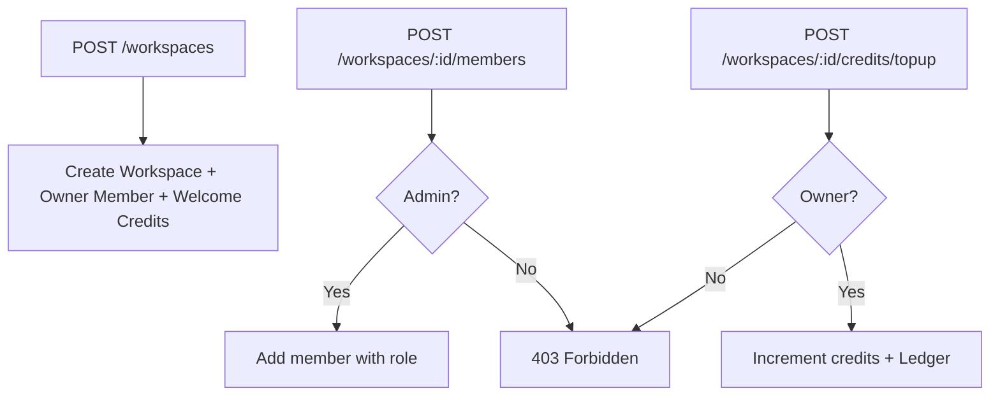

**Diagram sources**
- [src/routes/workspaces.ts:31-127](file://phoenix-backend/src/routes/workspaces.ts#L31-L127)

**Section sources**
- [src/routes/workspaces.ts:1-128](file://phoenix-backend/src/routes/workspaces.ts#L1-L128)

#### Projects Routes
- List projects per workspace with in-process cache.
- Create project invalidates cache.
- Get project by ID enforces workspace membership.

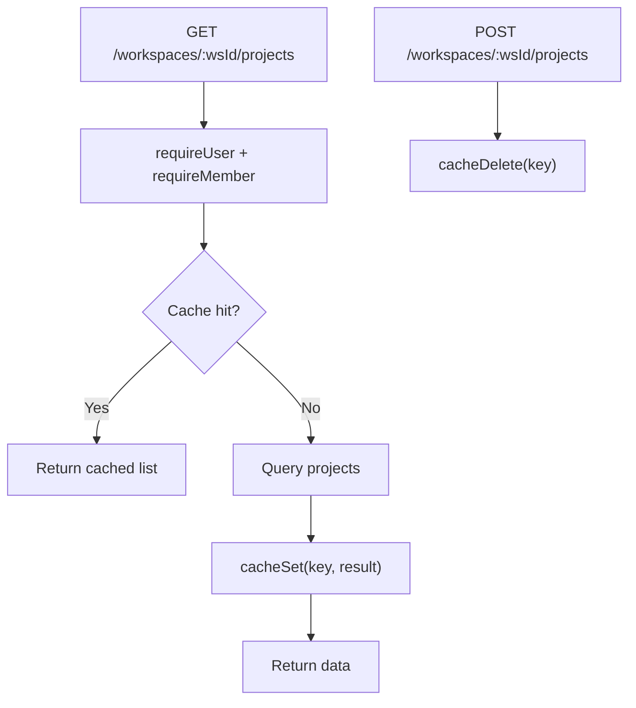

**Diagram sources**
- [src/routes/projects.ts:11-45](file://phoenix-backend/src/routes/projects.ts#L11-L45)
- [src/lib/cache.ts:5-24](file://phoenix-backend/src/lib/cache.ts#L5-L24)

**Section sources**
- [src/routes/projects.ts:1-58](file://phoenix-backend/src/routes/projects.ts#L1-L58)
- [src/lib/cache.ts:1-26](file://phoenix-backend/src/lib/cache.ts#L1-L26)

#### Tasks Routes
- List tasks with pagination, filtering, and stable ordering.
- Create task costs credits, uses atomic decrement, idempotency key support, and ledger entries.
- Refund logic ensures consistency if task creation fails.

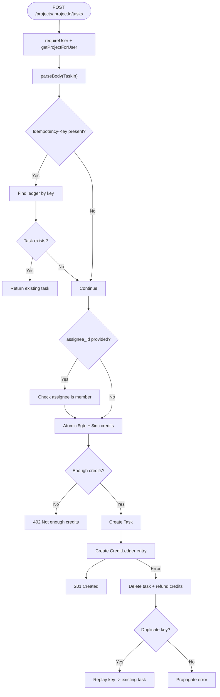

**Diagram sources**
- [src/routes/tasks.ts:38-125](file://phoenix-backend/src/routes/tasks.ts#L38-L125)

**Section sources**
- [src/routes/tasks.ts:1-127](file://phoenix-backend/src/routes/tasks.ts#L1-L127)

## Dependency Analysis
High-level dependencies between modules:

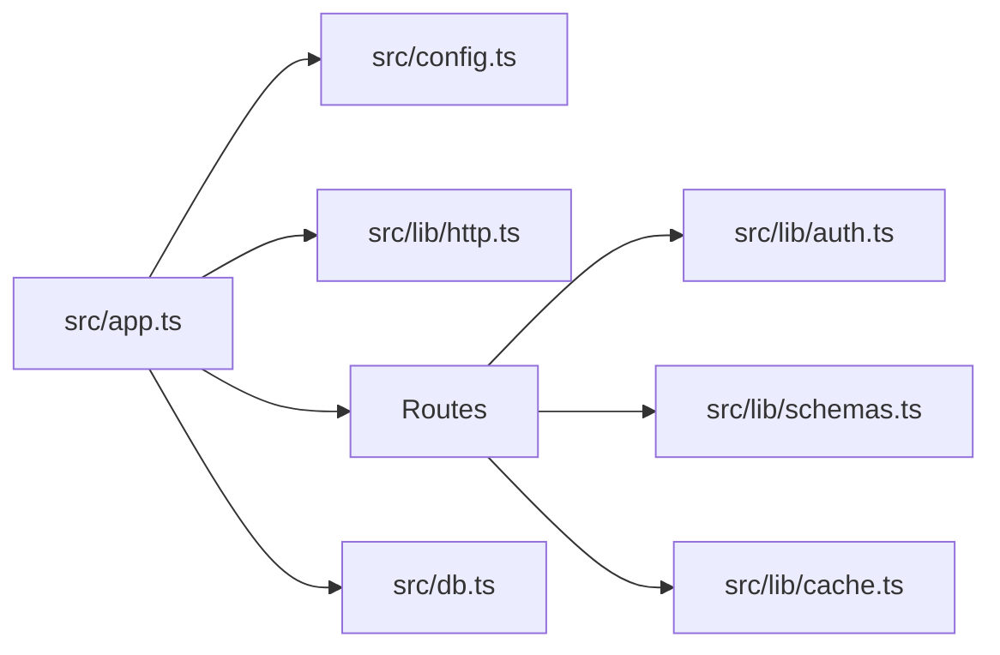

**Diagram sources**
- [src/app.ts:1-33](file://phoenix-backend/src/app.ts#L1-L33)
- [src/config.ts:1-41](file://phoenix-backend/src/config.ts#L1-L41)
- [src/lib/http.ts:1-81](file://phoenix-backend/src/lib/http.ts#L1-L81)
- [src/lib/auth.ts:1-58](file://phoenix-backend/src/lib/auth.ts#L1-L58)
- [src/lib/schemas.ts:1-41](file://phoenix-backend/src/lib/schemas.ts#L1-L41)
- [src/lib/cache.ts:1-26](file://phoenix-backend/src/lib/cache.ts#L1-L26)
- [src/db.ts:1-36](file://phoenix-backend/src/db.ts#L1-L36)

**Section sources**
- [src/app.ts:1-33](file://phoenix-backend/src/app.ts#L1-L33)

## Performance Considerations
- Connection pooling and reuse:
  - Mongoose default connection is reused; connectDb is idempotent and caches the connecting promise to prevent concurrent connection storms.
- Serverless cold starts:
  - Express app and database connection are created once per warm container; subsequent invocations reuse them to minimize latency.
- Caching strategy:
  - In-process TTL cache for read-mostly endpoints (e.g., project lists per workspace). Keys are scoped to workspace to respect multi-tenancy.
- Memory management:
  - Avoid storing large objects in cache; keep TTL short for hot data.
  - Ensure no long-lived references outside the request scope to allow garbage collection.
- Request size limits:
  - JSON body parser limited to 100KB to protect against oversized payloads.
- Database query efficiency:
  - Use lean queries where possible, selective field projection (e.g., credits-only reads), and stable sort keys for pagination.
- Atomic operations:
  - Credit spending uses atomic updates to prevent race conditions and ensure financial consistency.

[No sources needed since this section provides general guidance]

## Troubleshooting Guide
Common issues and resolutions:
- Invalid environment configuration:
  - Missing or malformed env vars cause startup failure due to strict schema validation. Verify required variables and formats.
- Database connectivity:
  - Health endpoint returns 503 when MongoDB is unreachable. Check network access rules and connection string.
- Authentication failures:
  - 401 indicates missing/invalid bearer token or expired token. Ensure client sends Authorization header correctly.
- Authorization denials:
  - 403 indicates insufficient role (admin/owner). Confirm user’s role in the workspace.
- Resource not found:
  - 404 for malformed IDs or non-existent resources. IDs must be 24-hex ObjectIds.
- Validation errors:
  - 422 for malformed request bodies. Inspect Zod error details in the response.
- Body too large:
  - 413 when request exceeds 100KB. Reduce payload size or adjust limits if necessary.
- Duplicate keys:
  - 409 for duplicate emails or memberships. Normalize inputs and handle conflicts gracefully.

**Section sources**
- [src/config.ts:28-40](file://phoenix-backend/src/config.ts#L28-L40)
- [src/routes/health.ts:11-26](file://phoenix-backend/src/routes/health.ts#L11-L26)
- [src/lib/http.ts:42-80](file://phoenix-backend/src/lib/http.ts#L42-L80)
- [src/lib/auth.ts:8-57](file://phoenix-backend/src/lib/auth.ts#L8-L57)
- [src/routes/auth.ts:11-51](file://phoenix-backend/src/routes/auth.ts#L11-L51)
- [src/routes/workspaces.ts:77-101](file://phoenix-backend/src/routes/workspaces.ts#L77-L101)

## Conclusion
Phoenix’s backend implements a clean, modular Express architecture suited for serverless deployment. It separates concerns across configuration, database management, shared libraries, and feature routes. Robust validation, centralized error handling, and careful permission checks provide security and reliability. Performance is optimized through connection reuse, targeted caching, and atomic operations, while maintaining clear operational signals via health checks and consistent error responses.