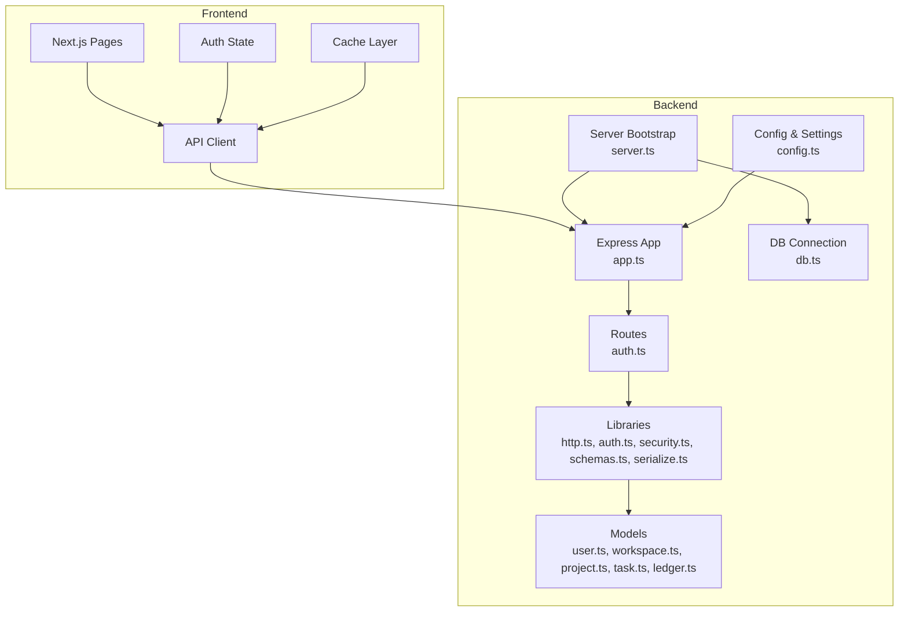
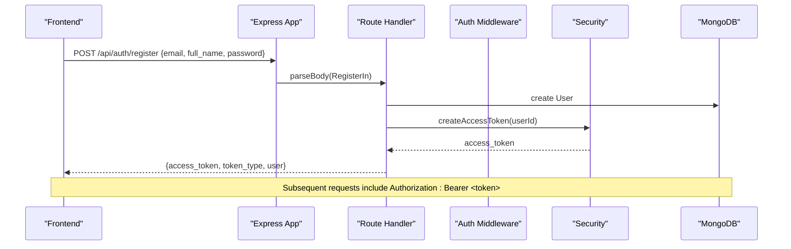
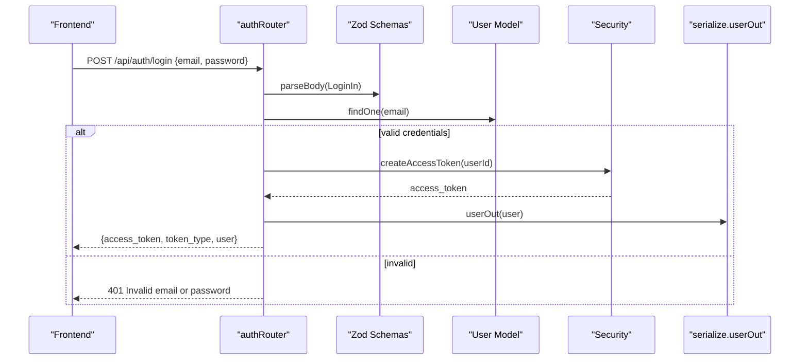
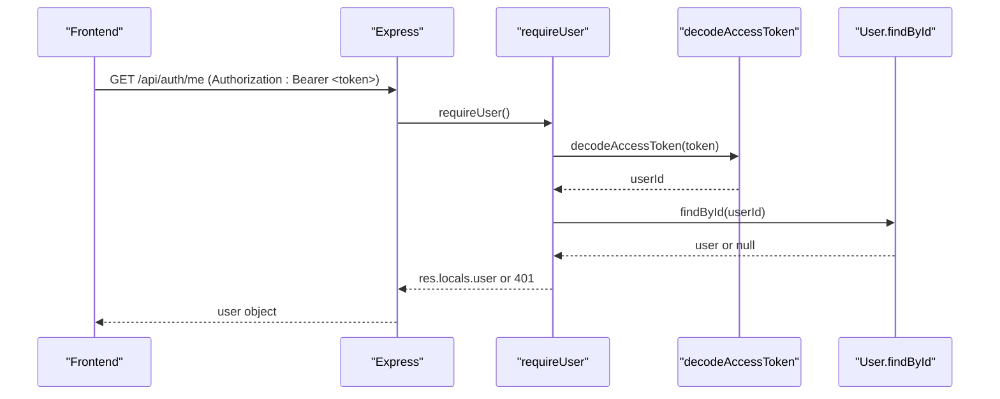
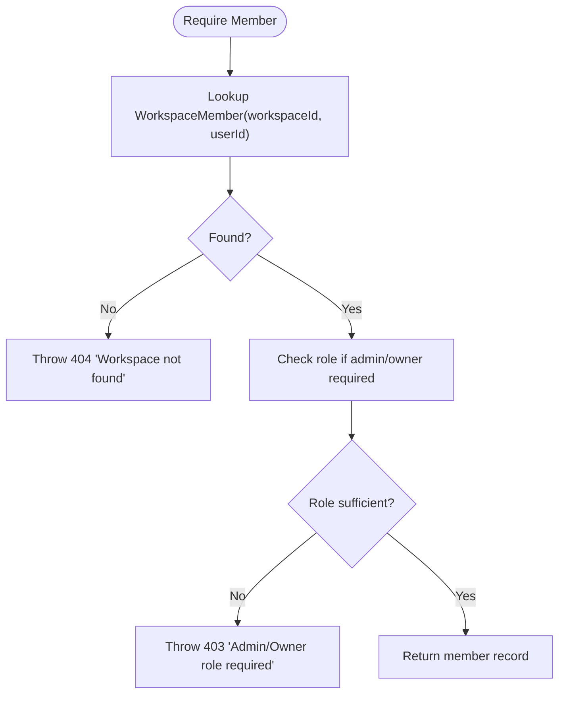
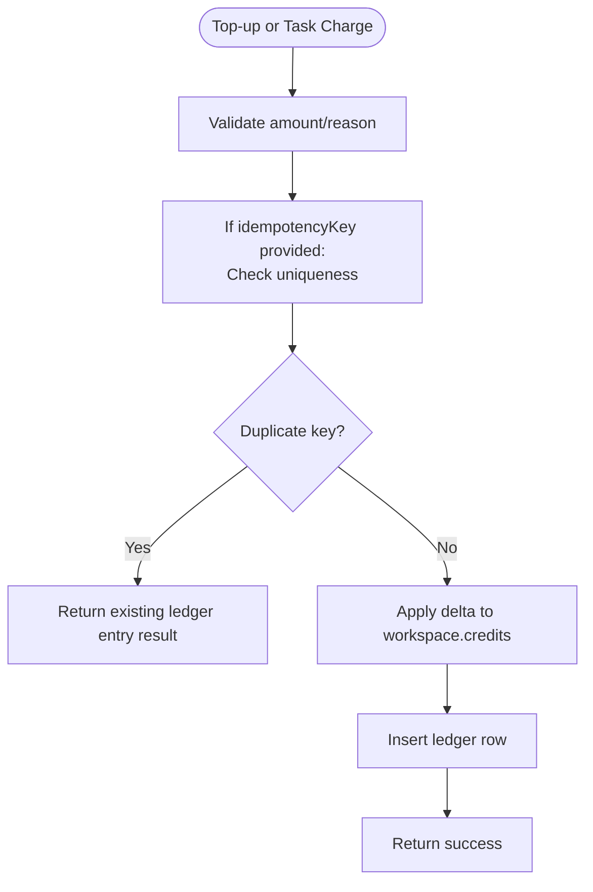
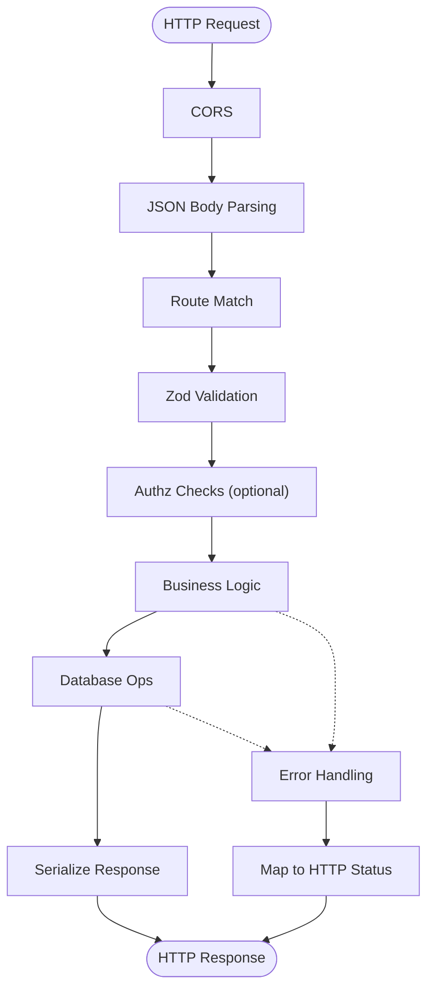
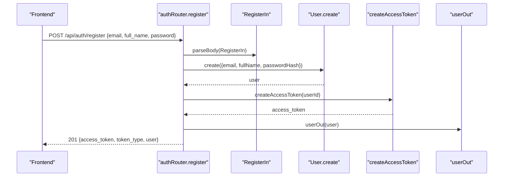
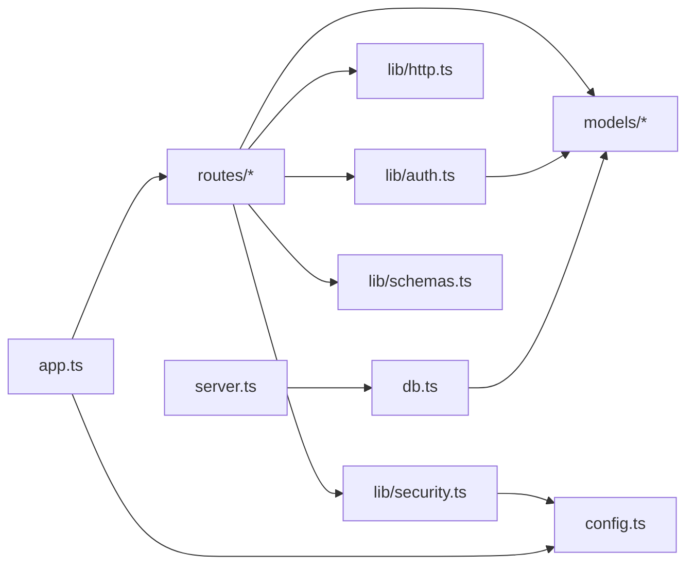

# Data Flow Patterns

<cite>
**Referenced Files in This Document**
- [README.md](file://README.md)
- [phoenix-backend/src/app.ts](file://phoenix-backend/src/app.ts)
- [phoenix-backend/src/server.ts](file://phoenix-backend/src/server.ts)
- [phoenix-backend/src/config.ts](file://phoenix-backend/src/config.ts)
- [phoenix-backend/src/db.ts](file://phoenix-backend/src/db.ts)
- [phoenix-backend/src/lib/http.ts](file://phoenix-backend/src/lib/http.ts)
- [phoenix-backend/src/lib/auth.ts](file://phoenix-backend/src/lib/auth.ts)
- [phoenix-backend/src/lib/security.ts](file://phoenix-backend/src/lib/security.ts)
- [phoenix-backend/src/lib/schemas.ts](file://phoenix-backend/src/lib/schemas.ts)
- [phoenix-backend/src/lib/serialize.ts](file://phoenix-backend/src/lib/serialize.ts)
- [phoenix-backend/src/routes/auth.ts](file://phoenix-backend/src/routes/auth.ts)
- [phoenix-backend/src/models/user.ts](file://phoenix-backend/src/models/user.ts)
- [phoenix-backend/src/models/workspace.ts](file://phoenix-backend/src/models/workspace.ts)
- [phoenix-backend/src/models/project.ts](file://phoenix-backend/src/models/project.ts)
- [phoenix-backend/src/models/task.ts](file://phoenix-backend/src/models/task.ts)
- [phoenix-backend/src/models/ledger.ts](file://phoenix-backend/src/models/ledger.ts)
- [phoenix-backend/src/models/index.ts](file://phoenix-backend/src/models/index.ts)
</cite>

## Table of Contents
1. [Introduction](#introduction)
2. [Project Structure](#project-structure)
3. [Core Components](#core-components)
4. [Architecture Overview](#architecture-overview)
5. [Detailed Component Analysis](#detailed-component-analysis)
6. [Dependency Analysis](#dependency-analysis)
7. [Performance Considerations](#performance-considerations)
8. [Troubleshooting Guide](#troubleshooting-guide)
9. [Conclusion](#conclusion)

## Introduction
This document explains the data flow patterns across the Phoenix application, focusing on:
- Authentication lifecycle (registration, login, JWT issuance and validation)
- Workspace membership and authorization
- Project and task operations
- Credit ledger and idempotent transactions
- Request-response pipeline (validation, business logic, persistence, serialization)
- Caching strategies at frontend and backend levels
- Error propagation and retry considerations

The backend is an Express + TypeScript API backed by MongoDB via Mongoose. The frontend is a Next.js application that consumes the API and manages local state and caching.

**Section sources**
- [README.md:1-140](file://README.md#L1-L140)

## Project Structure
Phoenix consists of three repositories:
- phoenix-backend: Node.js 20, TypeScript, Express, MongoDB (Mongoose), deployed to Vercel serverless
- phoenix-frontend: Next.js 14, React 18, TypeScript, deployed to Vercel
- phoenix-ci: GitHub Actions pipeline and smoke tests

**Diagram sources**
- [phoenix-backend/src/app.ts:11-31](file://phoenix-backend/src/app.ts#L11-L31)
- [phoenix-backend/src/server.ts:5-18](file://phoenix-backend/src/server.ts#L5-L18)
- [phoenix-backend/src/config.ts:28-40](file://phoenix-backend/src/config.ts#L28-L40)
- [phoenix-backend/src/db.ts:13-30](file://phoenix-backend/src/db.ts#L13-L30)
- [phoenix-backend/src/routes/auth.ts:11-51](file://phoenix-backend/src/routes/auth.ts#L11-L51)
- [phoenix-backend/src/models/user.ts:1-20](file://phoenix-backend/src/models/user.ts#L1-L20)
- [phoenix-backend/src/models/workspace.ts:1-22](file://phoenix-backend/src/models/workspace.ts#L1-L22)
- [phoenix-backend/src/models/project.ts:1-12](file://phoenix-backend/src/models/project.ts#L1-L12)
- [phoenix-backend/src/models/task.ts:1-15](file://phoenix-backend/src/models/task.ts#L1-L15)
- [phoenix-backend/src/models/ledger.ts:1-19](file://phoenix-backend/src/models/ledger.ts#L1-L19)

**Section sources**
- [README.md:1-140](file://README.md#L1-L140)

## Core Components
- Application bootstrap and middleware stack: Express app creation, CORS, JSON parsing, route mounting, error handlers
- Configuration: environment validation with defaults and derived settings
- Database: single shared Mongoose connection, model initialization, graceful disconnect
- Security: password hashing/verification, JWT signing/verification
- Authorization: bearer token extraction, user lookup, workspace membership checks
- Validation: Zod schemas for all inputs; typed request bodies
- Serialization: snake_case public contracts with string IDs
- Models: User, Workspace, WorkspaceMember, Project, Task, CreditLedger with indexes and constraints

**Section sources**
- [phoenix-backend/src/app.ts:11-31](file://phoenix-backend/src/app.ts#L11-L31)
- [phoenix-backend/src/config.ts:4-40](file://phoenix-backend/src/config.ts#L4-L40)
- [phoenix-backend/src/db.ts:1-36](file://phoenix-backend/src/db.ts#L1-L36)
- [phoenix-backend/src/lib/security.ts:1-38](file://phoenix-backend/src/lib/security.ts#L1-L38)
- [phoenix-backend/src/lib/auth.ts:1-58](file://phoenix-backend/src/lib/auth.ts#L1-L58)
- [phoenix-backend/src/lib/schemas.ts:1-41](file://phoenix-backend/src/lib/schemas.ts#L1-L41)
- [phoenix-backend/src/lib/serialize.ts:1-34](file://phoenix-backend/src/lib/serialize.ts#L1-L34)
- [phoenix-backend/src/models/index.ts:1-27](file://phoenix-backend/src/models/index.ts#L1-L27)

## Architecture Overview
The backend follows a layered architecture:
- HTTP layer: Express routes and middleware
- Domain layer: Authorization helpers and business rules
- Persistence layer: Mongoose models and indexes
- Cross-cutting: config, security, validation, serialization, error handling

**Diagram sources**
- [phoenix-backend/src/routes/auth.ts:11-31](file://phoenix-backend/src/routes/auth.ts#L11-L31)
- [phoenix-backend/src/lib/security.ts:23-29](file://phoenix-backend/src/lib/security.ts#L23-L29)
- [phoenix-backend/src/models/user.ts:1-20](file://phoenix-backend/src/models/user.ts#L1-L20)

## Detailed Component Analysis

### Authentication Flow
Registration and login both validate input, persist or verify the user, and return a signed JWT. Protected endpoints extract and decode the token, resolve the user, and attach it to the request context.

Token validation on protected routes:

Key behaviors:
- Input validation uses Zod schemas; malformed payloads return 422
- Passwords are hashed with PBKDF2; verification is timing-safe
- JWTs are signed with HS* algorithms using configured secret and algorithm
- Token decoding enforces the same algorithm used for signing
- Missing or invalid tokens yield 401; non-existent users yield 401

**Diagram sources**
- [phoenix-backend/src/routes/auth.ts:33-51](file://phoenix-backend/src/routes/auth.ts#L33-L51)
- [phoenix-backend/src/lib/auth.ts:8-27](file://phoenix-backend/src/lib/auth.ts#L8-L27)
- [phoenix-backend/src/lib/security.ts:23-37](file://phoenix-backend/src/lib/security.ts#L23-L37)
- [phoenix-backend/src/lib/schemas.ts:7-13](file://phoenix-backend/src/lib/schemas.ts#L7-L13)

**Section sources**
- [phoenix-backend/src/routes/auth.ts:11-51](file://phoenix-backend/src/routes/auth.ts#L11-L51)
- [phoenix-backend/src/lib/auth.ts:1-58](file://phoenix-backend/src/lib/auth.ts#L1-L58)
- [phoenix-backend/src/lib/security.ts:1-38](file://phoenix-backend/src/lib/security.ts#L1-L38)
- [phoenix-backend/src/lib/schemas.ts:7-13](file://phoenix-backend/src/lib/schemas.ts#L7-L13)
- [phoenix-backend/src/lib/serialize.ts:7-11](file://phoenix-backend/src/lib/serialize.ts#L7-L11)

### Authorization and Workspace Membership
Authorization helpers ensure the caller belongs to a workspace and has the required role. Access checks prefer 404 over 403 to avoid leaking workspace existence.

**Diagram sources**
- [phoenix-backend/src/lib/auth.ts:29-50](file://phoenix-backend/src/lib/auth.ts#L29-L50)

**Section sources**
- [phoenix-backend/src/lib/auth.ts:29-50](file://phoenix-backend/src/lib/auth.ts#L29-L50)

### Workspace Creation and Project Task Operations
While specific route files for workspaces and projects are not included here, the domain models and authorization primitives define the expected flows:
- Workspace creation requires an authenticated owner and initializes credits per configuration
- Projects belong to a workspace; tasks belong to a project
- Tasks support assignment to users and status transitions

Data models:
- Workspace: name, owner, credits (non-negative)
- WorkspaceMember: unique composite index on (workspace, user)
- Project: workspace reference, name, description
- Task: project reference, title, status enum, createdBy, assignee, createdAt
- CreditLedger: append-only history with optional idempotency key

Indexes and constraints:
- WorkspaceMember(workspace, user) unique
- Task(project, createdAt, _id) composite index for listing
- CreditLedger(workspace, idempotencyKey) unique partial index when present

**Section sources**
- [phoenix-backend/src/models/workspace.ts:1-22](file://phoenix-backend/src/models/workspace.ts#L1-L22)
- [phoenix-backend/src/models/project.ts:1-12](file://phoenix-backend/src/models/project.ts#L1-L12)
- [phoenix-backend/src/models/task.ts:1-15](file://phoenix-backend/src/models/task.ts#L1-L15)

### Credit Transaction Processing and Idempotency
Credit changes are recorded in an append-only ledger with optional idempotency keys to prevent duplicate charges.

Notes:
- The ledger schema includes a partial unique index on (workspace, idempotencyKey) when the key is present
- This provides database-enforced idempotency for operations that supply an idempotency key

**Diagram sources**
- [phoenix-backend/src/models/ledger.ts:1-19](file://phoenix-backend/src/models/ledger.ts#L1-L19)

**Section sources**
- [phoenix-backend/src/models/ledger.ts:1-19](file://phoenix-backend/src/models/ledger.ts#L1-L19)

### Request-Response Lifecycle
Every request passes through:
1. CORS and JSON body parsing
2. Route handler invocation
3. Input validation via Zod
4. Authorization checks (if protected)
5. Business logic and database operations
6. Response serialization to snake_case with string IDs
7. Global error handling mapping errors to appropriate HTTP statuses

**Diagram sources**
- [phoenix-backend/src/app.ts:17-30](file://phoenix-backend/src/app.ts#L17-L30)
- [phoenix-backend/src/lib/http.ts:20-24](file://phoenix-backend/src/lib/http.ts#L20-L24)
- [phoenix-backend/src/lib/http.ts:42-80](file://phoenix-backend/src/lib/http.ts#L42-L80)
- [phoenix-backend/src/lib/serialize.ts:1-34](file://phoenix-backend/src/lib/serialize.ts#L1-L34)

**Section sources**
- [phoenix-backend/src/app.ts:11-31](file://phoenix-backend/src/app.ts#L11-L31)
- [phoenix-backend/src/lib/http.ts:1-81](file://phoenix-backend/src/lib/http.ts#L1-L81)
- [phoenix-backend/src/lib/serialize.ts:1-34](file://phoenix-backend/src/lib/serialize.ts#L1-L34)

### Typical User Workflows

#### Registration Workflow

**Diagram sources**
- [phoenix-backend/src/routes/auth.ts:11-31](file://phoenix-backend/src/routes/auth.ts#L11-L31)
- [phoenix-backend/src/lib/security.ts:23-29](file://phoenix-backend/src/lib/security.ts#L23-L29)
- [phoenix-backend/src/lib/serialize.ts:7-11](file://phoenix-backend/src/lib/serialize.ts#L7-L11)

#### Workspace Creation Workflow
Conceptual flow:
- Authenticate user
- Validate workspace name
- Create workspace with owner and initial credits
- Create WorkspaceMember(owner, role=owner)
- Return workspace details

(Implementation-specific route code is not included in this analysis.)

#### Task Assignment Workflow
Conceptual flow:
- Authenticate user
- Verify workspace membership
- Load project within workspace
- Validate task payload (title, status, assignee_id)
- Update or create task with createdBy set to current user
- Optionally charge credits and record ledger entry (with idempotency key)
- Return serialized task

(Implementation-specific route code is not included in this analysis.)

## Dependency Analysis
High-level dependencies between core modules:

**Diagram sources**
- [phoenix-backend/src/app.ts:1-31](file://phoenix-backend/src/app.ts#L1-L31)
- [phoenix-backend/src/server.ts:1-18](file://phoenix-backend/src/server.ts#L1-L18)
- [phoenix-backend/src/db.ts:1-30](file://phoenix-backend/src/db.ts#L1-L30)
- [phoenix-backend/src/lib/auth.ts:1-58](file://phoenix-backend/src/lib/auth.ts#L1-L58)
- [phoenix-backend/src/lib/security.ts:1-38](file://phoenix-backend/src/lib/security.ts#L1-L38)
- [phoenix-backend/src/lib/http.ts:1-81](file://phoenix-backend/src/lib/http.ts#L1-L81)
- [phoenix-backend/src/lib/schemas.ts:1-41](file://phoenix-backend/src/lib/schemas.ts#L1-L41)
- [phoenix-backend/src/models/index.ts:1-27](file://phoenix-backend/src/models/index.ts#L1-L27)

**Section sources**
- [phoenix-backend/src/models/index.ts:1-27](file://phoenix-backend/src/models/index.ts#L1-L27)

## Performance Considerations
- Database connection reuse: The shared Mongoose connection is reused across serverless invocations and tests, reducing cold-start overhead.
- Indexing: Composite indexes on Task and unique partial index on CreditLedger improve query performance and enforce consistency.
- Strict query mode: Enabling strictQuery prevents accidental loose queries.
- Input size limits: JSON body limit protects against large payloads.
- Pagination: Task queries expose page and page_size parameters to control response sizes.

[No sources needed since this section provides general guidance]

## Troubleshooting Guide
Common issues and their handling:
- Malformed JSON: Returns 400 with a descriptive detail
- Validation failures: Returns 422 with Zod issue details
- Duplicate registration: Returns 409 for duplicate email
- Not found resources: Returns 404 for missing documents or invalid IDs
- Too-large payloads: Returns 413
- Unhandled exceptions: Logged and converted to 500 without crashing the process

Operational safeguards:
- Process-level handlers for unhandledRejection and uncaughtException log errors but keep the process alive
- Graceful shutdown closes the Express server and disconnects from MongoDB

**Section sources**
- [phoenix-backend/src/lib/http.ts:42-80](file://phoenix-backend/src/lib/http.ts#L42-L80)
- [phoenix-backend/src/server.ts:20-31](file://phoenix-backend/src/server.ts#L20-L31)

## Conclusion
Phoenix’s data flows are built around clear layers:
- Secure authentication with strong password hashing and algorithm-aware JWT verification
- Explicit authorization via workspace membership and role checks
- Validated inputs and consistent serialization for a stable API contract
- Append-only credit ledger with database-enforced idempotency
- Robust error mapping and process resilience

These patterns provide a solid foundation for reliable multi-tenant project tracking while maintaining clarity and safety across the system.