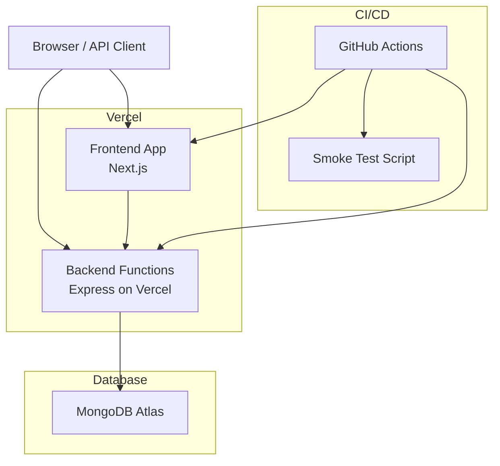
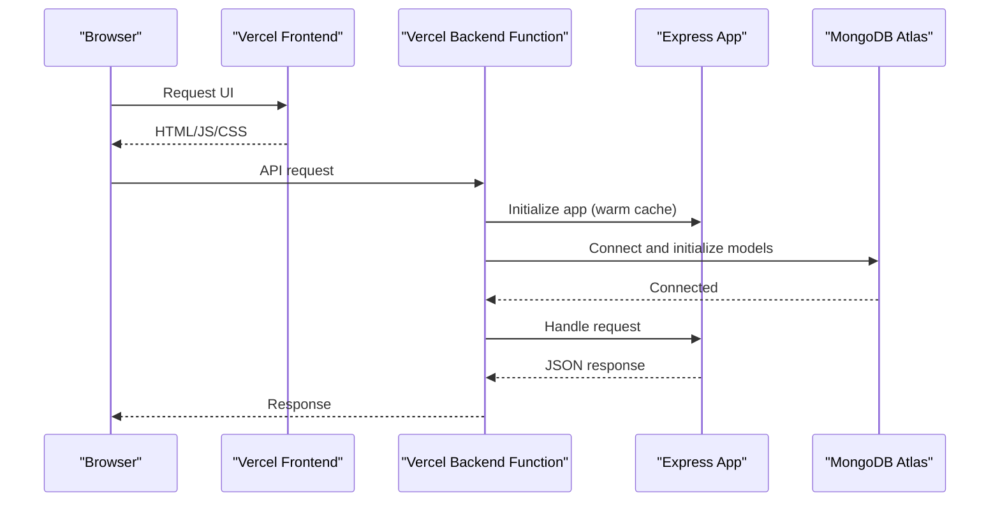
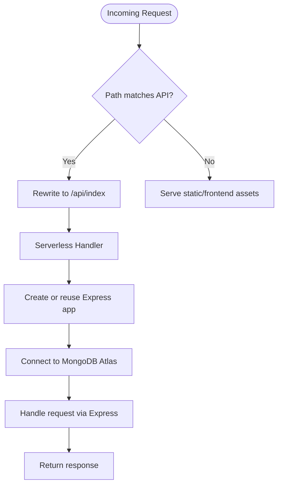
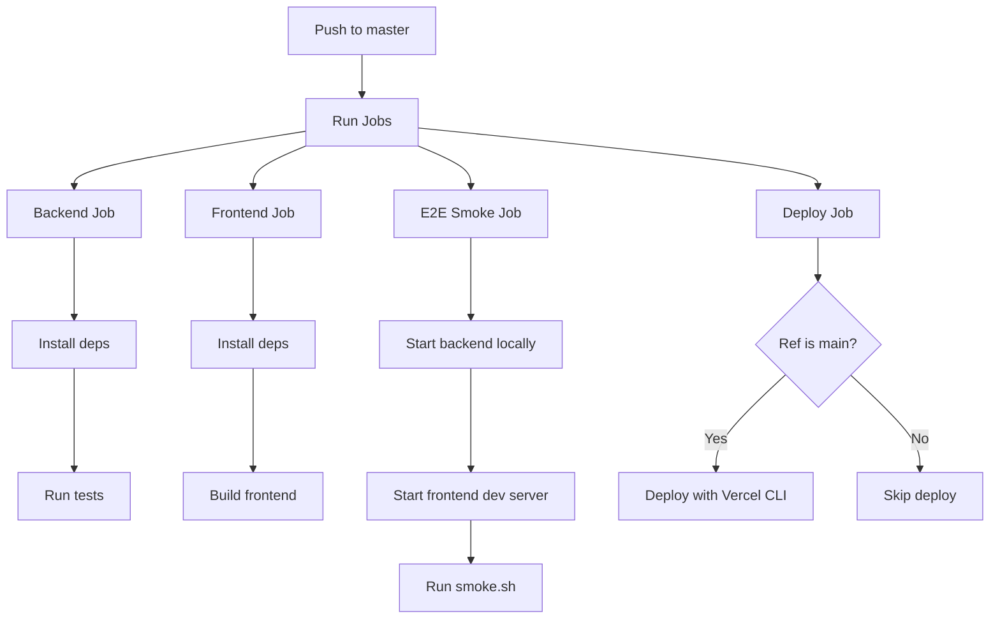
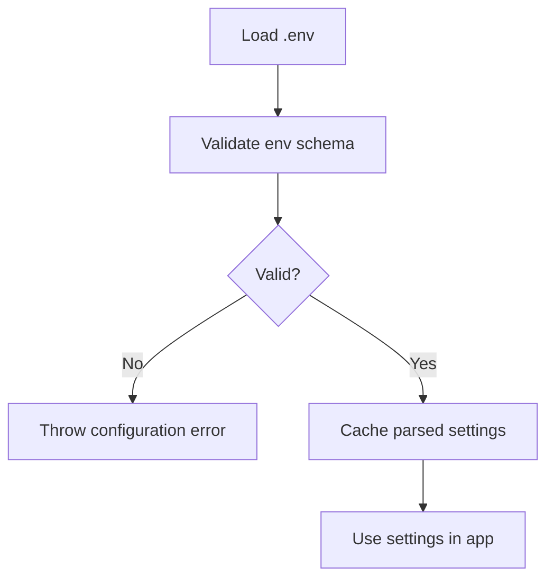
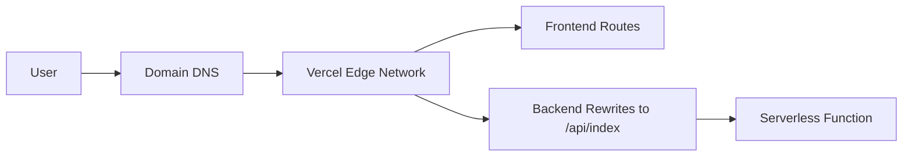
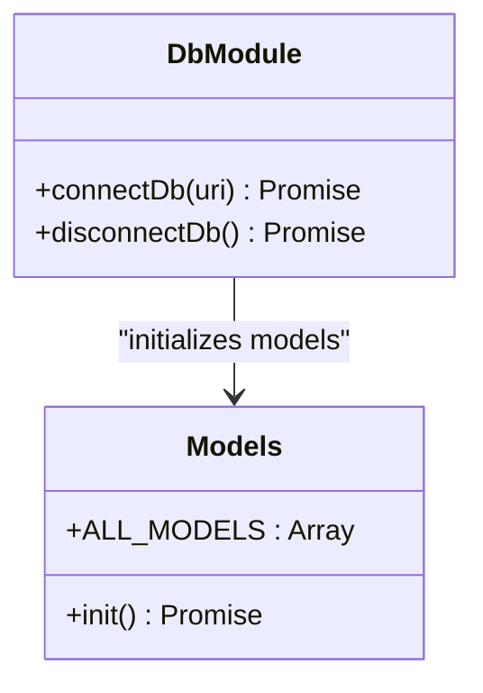
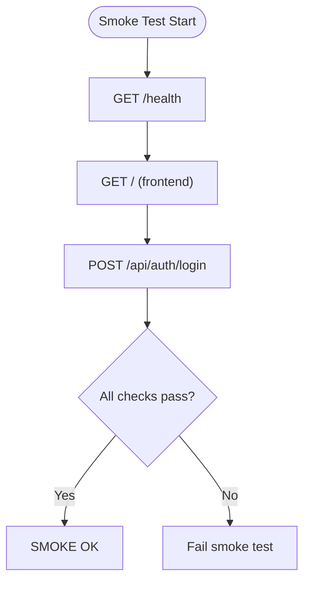
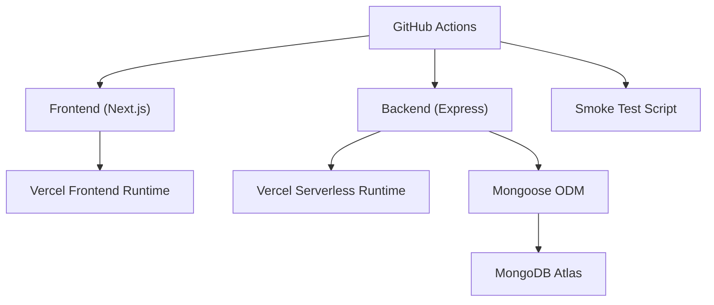

# Deployment Topology

<cite>
**Referenced Files in This Document**
- [README.md](file://README.md)
- [phoenix-backend/vercel.json](file://phoenix-backend/vercel.json)
- [phoenix-frontend/vercel.json](file://phoenix-frontend/vercel.json)
- [phoenix-backend/.github/workflows/ci.yml](file://phoenix-backend/.github/workflows/ci.yml)
- [phoenix-frontend/.github/workflows/ci.yml](file://phoenix-frontend/.github/workflows/ci.yml)
- [phoenix-ci/.github/workflows/pipeline.yml](file://phoenix-ci/.github/workflows/pipeline.yml)
- [phoenix-backend/src/config.ts](file://phoenix-backend/src/config.ts)
- [phoenix-backend/src/db.ts](file://phoenix-backend/src/db.ts)
- [phoenix-backend/api/index.ts](file://phoenix-backend/api/index.ts)
- [phoenix-frontend/next.config.mjs](file://phoenix-frontend/next.config.mjs)
- [phoenix-ci/scripts/smoke.sh](file://phoenix-ci/scripts/smoke.sh)
</cite>

## Table of Contents
1. [Introduction](#introduction)
2. [Project Structure](#project-structure)
3. [Core Components](#core-components)
4. [Architecture Overview](#architecture-overview)
5. [Detailed Component Analysis](#detailed-component-analysis)
6. [Dependency Analysis](#dependency-analysis)
7. [Performance Considerations](#performance-considerations)
8. [Troubleshooting Guide](#troubleshooting-guide)
9. [Conclusion](#conclusion)

## Introduction
This document describes the deployment topology and infrastructure architecture for Project Phoenix. The system consists of:
- A Next.js frontend deployed to Vercel as a static and serverless application.
- A Node.js Express backend deployed to Vercel as serverless functions.
- MongoDB Atlas as the managed database.
- GitHub Actions CI/CD pipelines for testing, building, smoke testing, and deploying.

The goal is to explain how requests flow through Vercel’s edge network into serverless functions, how environment configuration is managed, and how the CI/CD pipeline validates and deploys the application. It also covers scaling considerations, monitoring, disaster recovery, environment differences, and local development setup.

## Project Structure
Phoenix is organized into three repositories within one workspace:
- phoenix-frontend: Next.js 14 frontend with TypeScript.
- phoenix-backend: Express API with TypeScript and Mongoose.
- phoenix-ci: Shared GitHub Actions workflow and smoke test script.

**Diagram sources**
- [phoenix-frontend/vercel.json:1-5](file://phoenix-frontend/vercel.json#L1-L5)
- [phoenix-backend/vercel.json:1-5](file://phoenix-backend/vercel.json#L1-L5)
- [phoenix-backend/api/index.ts:1-21](file://phoenix-backend/api/index.ts#L1-L21)
- [phoenix-backend/src/db.ts:1-36](file://phoenix-backend/src/db.ts#L1-L36)
- [phoenix-ci/.github/workflows/pipeline.yml:1-73](file://phoenix-ci/.github/workflows/pipeline.yml#L1-L73)
- [phoenix-ci/scripts/smoke.sh:1-17](file://phoenix-ci/scripts/smoke.sh#L1-L17)

**Section sources**
- [README.md:7-14](file://README.md#L7-L14)

## Core Components
- Frontend (Next.js): Deployed to Vercel using the Next.js framework integration. The build is configured with React Strict Mode enabled.
- Backend (Express + Mongoose): Deployed to Vercel as serverless functions. All routes are rewritten to a single handler that initializes the app once per warm invocation and connects to MongoDB Atlas.
- Database (MongoDB Atlas): Managed cloud database accessed via Mongoose. Connection initialization includes model initialization and error handling.
- CI/CD (GitHub Actions): Separate workflows for frontend and backend builds/tests, plus a shared pipeline orchestrating tests, smoke tests, and deployment.

Key responsibilities:
- Vercel routing and serverless execution for both apps.
- Environment validation and settings loading for the backend.
- Database connection lifecycle management for serverless invocations.
- Automated testing and deployment automation.

**Section sources**
- [phoenix-frontend/vercel.json:1-5](file://phoenix-frontend/vercel.json#L1-L5)
- [phoenix-frontend/next.config.mjs:1-7](file://phoenix-frontend/next.config.mjs#L1-L7)
- [phoenix-backend/vercel.json:1-5](file://phoenix-backend/vercel.json#L1-L5)
- [phoenix-backend/api/index.ts:1-21](file://phoenix-backend/api/index.ts#L1-L21)
- [phoenix-backend/src/config.ts:1-41](file://phoenix-backend/src/config.ts#L1-L41)
- [phoenix-backend/src/db.ts:1-36](file://phoenix-backend/src/db.ts#L1-L36)

## Architecture Overview
The runtime architecture uses Vercel’s edge network to serve the frontend and route API requests to serverless functions. The backend connects to MongoDB Atlas over TLS.

**Diagram sources**
- [phoenix-frontend/vercel.json:1-5](file://phoenix-frontend/vercel.json#L1-L5)
- [phoenix-backend/vercel.json:1-5](file://phoenix-backend/vercel.json#L1-L5)
- [phoenix-backend/api/index.ts:1-21](file://phoenix-backend/api/index.ts#L1-L21)
- [phoenix-backend/src/db.ts:1-36](file://phoenix-backend/src/db.ts#L1-L36)

## Detailed Component Analysis

### Serverless Deployment Strategy on Vercel
- Frontend:
  - Framework detection is set to Next.js.
  - Build uses React Strict Mode.
  - Vercel automatically handles static assets, SSR where applicable, and global CDN distribution.
- Backend:
  - All paths are rewritten to a single serverless function entry point.
  - The handler reuses the Express app instance across invocations when possible.
  - Database connection is established lazily and cached per warm invocation.
  - No long-running server process; the function returns responses directly.

**Diagram sources**
- [phoenix-backend/vercel.json:1-5](file://phoenix-backend/vercel.json#L1-L5)
- [phoenix-backend/api/index.ts:1-21](file://phoenix-backend/api/index.ts#L1-L21)

**Section sources**
- [phoenix-frontend/vercel.json:1-5](file://phoenix-frontend/vercel.json#L1-L5)
- [phoenix-frontend/next.config.mjs:1-7](file://phoenix-frontend/next.config.mjs#L1-L7)
- [phoenix-backend/vercel.json:1-5](file://phoenix-backend/vercel.json#L1-L5)
- [phoenix-backend/api/index.ts:1-21](file://phoenix-backend/api/index.ts#L1-L21)

### GitHub Actions CI/CD Pipeline
There are three relevant CI configurations:
- Backend CI: Installs dependencies, sets a test MongoDB URI, runs tests, and allows failures.
- Frontend CI: Installs dependencies and runs the build, allowing failures.
- Shared Pipeline: Orchestrates backend and frontend jobs, caches npm packages, runs tests, starts local services for smoke testing, and deploys to Vercel.

**Diagram sources**
- [phoenix-ci/.github/workflows/pipeline.yml:1-73](file://phoenix-ci/.github/workflows/pipeline.yml#L1-L73)
- [phoenix-backend/.github/workflows/ci.yml:1-19](file://phoenix-backend/.github/workflows/ci.yml#L1-L19)
- [phoenix-frontend/.github/workflows/ci.yml:1-16](file://phoenix-frontend/.github/workflows/ci.yml#L1-L16)
- [phoenix-ci/scripts/smoke.sh:1-17](file://phoenix-ci/scripts/smoke.sh#L1-L17)

**Section sources**
- [phoenix-backend/.github/workflows/ci.yml:1-19](file://phoenix-backend/.github/workflows/ci.yml#L1-L19)
- [phoenix-frontend/.github/workflows/ci.yml:1-16](file://phoenix-frontend/.github/workflows/ci.yml#L1-L16)
- [phoenix-ci/.github/workflows/pipeline.yml:1-73](file://phoenix-ci/.github/workflows/pipeline.yml#L1-L73)
- [phoenix-ci/scripts/smoke.sh:1-17](file://phoenix-ci/scripts/smoke.sh#L1-L17)

### Environment Configuration Management
- Backend loads environment variables at startup and validates them using a schema. Required values include MongoDB URI, JWT secret, algorithm, expiration, CORS origins, feature flags, version, and port.
- Settings are cached after successful parsing to avoid repeated validation overhead.
- CORS origins are parsed from a comma-separated string into an array.

**Diagram sources**
- [phoenix-backend/src/config.ts:1-41](file://phoenix-backend/src/config.ts#L1-L41)

**Section sources**
- [phoenix-backend/src/config.ts:1-41](file://phoenix-backend/src/config.ts#L1-L41)

### Domain Routing and SSL Certificate Handling
- Frontend: Vercel detects the Next.js framework and serves the app globally. Custom domains and SSL certificates are managed by Vercel.
- Backend: All incoming requests are rewritten to the serverless function entry point. Vercel terminates TLS and forwards requests to the function.

**Diagram sources**
- [phoenix-frontend/vercel.json:1-5](file://phoenix-frontend/vercel.json#L1-L5)
- [phoenix-backend/vercel.json:1-5](file://phoenix-backend/vercel.json#L1-L5)

**Section sources**
- [phoenix-frontend/vercel.json:1-5](file://phoenix-frontend/vercel.json#L1-L5)
- [phoenix-backend/vercel.json:1-5](file://phoenix-backend/vercel.json#L1-L5)

### Database Connectivity and Initialization
- The backend uses Mongoose to connect to MongoDB Atlas.
- Connection initialization is idempotent and cached per warm invocation.
- Model initialization is triggered after connection establishment.
- Disconnection resets the connecting promise to allow retries.

**Diagram sources**
- [phoenix-backend/src/db.ts:1-36](file://phoenix-backend/src/db.ts#L1-L36)

**Section sources**
- [phoenix-backend/src/db.ts:1-36](file://phoenix-backend/src/db.ts#L1-L36)

### End-to-End Smoke Testing
The smoke test script verifies:
- Backend health endpoint responds.
- Frontend root page loads.
- Authentication login endpoint accepts demo credentials.

**Diagram sources**
- [phoenix-ci/scripts/smoke.sh:1-17](file://phoenix-ci/scripts/smoke.sh#L1-L17)

**Section sources**
- [phoenix-ci/scripts/smoke.sh:1-17](file://phoenix-ci/scripts/smoke.sh#L1-L17)

## Dependency Analysis
The following diagram shows high-level dependencies between components and external services.

**Diagram sources**
- [phoenix-frontend/vercel.json:1-5](file://phoenix-frontend/vercel.json#L1-L5)
- [phoenix-backend/vercel.json:1-5](file://phoenix-backend/vercel.json#L1-L5)
- [phoenix-backend/src/db.ts:1-36](file://phoenix-backend/src/db.ts#L1-L36)
- [phoenix-ci/.github/workflows/pipeline.yml:1-73](file://phoenix-ci/.github/workflows/pipeline.yml#L1-L73)
- [phoenix-ci/scripts/smoke.sh:1-17](file://phoenix-ci/scripts/smoke.sh#L1-L17)

**Section sources**
- [phoenix-backend/src/db.ts:1-36](file://phoenix-backend/src/db.ts#L1-L36)
- [phoenix-ci/.github/workflows/pipeline.yml:1-73](file://phoenix-ci/.github/workflows/pipeline.yml#L1-L73)

## Performance Considerations
- Cold Starts:
  - Backend serverless functions may experience cold starts. Reusing the Express app and database connection per warm invocation reduces latency.
  - Consider pre-warming strategies if critical endpoints require low-latency responses.
- Database Connections:
  - Ensure connection pooling is appropriate for serverless workloads.
  - Monitor MongoDB Atlas connection limits and adjust cluster sizing if needed.
- Caching:
  - Leverage Vercel’s CDN for frontend assets.
  - Consider adding caching headers for API responses where appropriate.
- Build Optimization:
  - Keep dependency lists minimal and pinned to reduce install times.
  - Use caching for npm packages in CI to speed up builds.

[No sources needed since this section provides general guidance]

## Troubleshooting Guide
Common issues and resolutions:
- Invalid Environment Variables:
  - If required environment variables are missing or invalid, the backend will throw a configuration error during startup. Verify all required keys and formats.
- Database Connection Failures:
  - Ensure MongoDB Atlas network access rules allow Vercel IPs or public access as needed.
  - Confirm the MongoDB URI format and credentials are correct.
- CI Pipeline Failures:
  - Backend and frontend CI steps currently allow failures; ensure tests and builds pass locally before pushing changes.
  - The shared pipeline deploys only when the branch reference matches the expected production branch.
- Smoke Test Failures:
  - Verify backend health and authentication endpoints respond correctly.
  - Ensure frontend dev server is reachable at the expected URL.

**Section sources**
- [phoenix-backend/src/config.ts:1-41](file://phoenix-backend/src/config.ts#L1-L41)
- [phoenix-backend/src/db.ts:1-36](file://phoenix-backend/src/db.ts#L1-L36)
- [phoenix-backend/.github/workflows/ci.yml:1-19](file://phoenix-backend/.github/workflows/ci.yml#L1-L19)
- [phoenix-frontend/.github/workflows/ci.yml:1-16](file://phoenix-frontend/.github/workflows/ci.yml#L1-L16)
- [phoenix-ci/.github/workflows/pipeline.yml:1-73](file://phoenix-ci/.github/workflows/pipeline.yml#L1-L73)
- [phoenix-ci/scripts/smoke.sh:1-17](file://phoenix-ci/scripts/smoke.sh#L1-L17)

## Conclusion
Project Phoenix deploys a Next.js frontend and an Express backend to Vercel, with MongoDB Atlas as the data store. The CI/CD pipeline automates testing, smoke testing, and deployment. Environment configuration is validated at runtime, and database connections are managed carefully for serverless environments. To improve reliability and performance, consider strengthening CI failure behavior, optimizing cold starts, and implementing robust monitoring and alerting. Disaster recovery should focus on MongoDB backups, environment secret rotation, and deployment rollback procedures.

[No sources needed since this section summarizes without analyzing specific files]