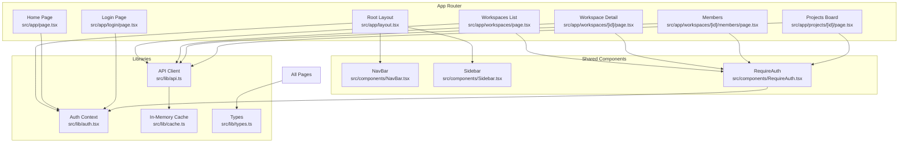
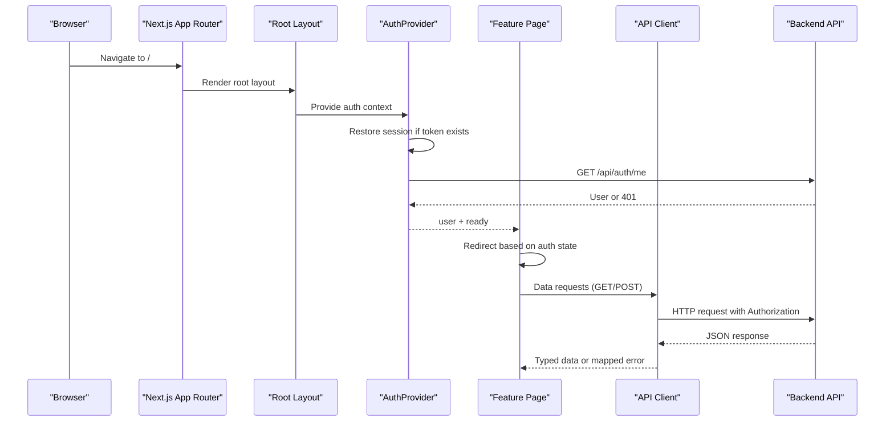
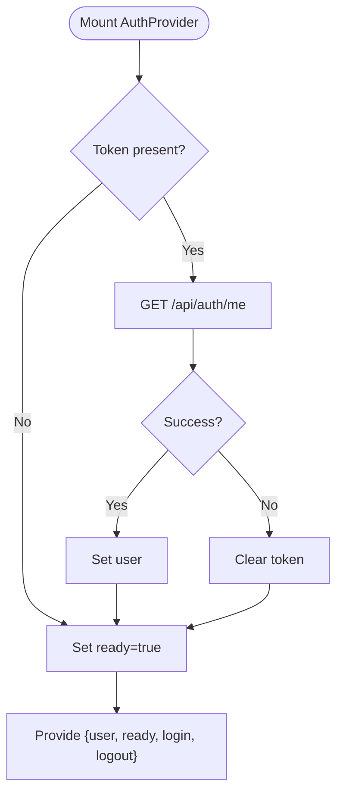
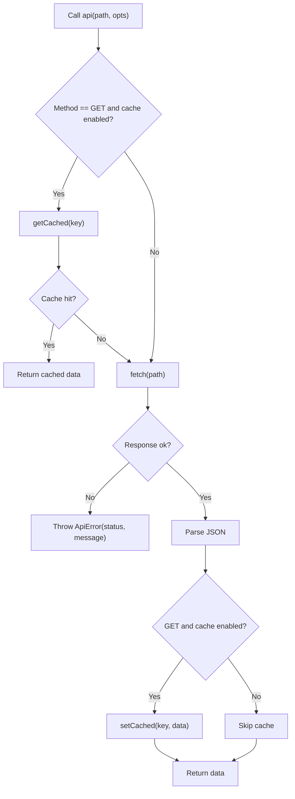
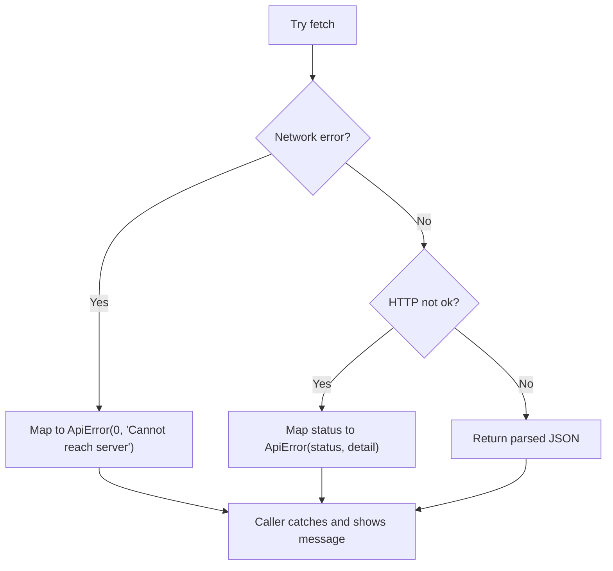
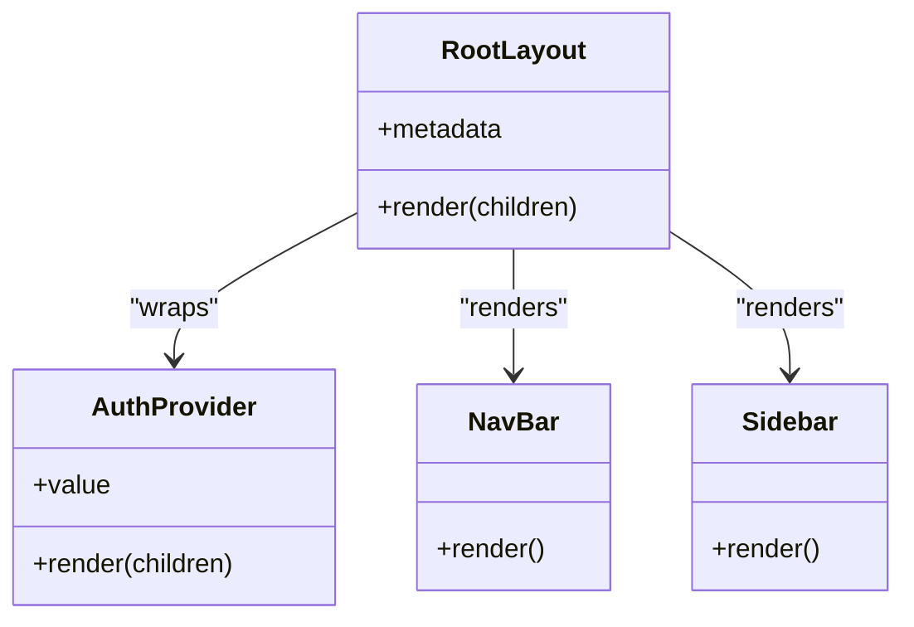
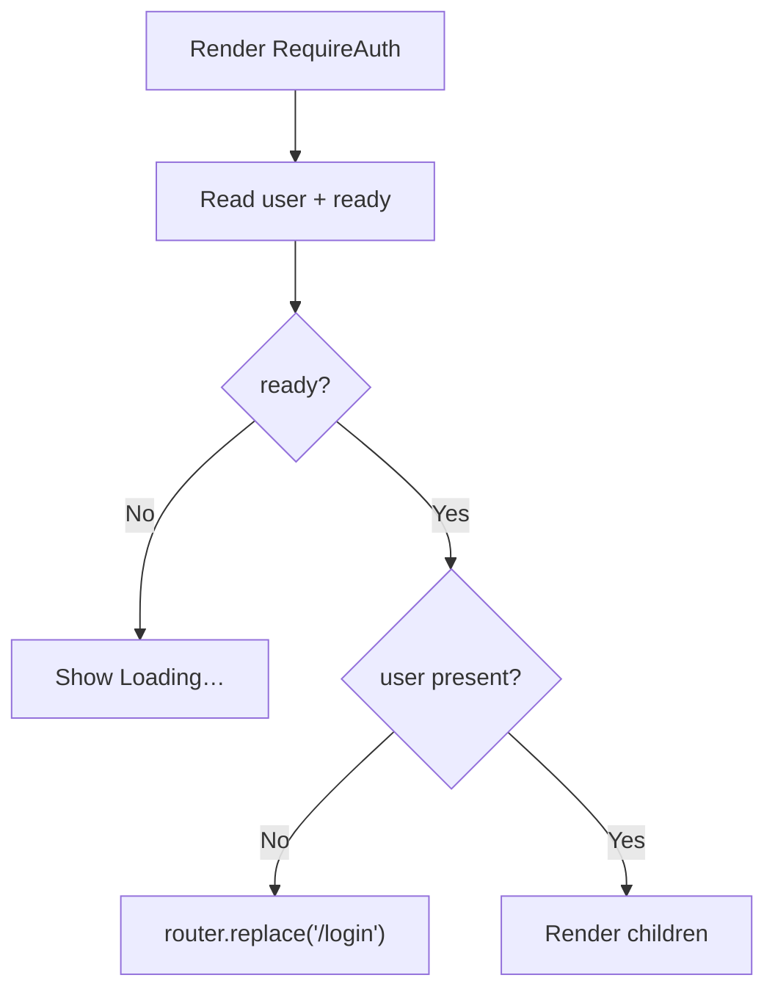
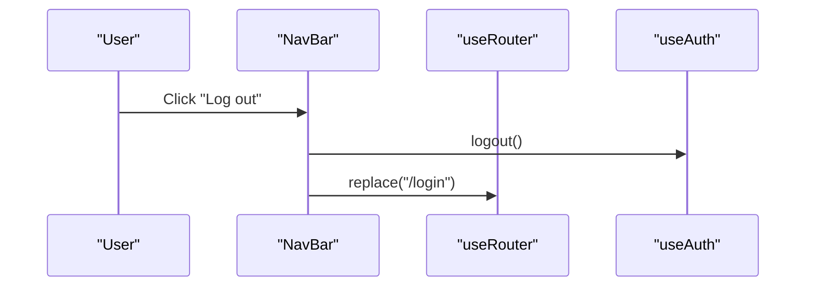
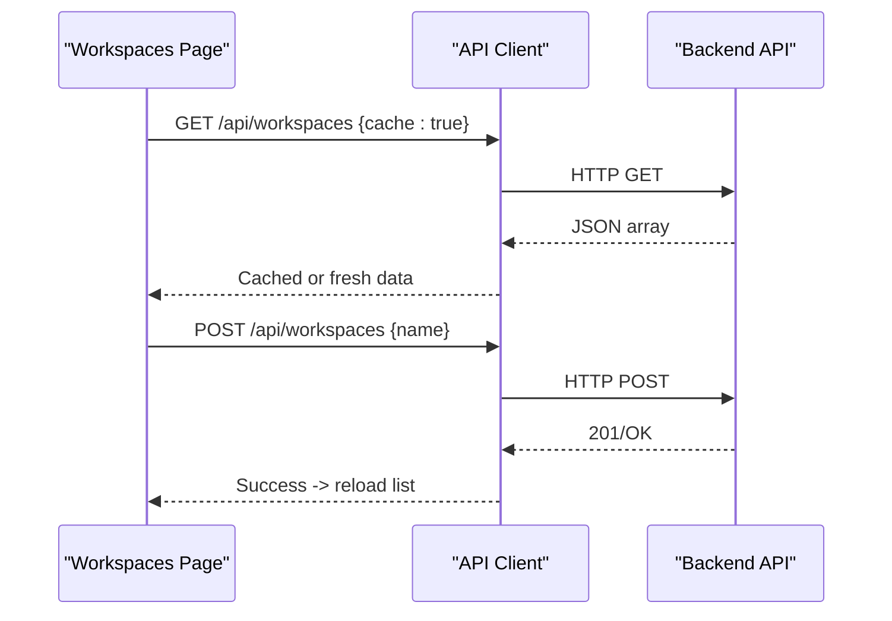
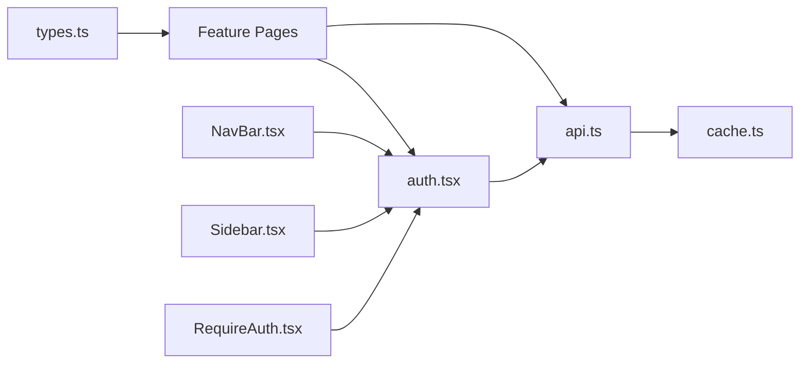

# Frontend Architecture

<cite>
**Referenced Files in This Document**
- [layout.tsx](file://phoenix-frontend/src/app/layout.tsx)
- [page.tsx (Home)](file://phoenix-frontend/src/app/page.tsx)
- [auth.tsx](file://phoenix-frontend/src/lib/auth.tsx)
- [api.ts](file://phoenix-frontend/src/lib/api.ts)
- [cache.ts](file://phoenix-frontend/src/lib/cache.ts)
- [types.ts](file://phoenix-frontend/src/lib/types.ts)
- [next.config.mjs](file://phoenix-frontend/next.config.mjs)
- [login page.tsx](file://phoenix-frontend/src/app/login/page.tsx)
- [workspaces page.tsx](file://phoenix-frontend/src/app/workspaces/page.tsx)
- [workspace detail page.tsx](file://phoenix-frontend/src/app/workspaces/[id]/page.tsx)
- [members page.tsx](file://phoenix-frontend/src/app/workspaces/[id]/members/page.tsx)
- [projects page.tsx](file://phoenix-frontend/src/app/projects/[id]/page.tsx)
- [NavBar.tsx](file://phoenix-frontend/src/components/NavBar.tsx)
- [RequireAuth.tsx](file://phoenix-frontend/src/components/RequireAuth.tsx)
- [Sidebar.tsx](file://phoenix-frontend/src/components/Sidebar.tsx)
</cite>

## Table of Contents
1. [Introduction](#introduction)
2. [Project Structure](#project-structure)
3. [Core Components](#core-components)
4. [Architecture Overview](#architecture-overview)
5. [Detailed Component Analysis](#detailed-component-analysis)
6. [Dependency Analysis](#dependency-analysis)
7. [Performance Considerations](#performance-considerations)
8. [Troubleshooting Guide](#troubleshooting-guide)
9. [Conclusion](#conclusion)

## Introduction
This document describes the Next.js frontend architecture for Project Phoenix. It covers the App Router structure, component hierarchy, authentication state management via React Context, API client layer with in-memory caching, error handling patterns, layout system, protected routes, navigation patterns, and performance optimizations such as code splitting and static generation opportunities. It also explains integration with the backend API and session management.

## Project Structure
The application uses the Next.js App Router under src/app with a root layout that provides global UI chrome and authentication context. Feature pages are organized by domain: login, workspaces, projects, and workspace members. Shared components live under src/components, and shared libraries (API client, cache, types, auth context) live under src/lib.

**Diagram sources**
- [layout.tsx:12-26](file://phoenix-frontend/src/app/layout.tsx#L12-L26)
- [page.tsx (Home):7-14](file://phoenix-frontend/src/app/page.tsx#L7-L14)
- [auth.tsx:16-55](file://phoenix-frontend/src/lib/auth.tsx#L16-L55)
- [api.ts:33-72](file://phoenix-frontend/src/lib/api.ts#L33-L72)
- [cache.ts:1-16](file://phoenix-frontend/src/lib/cache.ts#L1-L16)
- [types.ts:1-54](file://phoenix-frontend/src/lib/types.ts#L1-L54)
- [login page.tsx:8-53](file://phoenix-frontend/src/app/login/page.tsx#L8-L53)
- [workspaces page.tsx:9-72](file://phoenix-frontend/src/app/workspaces/page.tsx#L9-L72)
- [workspace detail page.tsx:52-136](file://phoenix-frontend/src/app/workspaces/[id]/page.tsx#L52-L136)
- [members page.tsx:10-94](file://phoenix-frontend/src/app/workspaces/[id]/members/page.tsx#L10-L94)
- [projects page.tsx:17-167](file://phoenix-frontend/src/app/projects/[id]/page.tsx#L17-L167)
- [NavBar.tsx:8-35](file://phoenix-frontend/src/components/NavBar.tsx#L8-L35)
- [Sidebar.tsx:26-56](file://phoenix-frontend/src/components/Sidebar.tsx#L26-L56)
- [RequireAuth.tsx:7-17](file://phoenix-frontend/src/components/RequireAuth.tsx#L7-L17)

**Section sources**
- [layout.tsx:1-27](file://phoenix-frontend/src/app/layout.tsx#L1-L27)
- [next.config.mjs:1-9](file://phoenix-frontend/next.config.mjs#L1-L9)

## Core Components
- Root layout: Provides metadata, wraps the app in AuthProvider, renders NavBar and Sidebar, and mounts page content in main.
- Authentication context: Manages user session, token persistence, login/logout flows, and readiness state.
- API client: Centralized fetch wrapper with Authorization header injection, typed responses, error mapping, and optional GET caching.
- In-memory cache: Simple Map-based cache keyed by path; used to avoid redundant GET requests.
- Protected route wrapper: Ensures authenticated users before rendering page content.

Key responsibilities:
- AuthContext propagates user state and actions across the tree.
- API client abstracts network calls and error translation.
- RequireAuth guards feature pages from unauthenticated access.

**Section sources**
- [layout.tsx:12-26](file://phoenix-frontend/src/app/layout.tsx#L12-L26)
- [auth.tsx:16-61](file://phoenix-frontend/src/lib/auth.tsx#L16-L61)
- [api.ts:10-85](file://phoenix-frontend/src/lib/api.ts#L10-L85)
- [cache.ts:1-16](file://phoenix-frontend/src/lib/cache.ts#L1-L16)
- [RequireAuth.tsx:7-17](file://phoenix-frontend/src/components/RequireAuth.tsx#L7-L17)

## Architecture Overview
The frontend is a client-side Next.js application using the App Router. The root layout establishes global UI and injects the authentication context. Feature pages use RequireAuth to protect routes and call the API client for data operations. Navigation is handled via Next.js Link and router utilities.

**Diagram sources**
- [layout.tsx:12-26](file://phoenix-frontend/src/app/layout.tsx#L12-L26)
- [auth.tsx:20-30](file://phoenix-frontend/src/lib/auth.tsx#L20-L30)
- [api.ts:33-72](file://phoenix-frontend/src/lib/api.ts#L33-L72)
- [page.tsx (Home):7-14](file://phoenix-frontend/src/app/page.tsx#L7-L14)

## Detailed Component Analysis

### Authentication Flow and Context Propagation
Authentication is managed through a React Context provider that:
- Restores session on mount by reading a stored token and validating it against the backend.
- Exposes login/logout functions and current user state.
- Emits a logout event to clear local state when needed.

**Diagram sources**
- [auth.tsx:20-30](file://phoenix-frontend/src/lib/auth.tsx#L20-L30)
- [auth.tsx:38-50](file://phoenix-frontend/src/lib/auth.tsx#L38-L50)

**Section sources**
- [auth.tsx:16-61](file://phoenix-frontend/src/lib/auth.tsx#L16-L61)

### API Client Layer and Caching Strategy
The API client:
- Builds URLs relative to a configurable backend base URL.
- Attaches Authorization headers when a token is available.
- Wraps errors into a typed ApiError with user-friendly messages.
- Supports optional GET caching via an in-memory Map keyed by path.

**Diagram sources**
- [api.ts:33-72](file://phoenix-frontend/src/lib/api.ts#L33-L72)
- [cache.ts:1-16](file://phoenix-frontend/src/lib/cache.ts#L1-L16)

**Section sources**
- [api.ts:1-86](file://phoenix-frontend/src/lib/api.ts#L1-L86)
- [cache.ts:1-16](file://phoenix-frontend/src/lib/cache.ts#L1-L16)

### Error Handling Patterns
Errors are centralized:
- Network failures map to a generic message.
- HTTP status codes are translated into user-facing messages (e.g., 401 session expired).
- Pages catch errors and display them inline.

**Diagram sources**
- [api.ts:41-67](file://phoenix-frontend/src/lib/api.ts#L41-L67)
- [api.ts:74-85](file://phoenix-frontend/src/lib/api.ts#L74-L85)

**Section sources**
- [api.ts:10-85](file://phoenix-frontend/src/lib/api.ts#L10-L85)

### Layout System and Global UI
The root layout:
- Sets site metadata.
- Wraps children in AuthProvider.
- Renders NavBar and Sidebar around page content.

**Diagram sources**
- [layout.tsx:7-26](file://phoenix-frontend/src/app/layout.tsx#L7-L26)
- [NavBar.tsx:8-35](file://phoenix-frontend/src/components/NavBar.tsx#L8-L35)
- [Sidebar.tsx:26-56](file://phoenix-frontend/src/components/Sidebar.tsx#L26-L56)
- [auth.tsx:16-55](file://phoenix-frontend/src/lib/auth.tsx#L16-L55)

**Section sources**
- [layout.tsx:1-27](file://phoenix-frontend/src/app/layout.tsx#L1-L27)
- [NavBar.tsx:1-36](file://phoenix-frontend/src/components/NavBar.tsx#L1-L36)
- [Sidebar.tsx:1-57](file://phoenix-frontend/src/components/Sidebar.tsx#L1-L57)

### Protected Routes Implementation
Protected routes are implemented via a RequireAuth component that:
- Reads user and ready state from AuthContext.
- Redirects to /login if not authenticated.
- Shows a loading indicator while determining readiness.

**Diagram sources**
- [RequireAuth.tsx:7-17](file://phoenix-frontend/src/components/RequireAuth.tsx#L7-L17)
- [auth.tsx:16-30](file://phoenix-frontend/src/lib/auth.tsx#L16-L30)

**Section sources**
- [RequireAuth.tsx:1-18](file://phoenix-frontend/src/components/RequireAuth.tsx#L1-L18)

### Navigation Patterns
- Declarative navigation uses Next.js Link for internal routes.
- Programmatic navigation uses useRouter for redirects after login/logout.
- Sidebar highlights active links based on pathname.

**Diagram sources**
- [NavBar.tsx:8-35](file://phoenix-frontend/src/components/NavBar.tsx#L8-L35)
- [auth.tsx:47-50](file://phoenix-frontend/src/lib/auth.tsx#L47-L50)

**Section sources**
- [NavBar.tsx:1-36](file://phoenix-frontend/src/components/NavBar.tsx#L1-L36)
- [Sidebar.tsx:1-57](file://phoenix-frontend/src/components/Sidebar.tsx#L1-L57)

### Data Flows Between Pages and Components
- Login page triggers authentication flow and navigates to workspaces on success.
- Workspaces list fetches workspaces with optional caching and allows creation.
- Workspace detail fetches workspace info, projects, and credits concurrently; supports project creation and credit top-up.
- Members page lists and adds members with role selection.
- Projects board fetches paginated tasks with search and filter support.

**Diagram sources**
- [workspaces page.tsx:14-36](file://phoenix-frontend/src/app/workspaces/page.tsx#L14-L36)
- [api.ts:33-72](file://phoenix-frontend/src/lib/api.ts#L33-L72)

**Section sources**
- [workspaces page.tsx:1-73](file://phoenix-frontend/src/app/workspaces/page.tsx#L1-L73)
- [workspace detail page.tsx:52-136](file://phoenix-frontend/src/app/workspaces/[id]/page.tsx#L52-L136)
- [members page.tsx:10-94](file://phoenix-frontend/src/app/workspaces/[id]/members/page.tsx#L10-L94)
- [projects page.tsx:17-167](file://phoenix-frontend/src/app/projects/[id]/page.tsx#L17-L167)

## Dependency Analysis
The following diagram maps key dependencies between core modules and pages.

**Diagram sources**
- [auth.tsx:1-61](file://phoenix-frontend/src/lib/auth.tsx#L1-L61)
- [api.ts:1-86](file://phoenix-frontend/src/lib/api.ts#L1-L86)
- [cache.ts:1-16](file://phoenix-frontend/src/lib/cache.ts#L1-L16)
- [types.ts:1-54](file://phoenix-frontend/src/lib/types.ts#L1-L54)
- [NavBar.tsx:1-36](file://phoenix-frontend/src/components/NavBar.tsx#L1-L36)
- [Sidebar.tsx:1-57](file://phoenix-frontend/src/components/Sidebar.tsx#L1-L57)
- [RequireAuth.tsx:1-18](file://phoenix-frontend/src/components/RequireAuth.tsx#L1-L18)
- [workspaces page.tsx:1-73](file://phoenix-frontend/src/app/workspaces/page.tsx#L1-L73)
- [workspace detail page.tsx:1-137](file://phoenix-frontend/src/app/workspaces/[id]/page.tsx#L1-L137)
- [members page.tsx:1-95](file://phoenix-frontend/src/app/workspaces/[id]/members/page.tsx#L1-L95)
- [projects page.tsx:1-168](file://phoenix-frontend/src/app/projects/[id]/page.tsx#L1-L168)

**Section sources**
- [auth.tsx:1-61](file://phoenix-frontend/src/lib/auth.tsx#L1-L61)
- [api.ts:1-86](file://phoenix-frontend/src/lib/api.ts#L1-L86)
- [cache.ts:1-16](file://phoenix-frontend/src/lib/cache.ts#L1-L16)
- [types.ts:1-54](file://phoenix-frontend/src/lib/types.ts#L1-L54)

## Performance Considerations
- Code splitting: Each App Router page is automatically code-split by Next.js, reducing initial bundle size.
- Client-only features: Pages marked "use client" run only in the browser, keeping server bundles lean.
- Image optimization: When images are added, use Next.js Image component for automatic optimization and responsive delivery.
- Static generation: Where feasible, convert read-only pages to static generation or incremental static regeneration to reduce runtime costs.
- Data fetching: Use GET caching for repeated reads; consider server-side data fetching where appropriate to minimize client load.
- Debounced search: The projects board debounces search input to limit API calls during typing.

[No sources needed since this section provides general guidance]

## Troubleshooting Guide
Common issues and resolutions:
- Session expired: Occurs when the backend returns 401. The API client maps this to a friendly message prompting re-login.
- Network unreachable: Non-JSON or connection errors are surfaced as a generic message.
- Unauthorized actions: 403 indicates insufficient permissions; guide users accordingly.
- Not found: 404 suggests missing resources or lack of access.
- Server errors: 5xx responses indicate backend issues; prompt retry.

Operational tips:
- Verify NEXT_PUBLIC_BACKEND_URL points to the correct backend.
- Ensure tokens are persisted and cleared correctly on logout.
- Inspect in-memory cache behavior for stale data after mutations; write operations should invalidate relevant caches.

**Section sources**
- [api.ts:74-85](file://phoenix-frontend/src/lib/api.ts#L74-L85)
- [auth.tsx:20-30](file://phoenix-frontend/src/lib/auth.tsx#L20-L30)

## Conclusion
The frontend follows a clean separation of concerns: a root layout provides global UI and authentication context; feature pages encapsulate domain logic and interact with the backend via a typed API client with optional GET caching. Protected routes ensure secure access, and navigation is consistent across the app. The architecture supports scalability through code splitting, clear module boundaries, and straightforward error handling. Future enhancements can include more aggressive caching strategies, server-side data fetching for improved performance, and expanded static generation for read-heavy pages.

[No sources needed since this section summarizes without analyzing specific files]