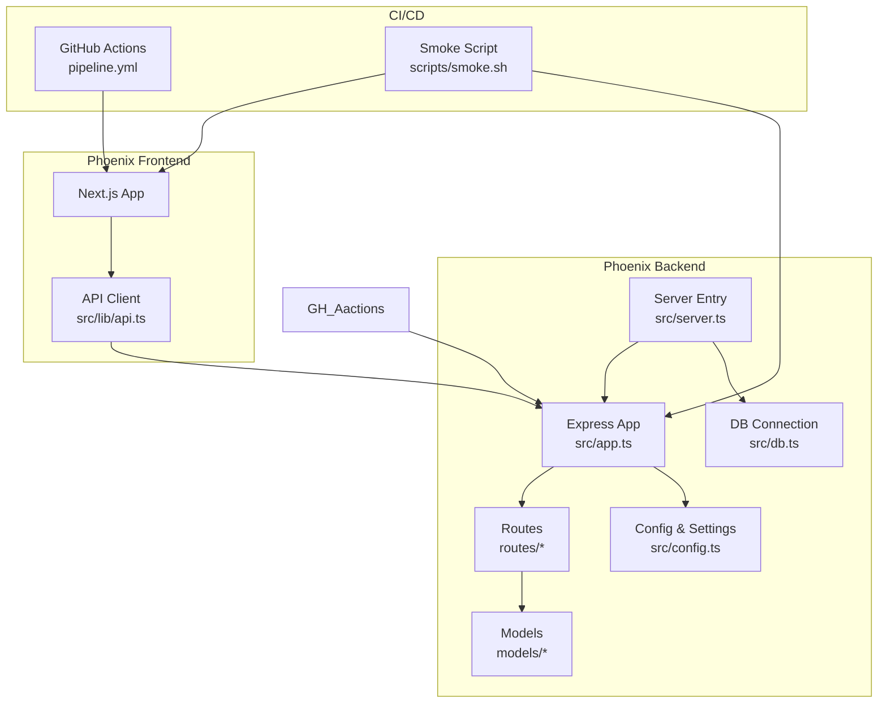
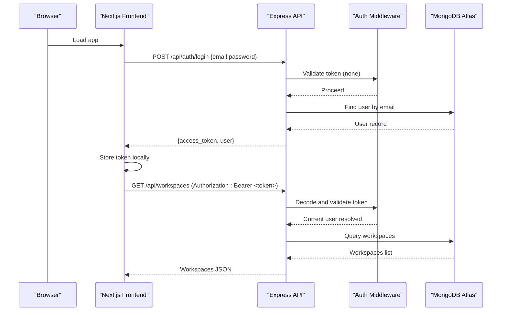
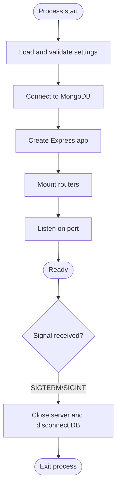
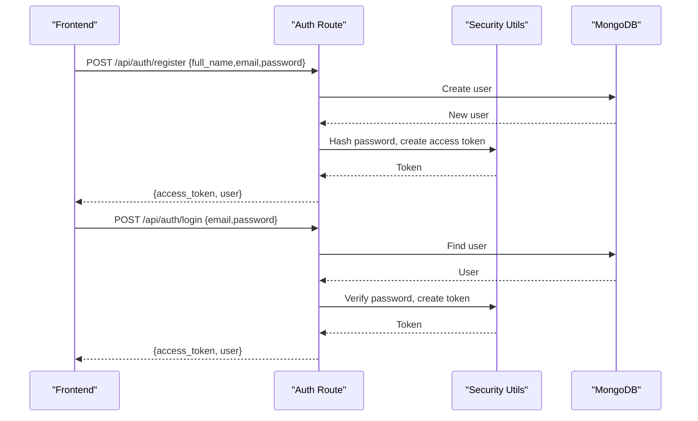
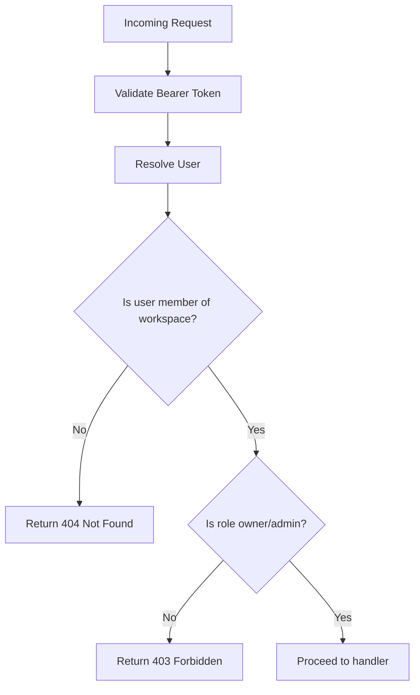
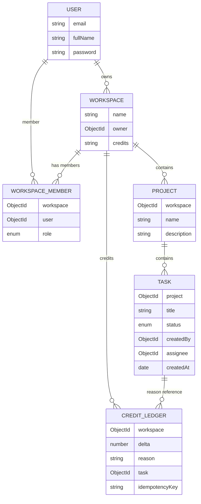
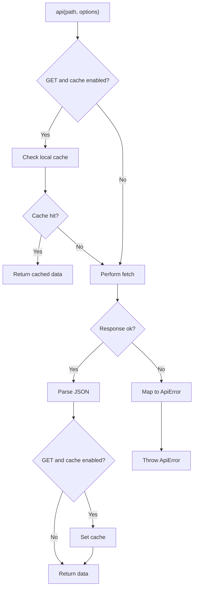
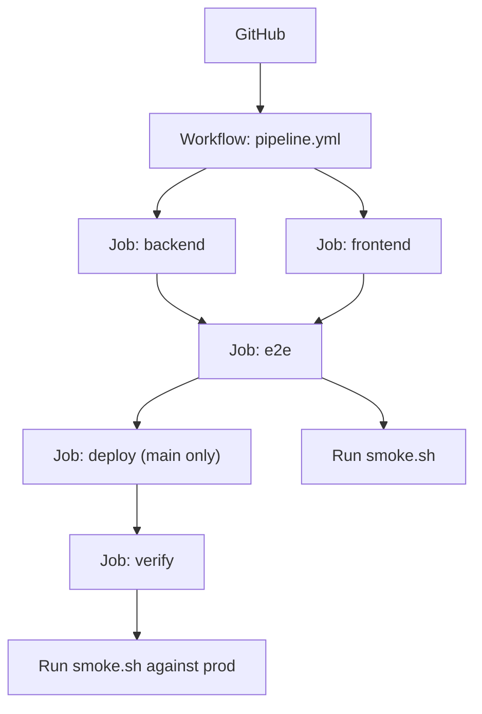
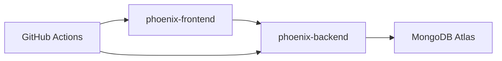

# System Architecture

<cite>
**Referenced Files in This Document**
- [README.md](file://README.md)
- [phoenix-backend/package.json](file://phoenix-backend/package.json)
- [phoenix-frontend/package.json](file://phoenix-frontend/package.json)
- [phoenix-ci/README.md](file://phoenix-ci/README.md)
- [phoenix-backend/src/app.ts](file://phoenix-backend/src/app.ts)
- [phoenix-backend/src/server.ts](file://phoenix-backend/src/server.ts)
- [phoenix-backend/src/config.ts](file://phoenix-backend/src/config.ts)
- [phoenix-backend/src/db.ts](file://phoenix-backend/src/db.ts)
- [phoenix-backend/src/lib/auth.ts](file://phoenix-backend/src/lib/auth.ts)
- [phoenix-backend/src/routes/auth.ts](file://phoenix-backend/src/routes/auth.ts)
- [phoenix-backend/src/models/user.ts](file://phoenix-backend/src/models/user.ts)
- [phoenix-backend/src/models/workspace.ts](file://phoenix-backend/src/models/workspace.ts)
- [phoenix-backend/src/models/project.ts](file://phoenix-backend/src/models/project.ts)
- [phoenix-backend/src/models/task.ts](file://phoenix-backend/src/models/task.ts)
- [phoenix-backend/src/models/ledger.ts](file://phoenix-backend/src/models/ledger.ts)
- [phoenix-frontend/src/lib/api.ts](file://phoenix-frontend/src/lib/api.ts)
</cite>

## Table of Contents
1. [Introduction](#introduction)
2. [Project Structure](#project-structure)
3. [Core Components](#core-components)
4. [Architecture Overview](#architecture-overview)
5. [Detailed Component Analysis](#detailed-component-analysis)
6. [Dependency Analysis](#dependency-analysis)
7. [Performance Considerations](#performance-considerations)
8. [Troubleshooting Guide](#troubleshooting-guide)
9. [Conclusion](#conclusion)

## Introduction
Project Phoenix is a multi-tenant project tracker composed of three repositories:
- phoenix-backend: Express.js API with TypeScript, MongoDB (Mongoose), and serverless deployment on Vercel.
- phoenix-frontend: Next.js 14 React application with TypeScript, deployed to Vercel.
- phoenix-ci: GitHub Actions pipeline orchestrating tests, smoke checks, and deployments.

The system uses JWT for authentication, Zod for configuration validation, and MongoDB Atlas as the database. The frontend communicates with the backend via REST APIs, carrying bearer tokens for authenticated requests.

## Project Structure
The repository contains three top-level packages:
- phoenix-backend: API server, models, routes, middleware, configuration, and database initialization.
- phoenix-frontend: Next.js app pages, components, and an API client library.
- phoenix-ci: CI/CD workflow definitions and smoke test scripts.

**Diagram sources**
- [phoenix-backend/src/app.ts:11-28](file://phoenix-backend/src/app.ts#L11-L28)
- [phoenix-backend/src/server.ts:5-10](file://phoenix-backend/src/server.ts#L5-L10)
- [phoenix-backend/src/config.ts:1-32](file://phoenix-backend/src/config.ts#L1-L32)
- [phoenix-backend/src/db.ts:12-22](file://phoenix-backend/src/db.ts#L12-L22)
- [phoenix-frontend/src/lib/api.ts:3-72](file://phoenix-frontend/src/lib/api.ts#L3-L72)
- [phoenix-ci/README.md:15-27](file://phoenix-ci/README.md#L15-L27)

**Section sources**
- [README.md:7-14](file://README.md#L7-L14)
- [phoenix-backend/package.json:1-42](file://phoenix-backend/package.json#L1-L42)
- [phoenix-frontend/package.json:1-27](file://phoenix-frontend/package.json#L1-L27)
- [phoenix-ci/README.md:1-39](file://phoenix-ci/README.md#L1-L39)

## Core Components
- Backend entrypoint initializes settings, connects to MongoDB, creates the Express app, registers routers, and listens on a port.
- Configuration is validated at startup using Zod; invalid environment variables cause a hard failure.
- Database connection initializes Mongoose and pre-registers all models.
- Authentication middleware validates bearer tokens, resolves users, and enforces workspace membership and admin roles.
- Routes expose endpoints for health, authentication, workspaces, projects, and tasks.
- Models define schemas for User, Workspace, WorkspaceMember, Project, Task, and CreditLedger.
- Frontend API client manages token storage, request headers, error mapping, and optional GET caching.

Key responsibilities:
- Server lifecycle and graceful shutdown are handled in the server entrypoint.
- CORS is configured from settings, allowing credentials.
- Input validation and serialization utilities support consistent request/response shapes.
- Credit operations use an append-only ledger with idempotency keys.

**Section sources**
- [phoenix-backend/src/server.ts:5-23](file://phoenix-backend/src/server.ts#L5-L23)
- [phoenix-backend/src/app.ts:11-28](file://phoenix-backend/src/app.ts#L11-L28)
- [phoenix-backend/src/config.ts:1-32](file://phoenix-backend/src/config.ts#L1-L32)
- [phoenix-backend/src/db.ts:12-22](file://phoenix-backend/src/db.ts#L12-L22)
- [phoenix-backend/src/lib/auth.ts:8-49](file://phoenix-backend/src/lib/auth.ts#L8-L49)
- [phoenix-backend/src/routes/auth.ts:11-51](file://phoenix-backend/src/routes/auth.ts#L11-L51)
- [phoenix-backend/src/models/user.ts:1-14](file://phoenix-backend/src/models/user.ts#L1-L14)
- [phoenix-backend/src/models/workspace.ts:1-22](file://phoenix-backend/src/models/workspace.ts#L1-L22)
- [phoenix-backend/src/models/project.ts:1-12](file://phoenix-backend/src/models/project.ts#L1-L12)
- [phoenix-backend/src/models/task.ts:1-15](file://phoenix-backend/src/models/task.ts#L1-L15)
- [phoenix-backend/src/models/ledger.ts:1-19](file://phoenix-backend/src/models/ledger.ts#L1-L19)
- [phoenix-frontend/src/lib/api.ts:3-85](file://phoenix-frontend/src/lib/api.ts#L3-L85)

## Architecture Overview
The system follows a standard web architecture:
- Browser-based Next.js frontend calls the Express API over HTTPS.
- The API authenticates requests using JWT bearer tokens and enforces authorization based on workspace membership and roles.
- Data is persisted in MongoDB Atlas through Mongoose models.
- CI/CD runs tests, seeds data, performs smoke tests against running services, and deploys both apps to Vercel.

**Diagram sources**
- [phoenix-frontend/src/lib/api.ts:33-72](file://phoenix-frontend/src/lib/api.ts#L33-L72)
- [phoenix-backend/src/routes/auth.ts:33-51](file://phoenix-backend/src/routes/auth.ts#L33-L51)
- [phoenix-backend/src/lib/auth.ts:8-27](file://phoenix-backend/src/lib/auth.ts#L8-L27)
- [phoenix-backend/src/db.ts:12-22](file://phoenix-backend/src/db.ts#L12-L22)

## Detailed Component Analysis

### Backend Application Lifecycle
The server bootstraps configuration, connects to MongoDB, creates the Express app, mounts routers, and starts listening. Graceful shutdown handles SIGTERM/SIGINT and disconnects the database.

**Diagram sources**
- [phoenix-backend/src/server.ts:5-18](file://phoenix-backend/src/server.ts#L5-L18)
- [phoenix-backend/src/app.ts:11-28](file://phoenix-backend/src/app.ts#L11-L28)
- [phoenix-backend/src/config.ts:19-31](file://phoenix-backend/src/config.ts#L19-L31)
- [phoenix-backend/src/db.ts:12-22](file://phoenix-backend/src/db.ts#L12-L22)

**Section sources**
- [phoenix-backend/src/server.ts:5-23](file://phoenix-backend/src/server.ts#L5-L23)
- [phoenix-backend/src/app.ts:11-28](file://phoenix-backend/src/app.ts#L11-L28)

### Authentication Flow
Authentication uses JWT bearer tokens. Login and register endpoints create tokens; protected routes require valid tokens and resolve the current user.

**Diagram sources**
- [phoenix-backend/src/routes/auth.ts:11-51](file://phoenix-backend/src/routes/auth.ts#L11-L51)
- [phoenix-backend/src/lib/auth.ts:8-27](file://phoenix-backend/src/lib/auth.ts#L8-L27)

**Section sources**
- [phoenix-backend/src/routes/auth.ts:11-51](file://phoenix-backend/src/routes/auth.ts#L11-L51)
- [phoenix-backend/src/lib/auth.ts:8-27](file://phoenix-backend/src/lib/auth.ts#L8-L27)

### Authorization and Workspace Membership
Protected routes enforce that the requester is a member or admin of the target workspace. Non-members receive a 404 to avoid leaking existence information.

**Diagram sources**
- [phoenix-backend/src/lib/auth.ts:29-42](file://phoenix-backend/src/lib/auth.ts#L29-L42)

**Section sources**
- [phoenix-backend/src/lib/auth.ts:29-42](file://phoenix-backend/src/lib/auth.ts#L29-L42)

### Data Model Relationships
The domain model includes users, workspaces, members, projects, tasks, and an append-only credit ledger.

**Diagram sources**
- [phoenix-backend/src/models/user.ts:1-14](file://phoenix-backend/src/models/user.ts#L1-L14)
- [phoenix-backend/src/models/workspace.ts:1-22](file://phoenix-backend/src/models/workspace.ts#L1-L22)
- [phoenix-backend/src/models/project.ts:1-12](file://phoenix-backend/src/models/project.ts#L1-L12)
- [phoenix-backend/src/models/task.ts:1-15](file://phoenix-backend/src/models/task.ts#L1-L15)
- [phoenix-backend/src/models/ledger.ts:1-19](file://phoenix-backend/src/models/ledger.ts#L1-L19)

**Section sources**
- [phoenix-backend/src/models/user.ts:1-14](file://phoenix-backend/src/models/user.ts#L1-L14)
- [phoenix-backend/src/models/workspace.ts:1-22](file://phoenix-backend/src/models/workspace.ts#L1-L22)
- [phoenix-backend/src/models/project.ts:1-12](file://phoenix-backend/src/models/project.ts#L1-L12)
- [phoenix-backend/src/models/task.ts:1-15](file://phoenix-backend/src/models/task.ts#L1-L15)
- [phoenix-backend/src/models/ledger.ts:1-19](file://phoenix-backend/src/models/ledger.ts#L1-L19)

### Frontend API Client
The frontend API client centralizes fetch calls, attaches bearer tokens, maps HTTP errors to user-friendly messages, and optionally caches GET responses.

**Diagram sources**
- [phoenix-frontend/src/lib/api.ts:33-85](file://phoenix-frontend/src/lib/api.ts#L33-L85)

**Section sources**
- [phoenix-frontend/src/lib/api.ts:3-85](file://phoenix-frontend/src/lib/api.ts#L3-L85)

### CI/CD Pipeline Topology
The pipeline defines jobs for backend and frontend checks, an end-to-end job with real MongoDB and smoke testing, deployment to Vercel on main branch pushes, and production verification.

**Diagram sources**
- [phoenix-ci/README.md:15-27](file://phoenix-ci/README.md#L15-L27)

**Section sources**
- [phoenix-ci/README.md:15-39](file://phoenix-ci/README.md#L15-L39)

## Dependency Analysis
- Backend depends on Express, Mongoose, JSON Web Tokens, Zod, and CORS.
- Frontend depends on Next.js, React, and date-fns.
- CI/CD depends on GitHub Actions and external services (MongoDB Atlas, Vercel).

**Diagram sources**
- [phoenix-backend/package.json:20-26](file://phoenix-backend/package.json#L20-L26)
- [phoenix-frontend/package.json:14-18](file://phoenix-frontend/package.json#L14-L18)
- [phoenix-ci/README.md:15-27](file://phoenix-ci/README.md#L15-L27)

**Section sources**
- [phoenix-backend/package.json:1-42](file://phoenix-backend/package.json#L1-L42)
- [phoenix-frontend/package.json:1-27](file://phoenix-frontend/package.json#L1-L27)
- [phoenix-ci/README.md:15-39](file://phoenix-ci/README.md#L15-L39)

## Performance Considerations
- Use serverless deployment for the backend to scale automatically and reduce operational overhead.
- Keep request bodies small and validated early to minimize processing time.
- Leverage MongoDB indexes defined in models for efficient queries.
- Avoid unnecessary re-fetches by using the frontend’s GET cache where appropriate.
- Ensure CORS origins are narrowly scoped to reduce overhead and improve security.

[No sources needed since this section provides general guidance]

## Troubleshooting Guide
Common issues and patterns:
- Invalid environment configuration causes startup failure due to strict Zod validation.
- Health endpoint must reflect actual service state; ensure it checks connectivity.
- Authentication failures occur when tokens are missing, malformed, or expired.
- Authorization returns 404 for unknown workspace IDs to prevent enumeration.
- Duplicate key errors during registration should map to 409 Conflict.
- Frontend error mapping translates HTTP statuses into user-friendly messages.

Operational tips:
- Verify MongoDB connection URI format and network access rules.
- Confirm CORS origin list matches the frontend URL.
- Ensure secrets are not printed in logs or pipelines.
- Run smoke tests locally against running services to validate integration.

**Section sources**
- [phoenix-backend/src/config.ts:19-31](file://phoenix-backend/src/config.ts#L19-L31)
- [phoenix-backend/src/routes/auth.ts:11-51](file://phoenix-backend/src/routes/auth.ts#L11-L51)
- [phoenix-backend/src/lib/auth.ts:8-42](file://phoenix-backend/src/lib/auth.ts#L8-L42)
- [phoenix-frontend/src/lib/api.ts:74-85](file://phoenix-frontend/src/lib/api.ts#L74-L85)
- [phoenix-ci/README.md:29-39](file://phoenix-ci/README.md#L29-L39)

## Conclusion
Project Phoenix combines a secure, typed backend with a modern Next.js frontend and a robust CI/CD pipeline. The design emphasizes clear separation of concerns, strong validation, and safe defaults. With JWT-based authentication, workspace-scoped authorization, and an append-only credit ledger, the system supports multi-tenant workflows while maintaining data integrity. Deployment to Vercel and MongoDB Atlas simplifies operations, and the pipeline ensures quality gates before production releases.

[No sources needed since this section summarizes without analyzing specific files]