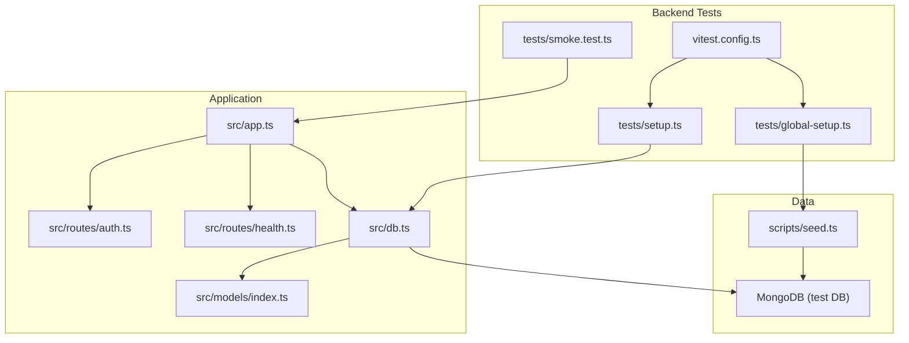
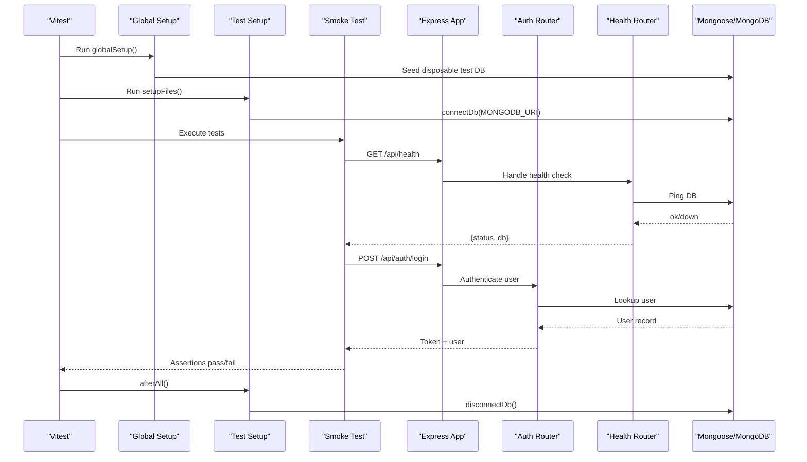
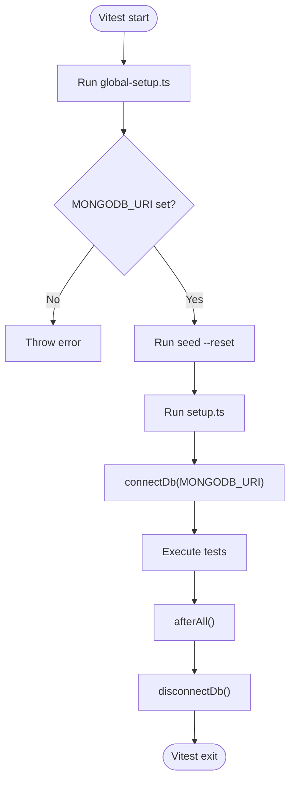
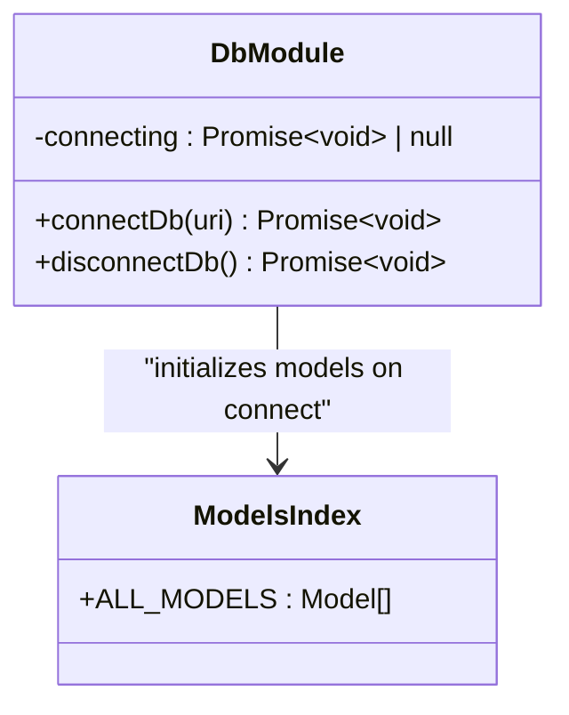
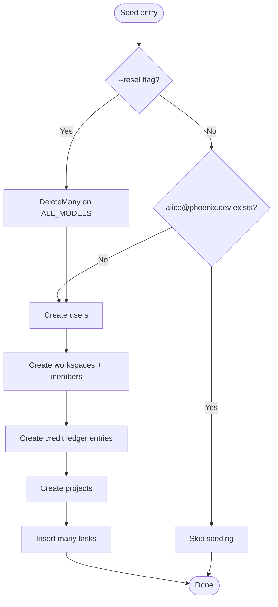
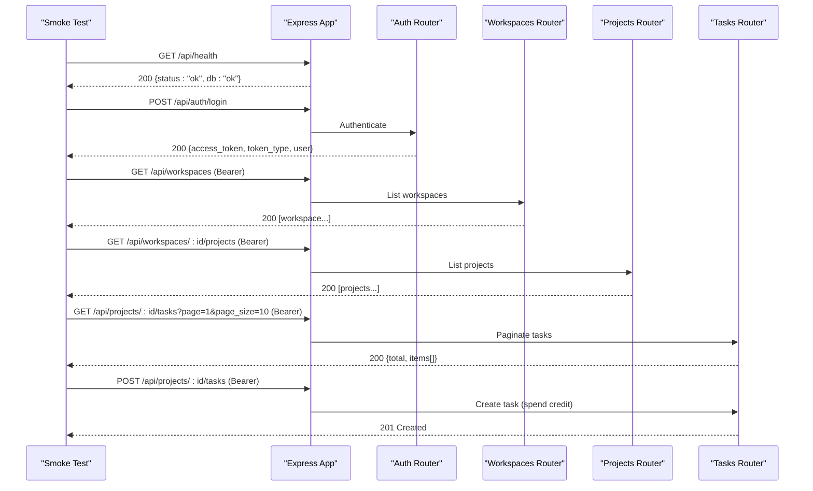
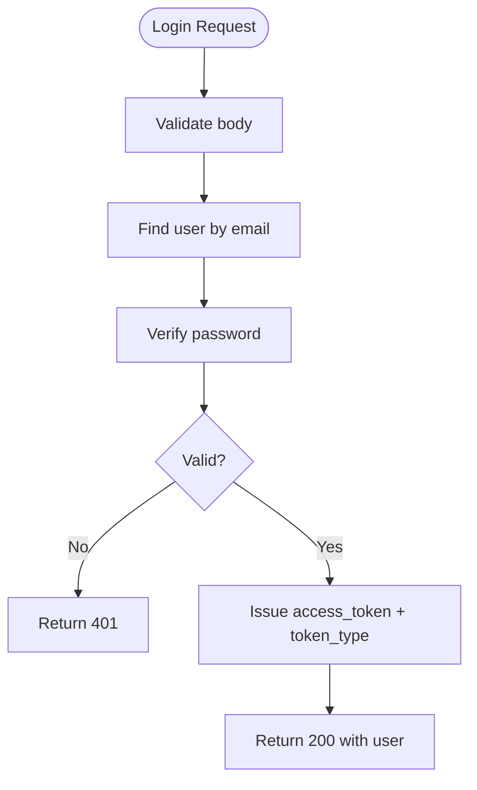
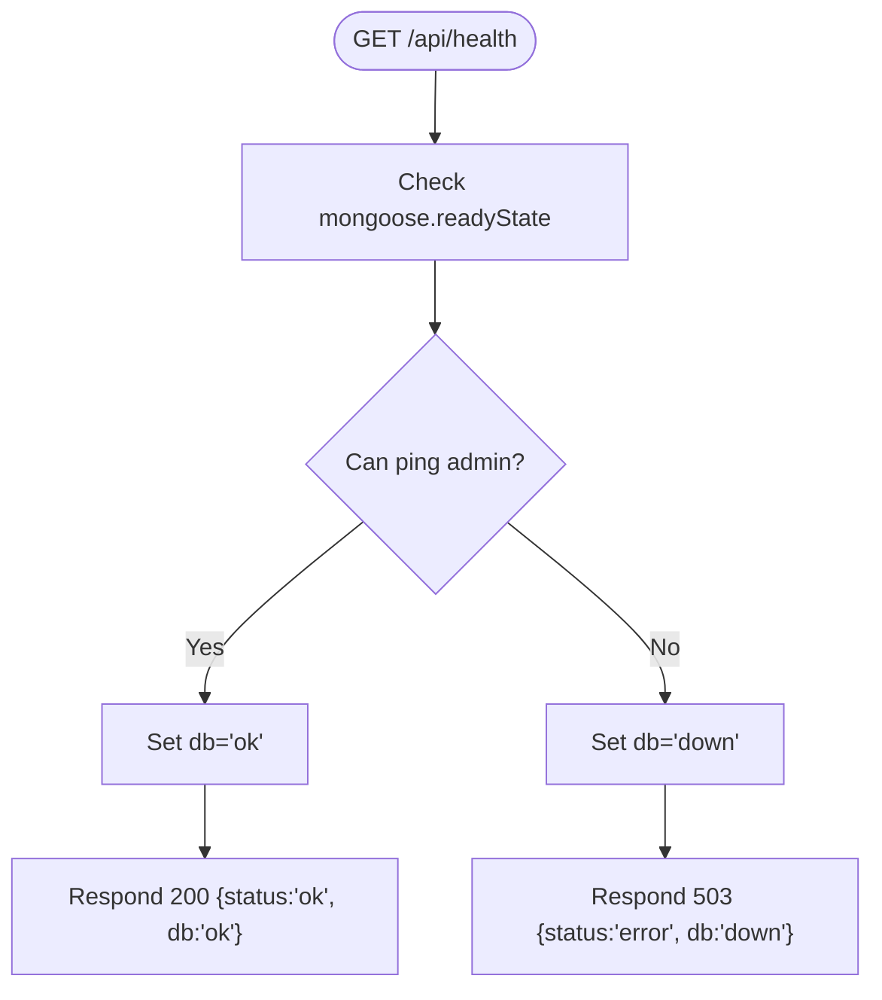
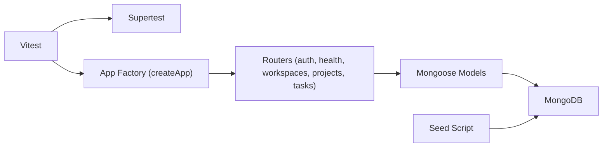
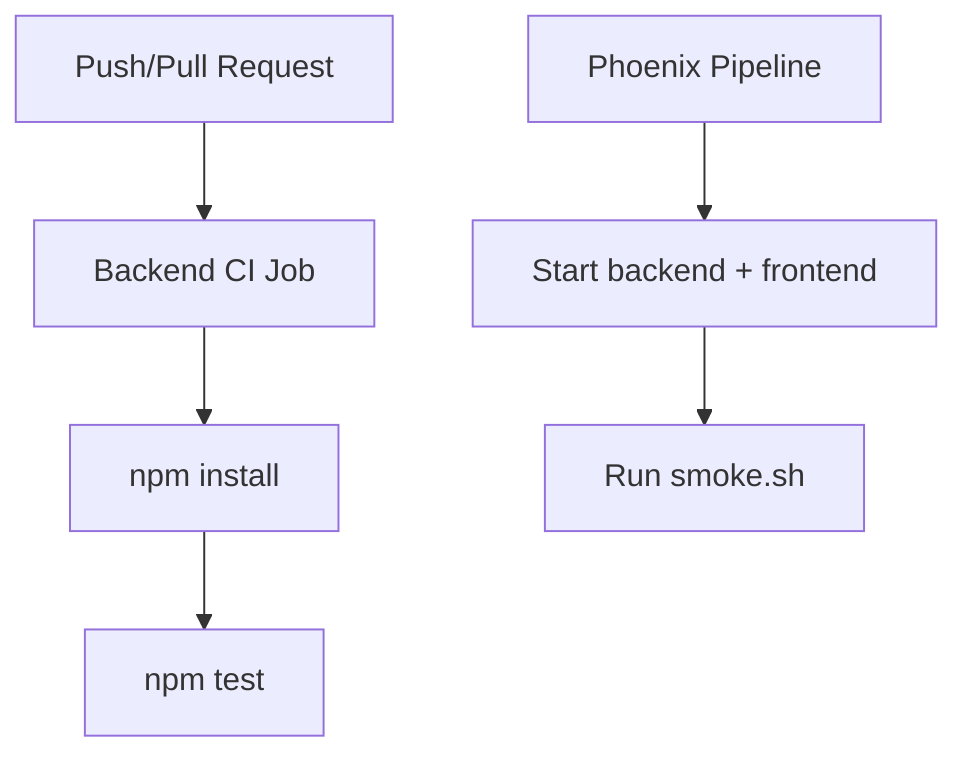

# Testing Strategy

<cite>
**Referenced Files in This Document**
- [vitest.config.ts](file://phoenix-backend/vitest.config.ts)
- [global-setup.ts](file://phoenix-backend/tests/global-setup.ts)
- [setup.ts](file://phoenix-backend/tests/setup.ts)
- [smoke.test.ts](file://phoenix-backend/tests/smoke.test.ts)
- [package.json](file://phoenix-backend/package.json)
- [db.ts](file://phoenix-backend/src/db.ts)
- [app.ts](file://phoenix-backend/src/app.ts)
- [auth.ts](file://phoenix-backend/src/routes/auth.ts)
- [health.ts](file://phoenix-backend/src/routes/health.ts)
- [seed.ts](file://phoenix-backend/scripts/seed.ts)
- [index.ts](file://phoenix-backend/src/models/index.ts)
- [ci.yml (backend)](file://phoenix-backend/.github/workflows/ci.yml)
- [pipeline.yml](file://phoenix-ci/.github/workflows/pipeline.yml)
</cite>

## Table of Contents
1. [Introduction](#introduction)
2. [Project Structure](#project-structure)
3. [Core Components](#core-components)
4. [Architecture Overview](#architecture-overview)
5. [Detailed Component Analysis](#detailed-component-analysis)
6. [Dependency Analysis](#dependency-analysis)
7. [Performance Considerations](#performance-considerations)
8. [Troubleshooting Guide](#troubleshooting-guide)
9. [Conclusion](#conclusion)
10. [Appendices](#appendices)

## Introduction
This document describes the testing strategy and implementation for Project Phoenix’s backend. It covers unit and integration testing with Vitest, test configuration, database setup and teardown, API endpoint testing using Supertest, authentication flows, test data seeding, CI pipelines, coverage reporting, and best practices for writing reliable tests.

## Project Structure
The backend test suite is centered under phoenix-backend:
- Test runner and configuration: Vitest
- Integration tests: HTTP smoke tests against a running Express app
- Database lifecycle: Global seed + per-test DB connection management
- CI: GitHub Actions jobs for backend tests and an end-to-end pipeline

**Diagram sources**
- [vitest.config.ts:1-11](file://phoenix-backend/vitest.config.ts#L1-L11)
- [global-setup.ts:1-10](file://phoenix-backend/tests/global-setup.ts#L1-L10)
- [setup.ts:1-14](file://phoenix-backend/tests/setup.ts#L1-L14)
- [smoke.test.ts:1-59](file://phoenix-backend/tests/smoke.test.ts#L1-L59)
- [app.ts:1-33](file://phoenix-backend/src/app.ts#L1-L33)
- [auth.ts:1-52](file://phoenix-backend/src/routes/auth.ts#L1-L52)
- [health.ts:1-27](file://phoenix-backend/src/routes/health.ts#L1-L27)
- [db.ts:1-36](file://phoenix-backend/src/db.ts#L1-L36)
- [index.ts:1-27](file://phoenix-backend/src/models/index.ts#L1-L27)
- [seed.ts:1-84](file://phoenix-backend/scripts/seed.ts#L1-L84)

**Section sources**
- [vitest.config.ts:1-11](file://phoenix-backend/vitest.config.ts#L1-L11)
- [package.json:10-18](file://phoenix-backend/package.json#L10-L18)

## Core Components
- Vitest configuration defines global setup, per-test setup, timeouts, and disables file parallelism to ensure deterministic database state across tests.
- Global setup ensures a disposable MongoDB URI is provided, sets a JWT secret, and seeds the database via a script that can reset collections.
- Per-test setup connects to MongoDB before tests run and disconnects after all tests complete.
- Smoke tests use Supertest to exercise the Express application created by the app factory.
- The application wires routers for health, auth, workspaces, projects, and tasks.
- Database module manages a shared Mongoose connection and model initialization.
- Seed script populates demo users, workspaces, projects, tasks, and ledger entries.

**Section sources**
- [vitest.config.ts:1-11](file://phoenix-backend/vitest.config.ts#L1-L11)
- [global-setup.ts:1-10](file://phoenix-backend/tests/global-setup.ts#L1-L10)
- [setup.ts:1-14](file://phoenix-backend/tests/setup.ts#L1-L14)
- [smoke.test.ts:1-59](file://phoenix-backend/tests/smoke.test.ts#L1-L59)
- [app.ts:1-33](file://phoenix-backend/src/app.ts#L1-L33)
- [db.ts:1-36](file://phoenix-backend/src/db.ts#L1-L36)
- [seed.ts:1-84](file://phoenix-backend/scripts/seed.ts#L1-L84)

## Architecture Overview
The test architecture integrates Vitest, Supertest, Express, and MongoDB:
- Vitest orchestrates test execution and lifecycle hooks.
- Global setup prepares a clean test database and environment variables.
- Per-test setup establishes a Mongoose connection for the duration of the test run.
- Smoke tests send HTTP requests to the Express app and assert responses.
- Routes depend on models and security utilities; health checks validate DB connectivity.

**Diagram sources**
- [vitest.config.ts:1-11](file://phoenix-backend/vitest.config.ts#L1-L11)
- [global-setup.ts:1-10](file://phoenix-backend/tests/global-setup.ts#L1-L10)
- [setup.ts:1-14](file://phoenix-backend/tests/setup.ts#L1-L14)
- [smoke.test.ts:1-59](file://phoenix-backend/tests/smoke.test.ts#L1-L59)
- [app.ts:1-33](file://phoenix-backend/src/app.ts#L1-L33)
- [auth.ts:1-52](file://phoenix-backend/src/routes/auth.ts#L1-L52)
- [health.ts:1-27](file://phoenix-backend/src/routes/health.ts#L1-L27)
- [db.ts:1-36](file://phoenix-backend/src/db.ts#L1-L36)

## Detailed Component Analysis

### Vitest Configuration and Lifecycle
- Global setup enforces a disposable MongoDB URI and runs the seed script with optional reset.
- Per-test setup imports the database module dynamically to connect before tests and disconnect after all tests.
- Timeouts are configured to accommodate network and DB operations.
- File parallelism is disabled to avoid concurrent writes to the same test database.

**Diagram sources**
- [vitest.config.ts:1-11](file://phoenix-backend/vitest.config.ts#L1-L11)
- [global-setup.ts:1-10](file://phoenix-backend/tests/global-setup.ts#L1-L10)
- [setup.ts:1-14](file://phoenix-backend/tests/setup.ts#L1-L14)

**Section sources**
- [vitest.config.ts:1-11](file://phoenix-backend/vitest.config.ts#L1-L11)
- [global-setup.ts:1-10](file://phoenix-backend/tests/global-setup.ts#L1-L10)
- [setup.ts:1-14](file://phoenix-backend/tests/setup.ts#L1-L14)

### Database Connection Management
- The database module provides a singleton-like connection manager that reuses an existing connection if already established.
- On connect, it initializes all registered models to ensure indexes exist.
- Disconnect clears the pending connection promise and closes the Mongoose connection.

**Diagram sources**
- [db.ts:1-36](file://phoenix-backend/src/db.ts#L1-L36)
- [index.ts:1-27](file://phoenix-backend/src/models/index.ts#L1-L27)

**Section sources**
- [db.ts:1-36](file://phoenix-backend/src/db.ts#L1-L36)
- [index.ts:1-27](file://phoenix-backend/src/models/index.ts#L1-L27)

### Test Data Seeding
- The seed script creates demo users, workspaces, members, projects, tasks, and credit ledger entries.
- When invoked with reset, it deletes all documents from every model before seeding.
- The global setup calls the seed script with reset to ensure a clean state for each test run.

**Diagram sources**
- [seed.ts:1-84](file://phoenix-backend/scripts/seed.ts#L1-L84)
- [index.ts:1-27](file://phoenix-backend/src/models/index.ts#L1-L27)

**Section sources**
- [seed.ts:1-84](file://phoenix-backend/scripts/seed.ts#L1-L84)
- [global-setup.ts:1-10](file://phoenix-backend/tests/global-setup.ts#L1-L10)

### API Endpoint Testing (Supertest + Express)
- Smoke tests import the Express app factory and send HTTP requests using Supertest.
- They assert status codes and response bodies for health, login, workspace listing, task listing, and credit consumption.
- Authentication is handled by sending Bearer tokens obtained from the login endpoint.

**Diagram sources**
- [smoke.test.ts:1-59](file://phoenix-backend/tests/smoke.test.ts#L1-L59)
- [app.ts:1-33](file://phoenix-backend/src/app.ts#L1-L33)
- [auth.ts:1-52](file://phoenix-backend/src/routes/auth.ts#L1-L52)

**Section sources**
- [smoke.test.ts:1-59](file://phoenix-backend/tests/smoke.test.ts#L1-L59)
- [app.ts:1-33](file://phoenix-backend/src/app.ts#L1-L33)

### Authentication Flow Under Test
- Login endpoint validates credentials and returns a bearer token along with user info.
- Health endpoint verifies MongoDB reachability and reports status accordingly.
- Protected endpoints require a valid Authorization header; tests obtain tokens via login and attach them to subsequent requests.

**Diagram sources**
- [auth.ts:1-52](file://phoenix-backend/src/routes/auth.ts#L1-L52)

**Section sources**
- [auth.ts:1-52](file://phoenix-backend/src/routes/auth.ts#L1-L52)

### Health Check Behavior
- The health route pings MongoDB and returns a 200 with db: "ok" when reachable, otherwise 503 with db: "down".
- Smoke tests assert both status code and body shape.

**Diagram sources**
- [health.ts:1-27](file://phoenix-backend/src/routes/health.ts#L1-L27)

**Section sources**
- [health.ts:1-27](file://phoenix-backend/src/routes/health.ts#L1-L27)

## Dependency Analysis
The test suite depends on:
- Vitest for test orchestration and assertions
- Supertest for HTTP integration testing
- Express app factory to create the server instance
- Mongoose and MongoDB for persistence
- Seed script for deterministic test data

**Diagram sources**
- [vitest.config.ts:1-11](file://phoenix-backend/vitest.config.ts#L1-L11)
- [smoke.test.ts:1-59](file://phoenix-backend/tests/smoke.test.ts#L1-L59)
- [app.ts:1-33](file://phoenix-backend/src/app.ts#L1-L33)
- [db.ts:1-36](file://phoenix-backend/src/db.ts#L1-L36)
- [seed.ts:1-84](file://phoenix-backend/scripts/seed.ts#L1-L84)

**Section sources**
- [package.json:28-38](file://phoenix-backend/package.json#L28-L38)
- [vitest.config.ts:1-11](file://phoenix-backend/vitest.config.ts#L1-L11)

## Performance Considerations
- Disabling fileParallelism avoids race conditions on the shared test database but may increase total runtime.
- Using a disposable MongoDB instance and resetting data globally reduces per-test overhead while ensuring isolation.
- Dynamic imports in setup files minimize startup cost until needed.
- Pagination in task listing tests demonstrates efficient querying patterns for large datasets.

[No sources needed since this section provides general guidance]

## Troubleshooting Guide
Common issues and resolutions:
- Missing or invalid MONGODB_URI: Global setup throws an error if not set. Ensure the environment variable points to a disposable MongoDB instance.
- Seed failures: If seeding fails, verify MongoDB connectivity and permissions. Use the seed script directly to diagnose errors.
- Auth failures: Confirm JWT_SECRET is set and consistent between tests and application configuration.
- Flaky tests: Because fileParallelism is disabled, most concurrency issues should be mitigated. If still flaky, isolate failing tests and inspect DB state after seed.

**Section sources**
- [global-setup.ts:1-10](file://phoenix-backend/tests/global-setup.ts#L1-L10)
- [setup.ts:1-14](file://phoenix-backend/tests/setup.ts#L1-L14)
- [seed.ts:1-84](file://phoenix-backend/scripts/seed.ts#L1-L84)

## Conclusion
Project Phoenix’s backend testing strategy centers on Vitest-driven integration tests that exercise real routes against a seeded MongoDB instance. The approach emphasizes deterministic data, clear lifecycle management, and straightforward HTTP assertions. CI pipelines automate test execution and provide an end-to-end validation path.

[No sources needed since this section summarizes without analyzing specific files]

## Appendices

### Test Scripts and Coverage
- npm test: Runs Vitest in non-interactive mode.
- npm run test:coverage: Generates coverage reports using the V8 provider.

**Section sources**
- [package.json:10-18](file://phoenix-backend/package.json#L10-L18)

### Continuous Integration
- Backend CI job runs tests with a local MongoDB URI and Node 16.
- Pipeline includes backend tests, frontend build, and an e2e job that starts both services and executes smoke.sh.

**Diagram sources**
- [ci.yml (backend):1-19](file://phoenix-backend/.github/workflows/ci.yml#L1-L19)
- [pipeline.yml:1-73](file://phoenix-ci/.github/workflows/pipeline.yml#L1-L73)

**Section sources**
- [ci.yml (backend):1-19](file://phoenix-backend/.github/workflows/ci.yml#L1-L19)
- [pipeline.yml:1-73](file://phoenix-ci/.github/workflows/pipeline.yml#L1-L73)