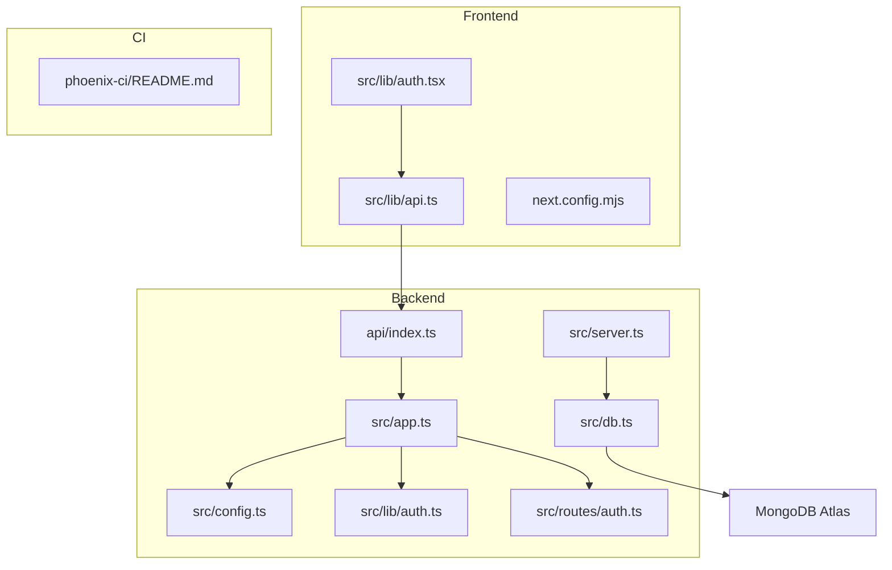
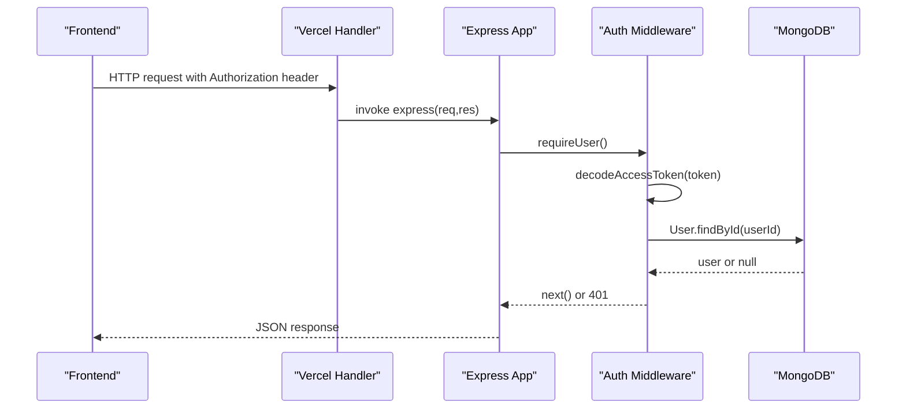
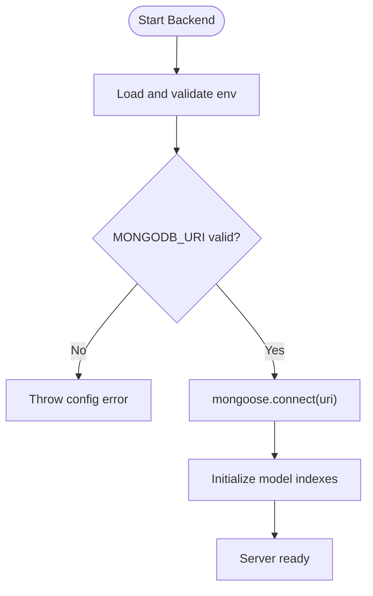
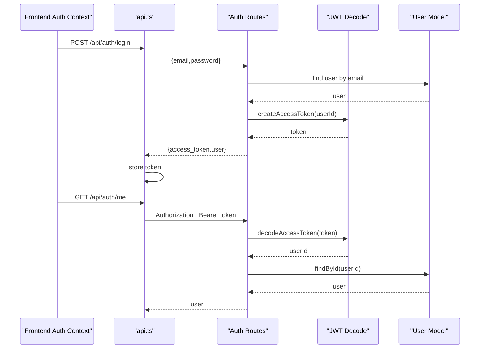
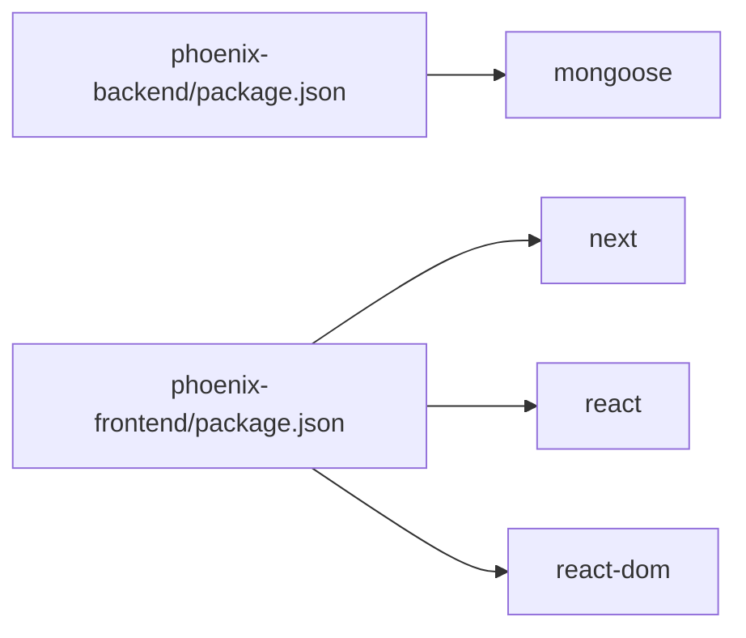

# Troubleshooting Guide

<cite>
**Referenced Files in This Document**
- [README.md](file://README.md)
- [phoenix-backend/README.md](file://phoenix-backend/README.md)
- [phoenix-frontend/README.md](file://phoenix-frontend/README.md)
- [phoenix-ci/README.md](file://phoenix-ci/README.md)
- [phoenix-backend/package.json](file://phoenix-backend/package.json)
- [phoenix-frontend/package.json](file://phoenix-frontend/package.json)
- [phoenix-backend/src/config.ts](file://phoenix-backend/src/config.ts)
- [phoenix-backend/src/db.ts](file://phoenix-backend/src/db.ts)
- [phoenix-backend/src/app.ts](file://phoenix-backend/src/app.ts)
- [phoenix-backend/src/server.ts](file://phoenix-backend/src/server.ts)
- [phoenix-backend/api/index.ts](file://phoenix-backend/api/index.ts)
- [phoenix-backend/src/lib/auth.ts](file://phoenix-backend/src/lib/auth.ts)
- [phoenix-backend/src/routes/auth.ts](file://phoenix-backend/src/routes/auth.ts)
- [phoenix-backend/src/models/user.ts](file://phoenix-backend/src/models/user.ts)
- [phoenix-backend/src/models/index.ts](file://phoenix-backend/src/models/index.ts)
- [phoenix-frontend/src/lib/api.ts](file://phoenix-frontend/src/lib/api.ts)
- [phoenix-frontend/src/lib/auth.tsx](file://phoenix-frontend/src/lib/auth.tsx)
- [phoenix-frontend/next.config.mjs](file://phoenix-frontend/next.config.mjs)
</cite>

## Table of Contents
1. [Introduction](#introduction)
2. [Project Structure](#project-structure)
3. [Core Components](#core-components)
4. [Architecture Overview](#architecture-overview)
5. [Detailed Component Analysis](#detailed-component-analysis)
6. [Dependency Analysis](#dependency-analysis)
7. [Performance Considerations](#performance-considerations)
8. [Troubleshooting Guide](#troubleshooting-guide)
9. [Conclusion](#conclusion)

## Introduction
This guide provides systematic troubleshooting for Project Phoenix across the backend, frontend, and CI pipeline. It focuses on database connectivity (MongoDB Atlas), authentication and JWT behavior, CORS configuration, build and deployment issues, dependency conflicts, environment variable problems, and pipeline failures. Each section includes diagnostic steps, likely root causes, and concrete fixes mapped to specific files.

## Project Structure
Phoenix consists of three repositories:
- phoenix-backend: Express + TypeScript API with Mongoose and MongoDB.
- phoenix-frontend: Next.js 14 application consuming the backend API.
- phoenix-ci: GitHub Actions workflow plus smoke tests.

**Diagram sources**
- [phoenix-backend/api/index.ts:1-21](file://phoenix-backend/api/index.ts#L1-L21)
- [phoenix-backend/src/app.ts:1-33](file://phoenix-backend/src/app.ts#L1-L33)
- [phoenix-backend/src/server.ts:1-32](file://phoenix-backend/src/server.ts#L1-L32)
- [phoenix-backend/src/db.ts:1-36](file://phoenix-backend/src/db.ts#L1-L36)
- [phoenix-backend/src/config.ts:1-41](file://phoenix-backend/src/config.ts#L1-L41)
- [phoenix-backend/src/lib/auth.ts:1-58](file://phoenix-backend/src/lib/auth.ts#L1-L58)
- [phoenix-backend/src/routes/auth.ts:1-52](file://phoenix-backend/src/routes/auth.ts#L1-L52)
- [phoenix-frontend/src/lib/api.ts:1-86](file://phoenix-frontend/src/lib/api.ts#L1-L86)
- [phoenix-frontend/src/lib/auth.tsx:1-62](file://phoenix-frontend/src/lib/auth.tsx#L1-L62)
- [phoenix-frontend/next.config.mjs:1-9](file://phoenix-frontend/next.config.mjs#L1-L9)
- [phoenix-ci/README.md:1-39](file://phoenix-ci/README.md#L1-L39)

**Section sources**
- [README.md:1-140](file://README.md#L1-L140)
- [phoenix-backend/README.md:1-76](file://phoenix-backend/README.md#L1-L76)
- [phoenix-frontend/README.md:1-40](file://phoenix-frontend/README.md#L1-L40)
- [phoenix-ci/README.md:1-39](file://phoenix-ci/README.md#L1-L39)

## Core Components
- Backend configuration and validation: Environment variables are validated at startup; invalid values cause immediate failure.
- Database connection: Mongoose connection is initialized once per process or serverless invocation, with index initialization after connect.
- API routing and middleware: CORS, body parsing, route order, and error handling are configured centrally.
- Authentication: Bearer token extraction, JWT decoding, user lookup, and role checks.
- Frontend API client: Token storage, request headers, error mapping, and caching.
- Frontend auth context: Session restoration, login/logout flow.

**Section sources**
- [phoenix-backend/src/config.ts:1-41](file://phoenix-backend/src/config.ts#L1-L41)
- [phoenix-backend/src/db.ts:1-36](file://phoenix-backend/src/db.ts#L1-L36)
- [phoenix-backend/src/app.ts:1-33](file://phoenix-backend/src/app.ts#L1-L33)
- [phoenix-backend/src/lib/auth.ts:1-58](file://phoenix-backend/src/lib/auth.ts#L1-L58)
- [phoenix-frontend/src/lib/api.ts:1-86](file://phoenix-frontend/src/lib/api.ts#L1-L86)
- [phoenix-frontend/src/lib/auth.tsx:1-62](file://phoenix-frontend/src/lib/auth.tsx#L1-L62)

## Architecture Overview
The backend exposes REST endpoints under /api. The frontend calls these endpoints using a typed client that attaches a bearer token. In serverless mode, the Vercel handler reuses the app instance and database connection within a warm invocation.

**Diagram sources**
- [phoenix-backend/api/index.ts:1-21](file://phoenix-backend/api/index.ts#L1-L21)
- [phoenix-backend/src/app.ts:1-33](file://phoenix-backend/src/app.ts#L1-L33)
- [phoenix-backend/src/lib/auth.ts:1-58](file://phoenix-backend/src/lib/auth.ts#L1-L58)
- [phoenix-backend/src/db.ts:1-36](file://phoenix-backend/src/db.ts#L1-L36)

## Detailed Component Analysis

### Database Connectivity (MongoDB Atlas)
Symptoms
- Health endpoint fails or never becomes healthy.
- Seed script appears successful but no data is created.
- Serverless function returns errors when connecting to MongoDB.

Likely Causes
- Missing or malformed MONGODB_URI.
- Network Access not allowing Vercel IPs (0.0.0.0/0).
- Wrong database name in URI.
- Connection timeout due to network restrictions.

Diagnostics
- Validate environment configuration at startup; invalid env throws immediately.
- Check health endpoint only responds 200 when MongoDB answers.
- Confirm serverless handler connects without calling listen().

Fixes
- Ensure MONGODB_URI starts with mongodb:// or mongodb+srv:// and includes the database name.
- Add 0.0.0.0/0 to Atlas Network Access for serverless deployments.
- Verify the database name matches what seed expects.

**Diagram sources**
- [phoenix-backend/src/config.ts:1-41](file://phoenix-backend/src/config.ts#L1-L41)
- [phoenix-backend/src/db.ts:1-36](file://phoenix-backend/src/db.ts#L1-L36)
- [phoenix-backend/src/server.ts:1-32](file://phoenix-backend/src/server.ts#L1-L32)
- [phoenix-backend/api/index.ts:1-21](file://phoenix-backend/api/index.ts#L1-L21)

**Section sources**
- [phoenix-backend/README.md:9-20](file://phoenix-backend/README.md#L9-L20)
- [phoenix-backend/src/config.ts:1-41](file://phoenix-backend/src/config.ts#L1-L41)
- [phoenix-backend/src/db.ts:1-36](file://phoenix-backend/src/db.ts#L1-L36)
- [phoenix-backend/src/server.ts:1-32](file://phoenix-backend/src/server.ts#L1-L32)
- [phoenix-backend/api/index.ts:1-21](file://phoenix-backend/api/index.ts#L1-L21)

### Authentication and JWT Issues
Symptoms
- Login succeeds but subsequent requests return 401.
- “Invalid or expired token” errors.
- Session lost after page refresh.

Likely Causes
- Incorrect Authorization header format or missing Bearer scheme.
- Token stored under a different key than read by the client.
- JWT_SECRET mismatch between environments.
- Expired tokens or wrong algorithm settings.

Diagnostics
- Inspect browser storage for token presence and key name.
- Verify Authorization header sent by the client.
- Check JWT_SECRET length and value consistency.
- Review token decoding path and user lookup.

Fixes
- Ensure the frontend stores and reads the same token key.
- Send Authorization: Bearer <token> on every request.
- Align JWT_SECRET across all environments.
- Keep JWT_ALGORITHM consistent (default HS256).

**Diagram sources**
- [phoenix-frontend/src/lib/auth.tsx:1-62](file://phoenix-frontend/src/lib/auth.tsx#L1-L62)
- [phoenix-frontend/src/lib/api.ts:1-86](file://phoenix-frontend/src/lib/api.ts#L1-L86)
- [phoenix-backend/src/routes/auth.ts:1-52](file://phoenix-backend/src/routes/auth.ts#L1-L52)
- [phoenix-backend/src/lib/auth.ts:1-58](file://phoenix-backend/src/lib/auth.ts#L1-L58)
- [phoenix-backend/src/models/user.ts:1-20](file://phoenix-backend/src/models/user.ts#L1-L20)

**Section sources**
- [phoenix-backend/src/lib/auth.ts:1-58](file://phoenix-backend/src/lib/auth.ts#L1-L58)
- [phoenix-backend/src/routes/auth.ts:1-52](file://phoenix-backend/src/routes/auth.ts#L1-L52)
- [phoenix-frontend/src/lib/api.ts:1-86](file://phoenix-frontend/src/lib/api.ts#L1-L86)
- [phoenix-frontend/src/lib/auth.tsx:1-62](file://phoenix-frontend/src/lib/auth.tsx#L1-L62)

### CORS Errors
Symptoms
- Browser blocks requests from the frontend to the backend.
- Preflight fails or credentials not allowed.

Likely Causes
- Frontend URL not included in CORS_ORIGINS.
- Credentials enabled but origin not whitelisted.
- Misconfigured origins list.

Diagnostics
- Check CORS_ORIGINS in backend environment.
- Confirm frontend URL matches exactly (including protocol).
- Verify credentials: true is set on the server side.

Fixes
- Add the exact frontend URL to CORS_ORIGINS.
- Redeploy backend after changing CORS_ORIGINS.
- Ensure frontend URL is also added to backend’s trusted origins.

**Section sources**
- [phoenix-backend/src/app.ts:1-33](file://phoenix-backend/src/app.ts#L1-L33)
- [phoenix-backend/src/config.ts:1-41](file://phoenix-backend/src/config.ts#L1-L41)
- [phoenix-frontend/README.md:26-31](file://phoenix-frontend/README.md#L26-L31)

### Build and Deployment Issues
Symptoms
- npm ci or build fails.
- Typecheck errors.
- Vercel deploy fails.

Likely Causes
- Dependency version mismatches.
- Node.js engine constraints.
- Incorrect build scripts or entry points.
- Missing environment variables during build/deploy.

Diagnostics
- Compare engines and dependencies in package.json files.
- Run typecheck locally before pushing.
- Verify Vercel environment variables for both apps.

Fixes
- Align React versions across dependencies.
- Ensure Node.js version meets requirements.
- Pin CLI tools and actions in CI.
- Provide required secrets and variables in Vercel.

**Section sources**
- [phoenix-backend/package.json:1-41](file://phoenix-backend/package.json#L1-L41)
- [phoenix-frontend/package.json:1-27](file://phoenix-frontend/package.json#L1-L27)
- [phoenix-frontend/next.config.mjs:1-9](file://phoenix-frontend/next.config.mjs#L1-L9)
- [phoenix-backend/README.md:32-41](file://phoenix-backend/README.md#L32-L41)
- [phoenix-frontend/README.md:26-31](file://phoenix-frontend/README.md#L26-L31)

### Environment Variable Problems
Symptoms
- Startup fails with configuration errors.
- Unexpected defaults applied.
- Behavior differs between local and deployed environments.

Likely Causes
- Missing required variables (e.g., MONGODB_URI, JWT_SECRET).
- Invalid formats or lengths.
- Different values across environments.

Diagnostics
- Inspect startup logs for configuration validation errors.
- Compare .env values with deployed environment variables.
- Validate regex patterns and minimum lengths.

Fixes
- Set MONGODB_URI and JWT_SECRET correctly.
- Ensure JWT_SECRET length meets minimum requirement.
- Keep CORS_ORIGINS aligned with frontend URLs.

**Section sources**
- [phoenix-backend/src/config.ts:1-41](file://phoenix-backend/src/config.ts#L1-L41)
- [phoenix-backend/README.md:15-21](file://phoenix-backend/README.md#L15-L21)

### Pipeline Failures (GitHub Actions)
Symptoms
- Workflow does not run on expected branches.
- Jobs run out of order or do not wait for each other.
- Secrets not available or printed.
- Smoke test never fails.

Likely Causes
- Workflow triggers misconfigured.
- Steps hide failures.
- Secrets not provided or incorrectly named.
- No proper waiting for services.

Diagnostics
- Review workflow file and job dependencies.
- Check repository secrets and variables.
- Inspect logs for skipped jobs or silent failures.

Fixes
- Configure triggers for push/PR on main branch.
- Remove any step that can hide failures.
- Provide VERCEL_TOKEN and project IDs as secrets.
- Use BACKEND_URL and FRONTEND_URL variables.
- Ensure smoke.sh exits non-zero on failure.

**Section sources**
- [phoenix-ci/README.md:15-39](file://phoenix-ci/README.md#L15-L39)

## Dependency Analysis
Key dependency concerns:
- Backend uses Mongoose 8.x; ensure driver compatibility.
- Frontend has mismatched React and react-dom versions.
- Node.js engines differ between apps.

**Diagram sources**
- [phoenix-backend/package.json:20-26](file://phoenix-backend/package.json#L20-L26)
- [phoenix-frontend/package.json:14-19](file://phoenix-frontend/package.json#L14-L19)

**Section sources**
- [phoenix-backend/package.json:1-41](file://phoenix-backend/package.json#L1-L41)
- [phoenix-frontend/package.json:1-27](file://phoenix-frontend/package.json#L1-L27)

## Performance Considerations
- Avoid repeated database connections; reuse the single Mongoose connection per process or serverless invocation.
- Initialize indexes after connection to prevent race conditions.
- Limit request body size to mitigate abuse.
- Cache GET responses selectively in the frontend to reduce redundant calls.
- Monitor MongoDB latency and adjust timeouts if needed.

[No sources needed since this section provides general guidance]

## Troubleshooting Guide

### Systematic Debugging Approach
- Reproduce the issue locally with a fresh database.
- Validate environment variables first; fix configuration errors before proceeding.
- Test the health endpoint to confirm database connectivity.
- Inspect browser dev tools for network requests, headers, and storage keys.
- Check server logs for unhandled exceptions and rejected promises.
- Isolate components: backend-only, frontend-only, then full stack.

**Section sources**
- [phoenix-backend/src/server.ts:20-31](file://phoenix-backend/src/server.ts#L20-L31)
- [phoenix-frontend/src/lib/api.ts:74-86](file://phoenix-frontend/src/lib/api.ts#L74-L86)

### Log Analysis Techniques
- Look for configuration validation errors at startup.
- Watch for connection timeouts or network errors from MongoDB.
- Identify 401/403 responses indicating auth or authorization failures.
- Detect CORS preflight failures in browser console.
- Capture stack traces for unhandled exceptions and rejected promises.

**Section sources**
- [phoenix-backend/src/config.ts:28-41](file://phoenix-backend/src/config.ts#L28-L41)
- [phoenix-backend/src/db.ts:13-30](file://phoenix-backend/src/db.ts#L13-L30)
- [phoenix-backend/src/lib/auth.ts:8-23](file://phoenix-backend/src/lib/auth.ts#L8-L23)

### Common Issues and Fixes

#### MongoDB Atlas Configuration
- Ensure MONGODB_URI includes the correct database name.
- Allow 0.0.0.0/0 in Atlas Network Access for serverless deployments.
- Verify the cluster is accessible from the deployment region.

**Section sources**
- [phoenix-backend/README.md:9-20](file://phoenix-backend/README.md#L9-L20)
- [phoenix-backend/src/config.ts:4-6](file://phoenix-backend/src/config.ts#L4-L6)
- [phoenix-backend/src/db.ts:13-20](file://phoenix-backend/src/db.ts#L13-L20)

#### Network Access and Credential Problems
- Confirm IP allowlist includes Vercel ranges or 0.0.0.0/0.
- Validate username/password embedded in the connection string.
- Test connectivity from the deployment environment.

**Section sources**
- [phoenix-backend/README.md:32-41](file://phoenix-backend/README.md#L32-L41)
- [phoenix-backend/api/index.ts:11-19](file://phoenix-backend/api/index.ts#L11-L19)

#### Authentication Failures
- Verify Authorization header format: Bearer token.
- Ensure token storage key matches between write and read paths.
- Check JWT_SECRET alignment across environments.

**Section sources**
- [phoenix-backend/src/lib/auth.ts:8-23](file://phoenix-backend/src/lib/auth.ts#L8-L23)
- [phoenix-frontend/src/lib/api.ts:16-23](file://phoenix-frontend/src/lib/api.ts#L16-L23)
- [phoenix-frontend/src/lib/auth.tsx:38-45](file://phoenix-frontend/src/lib/auth.tsx#L38-L45)

#### JWT Token Issues
- Confirm token expiration settings and algorithm.
- Validate token decoding path and user existence.
- Handle expired tokens gracefully by prompting re-login.

**Section sources**
- [phoenix-backend/src/config.ts:6-12](file://phoenix-backend/src/config.ts#L6-L12)
- [phoenix-backend/src/lib/auth.ts:13-23](file://phoenix-backend/src/lib/auth.ts#L13-L23)
- [phoenix-frontend/src/lib/api.ts:74-86](file://phoenix-frontend/src/lib/api.ts#L74-L86)

#### CORS Errors
- Add frontend URL to CORS_ORIGINS.
- Redeploy backend after updating CORS settings.
- Ensure credentials are allowed when cookies are used.

**Section sources**
- [phoenix-backend/src/app.ts:17-17](file://phoenix-backend/src/app.ts#L17-L17)
- [phoenix-backend/src/config.ts:9-24](file://phoenix-backend/src/config.ts#L9-L24)
- [phoenix-frontend/README.md:26-31](file://phoenix-frontend/README.md#L26-L31)

#### Build and Deployment Issues
- Align React and react-dom versions.
- Ensure Node.js engines match expectations.
- Provide required environment variables in Vercel.

**Section sources**
- [phoenix-frontend/package.json:14-19](file://phoenix-frontend/package.json#L14-L19)
- [phoenix-backend/package.json:7-9](file://phoenix-backend/package.json#L7-L9)
- [phoenix-backend/README.md:32-41](file://phoenix-backend/README.md#L32-L41)

#### Dependency Conflicts
- Resolve peer dependency warnings by aligning versions.
- Avoid legacy flags in CI; fix actual conflicts.
- Pin tool versions in workflows.

**Section sources**
- [phoenix-backend/package.json:20-39](file://phoenix-backend/package.json#L20-L39)
- [phoenix-frontend/package.json:14-25](file://phoenix-frontend/package.json#L14-L25)
- [phoenix-ci/README.md:25-27](file://phoenix-ci/README.md#L25-L27)

#### Environment Variable Problems
- Validate MONGODB_URI format and JWT_SECRET length.
- Keep CORS_ORIGINS synchronized with frontend URLs.
- Avoid leaking secrets in logs.

**Section sources**
- [phoenix-backend/src/config.ts:4-13](file://phoenix-backend/src/config.ts#L4-L13)
- [phoenix-backend/README.md:15-21](file://phoenix-backend/README.md#L15-L21)
- [phoenix-ci/README.md:29-31](file://phoenix-ci/README.md#L29-L31)

#### Pipeline Failures
- Configure workflow triggers for main branch pushes.
- Ensure jobs depend on previous jobs completing successfully.
- Provide secrets and variables; avoid printing secrets.
- Make smoke tests fail fast on errors.

**Section sources**
- [phoenix-ci/README.md:15-39](file://phoenix-ci/README.md#L15-L39)

### Performance Troubleshooting Methods
- Measure API latency and identify slow queries.
- Reduce unnecessary GET requests via selective caching.
- Monitor MongoDB connection pool and timeouts.
- Profile serverless cold starts and warm reuse behavior.

[No sources needed since this section provides general guidance]

## Conclusion
Use this guide to systematically diagnose and resolve common issues in Project Phoenix. Start with environment validation and database connectivity, then move through authentication, CORS, builds, dependencies, and pipeline configuration. Apply the provided diagnostics and fixes, verify with the health endpoint and smoke tests, and ensure consistent configuration across local, staging, and production environments.